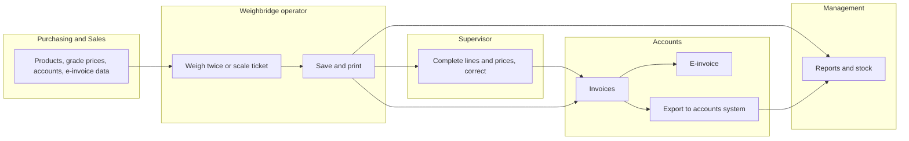
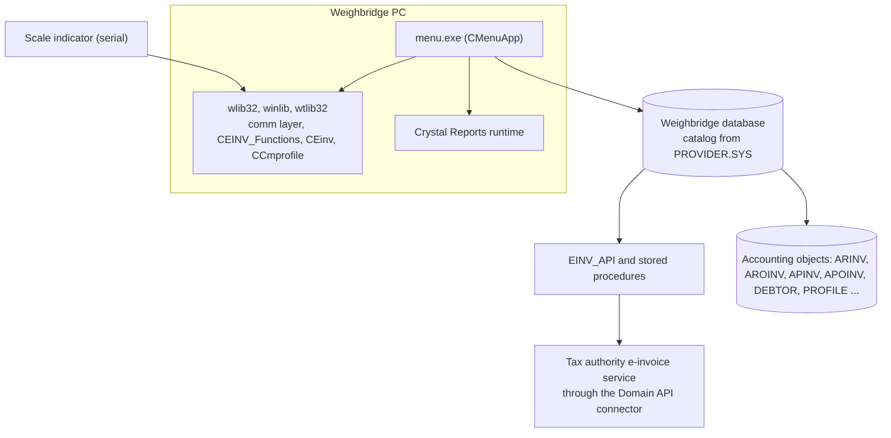
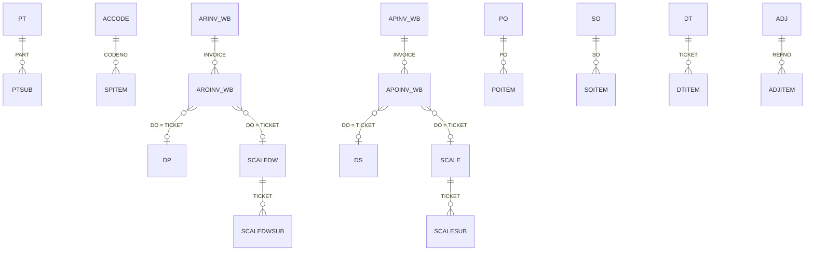
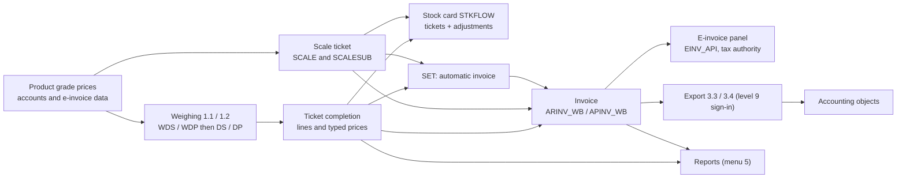

# TradeWin Metals weighbridge - Module reference (index)

The single reference for this application. **Part 1** explains how to use it, in plain words, for people who do not know the program. **Part 2** explains where everything is in the code, for programmers and support. The detail of each menu group is in one file per group (listed below); every group file has the same two parts.

- Repo: `Domain-Application/Application_TradeWin`, branch `main`. There is **no schema repo** (no `SQL_TradeWin`) and no `.sql` file in this repo: column types in these files are marked "type from SQL_LekokPaper (sister app), unverified for TradeWin" or "type: unverified".
- Last verified against commit `2f77122` ("E-Invoice enhancement").
- Translation status: English only. No zh-CN copy yet (`docs/module-reference/zh-CN/` does not exist).
- Rule: any change to behaviour, tables, fields, screens, reports or calculations must update this reference in the same commit.
- This repo has no `User_Guide` and no other `docs/` file, so there are no screenshots to link; none are invented here.
- **This is a member of the SengHiap family** (copy of Application_SengHiap_Metal). Its source is closest to Application_LekokPaper (192 of 226 shared source, header, resource and project files are byte-identical and the repo has no file that Lekok lacks) and it adds the **e-invoice enhancement** of February 2026. See [Differences from Application_LekokPaper](#differences-from-application_lekokpaper).
- **Names:** the repo is called TradeWin; the company constant in the code is `TRADEWIN METALS SDN BHD`; `PROVIDER.SYS` lists the catalogs `tradewin_dev` (line 1) and `tradewin2` (line 2); the program title is `<company> VER 2.00` (the version marks the e-invoice release).

## Contents

- [Module files](#module-files)
- [Menu map and coverage](#menu-map-and-coverage)
- [Part 1 - Business view (whole application)](#part-1---business-view-whole-application)
  - [1.1 In plain words](#11-in-plain-words)
  - [1.2 Who uses what](#12-who-uses-what)
  - [1.3 A day in the life](#13-a-day-in-the-life)
  - [1.4 User levels and approvals](#14-user-levels-and-approvals)
  - [1.5 Glossary](#15-glossary)
  - [1.6 Ask the AI](#16-ask-the-ai)
- [Part 2 - Technical view (whole application)](#part-2---technical-view-whole-application)
  - [Differences from Application_LekokPaper](#differences-from-application_lekokpaper)
  - [2.1 Overview](#21-overview)
  - [2.2 Architecture and dependencies](#22-architecture-and-dependencies)
  - [2.3 Master data catalogue](#23-master-data-catalogue)
  - [2.4 Sub-table hierarchy](#24-sub-table-hierarchy)
  - [2.5 Modules and process flows](#25-modules-and-process-flows)
  - [2.6 End-to-end flows](#26-end-to-end-flows)
  - [2.7 Report catalogue](#27-report-catalogue)
  - [2.8 Integrations](#28-integrations)
  - [2.9 Configuration](#29-configuration)
  - [2.10 Maintenance](#210-maintenance)
- [Dormant code](#dormant-code)
- [User rights](#user-rights)
- [Not yet documented](#not-yet-documented)
- [Code findings](#code-findings)

## Module files

| File | Menu groups | What it covers |
|---|---|---|
| [weighing.md](weighing.md) | 1.1 Receiving Note, 1.2 Despatch, 1.3 and 1.4 View/Edit/Delete First Weight, 1.5 Public Weighing (and the return-note weighing, nodes 18 and 19) | Weight window, first and second weight, in-yard list, preset deductions, public weighing, the indicator through wlib32 |
| [scale-weighing.md](scale-weighing.md) | 1.6 Scale Weighing, 1.7 Scale Despatch Weighing | Scale tickets with unlimited product lines (typed quantity, wastage, bin, first-grade price, whole-unit rounding of the total on cash tickets), SET pay date and automatic invoice |
| [tickets.md](tickets.md) | 2.1 Receiving Note, 2.2 Despatch, 2.3 Public Weighing; nodes 23, 24, 25, 27 without a menu item | Receiving and despatch tickets with eight own and eight party product lines, public-weighing ticket, direct delivery, delivery order, return note |
| [invoice-cashier.md](invoice-cashier.md) | 3.1 to 3.4 and the e-invoice panel | Purchase and sales invoices, automatic invoice, tax, classification code, **e-invoice panel**, export to the accounts system. File name kept from the base; there is no cashier here |
| [control-tables.md](control-tables.md) | 4.1 Table 1, 4.2 Table 2 | Product with grade prices, lorry, account with product list and **e-invoice data**, driver, transporter, tax code, GWST and the simple lists |
| [reports.md](reports.md) | 5 Report | Report picker, 7 groups, the 45 report entries, report files |
| [other-stock-export.md](other-stock-export.md) | 6 Other, 7 Stock | Password, company profile, users, **Reset Database**, **E-Invoice Profile**, stock adjustment, reason code. File name kept from the base; export is in menu 3 and there is no backup menu |

## Menu map and coverage

There is **one** menu resource, `IDR_MAINMENU` (`menu.rc:126-194`, 35 items), created by `CMenuApp::Domain` (MENU.CPP:257-263). A second resource `IDR_PIREQ` (`menu.rc:196-204`, Invoice, Cash Bill, Delivery Order) is never loaded. The menu ID `ID000nn` is node `nn`; `CMenuApp::SubProgram` (MAIN.CPP:176) switches on the node. Every item below is documented in the file shown. The captions are the ones in `menu.rc`; the number in a caption does not always equal the node (2.3 is node 26).

| Menu path (caption) | Node | Handler | File |
|---|---|---|---|
| 1.1 RECEIVING NOTE | 11 | `Purchase_Flag = TRUE; WeighingProcess(&ds,&wds)` (MAIN.CPP:188-191) | [weighing](weighing.md) |
| 1.2 DESPATCH | 12 | `Weighing_Despatch(&dp,&wdp)` (MAIN.CPP:192-195) | [weighing](weighing.md) |
| 1.3 View/Edit/Delete First Weight RECEIVING NOTE | 13 | `TicketData(&wds)` (MAIN.CPP:196-200) | [weighing](weighing.md) |
| 1.4 View/Edit/Delete First Weight DESPATCH | 14 | `TicketData(&wdp)` (MAIN.CPP:201-204) | [weighing](weighing.md) |
| 1.5 Public Weighing | 15 | `PublicWeighingProcess(&pr_new,&wpr_new)` (MAIN.CPP:205-207) | [weighing](weighing.md) |
| 1.6 Scale Weighing (Unlimited Product Features) | 16 | `AdminDbScale(&scale,&scalesub)` (MAIN.CPP:208-211) | [scale-weighing](scale-weighing.md) |
| 1.7 Scale Despatch Weighing (Unlimited Product Features) | 17 | `AdminDbScale(&scaledw,&scaledwsub)` (MAIN.CPP:212-215) | [scale-weighing](scale-weighing.md) |
| (no item) | 18 | `Weighing_Despatch(&rt,&wrt)` (MAIN.CPP:216-219) | [weighing](weighing.md) |
| (no item) | 19 | `TicketData(&wrt)` (MAIN.CPP:220-223) | [weighing](weighing.md) |
| 2.1 RECEIVING NOTE | 21 | `TicketData(&ds)` (MAIN.CPP:224-227) | [tickets](tickets.md) |
| 2.2 DESPATCH | 22 | `TicketData(&dp)` (MAIN.CPP:228-231) | [tickets](tickets.md) |
| (no item) | 23 | `DirectDeliveryTicket()` (MAIN.CPP:232-234) | [tickets](tickets.md) |
| (no item) | 24 | `DirectDeliveryPricingUpdate()` (MAIN.CPP:235-237) | [tickets](tickets.md) |
| (no item) | 25 | `Despatch_DO(&dp_do)` (MAIN.CPP:238-242) | [tickets](tickets.md) |
| 2.3 Public Weighing | **26** | `PublicTicketData(&pr_new)` (MAIN.CPP:243-245) | [tickets](tickets.md) |
| (no item) | 27 | `TicketData(&rt)` (MAIN.CPP:246-249) | [tickets](tickets.md) |
| 3.1 Purchase Invoice | 31 | `PurchaseInvoiceWb()` (MAIN.CPP:250-252) | [invoice-cashier](invoice-cashier.md) |
| 3.2 Sales Invoice | 32 | `SalesInvoiceWb()` (MAIN.CPP:253-255) | [invoice-cashier](invoice-cashier.md) |
| 3.3 Export Purchase Invoice | 33 | `ExportPurchaseInvoiceTransactions()` (MAIN.CPP:256-258) | [invoice-cashier](invoice-cashier.md) |
| 3.4 Export Sales Invoice | 34 | `ExportInvoiceTransactions()` (MAIN.CPP:259-261) | [invoice-cashier](invoice-cashier.md) |
| 4.1.1 Product Code | 411 | `AdminDbPtentry(&prodtype,&ptsub)` (MAIN.CPP:262-264) | [control-tables](control-tables.md) |
| 4.1.2 Lorry Data Maintenance | 412 | `AdminDb(&lorry)` (MAIN.CPP:265-267) | [control-tables](control-tables.md) |
| 4.1.3 Category Code | 413 | `AdminDb(&category)` (MAIN.CPP:268-270) | [control-tables](control-tables.md) |
| 4.1.4 Unit Code | 414 | `AdminDb(&unit)` (MAIN.CPP:271-273) | [control-tables](control-tables.md) |
| 4.1.5 Product Grade | 415 | `prodgrade.Run()` (MAIN.CPP:274-276) | [control-tables](control-tables.md) |
| 4.1.6 Pay Type | 416 | `AdminDbPTYPE(&ptype)` (MAIN.CPP:277-280) | [control-tables](control-tables.md) |
| 4.1.7 Country Code | 417 | `AdminDb(&country)` (MAIN.CPP:281-283) | [control-tables](control-tables.md) |
| 4.1.8 Product Group | 418 | `AdminDb(&ptgroup)` (MAIN.CPP:284-286) | [control-tables](control-tables.md) |
| 4.1.9 GWST | 419 | `AdminDb(&gst)` (MAIN.CPP:287-289) | [control-tables](control-tables.md) |
| 4.2.1 Buyer/Seller Code | 421 | `AccodeMaintenance()` (MAIN.CPP:290-292) | [control-tables](control-tables.md) |
| 4.2.2 Driver Code | 422 | `AdminDb(&driver)` (MAIN.CPP:293-295) | [control-tables](control-tables.md) |
| 4.2.3 Transporter | 423 | `AdminDb(&transp)` (MAIN.CPP:296-298) | [control-tables](control-tables.md) |
| 4.2.4 Tax Code | 424 | `taxcode.Run()` (MAIN.CPP:299-301) | [control-tables](control-tables.md) |
| (no item) | 425 to 429 | grade, invoice status, salesman, vehicle type lists; 429 is an empty case (MAIN.CPP:302-318) | [control-tables](control-tables.md) |
| (no item) | 431, 432 | `PurchaseOrderData()`, `SalesOrderData()` (MAIN.CPP:319-324) | [control-tables](control-tables.md) |
| (no item) | 441 to 449 | accounting maintenance: debtor, creditor, pay type, prefix, area, TT, bank, GL code, GL group (MAIN.CPP:325-353) | [Dormant code](#dormant-code) |
| 5 Report | 5 | `TableContainer("rptctn")` (MAIN.CPP:354-356) | [reports](reports.md) |
| (no item) | 51 to 54 | `FileChangeReport(&ds/&dp)`, `VarianceDetailReport(&ds/&dp)` (MAIN.CPP:357-368) | [reports](reports.md) |
| 6.1 Set Password | 61 | `OnPassword` (main frame message map, MAINFRM.CPP:64) | [other-stock-export](other-stock-export.md) |
| 6.2 Company Profile | 62 | `AdminProfileDb(&stkpf)` (MAIN.CPP:371-374) | [other-stock-export](other-stock-export.md) |
| 6.3 Operator Information | 63 | `SetUser()` (MAIN.CPP:375-377) | [other-stock-export](other-stock-export.md) |
| 6.4 Reset Database | 64 | `CleanDatabase()` (MAIN.CPP:378-380) | [other-stock-export](other-stock-export.md) |
| 6.5 E-Invoice Profile | 65 | `AdminDb_CMProfile` on `profile_einv` (MAIN.CPP:381-388) | [other-stock-export](other-stock-export.md) |
| (no item) | 66 | `ViewViolation()` (MAIN.CPP:389-391) | [other-stock-export](other-stock-export.md) |
| 7.1 Adjustment Data Entry | 71 | `AdjustmentEntry()` (MAIN.CPP:392-394) | [other-stock-export](other-stock-export.md) |
| 7.2 Reason Code | 72 | `AdminDb(&reason)` (MAIN.CPP:395-397) | [other-stock-export](other-stock-export.md) |

`SubProgram` has 27 cases that the menu does not reach (18, 19, 23, 24, 25, 27, 425 to 429, 431, 432, 441 to 449, 51 to 54, 66); the menu has 35 items. The generated inventory (`_inventory/Application_TradeWin`) was used only as a lead: it misses the multi-line menu entry 1.7 and its menu tree is built from `menu.rc` directly, which this table follows. The old account cases (invoice, payment, credit note and so on) and the backup case sit inside a comment block (MAIN.CPP:398-459).

---

# Part 1 - Business view (whole application)

## 1.1 In plain words

- This program runs the **weighbridge and trading office** of TradeWin Metals. Lorries bring goods in (buying, called **receiving**), collect goods (selling, called **despatch**) or only use the scale (**public weighing**).
- Receiving and despatch are weighed **twice** (the full lorry and the empty lorry); the program works out the net weight, and the operator splits it into **product lines** by percentage. A second way is the **scale ticket**: the operator adds one line per product and types the quantity.
- Tickets are billed on **invoices**: purchase invoices for what was bought, sales invoices for what was sold. A user can create an invoice from a ticket with one button. Each invoice has an **e-invoice panel** to submit it to the tax authority's e-invoice service. Invoices are sent to the accounts system with the two **Export** items of the Invoice menu.
- Lists such as products with their grade prices, customers (with their e-invoice data), lorries, drivers and tax codes are kept in **control tables**.
- **Reports** show purchases, sales, unbilled tickets and stock. **Stock** is worked out from tickets and corrected with adjustments.
- If the daily routine is skipped, tickets are missing, invoices are late, e-invoices are not reported, stock is wrong and the accounts system is out of date.

## 1.2 Who uses what

| Department | Modules | Main tasks |
|---|---|---|
| Weighbridge operator | [Weighing](weighing.md), [Scale weighing](scale-weighing.md) | Weigh lorries twice, open scale and public tickets, capture weights, print |
| Weighbridge supervisor | [Tickets](tickets.md), [Weighing](weighing.md), [Control tables](control-tables.md), [Other, Stock](other-stock-export.md) | Complete and correct tickets (lines, prices), delete first weights, keep lorries, drivers and transporters, stock adjustments |
| Purchasing / Sales | [Control tables](control-tables.md) | Products with grade prices, accounts and their product lists and e-invoice data |
| Accounts / Finance | [Invoice and Export](invoice-cashier.md), [Reports](reports.md), [Control tables](control-tables.md) | Invoices, e-invoice, export to accounts, tax codes, reports |
| Management | [Reports](reports.md) | Totals, stock, unbilled tickets, changed tickets |
| IT / Admin | [Other, Stock](other-stock-export.md) | Settings, users, e-invoice profile, indicator, data reset (training only) |

**Start here (one line per department)**
- Operator: Weighing > Receiving Note or Despatch for goods; Scale Weighing or Scale Despatch Weighing for product-by-product tickets; Public Weighing for walk-ins.
- Supervisor: open the ticket from the Ticket menu to complete or correct it; Weighing > 1.3 / 1.4 for first weights still waiting.
- Purchasing / Sales: Table 1 > Product Code; Table 2 > Buyer/Seller Code (and its E-Invoices button).
- Accounts: Invoice; submit the e-invoice; month-end Export Purchase Invoice and Export Sales Invoice.
- Management: Report.
- IT: Other > Company Profile and E-Invoice Profile; check the indicator.

## 1.3 A day in the life

Morning: IT or the supervisor checks the scale reading. During the day: operators weigh lorries; supervisors complete the tickets (product lines and prices); purchasing keeps the lists. Evening or month-end: accounts create invoices from tickets, submit the e-invoices and run the two exports, management runs reports. Swimlane of the whole flow:



*Caption: lists feed the weighing; tickets go to completion, invoices and reports; invoices end in the e-invoice service and the accounts system.*

## 1.4 User levels and approvals

Each user has a number called the **level**. The levels that matter in this program:

| Level | What it allows |
|---|---|
| below 5 | Cannot change weights and times on receiving, despatch tickets |
| below 9 | Cannot change the date of scale, receiving, despatch and public tickets (the lists have a flaw, see the code findings), the date of an invoice, an invoice status or a tax amount |
| 9 or more | Can sign in to confirm an export to the accounts system |
| 99 | Operator Information (users), Set Password, the Unlock Period button on invoices, the SET and UNSET buttons on **scale** tickets, the report maintenance buttons |
| 999 | Can edit the "weight modified" marker of tickets |

There are **no approval windows** in this version: the sign-in that asked a supervisor to approve weight differences is switched off in the code. The export confirmation is the only sign-in, and the Reset Database window has its own reset password. The E-Invoice Profile (6.5) has **no** password or level check.

Besides the level, each user can be blocked from menu items (or limited to view or edit) by a list kept on the user record, and per table by the table access list. See [User rights](#user-rights).

## 1.5 Glossary

| Term | English | Malay | Chinese |
|---|---|---|---|
| Weighbridge | Truck scale | Jambatan timbang | 地磅 |
| Ticket | Weighing document | Tiket | 磅单 |
| Receiving | Goods bought in | Terimaan | 收货 |
| Despatch | Goods sold out | Penghantaran | 发货 |
| Public weighing | Weighing service for outsiders | Timbang awam | 公众过磅 |
| Scale weighing | Weighing goods product by product | Timbang skala | 磅秤称重 |
| Product grade | Quality level of a product with its own prices | Gred produk | 产品等级 |
| Invoice | Bill | Invois | 发票 |
| E-invoice | Electronic invoice reported to the tax authority | e-Invois | 电子发票 |
| TIN | Tax identification number | Nombor pengenalan cukai | 税务识别号 |
| Net weight | Weight of the load | Berat bersih | 净重 |
| Party | The other company | Pihak | 对方 |
| Adjustment | Stock correction | Pelarasan | 调整 |
| Export | Send invoices to accounts | Eksport | 导出 |

Each module file has its own glossary for its terms.

## 1.6 Ask the AI

1. What is the daily routine of the weighbridge operator?
2. How does a lorry get from the scale to an invoice?
3. Which menu item do I use to correct a ticket?
4. What can a level 99 user do that a level 9 user cannot?
5. How do I complete the e-invoice data of a customer?
6. How do I submit an invoice as an e-invoice?
7. How do I send the month's invoices to the accounts system?
8. How do I weigh a walk-in customer who only pays for the scale?
9. Which reports show unbilled tickets?
10. What does Reset Database delete?

---

# Part 2 - Technical view (whole application)

## Differences from Application_LekokPaper

This repo is a sibling of Application_LekokPaper: of the 226 source, header, `.rc` and `.dsp` file names present in both, 31 differ in content and 195 are identical; no file exists only here and 29 exist only in Lekok. The shared base of the family is Application_SengHiap_Metal (comparison below). Checked against the newer features of the Paper and Alloy copies: **sub-table product lines**: yes for scale tickets (`SCALESUB`), none for the two-weight tickets (flat columns); **registration**: none; **rounding**: only the whole-unit rounding of the scale-ticket total of cash tickets (Lekok has several methods and rounds lines too); **e-invoice**: yes, reduced (below); **gate automation, cameras, sensors**: none.

**1. Menu and nodes**
- One menu resource with 35 items (Lekok: four loadable layouts chosen by `Program4` / `isUnlimited_Product`, 28 items in the shipped one). The two-weight modules are live: **1.1 Receiving Note, 1.2 Despatch, 1.3 and 1.4 View/Edit/Delete First Weight, 2.1 Receiving Note, 2.2 Despatch**. Public Weighing (1.5, 2.3 = node 26) and Scale Weighing (1.6, 1.7) are as in Lekok.
- **6.4 Reset Database is the real reset** (node 64, `CleanDatabase`); in Lekok the caption belonged to the program update. **6.5 E-Invoice Profile** (node 65) is new; there is no update item and no `OnSystemUpgrade` call.

**2. Weighing and scale hardware**
- No reader thread of its own (no `THREAD.CPP`, `COMM1/2.CPP`, `Program4`): the indicator is read through the wlib32 comm layer (`GetCurrenctCommWeight(1)`). A Debug build simulates the weight (GETWT.CPP:107-111).
- The weight dialog applies the preset deduction **only on 1.1 Receiving Note**; `GWST_Code` and the 17-letter conversion are not here.
- Public weighing has **no Cancel Ticket** and no "Ticket Cancelled" text; `CWds` and `CWdp` have no `OnInitDialog` of their own; the first-weight form `wds.rpt` is not printed (`prec = unprint`).
- No `RECEIVE` / `DESPATCH` / `RDATA` / `DDATA` / `WB` forms, no `BIN_BAG`, no `ICNO` driver identity record, no fast search.

**3. Scale tickets**
- Plain wlib32 header-detail screen: typed quantity, **no Capture Weight**, no bin codes, no `QTY_MODIFIED` mark, no Cancel Ticket, no net-weight box; the price comes from the first grade line only (no customer price list); lines are not rounded; the total of cash tickets is rounded to a whole unit (Lekok: cut down to 0.1 and several methods); the pay type is not defaulted to `CASH`.
- Commented-out code for an e-wallet payment QR on the scale ticket (SCALE.CPP:8-243, 247-315).

**4. Tickets**
- Receiving and despatch tickets (`CDs`): lines are **not rounded**, no `Get_Adjustment(...,3)`; prices are **typed** (no PTSUB cost lookup, no remaining-weight fill); percent boxes are editable; no start value `CASH`; the total-quantity check runs for every table using `ds_save`; level lists use the older overwrite pattern; the second-weight "Set Payment Date" question and the auto invoice are **active** (commented out in Lekok).

**5. Invoice and e-invoice**
- Embedded **E-invoice panel** (`CEINV_Functions`, shared wlib32 class) on the sales and purchase invoice dialogs, a **Classification** column on the lines (default `022`), a **Transaction Type** box and `SetTransactionType` (never called). The wlib32 `CEinv` account window and `CCmprofile` company profile screen back menu 6.5 and the account button. Lekok has none of this.

**6. Control tables**
- No grade-price trigger (`ptsub_Triggers` removed), `SPITEM` without prices and without `tell_spitem`, no `ACCODE` bank number, **Add switched off on the account screen**, the driver is a plain table `ic` with dialog `IDD_DRIVER` (no `ICNO`, no MyKad import, no snapshot), **E-Invoices** button on accounts.

**7. Reports**
- `RPTCTN.SET`, `rptctn.GRP`, `RPTCTN.USR` and the other container files are **byte-identical** to Lekok's: 45 entries in 7 groups. Layout files in the repo root: 407 `.rpt`, 51 `.rep`, 24 `.FMT`, 38 `.scr`; no `.rdl`.

**8. Settings (`STKPF`) and company**
- The Company Profile dialog has no "decimal weight" tick. The company name is the literal `TRADEWIN METALS SDN BHD` (an unused `tcompany` array holds an encoded string). Window title `<company> VER 2.00`. No licence timer, no `LICENCE.CPP`, no `szLicenceKey`.

**9. Integrations**
- E-invoice through SQL Server procedures and the Domain API connector (panel and company profile); QR viewer helper; nothing else outbound. The dormant e-wallet code is not active.

**10. Size**
- 142 `.cpp` files (26,563 lines), 118 `.cpp` entries in `menu.dsp` (184 `SOURCE=` entries in all), 79 headers, 154 dialog templates, `menu.rc` 9,581 lines, 76 enum blocks in MENU.H (Lekok: 160 files, 31,537 lines, 134 in the project, 90 headers, 167 dialogs, 11,176 lines of `menu.rc`, 79 enum blocks). `Receive.h` is a zero-byte file.

**Identical to Lekok** (same content apart from line endings), examples: `Two.cpp`, `PASS.CPP`, `Logerr.cpp`, `fc.cpp`, `Chkvar.cpp`, `mnws.cpp`, `detail.cpp`, `Dpp.cpp`, `Sdp.cpp`, `sv.cpp`, `Month.cpp`, `Daily.cpp`, `One.cpp`, `Tap.cpp`, `DT.CPP`, `DpDo.cpp`, `SetPrice.cpp`, `PartyGrading.cpp`, `TAXCODE.CPP`, `Exp_inv.cpp`, `Exp_ap.cpp`, `SETPAYDATEU.cpp`, `ADJ.CPP`, `PO.CPP`, `STKFLOW.CPP`, `TIMEFRM.CPP`, `ResetPassword.cpp`, `lorry.cpp` and all the accounting screens listed under [Dormant code](#dormant-code).

**Short comparison with Application_SengHiap_Metal (the base)**
- Of 199 file names in common, 71 differ and 128 are identical; 27 files exist only here (`SCALE`, `Pr`, `DpDo`, `Incentive`, `TIMEFRM`, `TNG`, `MIFARE`, `MICODE`, `Scan`, `WELCOME`, `FormatSmartCard`, `HexEdit`, `PtEntry_old`, `PTYPE.H`, `ExportFunc.h` and others) and 29 only in Metal.
- Missing here: the cashier (`Closing.cpp`, menu 4.4), the Export menu 8 and Backup menu 9 (export is menu 3.3 / 3.4), the Contract / Sales Order menu 4.3, the sensors, camera and gate files (`ADAM.CPP`, `SENSOR.CPP`, `STATUS.CPP`, `HHMVIEW.CPP`, `CCTVVIEW.CPP`, `SHOWJPG.CPP`), `COMM.CPP`, `RUNSQL.CPP`, `TICKET.CPP`, `MYFRM.CPP`, `ProductAmount.cpp`, `GridSheet_Party_Grading.cpp` and the base's own `EINV.CPP`, `Cmprofile.cpp` (the e-invoice classes are used from the shared library here).
- E-invoice: Metal has `CEinv` and `OnSubmitEinv` with the full invoice screen buttons (Submit, Refresh, Email) and a Transaction Type set from the account's self-billed flag; TradeWin has the same procedures behind an embedded panel (Submit, Refresh, QRCODE, View Msg; Email hidden), the same Classification column, and a profile screen on the table `profile_einv` (menu 6.5; Metal: 6.6 on the accounting profile).
- Present here but not in Metal: Scale Weighing (menus 1.6, 1.7), the unlimited-product ticket lines, the delivery order and return notes as in Lekok.

**Checklist of the base reference, answered**
1. File comparison: the larger differences from Lekok are in `menu.rc`, `SCALE.CPP`, `DS.CPP`, `ARINV_WB.CPP`, `MAIN.CPP`, `MAINFRM.CPP`, `MENU.CPP`, `MENU.H`, `SPITEM.CPP`.
2. Menu and `SubProgram`: above.
3. MENU.H enums: `dp` (144 names, MENU.H:284), `pr_new` (20), `scale` (17), `scalesub` (**10**), `spitem` (**5**), `ptsub`, `dp_do`, `stkpf` (11), `accode` (12, MENU.H:270-272), `profile` (accounting profile); the declarations `malaysia_state`, `malaysia_city`, `postcode`, `classification` and `SetTransactionType` are new (MENU.H:21-23).
4. `OpenAllDataFile` (MENU.CPP:386): opens `profile`, `stkpf`, `logo`, the four e-invoice lookups, `scale`, `scaledw`, `scalesub`, `scaledwsub`, `ptsub`, `pr_new`, `wpr_new`, `wrt`, `rt`, `dp_do`, `dp`, `ds`, `wds`, `wdp`, `driver` (table `ic`), the control tables and the accounting objects; no `receive`, `rdata`, `despatch`, `ddata`, `bin_bag`, `icno`; code after the early `return;` (MENU.CPP:556) is dead.
5. `RPTCTN.SET`, `rptctn.GRP`: [reports](reports.md#27-report-catalogue).
6. Company text: literal (MENU.CPP:116, 238-240).
7. Hardware: wlib32 comm only; no `TotalCamera`, no ADAM.
8. Integrations: the e-invoice panel and procedures, the QR helper, the export and the accounting objects.

## 2.1 Overview

- **What it is:** the weighbridge and trading program of TradeWin Metals Sdn Bhd, a Visual C++ 6 / MFC application on the shared libraries wlib32, winlib and wtlib32. Main exe `menu.exe` built from `menu.dsp` (Debug and Release; the Release link line has `wlib32.lib wininet.lib`, menu.dsp:56; Debug uses `dlib32.lib` only, menu.dsp:82). Window title `<company> VER 2.00` (MAINFRM.CPP:113, the comment says "E-Inv version").
- **Code size:** 142 `.cpp` files (26,563 lines), 118 `.cpp` entries in `menu.dsp` (184 `SOURCE=` entries in all), 79 headers, 154 dialog templates in `menu.rc` (9,581 lines), 76 enum blocks in MENU.H, plus `enum menu` and `enum kkk` for the menu nodes in MAIN.CPP:15-16. The e-invoice resources come from the shared `einv.rc` included by `RES/MENU.RC2`.
- **Company:** the program title and registry key use the constant `TRADEWIN METALS SDN BHD` (MENU.CPP:116, 238-240); address text constants sit in MENU.CPP:30-32 (site data, not reproduced).
- **Start-up:** `CMenuApp::Domain` (MENU.CPP:245) shows the login dialog `CStart` with flags `0x0002 | INIT_ADO_USER | INIT_ADO_PROGRAM_PASSWORD` (MENU.CPP:250), then `UserLogin`, then creates the SDI frame `CMainFrame` with `CMenuView` on `IDR_MAINMENU` (MENU.CPP:257-263); `HideStaffMenu = 99990` and `m_useDropDownBtnInsteadSrollbar = TRUE` (MENU.CPP:273-274). `CMainFrame::OnOpenOtherFiles` (MAINFRM.CPP:117-153) opens `one.scr` and `two.scr` and sets the hidden-menu list; `bCommOpen = TRUE` (MAINFRM.CPP:114) lets wlib32 open the indicator; `CMenuApp::OpenAllDataFile` (MENU.CPP:386) opens every table (`tado` / `ado`) and creates the one-row `stkpf` and `logo` rows when missing.
- **Menu dispatch:** wlib32 `CMyFrame::OnCommand` turns the menu ID into a node, `On00001` calls `CMyApp::ExecuteNode` which applies user restrictions and calls `CMenuApp::SubProgram` (MAIN.CPP:176).

## 2.2 Architecture and dependencies



*Caption: the exe reads the scale through the shared comm layer and the weighbridge database through SQL Server; e-invoices go through stored procedures to the tax authority service; customers, invoices and tax profile also live in the accounting objects.*

- **Libraries:** wlib32 (DB class, screen base classes `CStaff`, `CParent`, `CChild`, `CBrowse`, `CTio`, ticket numbering, comm layer, table container, user and password dialogs, the e-invoice classes), winlib, wtlib32. The repo contains local copies of some framework-style files; only those in `menu.dsp` are compiled.
- **Database:** SQL Server. `PROVIDER.SYS` has two connection lines (catalogs `tradewin_dev` and `tradewin2`; **each line carries a login and the first also a plain-text password**: the file is not documented, see the code findings). No schema repo.
- **Accounting objects:** `ARINV`, `AROINV`, `APINV`, `APOINV`, `DEBTOR`, `CREDITOR`, `SUPPLIER`, `PROFILE`, `GLCODE`, `GLGROUP` and so on are opened by `OpenAllDataFile` (MENU.CPP:386-555); their definitions are not in this repo (unverified).
- **Reports:** Crystal `.rpt` (407 files in the repo root, 45 picker entries), dot-matrix `.rep` / `.FMT` forms; no `.rdl`.
- **External services:** the e-invoice procedures and the Domain API connector (see [Invoice 2.8](invoice-cashier.md#28-integrations)); helper programs `QRCODE\QR.exe`. No outbound HTTP code is active in this repo (`wininet.lib` is linked for the wlib32 helpers; MAIN.CPP includes `wininet.h`; the e-wallet code in SCALE.CPP is commented out).
- **Hardware:** scale indicator (win.ini `[Indicator]` section, `device=` mask, wlib32 COMM); dot-matrix and A4 printers.

### Relationship to other applications and systems

| System | Relationship | Evidence |
|---|---|---|
| Accounting application and its database | Owns the customer, supplier, tax-profile, GL and accounting invoice objects. This app reads them and writes to them at export, on the account screen and on Reset Database. | `OpenAllDataFile`; export code in Exp_inv.cpp and Exp_ap.cpp; ResetPassword.cpp |
| E-invoice connector (Domain API) and the tax authority service | Receives the invoice through the stored procedures; the answer is read back with Refresh | `CEINV_Functions` (shared library), [Invoice](invoice-cashier.md#25-modules-and-process-flows) |
| Dispensing or QR system (outside) | Writes `API_SCANNED_QR` and `API_DISPENSED` on the scale tables | enum `scale` (MENU.H:804); no active code here |
| Crystal Reports | All printed reports and the A4 ticket and invoice forms | `.rpt` files, wlib32 table container |
| ReportEngine / SSRS (`.rdl`) | Not used by this app | no `.rdl` files |
| Scale indicator | Read by the wlib32 comm layer | GETWT.CPP:105 |
| Other Domain apps of the family | Same code lineage; `PROVIDER.SYS` still lists another catalog | see [Differences](#differences-from-application_lekokpaper) |

## 2.3 Master data catalogue

Every table is documented in the module that uses it. Index of the tables opened by the program (`OpenAllDataFile`, MENU.CPP:386-555) or read by its code:

| Table or view | Role | Documented in |
|---|---|---|
| `SCALE`, `SCALEDW`, `SCALESUB`, `SCALEDWSUB` | scale tickets and their lines | [scale-weighing](scale-weighing.md#24-sub-table-hierarchy) |
| `WPR_NEW`, `PR_NEW` | public weighing first weight and final ticket | [weighing](weighing.md#24-sub-table-hierarchy) |
| `WDS`, `WDP`, `WRT`, `DS`, `DP`, `RT` | two-weight tickets | [tickets](tickets.md#24-sub-table-hierarchy) |
| `DT`, `DTITEM`, `SETPRICE`, `DP_DO` | direct delivery, price update, delivery order | [tickets](tickets.md#23-master-data-catalogue) |
| `PAYMENTDATE`, `PAYMENTDATED`, `ARRIVEDDATE` | payment and arrival date per ticket | [tickets](tickets.md#23-master-data-catalogue) |
| `ARINV_WB`, `AROINV_WB`, `APINV_WB`, `APOINV_WB` | weighbridge invoices | [invoice-cashier](invoice-cashier.md#24-sub-table-hierarchy) |
| views `DSINV_NOPO`, `DPINV_NOSO`, `ALL_DS`, `ALL_DP`, `DPINV_EXPINV` (live definitions unknown) | unbilled tickets and export | [invoice-cashier](invoice-cashier.md#24-sub-table-hierarchy) |
| `EINV_API`, `EINVOICE_TIN`, `accode_einv` view, `profile_einv`, `malaysia_state`, `malaysia_city`, `postcode`, `classification` | e-invoice log, TIN search, account and company e-invoice data, lookups (none in a TradeWin script) | [invoice-cashier](invoice-cashier.md#23-master-data-catalogue), [control-tables](control-tables.md#23-master-data-catalogue), [other-stock-export](other-stock-export.md#23-master-data-catalogue) |
| `PT`, `PTSUB`, `PTGROUP`, `CATEGORY`, `UNIT`, `PRODGRADE` | product masters | [control-tables](control-tables.md#23-master-data-catalogue) |
| `LORRY`, `IC` (object `driver`), `TRANSP`, `GST` | weighbridge masters | [control-tables](control-tables.md#23-master-data-catalogue) |
| `ACCODE`, `SPITEM` | customer and supplier accounts and their product lists | [control-tables](control-tables.md#23-master-data-catalogue) |
| `PTYPE`, `COUNTRY`, `STATUS`, `TAXCODE`, `TAX_GRP`, `GRADE`, `SALESMAN`, `VTYPE`, `ACCODEHQ`, `INCENTIVE` | lookups | [control-tables](control-tables.md#23-master-data-catalogue) |
| `PO`, `POITEM`, `SO`, `SOITEM` | purchase and sales orders (no menu item) | [control-tables](control-tables.md#23-master-data-catalogue) |
| `STKPF`, `LOGO`, `PROFILE`, `USER`, `LOGIN`, `LogPW` | settings and users | [other-stock-export](other-stock-export.md#23-master-data-catalogue) |
| `ADJ`, `ADJITEM`, `REASON`, view `STKFLOW` | stock adjustment and stock card | [other-stock-export](other-stock-export.md#24-sub-table-hierarchy) |
| `TICKETNO` | running numbers and screen settings | [weighing](weighing.md#25-modules-and-process-flows) |
| `LOGERR`, `LogAlarm`, `LogAlarmData`, `TIMEFRM`, `WEIGHT_MAX_DATA` | approval log, weight alarm, weight log | [weighing](weighing.md#25-modules-and-process-flows), [other-stock-export](other-stock-export.md#23-master-data-catalogue) |
| `RptLog`, `ReportFilterDescription`, `rptctn_*` | reports | [reports](reports.md#23-master-data-catalogue) |
| `TableUserControl`, `FieldUserControl`, `USERDAT` | rights | [User rights](#user-rights) |
| accounting objects opened but with no menu path (`glcode`, `glgroup`, `ctrl_ac`, `tac`, `currency`, `period`, `bank`, `prefix`, `emode`, `scheme`, `wac`, `wacitem`, `debtor`, `creditor`, `supplier`, `aripay`, `arrc`, `arcr` and the `ap` counterparts) | dormant accounting code | [Dormant code](#dormant-code) |

Common audit columns (`REC_STATUS`, `NEWUSER`, `NEWTIME`, `MODIFYUSER`, `MODIFYTIME`, `Print Counter`) exist on most tables (sister schema); types differ by table. Nothing in TradeWin writes `REC_STATUS = 1` (no cancel function exists).

**Field numbering rule (wlib32):** a field number is the position of the column in the result set, so the enums in MENU.H only work when the table column order matches. Because TradeWin has no schema repo, none of the enums could be checked against the live tables; known or likely drifts are listed in [Code findings](#code-findings).

## 2.4 Sub-table hierarchy

All trees with link keys (details in the module files):

```text
SCALE / SCALEDW   (header, key TICKET)
  SCALESUB / SCALEDWSUB   TICKET = TICKET
PT   - PTSUB      PART = PART                ACCODE - SPITEM   ACCODE = CODENO
ARINV_WB - AROINV_WB   INVOICE = INVOICE     APINV_WB - APOINV_WB   INVOICE = INVOICE
PO - POITEM   PO = PO                        SO - SOITEM   SO = SO
DT - DTITEM   TICKET = TICKET
ADJ - ADJITEM   REFNO = REFNO
DS / DP / RT / WDS / WDP / WRT / PR_NEW / WPR_NEW   (flat: product lines are columns)
Nested sub-tables: none. Every tree stops at the first level.
```



*Caption: every parent-child pair in the application; the invoice lines link to tickets through the `DO` column; no pair has a third level.*

## 2.5 Modules and process flows

Each menu group has its flow, handlers, tables, running numbers, status transitions and `file:line` references in its module file:

| Menu group | Module file |
|---|---|
| 1 Weighing: 1.1 to 1.5 | [weighing](weighing.md#25-modules-and-process-flows) |
| 1.6, 1.7 Scale | [scale-weighing](scale-weighing.md#25-modules-and-process-flows) |
| 2 Ticket | [tickets](tickets.md#25-modules-and-process-flows) |
| 3 Invoice and Export, e-invoice | [invoice-cashier](invoice-cashier.md#25-modules-and-process-flows) |
| 4.1, 4.2 Control tables | [control-tables](control-tables.md#25-modules-and-process-flows) |
| 5 Report | [reports](reports.md#25-modules-and-process-flows) |
| 6, 7 | [other-stock-export](other-stock-export.md#25-modules-and-process-flows) |

**Screen class map** (class, base, file):

| Class | Base | File | Module |
|---|---|---|---|
| `CWeighing` | `CStaff` | WEIGHING.CPP | weighing |
| `CWds`, `CWdp`, `CWpr` | `CWeighing` | WDS.CPP, WDP.CPP, Wpr.cpp | weighing |
| `CGetWt`, `CGwEdit` | `CDialog`, `CEdit` | GETWT.CPP, GWEDIT.CPP | weighing |
| `CScale` | `CParent` | SCALE.CPP | scale-weighing |
| `CPr` | `CStaff` | Pr.cpp | tickets |
| `CDs`, `CDp` | `CStaff` | DS.CPP, DP.CPP | tickets |
| `CDt` | `CParent` | DT.CPP | tickets |
| `CSetPrice`, `CDpDo` | `CStaff` | SetPrice.cpp, DpDo.cpp | tickets |
| `CPartyGrading` | `CFEdit` | PartyGrading.cpp | tickets |
| `CTransferDirectTicketToMainSystem`, `CSETPAYDATEU` | `CDialog` | TransferDirectTicketToMainSystem.cpp, SETPAYDATEU.cpp | tickets |
| `CArinvWb` | `CParent` | ARINV_WB.CPP | invoice |
| `CEINV_Functions`, `CEinv`, `CCmprofile` | `CDialog`, `CFEdit`, `CStaff` | wlib32 (EINV_Functions.cpp, EINV.CPP, Cmprofile.cpp) | invoice, control tables, other |
| `CARINV_UNLOCK`, `CLogerr` | `CDialog` | ARINV_UNLOCK.cpp, Logerr.cpp | invoice |
| `CTwo` | `CTio` | Two.cpp | invoice (export criteria) |
| `CPtentry`, `CPTYPE`, `CSpitem` | `CParent` | PTENTRY.CPP, PTYPE.CPP, SPITEM.CPP | control tables |
| `CPO` | `CParent` | PO.CPP | control tables |
| `CAdj` | `CParent` | ADJ.CPP | other |
| `CResetPassword`, `CTimeFrm` | `CDialog` | ResetPassword.cpp, TIMEFRM.CPP | other |
| `CMainFrame` | `CMyFrame` | MAINFRM.CPP | all |

## 2.6 End-to-end flows



*Caption: prices and account data feed the tickets; tickets feed stock, invoices and reports; invoices go to the e-invoice service and to the accounts system.*

- Weighing to ticket: [weighing 2.5](weighing.md#25-modules-and-process-flows), [scale-weighing 2.5](scale-weighing.md#25-modules-and-process-flows), [tickets 2.5](tickets.md#25-modules-and-process-flows).
- Ticket to invoice: the unbilled-ticket views `DSINV_NOPO` / `DPINV_NOSO`, then [invoice 2.5](invoice-cashier.md#25-modules-and-process-flows).
- Invoice to the tax authority and to the accounts: [invoice 2.5, e-invoice panel and export](invoice-cashier.md#25-modules-and-process-flows).

## 2.7 Report catalogue

See [reports 2.7](reports.md#27-report-catalogue): 45 picker entries in 7 groups, 407 Crystal layouts, 51 dot-matrix `.rep` forms, 24 `.FMT` formats. Ticket and invoice forms are listed in [weighing 2.7](weighing.md#27-report-catalogue), [scale-weighing 2.7](scale-weighing.md#27-report-catalogue), [tickets 2.7](tickets.md#27-report-catalogue) and [invoice 2.7](invoice-cashier.md#27-report-catalogue).

## 2.8 Integrations

| Trigger | System | Payload | Audit tables | Failure handling |
|---|---|---|---|---|
| Every weight read | Scale indicator through wlib32 | weight | - | window shows 00,000; -1 after 5 s without data |
| Each confirmed weight (two-weight forms) | `weight_max_data` and `wt.log` | lorry, weight, table | the table | none |
| Weight alarm (wlib32) | `LogAlarm`, `LogAlarmData` | trace of readings | the tables | none |
| Submit E-Invoice, Refresh (3.1, 3.2) | stored procedures and the Domain API connector to the tax authority service | invoice number, action NEW or CANCEL | `EINV_API` | pre-check list; reset, retry, delete offers |
| Search TIN (account window) | `dt_SearchTinApi`, `EINVOICE_TIN` | IC or ROC number | `EINVOICE_TIN` | message |
| Export (3.3, 3.4) | accounting objects | invoice header and posting lines | `LOGERR` | skip existing, message |
| SET on a ticket | invoice tables | one-ticket invoice | - | rollback |
| E-Invoice Profile (6.5) | table `profile_einv` | company identity and credentials | none | none |

## 2.9 Configuration

- **win.ini:** the wlib32 `[Indicator]` section with key `device`; section `Program` keys `Expiry`, `sqllog`, `SqlCmdTrace`, `SQl_Database`, `UserDefault`, `user`; section `Files` key `Open` (wlib32). Names only.
- **PROVIDER.SYS:** connection lines for the database (not documented). **menu.ini:** empty in the repo; `CMenuApp::Profile` reads a company number 0 to 15 from it (MENU.CPP:222-234); numbers 2 to 9 hide nodes 11 to 17 and 2 ("small scale only", MAINFRM.CPP:119-129).
- **STKPF flags:** `ZERO`, `STABLE`, `GATEPASS` (unused), `VARIANCE`, `ACCODE`, `GST_NO`, `GST_DATE` (see [weighing](weighing.md#23-master-data-catalogue)).
- **Accounting profile (`PF_*`):** `PF_SALES`, `PF_PURCHASE`, `PF_PC`, `PF_CURRENCY`, `PF_TAX`, `PF_MINIMUM`, `PF_ADD1..3` (see [invoice](invoice-cashier.md#23-master-data-catalogue)).
- **E-invoice:** table `profile_einv` (menu 6.5); classification default `022` (ARINV_WB.CPP:364, AutoInvoice.cpp:77); helper folders `QRCODE\` next to the exe.
- **Code constants:** `FacileFlag = 1` (MENU.CPP:58), `price_unit = 1` (MENU.CPP:100), `txtSST_StartDate = 20180901` (MENU.CPP:382), `ProgramVersionNo = 2` (MENU.CPP:127), approval and sign-in levels 5, 9, 99, 999, `HideStaffMenu = 99990`.
- **TICKETNO columns** (per record set): `NextNo`, `Prefix`, `Len`, `Suffix` and many screen options (sister script `TicketNo.sql`); the actual prefixes and lengths are site data.
- **Folders next to the exe:** `PDF\`, `QRCODE\`, `EMAIL\` (the last two only for the e-invoice helpers). Log files: `wt.log` (weights), `pref.log` (last menu node, written by wlib32).

## 2.10 Maintenance

- How to update: change the module file that owns the screen, table or report, and this index when a menu item, table or class is added or removed. Regenerate the report table in `reports.md` from `RPTCTN.SET` when the report list changes.
- Changelog:

| Date | Commit | Who | What changed |
|---|---|---|---|
| 2026-10-19 | `2f77122` | Claude (draft for review) | First version of the module reference for Application_TradeWin (index and seven module files), started from the Application_LekokPaper reference and verified against this repo's code and the shared wlib32 e-invoice classes |

- Last verified against commit `2f77122`.
- Translation status: English only.

## Dormant code

Code that is compiled into `menu.exe` (or sits in the repo) but has no path from the menu. It comes from the general-ledger / AR / AP ancestor of this program. It may still be reachable if a site configured extra buttons in the `RUNBUTTON` / `MENUITEM` tables; this repo cannot tell.

- **`SubProgram` cases with no menu item:** 27 cases (see [Menu map](#menu-map-and-coverage)); of these, nodes 441 to 449 (debtor, creditor, pay type, prefix, area, TT, bank, GL code, GL group maintenance, MAIN.CPP:325-353) belong to the accounting ancestor. The old AR / AP cases (invoice, payment, credit note, cheque return, customer enquiry, statements, containers, export) are inside a comment block (MAIN.CPP:398-459).
- **Compiled screens and routines:** `CArinv` (ARINV.CPP), `CCr` (CR.CPP), `CIpay` (IPAY.CPP), `CDebtor` (DEBTOR.CPP), `CGldat` (GLDAT.CPP), `OINV.CPP`, `GLCODE.CPP`, `WAC.CPP` / `WACITEM.CPP`, `CReminder`, `CPayAllocate`, `CChequeNo`, `CChequeReturnRegister`, `CDuplicateCR`, `CAutoOffsetInvoice`, `CAdjOffset`, `CDiscAmt`, `COffsetAmt`, `CEmodeAmt`, `CEmode`, `CCiq` / `CViewCiq` / `CViewInv` / `CEnqBank` / `CBlist`, STATE.CPP / A_STATE.CPP / B_state.cpp / S_STATE.CPP, PPAY.CPP, PCR.CPP, PDR.CPP, INIT_CR.CPP, INIT_INV.CPP, INIT_PAY.CPP, INIT_WAC.CPP, PBANKR.CPP, BANKR.CPP; plus `CIncentive` (Incentive.cpp; `incentive.Run()` is commented out, MAIN.CPP:303), `CScan` (Scan.cpp, only used in commented code), MIFARE.CPP / MICODE.CPP (smart card), `PrintLogo` (MAIN.CPP:471, called only by the dormant PCR.CPP and PDR.CPP), `DoUploadProcess` (MAIN.CPP:163-173), `ViewData` and `ProfileData` (MAIN.CPP:74, 101), `SetTransactionType` (ARINV_WB.CPP:427-436; never called), `CPtEntry` old copy (PtEntry_old.cpp, not in the project).
- **Sub-table links in the dormant code:** payments and receipts (INIT_PAY.CPP), credit notes (CR.CPP), accounting invoices (ARINV.CPP), journal vouchers (`wacitem`); none can be reached from the menu.
- **Objects opened but unused:** `OpenARData()` is called at start (MENU.CPP:550) and sets the AR table pointers; the AR and AP tables are opened (MENU.CPP:496-553) but no reachable screen uses them. Code after the early `return;` at MENU.CPP:556 (`ido`, `pt` with `init_pt`, `locate`, `acccat`) is dead.
- **Source files not in `menu.dsp` (24):** CHECK.CPP, CrSelection.cpp, DB.CPP, DBSCR.CPP, EditToolBar.cpp, Editcombo.cpp, FormatSmartCard.cpp, HexEdit.cpp, Logo.cpp, M_ANIMATION.cpp, M_EDIT.CPP, PRODTYPE.CPP, PtEntry_old.cpp, STDSHOW.CPP, SVBAK.CPP, SetPaymentDate.cpp, TNG.CPP, Tscr.cpp, WELCOME.CPP, WLIST.CPP, bakgetwt.cpp, seller.cpp, test1.cpp, wdes.cpp. They are older copies of code now in wlib32, or unused. Also in the repo: `menu_20190319.rc` (an old copy of the resource file), `test.rc`, `PtEntry_old.h`, an empty `Receive.h`.
- **Declared but never opened** (MENU.CPP:22-114): `tso`, `acr`, `acrdat`, `cnq`, `cnqdat`, `gl_init`, `glitem`, `itemrec`, `tmo`, `daily`, `st`, `st1`, `st2`, `tww`.
- **Hidden controls on the ticket dialogs** and the e-invoice lookup screens without a menu item are listed in [Tickets](tickets.md#15-screen-tour) and [Invoice](invoice-cashier.md#23-master-data-catalogue).

## User rights

- **Menu level:** wlib32 `CMyApp::ExecuteNode` calls `IsRestrictNode(node)` with the user's lists: node numbers in the `USER` columns `N01` to `N20` and `N101` to `N110` are blocked, `N31` to `N39` view only, `N41` to `N49` edit only; a blocked parent node (node / 10) blocks its children. The message shown is the standard "no right" text. The frame hides nodes in `ProfileHiddenMenu` and `HideStaffMenu` (MAINFRM.CPP:119-129, MENU.CPP:273).
- **Table level:** generic master screens read `TableUserControl` (`ACCESS`, `VIEW`, `EDIT`, `ADD`, `PRINT`, `DELETE`, `FILTER`, `SEARCH`, `DUPLICATE` per table) and `FieldUserControl`.
- **Level numbers in code:** see [1.4](#14-user-levels-and-approvals); the checks are literals: `UserLevel()` and `user.dat[UR_LEVEL]` with 5, 9, 99 and 999 (DS.CPP:794-827, DP.CPP:442-463, Wpr.cpp:155-174, SCALE.CPP:369 and 586-594, ARINV_WB.CPP:176, 216-223, 260, `CLogerr` with `level = 9` in Exp_inv.cpp:258 and Exp_ap.cpp:220); `SetUser` and `ChangeProgramPassword` for 99 (wlib32).
- **Not protected:** menu 6.5 E-Invoice Profile has no password or level check (MAIN.CPP:381-388); 6.4 Reset Database has only its date-based password.
- **Approval log:** the sign-in window `CLogerr` writes `LOGERR` (date, user, ticket, purpose text, program id); only the export uses it in this version.

## Not yet documented

| Item | Reason |
|---|---|
| wlib32 internals (comm layer protocol, user dialog, table container, ticket-number algorithm, print selection of the Crystal layout, the `CEINV_Functions`, `CEinv` and `CCmprofile` classes beyond what the module files summarise) | Belong to the shared library; summarised only. See the `wlib32-kb` documents |
| Live contents of data tables (TICKETNO prefixes, USER rows, `RPTCTN.USR` lists, PROVIDER.SYS) | Site data, not in the repo; some contain secrets or personal names |
| All column names and types of the TradeWin database | There is no schema repo and no `.sql` file; the sister schema `SQL_LekokPaper` was used only as a hint and is labelled as such |
| The e-invoice database objects (`EINV_API`, `EINVOICE_TIN`, procedures `dt_export_einv_api`, `dt_RunEinvApi`, `dt_SearchTinApi`, function `PostAREinvError`, views `accode_einv`, `profile_einv`) | Defined outside this repo; names taken from the shared panel code |
| Live view definitions (`DSINV_NOPO`, `DPINV_NOSO`, `ALL_DS`, `ALL_DP`, `STKFLOW`, `ACCODE`, `PROFILE`) | Not in this repo; they must be read from the live database |
| Crystal layout internals (fields, parameters) of the 407 `.rpt` files | Binary files; only names are given |
| Dormant accounting screens and reports (see [Dormant code](#dormant-code)) | Not reachable from the menu |
| Tables of the sister schema with no code in this repo | Legacy; not listed individually because no schema is available here |
| zh-CN translation | Not yet written |
| Screenshots | The repo has none and the app was not run for this document |

## Code findings

Found while reading the code (details in the module files; none were changed):

1. **Secrets in the repo**: `PROVIDER.SYS` carries a SQL login on each of its connection lines (lines 1 and 2) and the first line also holds a plain-text password; `RPTCTN.USR` carries staff names; the reset password is a date-based rule held in the source (ResetPassword.cpp:56-60); `SCALE.CPP` holds a commented-out public key and payment-gateway address. Rotate the login, remove the files from the repository and replace the in-code rules.
2. **6.4 Reset Database is live, destructive and has no confirmation**: it deletes tickets, accounts, lorries, drivers and more after one password and leaves scale tickets, public tickets and the weighbridge invoices ([other 2.10](other-stock-export.md#210-maintenance)).
3. **6.5 E-Invoice Profile has no protection** while it holds the service credentials ([other 2.10](other-stock-export.md#210-maintenance)).
4. **`CMenuApp::ToDisplay` has a different signature from the wlib32 virtual and is never called**, so the zero-weight flag is never set and `STKPF.ZERO = 'Y'` keeps the light red in a Release build ([weighing 2.10](weighing.md#210-maintenance)).
5. **Level-based read-only lists never work as intended**: public weighing leaves a gap in the list, and the receiving and despatch lists overwrite index 0 several times ([weighing 2.10](weighing.md#210-maintenance), [tickets 2.10](tickets.md#210-maintenance)).
6. **No approval is ever asked**: the supervisor sign-ins for weight and net-weight variance are inside comments ([tickets 2.10](tickets.md#210-maintenance)).
7. **No price is filled on receiving and despatch ticket lines** and the account product list carries no prices; scale lines take the first grade row without ordering ([tickets 2.10](tickets.md#210-maintenance), [scale 2.10](scale-weighing.md#210-maintenance), [control tables 2.10](control-tables.md#210-maintenance)).
8. **Accounts cannot be added on 4.2.1** (Add is switched off) and the e-invoice button silently does nothing when the `accode_einv` view has no row for the account ([control tables 2.10](control-tables.md#210-maintenance)).
9. **E-invoice details**: `SetTransactionType` is never called, the classification code is hard-wired to `022`, the shared panel reads `DEBTOR` and `SUB_ACCODE` by name from tables whose columns are not verified, and the panel object is never freed ([invoice 2.10](invoice-cashier.md#210-maintenance)).
10. **Export problems**: purchase export posts running totals per line and the same line number for every line; sales export leaves the line number uninitialised; tax is not exported ([invoice 2.10](invoice-cashier.md#210-maintenance)).
11. **Hidden ticket fields and buttons still carry data** (order, D/O number, salesman, vehicle type, D/O Entry, arrived date) and cannot be used ([tickets 2.10](tickets.md#210-maintenance)).
12. **`UPRICE_ORI` and `ORI_WT*` are never written**, so the `*` price mark shows on every priced line ([scale 2.10](scale-weighing.md#210-maintenance)).
13. **`SetTicketAmount` writes `SUBTOTAL` by name** and `CScale::after_save` compares the table name case-sensitively, so the stored totals may be wrong or missing ([tickets 2.10](tickets.md#210-maintenance), [scale 2.10](scale-weighing.md#210-maintenance)).
14. **Debug builds do not read the scale** (a simulated 12,000 or 17,000 kg) ([weighing 2.10](weighing.md#210-maintenance)).
15. **Report container files hold more physical records than their headers count** (28 repeated report rows; the files are the same as Lekok's) ([reports 2.10](reports.md#210-maintenance)).
16. **The adjustment screen is flagged "cannot add"**: check whether new adjustments can be created ([other 2.10](other-stock-export.md#210-maintenance)).
17. **Purchase invoice line dialog has the Quantity and Amount labels swapped** ([invoice 2.10](invoice-cashier.md#210-maintenance)).
