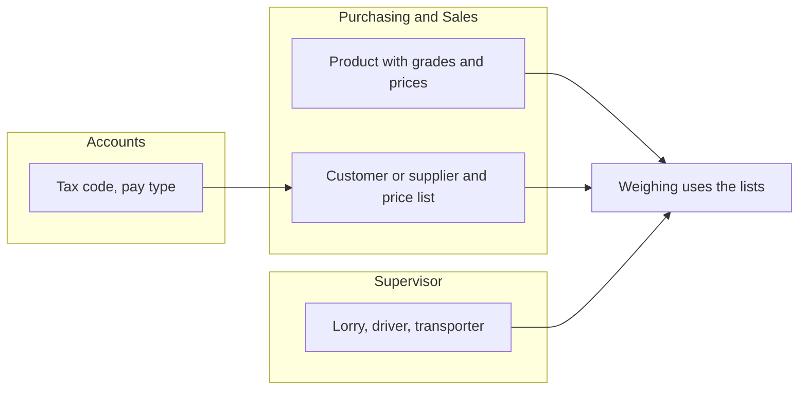
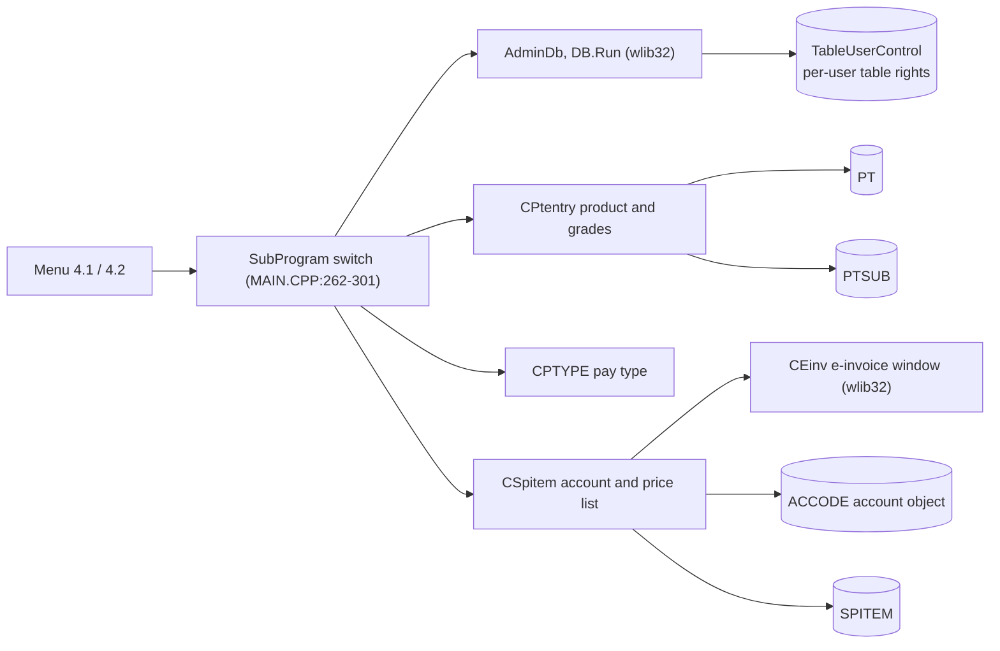
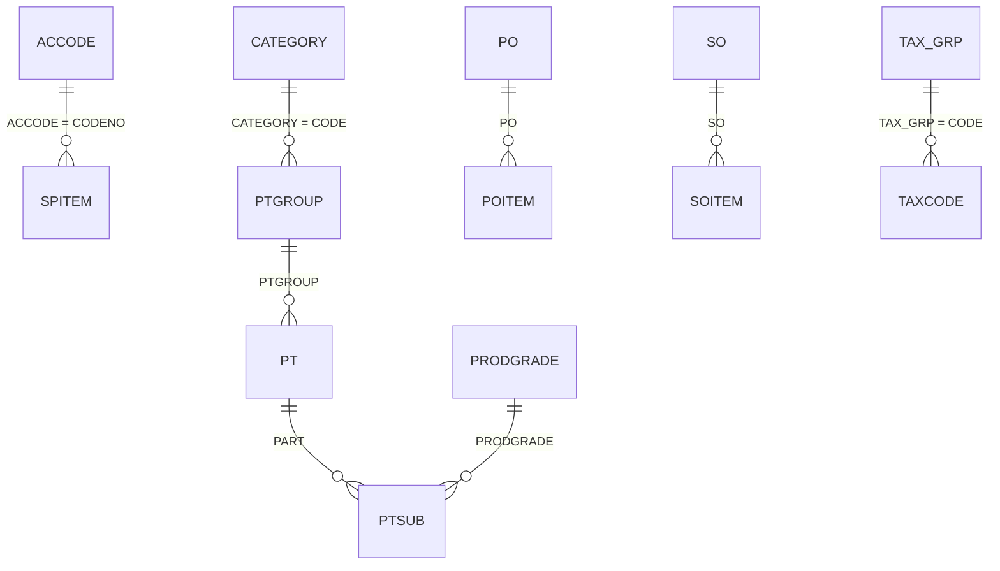
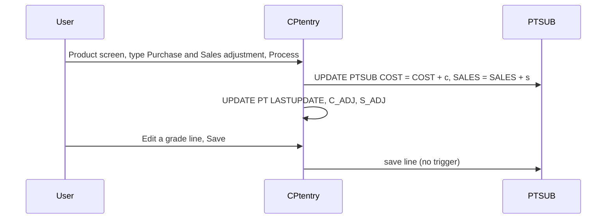

# Control tables (menu 4.1 and 4.2) - Module reference

> Part of the TradeWin module reference. Index and shared sections: [README](README.md).
> Menu items covered: 4.1.1 Product Code, 4.1.2 Lorry Data Maintenance, 4.1.3 Category Code, 4.1.4 Unit Code, 4.1.5 Product Grade, 4.1.6 Pay Type, 4.1.7 Country Code, 4.1.8 Product Group, 4.1.9 GWST, 4.2.1 Buyer/Seller Code, 4.2.2 Driver Code, 4.2.3 Transporter, 4.2.4 Tax Code. This app has **no menu 4.3 (Contract / Sales Order)** and no Gatepass, Yard, Marketing or Actual Code tables on the menu; the purchase-order and sales-order screens and a few more tables exist in code but have no menu item (listed in 2.5). The account screen (4.2.1) also carries the **e-invoice data** button of the E-Invoice enhancement.
> Last verified against commit `2f77122`. Translation status: English only (no zh-CN copy yet).

## Contents

- [Part 1 - Business view](#part-1---business-view)
  - [1.1 In plain words](#11-in-plain-words)
  - [1.2 Who uses what](#12-who-uses-what)
  - [1.3 A day in the life](#13-a-day-in-the-life)
  - [1.4 Worked example](#14-worked-example)
  - [1.5 Screen tour](#15-screen-tour)
  - [1.6 Where does this number come from?](#16-where-does-this-number-come-from)
  - [1.7 Status meanings](#17-status-meanings)
  - [1.8 What happens if...](#18-what-happens-if)
  - [1.9 Messages you may see](#19-messages-you-may-see)
  - [1.10 Do and don't](#110-do-and-dont)
  - [1.11 Before you start](#111-before-you-start)
  - [1.12 Glossary](#112-glossary)
  - [1.13 Ask the AI](#113-ask-the-ai)
- [Part 2 - Technical view](#part-2---technical-view)
  - [2.1 Overview](#21-overview)
  - [2.2 Architecture and dependencies](#22-architecture-and-dependencies)
  - [2.3 Master data catalogue](#23-master-data-catalogue)
  - [2.4 Sub-table hierarchy](#24-sub-table-hierarchy)
  - [2.5 Modules and process flows](#25-modules-and-process-flows)
  - [2.6 End-to-end flows](#26-end-to-end-flows)
  - [2.7 Report catalogue](#27-report-catalogue)
  - [2.8 Integrations](#28-integrations)
  - [2.9 Configuration](#29-configuration)
  - [2.10 Maintenance](#210-maintenance)

---

# Part 1 - Business view

## 1.1 In plain words

- **Control tables** are the lists the other screens pick from: products, lorries, customers and suppliers, drivers, transporters, tax codes and so on. They are set up once and changed only when something new appears.
- **Table 1** holds the product side (product code with its **grades and prices**, product group, category, unit, the grade list), the lorry list, the preset weight deductions (GWST), pay types and countries. **Table 2** holds the customer and supplier accounts with their product lists and **e-invoice data**, the drivers, the transporters and the tax codes.
- A product is priced **by grade**: each product has one or more grade lines, each with a purchase price and a sales price. On scale tickets the program takes the price from the product's first grade line; on receiving and despatch tickets the price is typed. A customer's or supplier's product list in this program holds only the product, the grade and the account's own name for the product, **not prices**.
- Each customer or supplier also has **e-invoice data** (TIN, identity or registration number, address codes, e-invoice e-mail) that must be complete before an invoice can be submitted as an e-invoice.
- Wrong or missing control data shows up everywhere: a missing price makes an amount zero, a wrong tax code gives a wrong invoice, a missing TIN makes the e-invoice fail.

## 1.2 Who uses what

| Department | Menu item | Main tasks |
|---|---|---|
| Purchasing / Sales | 4.2.1 customers and suppliers with product list and e-invoice data, 4.1.1 Product Code | Keep each account's product list and e-invoice data, set grade prices, adjust prices |
| Weighbridge supervisor | 4.1.2 Lorry, 4.2.2 Driver, 4.2.3 Transporter | Keep lorries, drivers and transporters current |
| Accounts | 4.2.4 Tax Code, 4.1.6 Pay Type, 4.2.1 e-invoice data | Keep tax and pay setup and the TIN data |
| IT / Admin | 4.1.5 Product Grade, 4.1.8 Product Group, 4.1.3 Category, 4.1.4 Unit, 4.1.7 Country, 4.1.9 GWST | Technical lists |
| Management | all | Look up |

**Start here - Purchasing / Sales**
- Existing customer or supplier: 4.2.1, check the tax code, add product-list lines, press E-Invoices and complete the TIN, address and e-mail.
- New product: 4.1.8 group and 4.1.5 grade first, then 4.1.1 with its grade lines and prices.
- Price change for all customers: 4.1.1, type the amount in the Price Adjustment boxes and press Process.

**Start here - Supervisor**
- New regular lorry or driver: 4.1.2 and 4.2.2 so the operators can pick them and the ticket fills itself.

**Start here - IT / Admin**
- Once: GWST presets, product groups, categories, units, grades, countries.

## 1.3 A day in the life

**An existing supplier needs e-invoices.** Purchasing opens 4.2.1, finds the supplier and presses **E-Invoices**. A small window opens. The clerk types the TIN, or the IC number or the ROC number and presses **Search TIN**; the program asks the e-invoice service and fills the TIN. The clerk also fills the state, city, postcode, country and the e-invoice e-mail, and presses Update. Note that **new accounts cannot be added on this screen** (the Add function is switched off for accounts in the program); a new account has to be created where the account list is kept.

**A product price rises.** Purchasing opens 4.1.1, picks the product, types the increase in the Purchase and Sales boxes of **Price Adjustment** and presses **Process**; every grade line of that product is raised by that amount and the "Last Update Information" box shows the date and the amounts.

**A lorry is new.** The supervisor adds the lorry (plate, usual driver, usual customer or supplier, transporter, empty weight). On the ticket the driver, account and transporter then fill in by themselves.
Swimlane:



*Caption: every group of people feeds the lists that weighing, tickets and invoices read.*

## 1.4 Worked example

All values are made up.

| Step | Screen | What the user does | What the program does |
|---|---|---|---|
| 1 | 4.1.8 Product Group | Adds group `MET` "METAL SCRAP", category `01` | Saves |
| 2 | 4.1.5 Product Grade | Adds grade `GA` "GRADE A" | Saves |
| 3 | 4.1.1 Product Code | Adds `AL01` "ALUMINIUM SCRAP", group `MET`, unit `KG`; grade line `GA`, purchase price 2.000, sales price 2.500 | Saves the product and the grade line |
| 4 | 4.2.1 account | Opens the existing supplier `S0001`, adds product-list line item `AL01`, grade `GA`, the supplier's own name "ALU SCRAP A" | Saves the line (no price is stored on it) |
| 5 | 4.2.1, E-Invoices | Types the IC number of the sole proprietor and presses Search TIN; fills state, city, postcode, country, e-mail; Update | The program looks up the TIN and stores the data |
| 6 | 4.1.1 | Product `AL01`: Purchase 0.100, Sales 0.100, Process, Yes | Every grade line of `AL01` rises by 0.100 (2.100, 2.600) and the date is stored |

After step 6 scale tickets for `AL01` take 2.100 as the purchase price.

## 1.5 Screen tour

All master screens share the same frame: the fields on one side and the standard record buttons Add, Edit, Save, Delete, Search, Previous, Next, Print. Which of these a user may use is controlled per table by the table access list (see the README, "User rights").

### 4.1.1 Product Code ("Product Data Entry")

| Field label | Meaning | Required? | Where the value comes from |
|---|---|---|---|
| SCRAP CODE | Product code (up to 8 characters) | Yes (key) | Typed |
| DESCRIPTION | Product name | No | Typed |
| SHORT NAME | Short name | No | Typed |
| PRODUCT GROUP | Group | No | Picked |
| UNIT | Unit | No | Picked |
| REMARKS | Free text | No | Typed |
| SALES GLCODE, PURCHASE GLCODE | Accounts the sales and purchases are posted to | No | Picked (accounting codes) |
| PURCHASE PRICE, SALES PRICE | Old single prices; the boxes are switched off | - | - |

**Grade lines (grid):** No, Code (the grade), Product Grade Description, Purchase Price, Sales Price. A product cannot have the same grade twice.

**Price Adjustment:** Purchase and Sales boxes with the **Process** button (shown while the record is only being viewed): adds the typed amount (positive or negative) to every grade line of the product and records it in "Last Update Information" (Date, Purchase, Sales). Both boxes zero: "Zero value on both Purchase and Sales adjustment column." and nothing happens.

**Stock Flow button:** the stock card of the product: date, reference, quantity in and out, description and type, with running balances.

### 4.1.2 Lorry Data Maintenance

| Field label | Meaning | Required? | Source |
|---|---|---|---|
| LORRY | Plate number | Yes (key) | Typed |
| DRIVER | Usual driver (driver code) | No | Picked from the driver list |
| ACCODE | Usual customer or supplier | No | Picked |
| TRANSPORTER | Transport company | No | Picked |
| TARE WT(KG) | Empty weight | No | Typed |
| REMARKS | Free text | No | Typed |

### 4.1.3 to 4.1.9 simple lists

| Screen | Fields | Notes |
|---|---|---|
| 4.1.3 Category Code | PRODUCT CATEGORY (key), DESCRIPTION, TICKET PREFIX, REMARKS | Prefix for serial numbers (the serial routine is switched off in this program) |
| 4.1.4 Unit Code | UNIT (key), DESCRIPTION, REMARKS | - |
| 4.1.5 Product Grade | Code (key), Description, Remark | The grade lines of products and price lists pick from it |
| 4.1.6 Pay Type | PAY TYPE (key), DESCRIPTION, REMARKS | Codes `01` and `CASH` are treated as **cash** by tickets and invoices |
| 4.1.7 Country Code | CODE (key), COUNTRY, REMARKS | - |
| 4.1.8 Product Group | PRODUCT GROUP (key), DESCRIPTION, PRODUCT CATEGORY | - |
| 4.1.9 GWST | "G.W.S.T RATE SETTING": fifteen boxes A to O, each a weight in kg | In the weight window of 1.1 Receiving Note (only), with Scroll Lock on, Ctrl+A to Ctrl+O choose one as the deduction |

### 4.2.1 Buyer/Seller Code (customer and supplier account, "Customer Data Entry")

| Field label | Meaning | Required? | Where the value comes from |
|---|---|---|---|
| CODE NO | Account code (up to 10 characters) | Yes (key) | Typed |
| NAME | Account name | Yes for tickets and invoices | Typed |
| ADDRESS (3 lines) | Address | No | Typed |
| TEL. NO, FAX NO, CONTACT | Contact data | No | Typed |
| AREA | Area code | No | Picked |
| REMARKS | Free text | No | Typed |
| GST NO | Tax registration number | No | Typed |
| Tax code | Default tax code on invoices | Yes for invoices | Picked |

**Product list (grid, often called the price list):** Item Code, Product Grade, Buyer Product Name. The line window shows the Item Code, the Product Grade and the Buyer Product Description; there are **no price boxes**. A product can appear only once.

**E-Invoices button:** opens the window "Set E-invoice data" for the account:

| Field label | Meaning | Required? | Where the value comes from |
|---|---|---|---|
| Tin (*) | Tax identification number | Yes for e-invoice | Typed, or filled by Search TIN |
| New I/C No., Passport No., ROC No., Exempt No. | Identity or registration numbers of the party | One of them for the TIN search | Typed |
| No einv flag | Tick: this party gets no e-invoice | No | Tick box |
| Self Bill | Tick: self-billed party (the program writes the text "Not Self Bill" on this box) | No | Tick box |
| State, City, Postcode, Country | Address codes; picking the postcode fills the state and the city; the country starts as `MYS` | Yes for e-invoice | Picked |
| Einv email | E-mail address of the party for the e-invoice | No | Typed |

Buttons: **Search TIN** (needs the IC or the ROC number and a blank TIN; asks the e-invoice service and waits up to 5 seconds for the answer), **Update** (saves). The window reminds the fixed TIN values for a buyer without a TIN (`EI00000000010`), a foreign buyer (`EI00000000020`), a self-billed foreign party (`EI00000000030`) and an exempt party (`EI00000000040`).

The account list is not editable by adding: the Add function is switched off on this screen.

### 4.2.2 Driver Code

Simple record of a driver: NRIC (key, up to 14 characters), NAME, NEW IC NO, REMARKS and the ADDRESS (three lines). Standard record buttons only. The lorry list and the tickets pick the driver by the NRIC code and show the name.

### 4.2.3 Transporter

CODE NO (key), FULL NAME, SHORT NAME, TEL. NO, FAX. NO, ADDRESS (3 lines), CONTACT, OWNER (a Y/N flag), REMARKS.

### 4.2.4 Tax Code

| Field label | Meaning | Required? | Source |
|---|---|---|---|
| Tax Code | Code | Yes (key) | Typed |
| Description | Name | No | Typed |
| Tax Percen | Rate in percent | Yes for taxed codes | Typed |
| Tax Group | Group | No | Picked |
| Remark | Free text | No | Typed |
| G/L Code | Account for posting | Yes in the table | Typed |
| Tax Type | One letter: `I` input, `O` output, `C` | Yes in the table | Typed |
| GST03 | Mapping code | No | Typed |
| Inactive | Tick to retire the code | No | Tick box |

## 1.6 Where does this number come from?

- **Price of a scale-ticket line**: the product's first grade price (purchase when buying, sales when selling) - see [Scale weighing](scale-weighing.md#16-where-does-this-number-come-from).
- **Price on a receiving or despatch ticket line**: typed; the program does not look it up.
- **Grade price after Price Adjustment** = old price + the typed amount. Example: 0.627 + 0.010 = **0.637**.
- **Tax on an invoice**: percent of the account's tax code (see [Invoice](invoice-cashier.md#16-where-does-this-number-come-from)).

## 1.7 Status meanings

| Document | Status | Meaning | Who changes it |
|---|---|---|---|
| Masters (product, lorry, account, driver and so on) | none | A row exists or not | Users with edit rights |
| Tax code | Inactive | A retired code (the ticket-side lookups that used it are not part of this program's menu) | Tick box |
| Price adjustment | Last update | Date and amounts of the last Process | Process button |

## 1.8 What happens if...

| Situation | What to do | Call IT when |
|---|---|---|
| A customer was entered twice with different codes | Use one; do not delete the other if tickets used it | The tickets must be merged |
| Price changed for a product | 4.1.1 Price Adjustment, Process, or edit the grade line; tickets already saved keep their prices | - |
| A customer wants their own price | Not available in the account screen of this program; type the price on the ticket line | - |
| Search TIN says it cannot find the TIN | Check the IC or ROC number; if the party has no TIN, type one of the fixed TIN values shown in the window | The service never answers |
| A product code must change | Add a new code; do not rename codes already used | - |
| Delete a master that tickets use | Do not: tickets keep the code but lookups fail | - |
| Contract, Sales Order, Gatepass | Not on this program's menu | - |

## 1.9 Messages you may see

| Message | What it means | What to do |
|---|---|---|
| `Zero value on both Purchase and Sales adjustment column.` + `Not allowed to proceed.` | Process pressed with both boxes empty | Type an amount |
| `Do you want to adjust value <n> on Purchase Price` + `and <n> on Sales Price` | Process confirmation | Yes applies |
| `Data Not found` | An account code that does not exist was typed on 4.2.1 (adding is switched off, the toolbar offers edit only) | Create the account where accounts are kept |
| `Confirm Search Tin? If TIN is not blank, please remove it!` | Search TIN pressed with a TIN already typed | Clear the TIN first |
| `TIN is not blank!` | Same, the cursor goes to the TIN box | Clear the TIN |
| `Pls key in IC or ROC no.!` | Search TIN with no IC and no ROC number | Type one |
| `Sorry, can't find the TIN!` | The e-invoice service had no TIN for that number | Check the number, or use a fixed TIN value |
| `Database not open` | The table is not available | Call IT |
| `Please key in Registered Account Code.` | Purchase or sales order without a registered account | Pick one |

## 1.10 Do and don't

- Do give every account a tax code before its first invoice.
- Do keep one code per real company.
- Do complete the TIN, address and e-mail of an account before its first e-invoice.
- Don't reuse a product code for a different product.
- Don't delete masters that are already on tickets.

## 1.11 Before you start

- Product groups, units and grades exist before products.
- Pay types, tax codes and areas exist before accounts.
- Lorries need the driver list and the transporter list.

## 1.12 Glossary

| Term | English | Malay | Chinese |
|---|---|---|---|
| Control table | List used by other screens | Jadual kawalan | 控制表 |
| Scrap code / product code | Code of the paper or scrap type | Kod bahan | 货品代码 |
| Product grade | Quality level of a product, with its own prices | Gred produk | 产品等级 |
| Product group / category | Grouping of products | Kumpulan / kategori | 货品组 / 类别 |
| Pay type | Cash or credit code | Jenis bayaran | 付款方式 |
| Tax code | Rate code | Kod cukai | 税码 |
| GWST | Preset weight deductions | Potongan berat | 预设扣重 |
| Product list | The products a customer or supplier trades, with its own names | Senarai produk | 产品清单 |
| TIN | Tax identification number used on e-invoices | Nombor pengenalan cukai | 税务识别号 |
| E-invoice | Electronic invoice reported to the tax authority | e-Invois | 电子发票 |
| Account code | Code of a customer or supplier | Kod akaun | 账户代码 |

## 1.13 Ask the AI

1. How do I complete the e-invoice data of a customer?
2. What are pay types 01 and CASH?
3. How do I set up a new product with grades and prices?
4. How do I raise the price of a product for all customers?
5. What does the GWST table do and what are the Ctrl keys?
6. Why can I not add a new customer in 4.2.1?
7. How do I add a driver and a lorry so the ticket fills itself?
8. Who can change the master tables?
9. What do I do when Search TIN cannot find the TIN?
10. What is the difference between a product grade and a product group?

---

# Part 2 - Technical view

## 2.1 Overview

- Application: TradeWin Metals weighbridge (VC6/MFC on wlib32, `menu.dsp`, `menu.exe`). See [README](README.md).
- This module: the master tables on menus 4.1 and 4.2. Most screens have no class in this repo: they run through the wlib32 generic screens `AdminDb(&table)` (header-detail `CParent` with the table's own dialog), `DB::Run()` (`prodgrade`, `taxcode`, `salesman`, `vtype`) or `AdminOneRecord(&table)` (a `CStaff` with `OneRecordOnly`, MAIN.CPP:140-150). Classes in this repo: `CPtentry` (product with grades, PtEntry.cpp), `CPTYPE` (pay type, PTYPE.CPP), `CSpitem` (account with product list and e-invoice button, SPITEM.CPP), `CPO` (orders, PO.CPP, no menu item). The driver (4.2.2) has no class: it is the generic screen on the table `ic` with dialog `IDD_DRIVER`.
- `CMenuApp::SetDBNodeNo` gives the master tables their node numbers for the user-rights checks: product 411, lorry 412, unit 414, pay type 416, account 421, driver 422, transporter 423 (MENU.CPP:597-611); for product, pay type and account it also sets `e->ReportFlag = 1` (the comment in the code calls it "not allow create new record"; in wlib32 bit 1 of `ReportFlag` stops a field of another screen from creating a new item of that table by typing an unknown code, not the master screen's own Add button).
- E-invoice enhancement parts of this module: the **E-Invoices** button of the account screen (`CSpitem::OnEinv`, SPITEM.CPP:154-185), the view hook `tell_einv_view` (SPITEM.CPP:132-152) and `df->m_CannotAdd = TRUE` in `CSpitem::DoDataExchange` (SPITEM.CPP:33), which switches off Add on the account screen. The window itself (`CEinv`, dialog `IDD_FN_EINV`) is in the shared wlib32 library.

## 2.2 Architecture and dependencies



*Caption: product and account screens have their own classes; the other masters use the generic frame; the account screen also opens the e-invoice data window.*

- Libraries: wlib32 (generic screens, table rights, `CParent`, `CStaff`), MSFlexGrid.
- Database: SQL Server; no schema repo for TradeWin (types below come from `SQL_LekokPaper`, a sister app, and are unverified for TradeWin unless stated). `accode` is opened as `ado(&accode,"accode",init_accodes)` (MENU.CPP:461); whether it is a view over the accounting database is not visible here. `CREDITOR`, `SUPPLIER` and `DEBTOR` are opened as separate objects (MENU.CPP:551-553).
- Rights: `TableUserControl` and `FieldUserControl` (wlib32) and the user's node lists (see README).

## 2.3 Master data catalogue

Every table below is opened with `ado(&x,"table",init)` in `OpenAllDataFile` (MENU.CPP:436-555). Types are from `SQL_LekokPaper` (sister app) and unverified for TradeWin. Audit columns on every master table (`REC_STATUS`, `NEWUSER`, `NEWTIME`, `MODIFYUSER`, `MODIFYTIME`, `Print Counter`) are listed once per table as the last row. The sister scripts are the files `<TABLE>.sql` of that schema.

### PT (product, menu 4.1.1)

Screen `AdminDbPtentry(&prodtype,&ptsub)` (MAIN.CPP:262-264; PtEntry.cpp:120-130): `CPtentry` (`CParent`) on dialog `IDD_PT` with the grade lines of `PTSUB` (`NonDupArray[0] = PTSB_PRODGRADE`). Opened `ado(&prodtype,"pt",init_ptentry)` (MENU.CPP:462; `init_ptentry` is empty, PtEntry.cpp:164-167). Enum `pt` (MENU.H:316).

| # | field (enum) | SQL column | data type | null | key | meaning |
|---|---|---|---|---|---|---|
| 1 | `PT_PART` | `PART` | nvarchar(8) | no | PK | product code |
| 2 | `PT_NAME` | `NAME` | nvarchar(40) | yes |  | description |
| 3 | `PT_SNAME` | `SNAME` | nvarchar(20) | yes |  | short name |
| 4 | `PT_PTGROUP` | `PTGROUP` | nvarchar(8) | yes |  | product group |
| 5 | `PT_UNIT` | `UNIT` | nvarchar(6) | yes |  | unit |
| 6 | `PT_COST` | `COST` | float(53) | yes |  | purchase price (box hidden on the form) |
| 7 | `PT_SALES` | `SALES` | float(53) | yes |  | sales price (box hidden) |
| 8 | `PT_REMARKS` | `REMARKS` | nvarchar(60) | yes |  | remarks |
| 9 | `PT_SALESGL` | `GLCODE1` | int | yes |  | sales posting account (used by the sales export) |
| 10 | `PT_PURCHASEGL` | `GLCODE2` | int | yes |  | purchase posting account |
| 11 | `PT_LASTUPDATE` | `LASTUPDATE` | datetime | yes |  | date of the last Process |
| 12 | `PT_C_ADJ` | `C_ADJ` | decimal(18,5) | yes |  | last purchase adjustment |
| 13 | `PT_S_ADJ` | `S_ADJ` | decimal(18,5) | yes |  | last sales adjustment |
| 14 to 19 | | audit columns | | yes |  | |

- Lookups: `PTGROUP`, `UNIT`, `GLCODE` view. Used by: scale, receiving and despatch lines, the account product lists, adjustments, stock card.

### PTSUB (product grade lines)

Link key: `PTSUB.PART = PT.PART`; enum `ptsub` (MENU.H:803); grid titles No, Code, Product Grade Description, Purchase Price, Sales Price (PtEntry.cpp:103-117); dialog `IDD_PTSUB`; opened `tado(&ptsub,"ptsub")` with **no init function** (MENU.CPP:440); `prodtype.sub = &ptsub` (MENU.CPP:566).

| # | field (enum) | SQL column | data type | null | key | meaning |
|---|---|---|---|---|---|---|
| 1 | `PTSB_PART` | `PART` | nvarchar(8) | no |  | product code (link key) |
| 2 | `PTSB_SQNO` | `SQNO` | float(53) | yes |  | line number |
| 3 | `PTSB_PRODGRADE` | `PRODGRADE` | nvarchar(10) | yes |  | grade (master `PRODGRADE`) |
| 4 | `PTSB_COST` | `COST` | decimal(18,5) | yes |  | purchase price |
| 5 | `PTSB_SALES` | `SALES` | decimal(18,5) | yes |  | sales price |
| 6 | `PTSB_PKKEY` | `PKKEY` | int | no | PK identity | row key |

- Cardinality 1..n per product; nested sub-tables: none. Saved by the `CParent` mechanism with the header.
- **No trigger:** the sister app runs a trigger after saving a grade line that overwrites every account's price list; TradeWin has no such code (`ptsub_Triggers` and `init_ptsub` do not exist in PtEntry.cpp, which ends at line 166).
- **Process button** (`CPtentry::OnProcess`, PtEntry.cpp:138-162): `UPDATE PTSUB SET COST = COST + c, SALES = SALES + s WHERE PART = '<code>'` then `UPDATE PT SET LASTUPDATE = getdate(), C_ADJ = c, S_ADJ = s WHERE PART = '<code>'` after a Yes/No question (PtEntry.cpp:142-155). The button is shown only in view mode (`SetAttribute`, PtEntry.cpp:66-76).
- Stock Flow button: `ViewStockFlow` (STKFLOW.CPP:17-37) runs `select * from [stkflow] where [pt]=<code> order by [date],[ordertype],[refno]` and shows it through the form `stkflow.rep` with running balances on columns 4 and 8.

### Account (ACCODE) with its product list (SPITEM) and e-invoice data

Screen `AccodeMaintenance()` (SPITEM.CPP:73-81): `CSpitem p1(IDD_ACCODE,&accode,1)`, `sub = &spitem`, `IDD_SUB = IDD_SPITEM`, `NonDupArray[0] = Sp_ITEM`, `m_WinPrint = TRUE`. Opened `ado(&accode,"accode",init_accodes)` (MENU.CPP:461) and `tado(&spitem,"spitem")` with no init function (MENU.CPP:477). **Add is switched off** (`df->m_CannotAdd = TRUE`, SPITEM.CPP:33): in wlib32 the toolbar then offers edit only and typing an unknown code answers `Data Not found`.

**ACCODE.** The dialog `IDD_ACCODE` is bound to the first 12 fields in the order of the enum `accode` (MENU.H:270-272): the box numbers `IDC_EDIT1` to `IDC_EDIT12` follow the enum (the older 18-entry enum above it is commented out, MENU.H:265-269; `ACCODE_AREA` is defined as `ACCODE_COUNTRY`). The column names and types of the live object are **unverified** (no script); the dialog and enum give the meaning:

| # | field (enum) | dialog label | meaning |
|---|---|---|---|
| 1 | `ACCODE_CODENO` | CODE NO | account code (key) |
| 2 | `ACCODE_CUSTOMER` | NAME | name |
| 3 to 5 | `ACCODE_ADD1..3` | ADDRESS (3 lines) | address |
| 6 | `ACCODE_TEL` | TEL. NO | telephone |
| 7 | `ACCODE_FAX` | FAX NO | fax |
| 8 | `ACCODE_CONTACT` | CONTACT | contact person |
| 9 | `ACCODE_COUNTRY` (alias `ACCODE_AREA`) | AREA | area code |
| 10 | `ACCODE_REMARKS` | REMARKS | remarks |
| 11 | `ACCODE_GST_NO` | GST NO | tax registration number |
| 12 | `ACCODE_TAXCODE` | Tax code | default tax code |

`init_accodes` installs `accodes_save` (returns 1) and `tell_accode` (returns 1): no rule (SPITEM.CPP:83-130). The enum must agree with the live object's column order; this was not checked (the sister app's enum did not agree with its view, see [Invoice](invoice-cashier.md#210-maintenance)).

**E-invoice data (button E-Invoices).** `CSpitem::OnEinv` (SPITEM.CPP:154-185): saves a new record first if needed, builds the name `<table>_einv` (for the account screen `accode_einv`), runs `select * from accode_einv where <key field> = '<code>'` into a temporary object (`ado(&adoTmp, dbName, init_einv_view, strSQL)`), closes silently when the view has no row for the account, otherwise shows `CEinv` (dialog `IDD_FN_EINV`, wlib32) on that row with `isFFBProgram = TRUE`; OK copies the fields back with `fetch(df, &adoTmp)`. The source comment says the view must be created with the account code and the fields from TIN to the e-invoice e-mail. `tell_einv_view` (hook on the view, field 10 = postcode): picking a postcode fills `MALAYSIA_STATE` and `MALAYSIA_CITY` from the `postcode` table (`STATE` column `MALAYSIA_STATE`, city column `CITY_NAME`). `CEinv` reads the columns `NICNO` (new IC), `TIN` and `REGNO` (ROC) by name, defaults `COUNTRY` to `MYS`, and its Search TIN button calls the procedure `dt_SearchTinApi` and reads the table `EINVOICE_TIN` (see [Invoice](invoice-cashier.md#28-integrations)). The view `accode_einv`, the procedure and the table are not in this repo (unverified).

**SPITEM** (the account's product list; sister script `SPITEM.sql`; enum `spitem` MENU.H:325 has **5** entries; grid titles No, Item Code, Product Grade, Buyer Product Name, SPITEM.CPP:53-60)

| # | field (enum) | SQL column | data type | null | key | meaning |
|---|---|---|---|---|---|---|
| 1 | `Sp_CUSTOMER` | `ACCODE` | nvarchar(10) | no |  | account (link key to `ACCODE.CODENO`) |
| 2 | `Sp_SQNO` | `SQNO` | float(53) | yes |  | line number |
| 3 | `Sp_ITEM` | `PT` | nvarchar(8) | no |  | product code |
| 4 | `Sp_PRODGRADE` | `PRODGRADE` | nvarchar(10) | yes |  | grade |
| 5 | `Sp_BUYERPTNAME` | `ACCPTNAME` | nvarchar(50) | yes |  | the account's own name for the product |
| 6 | | `PKKEY` | int | no | PK identity | row key (position as in the sister script has `COST`, `SALES` at 6 and 7; TradeWin's dialog `IDD_SPITEM` has no price boxes, so whether those columns exist is unverified) |

- Cardinality 1..n per account; nested sub-tables: none. There is **no** `tell_spitem` and no `init_spitem` in this program: picking an item copies nothing, and the line carries no prices.
- Used by: the dot-matrix slip print reads `ACCPTNAME` by account and product (SLIP1.CPP:47). The price lookups that used `SPITEM` are commented out or never called: the scale line price (SCALE.CPP:719-727), `ChangePrice` (DS.CPP:422-443), `FindSellerPrice` (DT.CPP:195-210, its call is commented out at DT.CPP:219) and `FindSpitem` (PO.CPP:79-89, call commented out at PO.CPP:101).

### LORRY (menu 4.1.2)

`AdminDb(&lorry)` (MAIN.CPP:265-267); `ado(&lorry,"lorry",init_lorry)` (MENU.CPP:465; `init_lorry` is empty); the object `vehicle` is a second handle on the same table (`ado(&vehicle,"vehicle",init_lorry)`, MENU.CPP:466; view `VEHICLE` = `SELECT LORRY.* FROM LORRY`). Enum `lorry` (MENU.H:315). `SetDBRelations` aliases field 3 as "ACCODE" (MENU.CPP:570). Script `LORRY.sql`.

| # | field (enum) | SQL column | data type | null | key | meaning |
|---|---|---|---|---|---|---|
| 1 | `LO_VEHICLE` | `LORRY` | nvarchar(10) | no | PK | plate number |
| 2 | `LO_DRIVER1` | `ICNO` (sister script) | nvarchar(14) | yes |  | usual driver (driver code, the NRIC of the `ic` table) |
| 3 | `LO_DRIVER2` | `IC2` | nvarchar(14) | yes |  | **usual customer or supplier account code** (aliased "ACCODE"; the form label says ACCODE) |
| 4 | `LO_TRANSP` | `TRANSP` | nvarchar(5) | yes |  | transporter |
| 5 | `LO_TARE` | `TARE` | float(53) | yes |  | empty weight |
| 6 | `LO_REMARKS` | `REMARKS` | nvarchar(40) | yes |  | remarks |
| 7 to 12 | | audit columns | | yes |  | |

### IC (driver, menu 4.2.2)

`AdminDb(&driver)` (MAIN.CPP:293-295): the generic header screen on the object `driver`, opened as `ado(&driver,"ic")` (MENU.CPP:464) with **no init function** (`init_driver` in driver.cpp has its print line commented out and is not wired); dialog `IDD_DRIVER` (menu.rc:4316, caption "Driver Data Entry"); node number 422 (MENU.CPP:608). There is no `ICNO` table, class or MyKad import in this program. `driver.dat[2]` (the name) is what the ticket screens copy.

Visible fields: NRIC (`IDC_EDIT1`, key), NAME (2), NEW IC NO (3), REMARKS (4), ADDRESS (5 to 7). Types from the sister script `IC.sql` (sister app, unverified for TradeWin; its audit columns are `varchar(10)` for the users):

| # | dialog label | SQL column | data type | null | key | meaning |
|---|---|---|---|---|---|---|
| 1 | NRIC | `NRIC` | nvarchar(14) | no | PK | driver code |
| 2 | NAME | `NAME` | nvarchar(35) | yes |  | name |
| 3 | NEW IC NO | `NERIC` | nvarchar(14) | no |  | new IC number |
| 4 | REMARKS | `REMARKS` | nvarchar(35) | yes |  | remarks |
| 5 to 7 | ADDRESS | `ADD1..3` | nvarchar(40) | yes |  | address |
| (not on the form) | | `CONTACT` | nvarchar(20) | yes |  | contact (in the sister script only) |
| | | audit columns | | yes |  | `REC_STATUS`, `NEWUSER`, `NEWTIME`, `MODIFYUSER`, `MODIFYTIME`, `Print Counter` |

- Used by: lorry (`LO_DRIVER1`), the ticket screens (`qd(df->dat[DP_IC], &driver)` fills the driver name, for example DS.CPP:502-503, SCALE.CPP:617-618, Wpr.cpp:184-185).
- Nested sub-tables: none.

### TRANSP (menu 4.2.3)

`AdminDb(&transp)` (MAIN.CPP:296-298); `ado(&transp,"transp",init_transp)` (MENU.CPP:467); enum `transp` (MENU.H:317); script `TRANSP.sql`.

| # | field (enum) | SQL column | data type | null | key | meaning |
|---|---|---|---|---|---|---|
| 1 | `Trn_TR_NO` | `TR_NO` | nvarchar(5) | no | PK | code |
| 2, 3 | `Trn_NAME`, `Trn_SNAME` | `TR_NAME`, `TR_SNAME` | nvarchar(40), nvarchar(20) | yes |  | full and short name |
| 4, 5 | `Trn_TR_TEL`, `Trn_TR_FAX` | `TR_TEL`, `TR_FAX` | nvarchar(15) | yes |  | telephone, fax |
| 6 to 8 | `Trn_TR_ADD1..3` | `TR_ADD1..3` | nvarchar(30) | yes |  | address |
| 9 | `Trn_CONTACT` | `CONTACT` | nvarchar(30) | yes |  | contact |
| 10 | `Trn_COMPUTE` | `COMPUTE` | nvarchar(1) | yes |  | form label "OWNER" (Y/N) |
| 11 | `Trn_REM` | `REM` | nvarchar(30) | yes |  | remarks |
| 12 to 17 | | audit columns | | yes |  | |

### TAXCODE and TAX_GRP (menu 4.2.4)

`taxcode.Run()` (MAIN.CPP:299-301); `ado(&taxcode,"taxcode")` (MENU.CPP:555), dialog `IDD_TAXCODE`. Scripts `TAXCODE.sql`, `TAX_GRP.sql`.

| # | SQL column | data type | null | key | meaning |
|---|---|---|---|---|---|
| 1 | `CODE` | nvarchar(10) | no | PK | tax code |
| 2 | `DESCRIPTION` | nvarchar(150) | yes |  | description |
| 3 | `PERCEN` | decimal(5,2) | yes |  | percent (field 3, read by `FindPercen`) |
| 4 | `TAX_GRP` | nvarchar(10) | yes | FK to `TAX_GRP.CODE` | tax group (default 0) |
| 5 | `REMARK` | nvarchar(50) | yes |  | remark |
| 6 | `GLCODE` | nvarchar(8) | no |  | posting account |
| 7 | `TAX_TYPE` | nvarchar(1) | no |  | `I`, `O` or `C` (check constraint) |
| 8 | `GST03` | nvarchar(10) | yes |  | mapping code |
| 9 | `INACTIVE` | bit | yes |  | retired |
| 10 to 15 | audit columns | | yes |  | |

`TAX_GRP`: `CODE` nvarchar(10) PK, `DESCRIPTION` nvarchar(50), `REMARK` nvarchar(50), audit columns.

### Simple lists

| Menu | Handler (MAIN.CPP) | Table and script | Columns |
|---|---|---|---|
| 4.1.3 Category | `AdminDb(&category)` (MAIN.CPP:268-270) | `CATEGORY.sql` | `CODE` nvarchar(5) PK, `DESC` nvarchar(40), `PREFIX` nvarchar(10), `REMARKS` nvarchar(200), audit |
| 4.1.4 Unit | `AdminDb(&unit)` (MAIN.CPP:271-273) | `UNIT.sql` | `CODE` nvarchar(6) PK, `UNIT` nvarchar(12), `REMARKS` nvarchar(12), audit |
| 4.1.5 Product Grade | `prodgrade.Run()` (MAIN.CPP:274-276) | `PRODGRADE.sql` | `PRODGRADE` nvarchar(10) PK, `DESCRIPTION` nvarchar(50), `REMARK` nvarchar(50), audit |
| 4.1.6 Pay Type | `AdminDbPTYPE(&ptype)` (MAIN.CPP:277-280; PTYPE.CPP:51-61) | `PTYPE.sql` | `CODE` nvarchar(5) PK, `DECRIBE` nvarchar(30) (spelling as in the script), `REMARKS` nvarchar(30), audit |
| 4.1.7 Country | `AdminDb(&country)` (MAIN.CPP:281-283) | `COUNTRY.sql` | `CODE` nvarchar(5) PK, `COUNTRY` nvarchar(30), `REMARKS` nvarchar(40), audit |
| 4.1.8 Product Group | `AdminDb(&ptgroup)` (MAIN.CPP:284-286) | `PTGROUP.sql` | `PTGROUP` nvarchar(8) PK, `DESCRIPTION` nvarchar(50), `CATEGORY` nvarchar(5), audit |
| 4.1.9 GWST | `AdminDb(&gst)` (MAIN.CPP:287-289) | `GST.sql` | `CODE` int PK, `A` to `O` float(53), audit |

`ado(&category,"category",init_category)`, `init_country`, `init_grade`, `init_ptype` and `init_unit` are declared but the bodies are empty or commented (CATEGORY.CPP:19, COUNTRY.CPP:19 and so on); `gst` is opened with `readrec(1,&gst)` (MENU.CPP:470-472) so the Ctrl presets read the first row. `CPTYPE` is a plain `CParent` with no extra code.

### Tables with code but no menu item

| Node | Handler | Table and script | Notes |
|---|---|---|---|
| 425 | `AdminDb(&grade)` (MAIN.CPP:302-305) | `GRADE.sql`: `CODE` nvarchar(5) PK, `NAME` nvarchar(30), `REMARKS` nvarchar(40), audit | Grader list ("Grader Code Data Maintenance") |
| 426 | `AdminDb(&status)` (MAIN.CPP:306-308) | `STATUS.sql`: `CODE` char(1) PK, `NAME` nvarchar(20), `REMARK` nvarchar(30), audit | "INVOICE STATUS" list |
| 427 | `salesman.Run()` (MAIN.CPP:309-311) | `SALESMAN.sql`: `SALESMAN` nvarchar(15) PK, `NAME` nvarchar(50), `REMARK` nvarchar(50), audit | Salesman |
| 428 | `vtype.Run()` (MAIN.CPP:312-315) | `VTYPE.sql`: `VTYPE` nvarchar(15) PK, `NAME` nvarchar(50), `REMARK` nvarchar(50), audit | Vehicle type |
| 429 | `accodehq` (MAIN.CPP:316-318) | `ACCODEHQ.sql` | the call is commented out; the case does nothing |
| 431, 432 | `PurchaseOrderData()`, `SalesOrderData()` (MAIN.CPP:319-324) | `PO.sql`, `POITEM.sql`, `SO.sql`, `SOITEM.sql` | purchase and sales orders, see below |
| 441 to 449 | accounting maintenance (MAIN.CPP:325-353) | views | see README "Dormant code" |

### PO / POITEM and SO / SOITEM (orders, no menu item)

`CPO` (PO.CPP, `CParent`) on `IDD_PO` with lines `IDD_POITEM`; `PurchaseOrderData()` (PO.CPP:133-143) sets `Purchase_Flag = TRUE`, `SalesOrderData()` (145-153) `FALSE`; both use `NonDupArray[0] = POD_ITEM` (a product once per order). Opened `ado(&po,"po",init_po)`, `tado(&poitem,...)`, `ado(&so,"so",init_po)`, `tado(&soitem,...)` (MENU.CPP:480-483). Orders are not reachable from the menu, and the PO / SO box that would limit a ticket's product list to the order lines is switched off on the ticket dialogs ([Tickets](tickets.md)).

**PO / SO** (scripts `PO.sql`, `SO.sql`; enum `po` MENU.H:326): `PO` or `SO` nvarchar(10) PK, `DATE`, `ETA` smalldatetime, `ACCODE` nvarchar(10) (the supplier or buyer), `TERMS` nvarchar(50), `REMARKS` nvarchar(50), audit columns. `CPO::OnDetail` refuses lines until the account is registered (`Please key in Registered Account Code.`, PO.CPP:62-70).

**POITEM / SOITEM** (scripts `POITEM.sql`, `SOITEM.sql`; enum `poitem` MENU.H:327): `PO` / `SO` nvarchar(10) (link key), `SQNO` float(53), `PT` nvarchar(8), `NAME` varchar(40), `CATEGORY` nvarchar(5), `QTY` float(53), `PRICE` float(53), `AMOUNT` float(53), `PKKEY` int PK identity (`FK_POITEM_PO` on the purchase side). `tell_poitem` (PO.CPP:93-114): picking the product fills the name and the category of its group; amount = quantity x price on every change. The price is not looked up (the `FindSpitem` call is commented out, PO.CPP:101).

## 2.4 Sub-table hierarchy

```text
PT       (key PART)
  - PTSUB   link: PTSUB.PART = PT.PART    (key PKKEY identity, line number SQNO)
    Nested sub-tables: none
ACCODE   (view, key CODENO)
  - SPITEM  link: SPITEM.ACCODE = ACCODE.CODENO    (key PKKEY identity, line number SQNO)
    Nested sub-tables: none
PO / SO  - POITEM / SOITEM   link: PO / SO number    (key PKKEY identity)
    Nested sub-tables: none
```



*Caption: the product has grade lines; the account has product-list lines; nothing copies prices between them in this program.*

- Link key of every sub-table is its first field (the parent code); the screens refresh the grid from the sub-table by that key. Lines are saved with the header by the `CParent` mechanism.

## 2.5 Modules and process flows

### Menu items and entry points

| Menu item | Node | Handler in `SubProgram` | Opens |
|---|---|---|---|
| 4.1.1 Product Code | 411 | `AdminDbPtentry(&prodtype,&ptsub)` (MAIN.CPP:262-264) | `CPtentry` |
| 4.1.2 Lorry Data Maintenance | 412 | `AdminDb(&lorry)` (MAIN.CPP:265-267) | generic |
| 4.1.3 Category Code | 413 | `AdminDb(&category)` (MAIN.CPP:268-270) | generic |
| 4.1.4 Unit Code | 414 | `AdminDb(&unit)` (MAIN.CPP:271-273) | generic |
| 4.1.5 Product Grade | 415 | `prodgrade.Run()` (MAIN.CPP:274-276) | `DB::Run` |
| 4.1.6 Pay Type | 416 | `AdminDbPTYPE(&ptype)` (MAIN.CPP:277-280) | `CPTYPE` |
| 4.1.7 Country Code | 417 | `AdminDb(&country)` (MAIN.CPP:281-283) | generic |
| 4.1.8 Product Group | 418 | `AdminDb(&ptgroup)` (MAIN.CPP:284-286) | generic |
| 4.1.9 GWST | 419 | `AdminDb(&gst)` (MAIN.CPP:287-289) | generic |
| 4.2.1 Buyer/Seller Code | 421 | `AccodeMaintenance()` (MAIN.CPP:290-292) | `CSpitem` |
| 4.2.2 Driver Code | 422 | `AdminDb(&driver)` (MAIN.CPP:293-295) | generic |
| 4.2.3 Transporter | 423 | `AdminDb(&transp)` (MAIN.CPP:296-298) | generic |
| 4.2.4 Tax Code | 424 | `taxcode.Run()` (MAIN.CPP:299-301) | `DB::Run` |

The captions of 4.1.5 ("Product Grade") and 4.1.9 ("GWST") are as in this program's menu; in the Seng Hiap Metal reference 4.1.5 is GWST and 4.2.4 is Grade Code. The menu is the single resource `IDR_MAINMENU` (menu.rc:154-175 for the Control Table popup with its two sub-menus 41 and 42).

### Flow: product price adjustment



*Caption: Process changes every grade line of the product and records the adjustment; editing a grade line later changes only that line. Nothing touches the accounts' product lists.*

### Tables read and written

| Table | Read | Written | Key |
|---|---|---|---|
| PT, PTSUB | product screen, scale price lookup | `CPtentry`, Process | `PART`, `PKKEY` |
| SPITEM | slip print (`ACCPTNAME`) | `CSpitem` | `PKKEY` |
| ACCODE, DEBTOR, CREDITOR | accounts | `CSpitem` (edits only, Add is off) | `CODENO` |
| `accode_einv` (view), POSTCODE, EINVOICE_TIN | e-invoice window | `CEinv` through the view | unverified |
| LORRY, `ic` (driver) | ticket defaults | their screens | `LORRY`, `NRIC` |
| TRANSP, TAXCODE, TAX_GRP, PTYPE, COUNTRY, CATEGORY, UNIT, PTGROUP, PRODGRADE, GST | lookups | their screens | codes |

### Running numbers

None: every code in these tables is typed by the user. (`CATEGORY.PREFIX` was the prefix of the serial routine `FindProductCategorySerialNo`, which returns at its first line, DS.CPP:72.)

### Status transitions

None.

### Dependencies on other modules

- Weighing, scale, tickets and invoices read all of these tables; see the other module files.

## 2.6 End-to-end flows

See [README](README.md#26-end-to-end-flows).

## 2.7 Report catalogue

- Listing forms exist for several masters in the repo (`lorry.rpt`, `ic.rpt`, the `.rep` forms) but the `prec` assignments are commented out in the init functions (CATEGORY.CPP:19, COUNTRY.CPP:19, GRADE.CPP:19, PRODTYPE.CPP:19, lorry.cpp:49, transp.cpp:20, unit.cpp:19, PTYPE.CPP:74), so the Print button of these screens uses the wlib32 default listing. `PrintLorryCode` (lorry.cpp:18-44) is unused.
- Reports over masters are in [Reports](reports.md).

## 2.8 Integrations

- Account e-invoice data: the window reads and writes through the view `accode_einv`, and **Search TIN** runs the procedure `dt_SearchTinApi` and reads the table `EINVOICE_TIN` (all defined outside this repo). See [Invoice](invoice-cashier.md#28-integrations).
- The account list and tax data may live in the accounting database; edits on 4.2.1 write to the `accode` object.

## 2.9 Configuration

- `TableUserControl`, `FieldUserControl` (wlib32); node numbers set in `SetDBNodeNo`.
- `SetDBRelations`: `prodtype.sub = &ptsub`; field alias `ACCODE` for `lorry` field 3 (MENU.CPP:564-570).
- No picture folder or MyKad path is configured in this program.

## 2.10 Maintenance

- Update this file with any change to the master screens or tables.
- Changelog:

| Date | Commit | Who | What changed |
|---|---|---|---|
| 2026-10-19 | `2f77122` | Claude (draft for review) | First version for Application_TradeWin, started from the Application_LekokPaper reference; simple driver table, account screen without prices and with e-invoice data, no grade-price trigger |

- Last verified against commit `2f77122`. Translation status: English only.

### Code findings (for the developer)

1. **Menu 4.1.5 and 4.1.9 captions differ from the node meaning of the sister apps**: here node 415 is Product Grade and 419 is GWST; the rights lists (`N01..N20`, view-only `N31..N39`) use these node numbers.
2. **Accounts cannot be added on 4.2.1** (`df->m_CannotAdd = TRUE`, SPITEM.CPP:33), so a new customer or supplier has to be created somewhere else; the screen offers only edits of existing accounts, their product list and the e-invoice window. The code does not say where new accounts are created.
3. **The account product list carries no prices and is not used for prices.** The price columns and the `tell_spitem` copy of the sister app are gone (enum `spitem` has 5 entries, MENU.H:325), and every lookup that read `SPITEM` prices is commented out (SCALE.CPP:719-727, DS.CPP:422-443, DT.CPP:219, PO.CPP:101). Scale lines use the first `PTSUB` row without ordering; receiving and despatch lines need a typed price.
4. **The enum `accode` must match the live `accode` object** (12 fields, MENU.H:270-272); the sister app's enum did not match its view and nothing here checks it. `DpDo` and the slips read `ACCODE_ADD1..3` (DpDo.cpp:78-80).
5. **No menu item maintains the grader list, the salesman list, the vehicle-type list, the order tables or the e-invoice lookups** (`malaysia_state`, `malaysia_city`, `postcode`, `classification`), although their screens exist (the e-invoice ones in the shared resource).
6. **`init_*` hooks for several masters are empty** while `AdminDb` still offers Print; the print routines such as `PrintLorryCode` and `PrintDriver` are not wired.
7. **The e-invoice window depends on a view named `accode_einv`**: the code opens `<table>_einv` and silently does nothing when the view has no row for the account (SPITEM.CPP:163-173). If the view is missing or empty for an account, pressing E-Invoices appears to do nothing.
8. **`CSpitem::OnEinv` copies the window's fields back with `fetch(df, &adoTmp)`** but never saves the account afterwards (SPITEM.CPP:179-182); whether the e-invoice window itself writes to the view is in the shared library.
