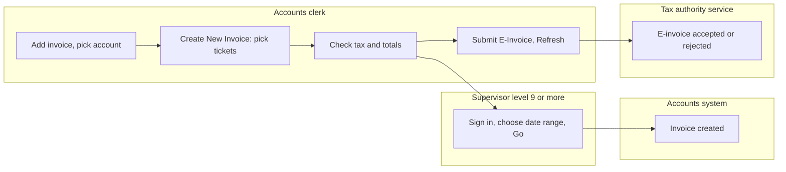
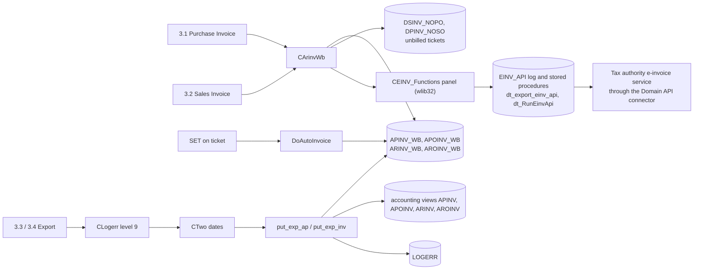
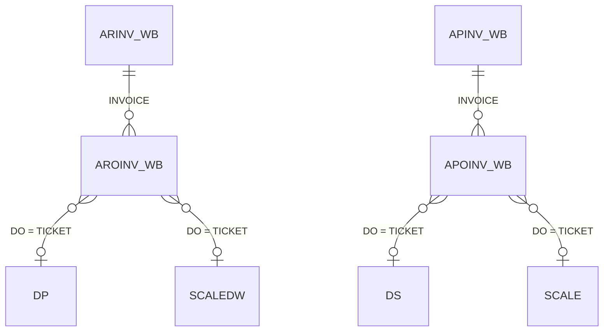
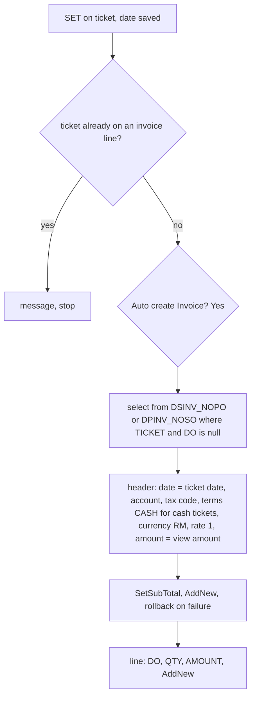
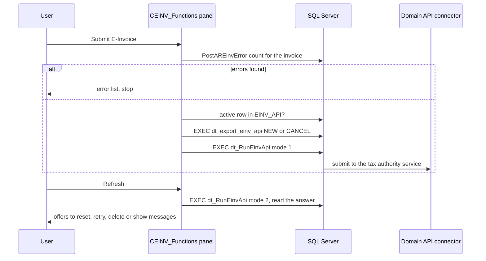
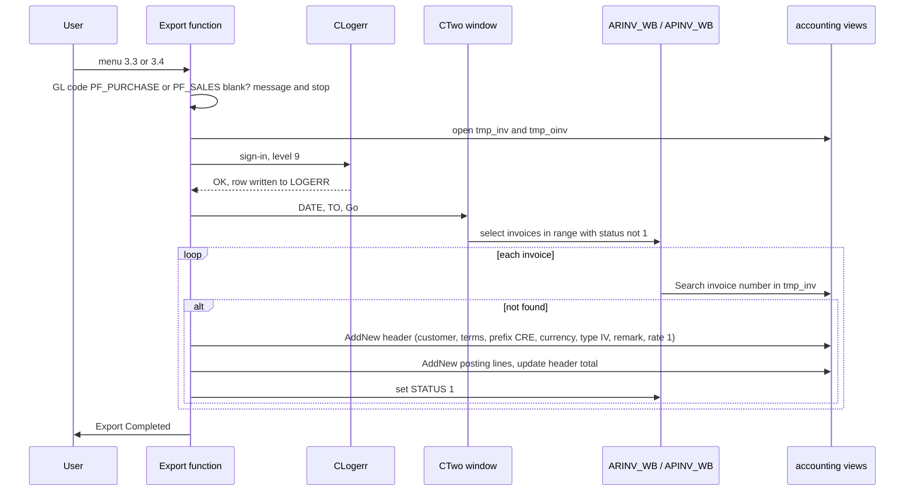
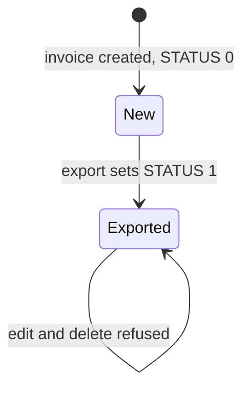

# Invoice and Export (menu 3) - Module reference

> Part of the TradeWin module reference. Index and shared sections: [README](README.md).
> Menu items covered: 3.1 Purchase Invoice, 3.2 Sales Invoice, 3.3 Export Purchase Invoice, 3.4 Export Sales Invoice, and the **e-invoice panel** that sits on the two invoice screens (this program is the "E-Invoice enhancement" version, program title `VER 2.00`). This app has **no cashier module** (no End Day Closing, payout or float, which Seng Hiap Metal has as 4.4); the file name `invoice-cashier.md` is kept so the family of references lines up file by file.
> Last verified against commit `2f77122`. Translation status: English only (no zh-CN copy yet).

## Contents

- [Part 1 - Business view](#part-1---business-view)
  - [1.1 In plain words](#11-in-plain-words)
  - [1.2 Who uses what](#12-who-uses-what)
  - [1.3 A day in the life](#13-a-day-in-the-life)
  - [1.4 Worked example](#14-worked-example)
  - [1.5 Screen tour](#15-screen-tour)
  - [1.6 Where does this number come from?](#16-where-does-this-number-come-from)
  - [1.7 Status meanings](#17-status-meanings)
  - [1.8 What happens if...](#18-what-happens-if)
  - [1.9 Messages you may see](#19-messages-you-may-see)
  - [1.10 Do and don't](#110-do-and-dont)
  - [1.11 Before you start](#111-before-you-start)
  - [1.12 Glossary](#112-glossary)
  - [1.13 Ask the AI](#113-ask-the-ai)
- [Part 2 - Technical view](#part-2---technical-view)
  - [2.1 Overview](#21-overview)
  - [2.2 Architecture and dependencies](#22-architecture-and-dependencies)
  - [2.3 Master data catalogue](#23-master-data-catalogue)
  - [2.4 Sub-table hierarchy](#24-sub-table-hierarchy)
  - [2.5 Modules and process flows](#25-modules-and-process-flows)
  - [2.6 End-to-end flows](#26-end-to-end-flows)
  - [2.7 Report catalogue](#27-report-catalogue)
  - [2.8 Integrations](#28-integrations)
  - [2.9 Configuration](#29-configuration)
  - [2.10 Maintenance](#210-maintenance)

---

# Part 1 - Business view

## 1.1 In plain words

- An **invoice** bills finished tickets. A **purchase invoice** (3.1) is what we owe a supplier for goods we bought; a **sales invoice** (3.2) is what a customer owes us for goods we sold. One invoice can carry many tickets; one ticket can be on only one invoice.
- Invoices are made in two ways: the accounts clerk opens an invoice and presses **Create New Invoice** to pick unbilled tickets, or a user presses **SET** on a ticket (see [Tickets](tickets.md) and [Scale weighing](scale-weighing.md)), which creates a one-ticket invoice automatically.
- Tax is worked out from the tax code of the customer or supplier.
- Each invoice line carries a **classification code** (the tax authority's category of the goods); new lines get the code `022` by default.
- Each invoice screen has an **E-invoice panel**: **Submit E-Invoice** sends the invoice to the tax authority's e-invoice service through the program's connector, **Refresh** reads the answer, **QRCODE** shows the validation code and **View Msg** shows the messages. See the screen tour for what each button does.
- **Export** (3.3 and 3.4) sends the invoices of a date range to the accounts system, one export for purchase invoices and one for sales invoices. A user of level 9 or more must sign in to confirm.
- If tickets are not billed, nothing is paid or collected; if invoices are not submitted as e-invoices they are not reported to the tax authority; if invoices are not exported the accounts system is incomplete.

## 1.2 Who uses what

| Department | Menu item | Main tasks |
|---|---|---|
| Accounts / Finance | 3.1 Purchase Invoice, 3.2 Sales Invoice | Create invoices from tickets, check tax, correct headers, submit the e-invoice and read the answer |
| Accounts (level 99) | Unlock Period button | Re-open invoices of a period |
| Accounts supervisor (level 9 or more) | 3.3, 3.4 Export | Confirm and run the export to the accounts system |
| IT / Admin | 6.5 E-Invoice Profile, 4.2.1 account e-invoice data | Keep the company's e-invoice identity and each customer's TIN data (see [Other, Stock](other-stock-export.md), [Control tables](control-tables.md)) |
| Management | [Reports](reports.md) | Invoice listings and unbilled-ticket reports |

**Start here - Accounts**
- Daily or weekly: 3.1 for suppliers and 3.2 for customers: add an invoice, pick the account, Create New Invoice, pick tickets, check the totals, press Submit E-Invoice.
- Weekly: press Refresh on submitted invoices to see whether they were accepted.
- Month-end: run the unbilled-ticket reports first, then 3.3 and 3.4 for the month.

## 1.3 A day in the life

**Billing a supplier.** The clerk opens 3.1, adds a new invoice, types the date and picks the supplier. The program fills the currency (`RM`), the rate (1) and the tax code of the supplier. The clerk presses **Create New Invoice**. A list shows the supplier's tickets up to the invoice date that are not on any invoice. The clerk picks one; it becomes a line with the ticket number, quantity, amount and the classification code `022`. The list opens again for the next ticket; Cancel ends it. The sub-total, tax and net total update after every line.

**Billing a cash customer.** For the closing (cash) account set in the Company Profile the list shows all cash tickets of any customer up to the date.

**Sending the e-invoice.** On a saved invoice the clerk presses **Submit E-Invoice**. If the checks find a problem a list of errors opens. Otherwise the program asks for confirmation, sends the request and waits. Later the clerk presses **Refresh** to read the answer; **QRCODE** shows the validation code for printing or showing to the customer.

**Month-end export.** A supervisor opens 3.3, signs in with a user ID and password of level 9 or more, types the date range and presses Go. Every purchase invoice in the range that is not exported yet is created in the accounts system; the program says "Export Completed". Then 3.4 for sales.

**A mistake after export.** An exported invoice is locked ("already post to ACC"). Accounts must correct it in the accounts system. A submitted e-invoice is corrected by cancelling it (Submit E-Invoice offers to cancel) and submitting again.

Swimlane:



*Caption: the clerk builds the invoice from tickets and submits the e-invoice; a supervisor signs in and exports; the accounts system and the tax authority service each receive their copy.*

## 1.4 Worked example

All values are made up. Continues the scale ticket of [Scale weighing](scale-weighing.md#14-worked-example) (total 7,215.25, quantity 4,635 kg). Supplier `S0001` has the tax code `TX8` at 8 percent, tax not included.

| Step | Screen | What the user does | What the program does | Status after |
|---|---|---|---|---|
| 1 | 3.1 Purchase Invoice | Add, date 2026-10-31, supplier `S0001` | Currency `RM`, rate 1, status `0`; tax code `TX8` and tax % 8 filled from the supplier | New invoice |
| 2 | Same | Create New Invoice, picks the scale ticket | Adds a line: ticket, quantity 4,635 kg, amount 7,215.25, classification code `022` | One line |
| 3 | Same | - | Sub Total 7,215.25; tax = 7,215.25 x 8 / 100 = 577.22; Net Total = 7,215.25 + 577.22 = 7,792.47 | Saved |
| 4 | Same, E-invoice panel | Presses Submit E-Invoice, answers Yes | Runs the checks, sends the request, shows "Done!"; the status text changes from `NEW` to the connector's remark | E-invoice submitted |
| 5 | 3.3 Export Purchase Invoice | Signs in (level 9 or more), date 2026-10-01 to 2026-10-31, Go | Creates the invoice in the accounts system with one posting line of 7,215.25 to the purchase account; sets the invoice status to `1`; message "Export Completed" | Exported |
| 6 | 3.1 | Tries to edit the invoice | "This invoice already post to ACC" and "Modification Not Allow" | Locked |

Note: the exported amount is the sum of the line amounts, **without tax** (see 1.6).

## 1.5 Screen tour

### 3.1 Purchase Invoice and 3.2 Sales Invoice

**Purpose:** the invoice header, its ticket lines and the tax totals.

| Field label | Meaning | Required? | Where the value comes from |
|---|---|---|---|
| Invoice No | Invoice number | Yes (key) | Automatic running number |
| Date of Invoice | Invoice date; users below level 9 cannot change it | Yes | Typed |
| Supplier / Customer | Account | Yes | Picked; fills the tax code and tax % |
| Terms | Credit terms text | No | Typed (`CASH` is filled by the automatic invoice for cash tickets) |
| Supplier Inv. No (purchase) / Your Ref. (sales) | The other party's reference | No | Typed |
| Our Ref. | Our reference | No | Typed |
| Remarks | Free text | No | Typed |
| Date of Payment | Payment date | No | Typed |
| Status | `0` new, `1` exported; users below level 9 cannot change it | - | Automatic |
| Currency, Rate | Currency and rate | - | `RM` and 1 by default |
| PO (sales form only) | Order reference | No | Typed |
| Sub Total | Sum of the line amounts | - | Calculated |
| Tax % | Rate of the tax code | - | From the tax code |
| GST Amt. | Tax amount; users below level 9 cannot change it | - | Calculated |
| Net Total | Sub total plus tax | - | Calculated |
| Total Qty, Sub Total (bottom) | Totals of the line grid | - | Calculated |
| Rounding Adj, Final Amount (purchase form only) | Shown on the form, but the program does not calculate them: do not rely on them | - | - |
| Transaction Type | Invoice type for the e-invoice (the form shows the box; the program has a routine that would set `IV` or `S` for self-billed accounts but nothing calls it, so it stays blank unless typed) | - | Typed |
| E-invoice status (panel) | Latest remark of the e-invoice connector for this invoice, `NEW` if it was never submitted | - | Read from the e-invoice log table when the invoice is shown |

The Tax Code and the "GST Inclusive" tick exist in the table but are not visible on the form.

**Line grid:** No, Ticket No, Date, Vehicle No, D/O No, Qty(Kg), Amount, Classification Code (the date, lorry and D/O number come from the ticket; the classification code starts as `022` on every new line). Double-click a line to open it: Ticket No, Quantity, Amount, Classification.

**Buttons:** **Create New Invoice** (pick unbilled tickets), **Unlock Period** (level 99; asks a date range and re-opens the invoices of that period for editing), Print, and the standard record buttons.

**E-invoice panel** (top right of both screens; it works on the invoice shown, so save it first):
- **Submit E-Invoice:** first runs the database checks for the invoice; if any error is found it says "E-invoice error, please check error message !" and opens the list of errors. If the invoice was never submitted it asks to submit a NEW e-invoice; if one is already active it asks to CANCEL it. Either answer Yes sends the request and the program waits (up to 1 to 2 minutes) before showing "Done!".
- **Refresh:** reads the answer of the e-invoice service. When the answer is not final or invalid it offers to reset the submission data (invalid ones only), to try again without changing data, or to delete the submission data; then it offers to show the API message.
- **QRCODE:** starts the external QR viewer for the invoice's validation link, if the QR helper program is installed next to the exe.
- **View Msg:** shows the API message and the document message of the invoice.
- An **Email** button exists on the panel but is switched off in this program.

### 3.3 Export Purchase Invoice and 3.4 Export Sales Invoice

1. A sign-in window asks for user ID, password and shows the purpose ("CONFIRM EXPORT INVOICE TO AP" or "TO AR"); the user must be level 9 or more. The attempt is logged.
2. A window asks **DATE** and **TO** (and a PAGE box that is not used) with a warning "ALL DATA TRANSACTIONS WILL TRANSFER TO ACCOUNT SYSTEM" and the advice "PLEASE BACKUP DATA BEFORE RUN THIS PROCESS."
3. Go runs the export.

## 1.6 Where does this number come from?

- **Line amount and quantity** are copied from the ticket when the line is added (the ticket's amount at that moment).
- **Sub Total** = sum of the line amounts. Example 7,215.25.
- **Tax %** = the percent of the account's tax code, **0 for invoices dated before the tax start date** set in the Company Profile.
- **GST Amt.** = Sub Total x Tax % / 100 (if the tax is included: Sub Total x % / (100 + %)). Example 7,215.25 x 8 / 100 = **577.22**.
- **Net Total** = Sub Total + GST Amt. (the tax is not added again when it is included). Example **7,792.47**. No rounding is applied on the invoice.
- **Tax code of the invoice**: from 1 September 2018 the account's own tax code; before that date `NR` for purchases and `SR` for sales.
- **Exported amount** = sum of the line amounts, tax excluded. Sales invoices are exported with one posting line per product general-ledger code (from the product master), purchase invoices with one line per ticket.

## 1.7 Status meanings

| Document | Status | Meaning | Who or what changes it | What can still be edited |
|---|---|---|---|---|
| Invoice | `0` | New, not exported | Creating the invoice | All fields allowed for the user's level |
| Invoice | `1` | Exported to the accounts system | The export | Locked: "already post to ACC"; deletion refused |
| Invoice period | Unlocked | The record-lock flag cleared for a date range | Unlock Period (level 99) | Invoices of the period can be edited again |

## 1.8 What happens if...

| Situation | What to do | Call IT when |
|---|---|---|
| A ticket is missing from the pick list | It is already on an invoice, its date is after the invoice date, or it belongs to another account; check with the unbilled-ticket report | The ticket is neither billed nor listed |
| The ticket on the pick list is wrong | Tickets cannot be cancelled in this program; correct or delete the ticket first, then reopen the pick list | - |
| Submit E-Invoice shows a list of errors | Fix the data named in the list (TIN, address, classification, phone and so on), save, submit again | The list does not make sense |
| The e-invoice stays without an answer | Press Refresh later; follow the offers in the Refresh dialogs | The status text never changes |
| A submitted e-invoice must be corrected | Press Submit E-Invoice again and answer Yes to CANCEL, fix the data, then submit a NEW one | The cancel fails |
| Wrong amount on a line | The amount is the ticket's: correct the ticket (not allowed once it is on an invoice) or remove the line and add it again | - |
| Export run twice | The second run skips invoices that already exist in the accounts system | Totals look doubled |
| Export says the GL code is not set | The accounting profile has no sales or purchase posting account | Always |
| Export fails for an invoice | "Invoice : <no> export to ACC fail. Please re-do" appears and the invoice stays with status 0 | The message repeats |
| Tax differs from what the accounts system shows | Only line amounts are exported, not tax | - |
| A user below level 9 tries to export | "not authorised" at the sign-in | - |

## 1.9 Messages you may see

| Message | What it means | What to do |
|---|---|---|
| `This invoice already post to ACC` + `Modification Not Allow` | The invoice is in the accounts system | Correct it there |
| `Error Message` + `Cannot delete Invoice No: <no>` + `because this invoice already Post to ACC.` | Delete refused | - |
| `Ticket No : <no> already existed in Invoice : <inv>.` + `Please rectify` | The ticket is already billed (after SET) | - |
| `Auto create Invoice?` | After SET on a scale ticket | Yes creates the invoice |
| `SALES GLCODE NOT SET.PLEASE CHECK ACC PROFILE` / `PURCHASE GLCODE NOT SET.PLEASE CHECK ACC PROFILE` | Posting account missing | IT sets it in the accounting profile |
| `User ID not found` / `Password incorrect` / `not authorised` | Sign-in refused | Use a level 9 user |
| `No Record Found` | Purchase export found no invoice in the range | Check the dates |
| `Invoice :<no> export to ACC fail. Please re-do` | The accounts system refused the invoice | Re-run |
| `Export Completed` | Export finished | - |
| `E-invoice error, please check error message !` | The pre-check found errors | Read the list that opens |
| `You woule like to submit this NEW E-Invoice? Please be patience submit may take 1 to 2 mins!` | Confirm submit (spelling as shown) | Yes and wait |
| `You woule like to CANCEL this E-Invoice? Please be patience submit may take 1 to 2 mins!` | Confirm cancel | Yes only if intended |
| `Done!` | The request was sent | Press Refresh later |
| `Do you want to reset data for submission! *Only Invalid Status*` | Refresh found an invalid answer | Yes clears it and prepares a new submission |
| `You would like to try to submit this E-Invoice without data changed? Please be patience submit may take 1 to 2 mins!` | Retry without changes | Yes retries |
| `Do you want to delete submission data of this invoice in Domain API?` / `Deleted!` | Remove the pending submission | Yes only if you will start again |
| `Do you want to view this invoice API Message?` | Show the connector messages | Yes to read them |

## 1.10 Do and don't

- Do run the unbilled-ticket reports before month-end.
- Do export a whole month once the invoices are final.
- Don't export before checking the totals: the invoice is locked afterwards.
- Don't submit an e-invoice before the TIN, address and classification of the customer are filled in (see [Control tables](control-tables.md)).
- Don't press Submit E-Invoice twice while the first request is still running.
- Don't rely on the export to carry the tax amount: it does not.

## 1.11 Before you start

- Tickets exist and are saved; suppliers and customers exist with a tax code.
- The tax codes (menu 4.2.4) exist, with their percent.
- For export: the accounting profile has the sales and purchase posting accounts, the accounts database is reachable, and a user of level 9 or more is present.

## 1.12 Glossary

| Term | English | Malay | Chinese |
|---|---|---|---|
| Purchase invoice | Bill from a supplier | Invois belian | 采购发票 |
| Sales invoice | Bill to a customer | Invois jualan | 销售发票 |
| Unbilled ticket | Ticket not on any invoice | Tiket belum bil | 未开发票磅单 |
| Tax code | Rate code | Kod cukai | 税码 |
| Net total | Sub total plus tax | Jumlah bersih | 净总额 |
| Export | Send to the accounts system | Eksport | 导出 |
| Unlock period | Re-open invoices of a date range | Buka kunci tempoh | 解锁期间 |
| Posting account (GL code) | Account the amount is posted to | Akaun lejar | 总账代码 |

## 1.13 Ask the AI

1. How do I make a purchase invoice from tickets?
2. Why is a ticket missing from the Create New Invoice list?
3. How is the tax on an invoice worked out?
4. How do I submit an e-invoice and check that it was accepted?
5. The e-invoice says there are errors. What do I do?
6. How do I export the month's invoices to the accounts system?
7. Who can run the export?
8. Why can I not edit an invoice?
9. What does Unlock Period do and who can use it?
10. What is the classification code on an invoice line?

---

# Part 2 - Technical view

## 2.1 Overview

- Application: TradeWin Metals weighbridge (VC6/MFC on wlib32, `menu.dsp`, `menu.exe`). See [README](README.md).
- This module: the invoice screen `CArinvWb` (ARINV_WB.CPP, base `CParent`) used for both purchase and sales, `CARINV_UNLOCK` (ARINV_UNLOCK.cpp), the automatic invoice (AutoInvoice.cpp), the tax helpers (TAXCODE.CPP) and the two export routines (Exp_inv.cpp, Exp_ap.cpp) with the criteria window `CTwo` (Two.cpp, base `CTio`) and the sign-in window `CLogerr` (Logerr.cpp).
- E-invoice: the "E-Invoice enhancement" commit adds, in this repo, the embedded panel (`CArinvWb::OnCreate_Einv_UI`), the Classification column and `SetTransactionType`; the panel class `CEINV_Functions` itself, the account data window `CEinv` and the company profile screen `CCmprofile` are in the shared wlib32 library (headers `EINV_Functions.h`, `EINV.H`, `Cmprofile.h`, resources `einv.rc` included by `RES/MENU.RC2`), not in this repo.
- Not in this app: `CClosing`, payout and float; none of these files exist.

## 2.2 Architecture and dependencies



*Caption: invoices live in the weighbridge tables; the e-invoice panel writes to SQL Server procedures that talk to the tax authority service; the export copies the invoices into the accounting database through views.*

- Libraries: wlib32 (`CParent`, `CTio`, `MGRID`, ticket numbering, `CEINV_Functions`), MSFlexGrid.
- Database: SQL Server; no schema repo for TradeWin (types below come from `SQL_LekokPaper`, a sister app, and are unverified for TradeWin). **Accounting database:** the accounting objects (`ARINV`, `AROINV`, `APINV`, `APOINV`, `DEBTOR`, `PROFILE` ...) are views or tables whose real definitions are not in this repo; `PROVIDER.SYS` has a second connection line for a catalog `tradewin2`. `CREDITOR`, `SUPPLIER` and `ACCODE` are opened as separate objects (MENU.CPP:551-553).
- **E-invoice database objects** (names used by the shared panel; none of them is in a TradeWin script, so their existence and definitions are unverified): table `EINV_API` (one row per submission: `REFNO`, `DOMAIN_REMARK`, `API_FLAG`, `DOCUMENT_FLAG`, `CANCEL_USER`, `REJECT_USER`, `IRB_URL`, `MSG`, `DOCUMENT_MSG`, ...), function `dbo.PostAREinvError(@refno, @accode, @sub_accode)` that returns the error list, procedures `dbo.dt_export_einv_api(@refno, @table, @type, @user)` (type `NEW` or `CANCEL`) and `dbo.dt_RunEinvApi(@refno, @mode)` (mode 1 send, mode 2 read the answer). As a hint, the sister schema `SQL_SengHiap_Paper` has scripts with these names (its function checks, among others: already submitted, older than 60 days, future date, missing classification, missing SST number, missing TIN, address, phone and account number of seller or buyer).
- The panel reads the invoice header columns named `DEBTOR` and `SUB_ACCODE` by name; the TradeWin enum `arinv_wb` (MENU.H:333) does not list them, so they must exist in the live `ARINV_WB` and `APINV_WB` tables (unverified); if a column is missing the lookup returns field 0 and the checks run with blank values.

## 2.3 Master data catalogue

### TAXCODE and TAX_GRP (menu 4.2.4), CLASSIFICATION and the Malaysian address tables

Documented in [Control tables](control-tables.md#23-master-data-catalogue). Used here by `FindPercen` (percent = field 3 of `TAXCODE`).

The e-invoice enhancement also opens four lookup tables at start: `malaysia_state`, `malaysia_city`, `postcode` and `classification` (MENU.CPP:430-433, as `ado` objects with no init function). Their maintenance screens (`IDD_EINV_CLASSIFICATION`, `IDD_EINV_MALAYSIA_STATE`, `IDD_EINV_MALAYSIA_CITY`, `IDD_EINV_POSTCODE`, `IDD_EINV_COUNTRY`) are in the shared library resource but **no menu item opens them in this program**. Columns are unverified (the code uses `POSTCODE`, `MALAYSIA_STATE`, `CITY_NAME` of `postcode`, SPITEM.CPP:138-140). The invoice line column `CLASSIFICATION` holds a code from `classification`.

### PROFILE (accounting profile, view)

`profile` is opened with `ado(&profile,"profile")` (MENU.CPP:388); Debug builds use dialog `IDD_ACCPF`, Release `IDD_PROFILE2` (MENU.CPP:389-393); no menu item edits it. This repo reads: `PF_SALES` and `PF_PURCHASE` (export), `PF_PC` (dormant auto payment), `PF_CURRENCY`, `PF_ADD1..3` (MENU.CPP:396-398), `PF_MINIMUM` (MENU.CPP:395) and `PF_TAX` (MAIN.CPP:182). Its column list belongs to the accounting database and is not in this repo; the enum `profile` (MENU.H:654) may drift from it as it does in the sister app (unverified).

## 2.4 Sub-table hierarchy

```text
ARINV_WB  (sales invoice header, key INVOICE)
  - AROINV_WB   link: AROINV_WB.INVOICE = ARINV_WB.INVOICE   (key PKKEY identity; DO unique)
    Nested sub-tables: none
APINV_WB  (purchase invoice header, key INVOICE)
  - APOINV_WB   link: APOINV_WB.INVOICE = APINV_WB.INVOICE   (key PKKEY identity; DO unique)
    Nested sub-tables: none
```



*Caption: each invoice has ticket lines; the `DO` column holds the ticket number and is unique per table, so a ticket can be billed once.*

- Objects: `arinv_wb(IDD_ARINV_WB,4)`, `aroinv_wb(IDD_AROINV_WB)`, `apinv_wb(IDD_ARINV_WB,4)`, `apoinv_wb(IDD_APOINV_WB)` (MENU.CPP:51-52); opened `tado(...)` with `init_arinv_wb`, `init_aroinv_wb` (MENU.CPP:487-490). Dialogs: the sales header uses `IDD_ARINV_WB`, the purchase header `IDD_APINV_WB` (ARINV_WB.CPP:311, 326); lines `IDD_AROINV_WB`, `IDD_APOINV_WB`.
- Link key: the first field of the line (`INVOICE`) equals the header; the screen refreshes the grid from the line table by that key (`ReFreshSubFile`, ARINV_WB.CPP:103).
- Line number: `sub->Find_SequenceNo()` (ARINV_WB.CPP:360; AutoInvoice.cpp:73). Lines are added by `sub->AddNew()` (ARINV_WB.CPP:375; AutoInvoice.cpp:79), immediately and independently of the header save.

### ARINV_WB and APINV_WB (headers)

Types from `SQL_LekokPaper` scripts `ARINV_WB.sql`, `APINV_WB.sql` (sister app, same layout; unverified for TradeWin, which has more columns, see below); enum `arinv_wb` (MENU.H:333).

| # | field (enum) | SQL column | data type | null | key | meaning |
|---|---|---|---|---|---|---|
| 1 | `IVWB_INVOICE` | `INVOICE` | nvarchar(10) | no | PK | invoice number |
| 2 | `IVWB_DATE` | `DATE` | smalldatetime | no |  | invoice date |
| 3 | `IVWB_ACCODE` | `ACCODE` | nvarchar(10) | no |  | customer / supplier |
| 4 | `IVWB_TERMS` | `TERMS` | nvarchar(50) | yes |  | terms |
| 5 | `IVWB_YOUR_REP` | `YOUR_REF` | nvarchar(50) | yes |  | the other party's reference |
| 6 | `IVWB_OUR_REF` | `OUR_REF` | nvarchar(50) | yes |  | our reference |
| 7 | `IVWB_REMARKS` | `REMARKS` | nvarchar(50) | yes |  | remarks |
| 8 | `IVWB_PAYDATE` | `PAYDATE` | smalldatetime | yes |  | payment date |
| 9 | `IVWB_STATUS` | `STATUS` | nvarchar(1) | yes |  | `0` new, `1` exported |
| 10 | `IVWB_CURRENCY` | `CURRENCY` | nvarchar(3) | yes |  | currency |
| 11 | `IVWB_RATE` | `RATE` | decimal(18) | yes |  | rate (default 1) |
| 12 | `IVWB_UPLOAD_ONHOLD` | `UPLOAD_ONHOLD` | bit | yes |  | hidden on the form |
| 13 | `IVWB_AMOUNT` | `AMOUNT` | numeric(13,2) | yes |  | sum of the line amounts |
| 14 | `IVWB_TAXCODE` | `TAXCODE` | nvarchar(10) | yes |  | tax code (not on the form) |
| 15 | `IVWB_INCLUDE` | `INCLUDED` | bit | yes |  | tax included (hidden) |
| 16 | `IVWB_PERCEN` | `PERCEN` | decimal(5,2) | yes |  | tax percent |
| 17 | `IVWB_TAXAMT` | `TAXAMT` | decimal(9,2) | yes |  | tax amount |
| 18 | `IVWB_SUBTOTAL` | `SUBTOTAL` | decimal(13,2) | yes |  | amount plus tax |
| 19 | `IVWB_PO` (enum only) | `REC_STATUS` | char(1) | yes |  | in the script, position 19 is the lock flag; the enum calls it `IVWB_PO` and the sales form shows a "PO" box on it (2.10, finding 5) |
| 20 to 24 | | `NEWUSER`, `NEWTIME`, `MODIFYUSER`, `MODIFYTIME`, `Print Counter` | char(5), smalldatetime, char(5), smalldatetime, int | yes |  | audit (sister script; the TradeWin dialog binds a "Transaction Type" box to field 20 and the e-invoice panel reads columns `DEBTOR`, `SUB_ACCODE` and `TT` by name, so the live column order differs from the sister script: unverified) |

### AROINV_WB and APOINV_WB (lines)

Types from `SQL_LekokPaper` scripts `AROINV_WB.sql`, `APOINV_WB.sql` (sister app); enum `aroinv_wb` (MENU.H:336).

| # | field (enum) | SQL column | data type | null | key | meaning |
|---|---|---|---|---|---|---|
| 1 | `VIWB_INVOICE` | `INVOICE` | nvarchar(10) | no | FK to the header (sales) | link key |
| 2 | `VIWB_SQNO` | `SQNO` | float(53) | yes |  | line number |
| 3 | `VIWB_DO` | `DO` | nvarchar(10) | no | unique | ticket number |
| 4 | `VIWB_QTY` | `QTY` | float(53) | yes |  | quantity from the ticket |
| 5 | `VIWB_AMOUNT` | `AMOUNT` | decimal(18,2) | yes |  | amount from the ticket |
| 6 | `VIWB_SCALE` | `SCALE` | nvarchar(10) | yes |  | scale ticket (unused: the code that filled it is commented out, ARINV_WB.CPP:365-374) |
| 7 | `VIWB_SCALE_AMT` | `SCALE_AMT` | decimal(18,2) | yes |  | scale amount (unused) |
| 8 | | `CLASSIFICATION` | type: unverified | yes |  | e-invoice classification code of the line. The enum has no name for it; the code finds it with `GetDbFieldNo`, and the line dialog binds its "Classification" box to field 8 (`IDC_EDIT8` in `IDD_AROINV_WB` and `IDD_APOINV_WB`), so in the live table it sits at position 8. It is set to `022` by `OnCreateNewInvoice` and `DoAutoInvoice` and shown in the grid (ARINV_WB.CPP:170, 364; AutoInvoice.cpp:77) |
| 9 | | `PKKEY` | int | no | PK identity | row key (position 9 in the live table if the framework rule that `PKKEY` is last holds; the sister script has it at 8) |

- Cardinality 1..n. Nested sub-tables: none. `FK_AROINV_ARINV` exists on the sales side only; `IX_AROINV_WB` and `IX_APOINV_WB` make `DO` unique.

### Views that feed the pick list

- `DSINV_NOPO` (purchase) and `DPINV_NOSO` (sales) are the pick-list sources: the code reads them with `select * from [DSINV_NOPO]` (ARINV_WB.CPP:338-346, AutoInvoice.cpp:35-38) and takes the ticket number from field 1, the quantity from field 4 and the amount from field 5, filtering on `[accode]`, `[date]`, `[ptype]` and `[DO] IS NULL` (so `DO IS NULL` means unbilled). `ALL_DS` and `ALL_DP` are the ticket look-ups used by the grid (`tado(&allTicket,"all_ds"/"all_dp")`, ARINV_WB.CPP:308, 323).
- **Their definitions are not in this repo.** The sister app's scripts build them from `RECEIVE`/`RDATA`, `SCALE`/`SCALESUB` and so on (`DS_ALLINVPT`, `DP_ALLINVPT`), tables that TradeWin does not have, so the live TradeWin views must differ: which of `DS`, `DP`, `RT`, `SCALE` and `SCALEDW` they cover, and whether they hide cancelled or already-billed rows, is unverified. Public-weighing tickets are not billable (the code has no path for them).

## 2.5 Modules and process flows

### Menu items and entry points

| Menu item | Node | Handler | Opens |
|---|---|---|---|
| 3.1 Purchase Invoice | 31 | `PurchaseInvoiceWb()` (MAIN.CPP:250-252; ARINV_WB.CPP:321-334) | `CArinvWb` on `apinv_wb`, `Purchase_Flag = TRUE` |
| 3.2 Sales Invoice | 32 | `SalesInvoiceWb()` (MAIN.CPP:253-255; ARINV_WB.CPP:306-319) | `CArinvWb` on `arinv_wb`, `Purchase_Flag = FALSE` |
| 3.3 Export Purchase Invoice | 33 | `ExportPurchaseInvoiceTransactions()` (MAIN.CPP:256-258; Exp_ap.cpp:210) | `CLogerr`, then `CTwo` |
| 3.4 Export Sales Invoice | 34 | `ExportInvoiceTransactions()` (MAIN.CPP:259-261; Exp_inv.cpp:248) | same |

### Flow: invoice screen

1. `start_arinv_wb` (ARINV_WB.CPP:207-214): `FldDefault(2)`, `STATUS = "0"`, `CURRENCY = "RM"`.
2. `tell_arinv_wb` (ARINV_WB.CPP:225-267): status and tax amount are skipped for users below level 9; picking the account (`IVWB_ACCODE`, after a change) looks up `accode` and calls `FindTaxCode(df, Purchase_Flag)`; changing the tax code calls `FindPercen` and `SetSubTotal`; a blank tax amount does the same; every call ends with `SetSubTotal`. `arinv_wb_initial` (ARINV_WB.CPP:216-223) makes the date read-only below level 9.
3. `FindTaxCode` (TAXCODE.CPP:53-70): invoice date before `txtSST_StartDate` (`20180901`, set in MENU.CPP:382): purchase = the account's tax code, `NR` when blank; sales = `SR`; from that date the account's tax code (field `ACCODE_TAXCODE`, see 2.10 finding 3). Then `FindPercen` (37-51): percent = `taxcode` field 3, forced to 0 when the invoice date is before `STKPF.GST_DATE`.
4. `SetSubTotal` (TAXCODE.CPP:16-35): tax = amount x % / 100, or amount x % / (100 + %) when included; `SUBTOTAL` = amount + tax unless included.
5. `CArinvWb::ShowInformation` (ARINV_WB.CPP:97-119): refreshes the lines and writes `SELECT SUM(AMOUNT) FROM <lines> WHERE INVOICE = ...` into the header `AMOUNT`.
6. **Create New Invoice** (`OnCreateNewInvoice`, ARINV_WB.CPP:336-403): `SELECT * FROM [DSINV_NOPO]` (purchase) or `[DPINV_NOSO]` (sales) with `[accode] = <invoice account>`, `[date] <= <invoice date>` and `[DO] IS NULL`; for the account equal to `STKPF.ACCODE` the account filter is replaced by `([ptype]='01' OR [ptype]='CASH')`. Loop: `viewidx(&invwb)` lets the user pick a row; `SaveMainInformation()` saves the header; a line is added with `DO` = ticket (field 1), `QTY` = field 4, `AMOUNT` = field 5; then totals are refreshed and `SetSubTotal` runs; the loop ends when the pick list is cancelled.
7. Double-click a line: `OnDblClickMsflexgrid` then `SetSubTotal` (ARINV_WB.CPP:419-425).
8. **Locks:** `IsCannotEdit` (ARINV_WB.CPP:66-95): if the invoice number exists in the accounting view `arinv` (sales) or `apinv` (purchase) the screen shows `This invoice already post to ACC` and refuses edits. `delete_arinv_wb` (ARINV_WB.CPP:269-290) refuses to delete such an invoice.
9. **Unlock Period** (`SetAttribute` shows the button only in edit mode for level 99 or more, ARINV_WB.CPP:173-187; `OnUnlock` ARINV_WB.CPP:405-411; `CARINV_UNLOCK::OnOK`, ARINV_UNLOCK.cpp:49-67): `UPDATE APINV_WB / ARINV_WB SET [rec_status] = 0 WHERE [date] >= .. AND [date] <= ..`, then closes the invoice screen.

### Flow: automatic invoice (`DoAutoInvoice`, AutoInvoice.cpp:10-101)



*Caption: the automatic invoice is a one-ticket invoice built from the same views as the pick list.*

- The invoice number comes from `FindAddInfoTicketNo(invmain)` (AutoInvoice.cpp:50). A failed `AddNew` rolls the transaction back (`cnn->RollbackTrans()`, AutoInvoice.cpp:65-70, 80-85). The routine also sets the global `paymentAmt` used only by the dormant auto-payment code.
- `DoInvoiceExportAndPayment` (AutoInvoice.cpp:160-248) and `OnDoAutoPayment` (AutoInvoice.cpp:103-156) are dormant: their only call is commented out (DS.CPP:235).

### Flow: e-invoice panel (`CEINV_Functions`, shared wlib32 class)



*Caption: the panel only calls SQL Server procedures; the procedures and the connector do the work.*

- The panel is created inside the invoice dialog by `CArinvWb::OnCreate_Einv_UI` (ARINV_WB.CPP:30-43), which places the dialog `IDD_EINV_FUNCTIONS` in the box `IDC_EINV_FUNCTIONS` (dialog resources `IDD_ARINV_WB` and `IDD_APINV_WB`), hands it `df` (the invoice header) and `sub` (the lines), and is called from `OnInitDialog` before the base class (ARINV_WB.CPP:45-50); `CArinvWb::ShowInformation` forwards to the panel (ARINV_WB.CPP:97-101), which writes the status text from `SELECT TOP 1 ISNULL(DOMAIN_REMARK,'NEW') FROM EINV_API WHERE REFNO = <invoice> ORDER BY PKKEY DESC` and refreshes the lines. The panel object is allocated with `new` and the repo has no matching `delete` (see 2.10, finding 13).
- **Submit E-Invoice:** nothing happens for a blank or `NEW` invoice number. It counts the rows of `dbo.PostAREinvError(<invoice>, <DEBTOR column>, <SUB_ACCODE column>)`; more than 0 shows `E-invoice error, please check error message !` and a browse list. Otherwise, if `EINV_API` already has an active row for the invoice (no cancel user, no reject user) it asks to CANCEL and runs `dt_export_einv_api ... 'CANCEL'`; else it asks to submit a NEW one and runs `... 'NEW'`; then `dt_RunEinvApi <invoice>,'1'`, one second pause, refresh, `Done!`.
- **Refresh:** `dt_RunEinvApi <invoice>,'2'`; it counts rows that are not final; invalid-only rows (API accepted the call but the document was refused) offer a reset (delete and re-create the submission); it then offers to retry without data change (clears `API_DATE` and runs mode 1) or to delete the submission rows; finally mode 2 again and an offer to view the message list.
- **QRCODE:** builds a command line from `SELECT TOP 1 IRB_URL FROM EINV_API WHERE REFNO = ...` and starts `QRCODE\QR.exe` next to the exe when that file exists. **Email** would build a PDF (`arinv_e3.rpt`) and start `EMAIL\DomainMail.exe`, but the button is hidden and disabled in `IDD_EINV_FUNCTIONS`, and `arinv_e3.rpt` is not in this repo. **View Msg** (`OnViewerror`) opens the message dialog `CEinvMsg` for the invoice's `EINV_API` row.
- Where the panel and the stored procedures live: the panel is in `wlib32`; the procedures, function and tables are database objects that no script in this repo or in a TradeWin schema repo defines (unverified).

### Flow: classification and transaction type

- `OnCreateNewInvoice` and `DoAutoInvoice` set the new line's `CLASSIFICATION` to the literal `022` (ARINV_WB.CPP:364, AutoInvoice.cpp:77); the user can change it in the line dialog (box "Classification"); the grid column "Classification Code" shows it (ARINV_WB.CPP:132, 170).
- `SetTransactionType(df, accode)` (ARINV_WB.CPP:427-436, declared in MENU.H:21) would write `S` (account flagged `SELFBILL`) or `IV` into the header column `tt`, but **nothing calls it**, so the Transaction Type box (field 20) stays blank unless typed.

### Flow: export (`Exp_inv.cpp`, `Exp_ap.cpp`)



*Caption: the export is idempotent per invoice number: invoices already present in the accounts system are skipped.*

- Sign-in: `CLogerr` (Logerr.cpp:55-89) checks the user and password against the `user` table and `UR_LEVEL >= level` (9 here: Exp_inv.cpp:258, Exp_ap.cpp:220), then writes one `LOGERR` row (date, user, ticket, purpose text, program id `Pref`). The ticket column receives the first field of `tmp_inv` (blank).
- Criteria: `CTwo t1(IDD_IMPORTSCR, &two, 0, put_exp_inv / put_exp_ap)` with `Status = 1` (Exp_inv.cpp:264-266, Exp_ap.cpp:226-228); the dialog has DATE, TO and a PAGE box.
- Selection: sales `SELECT * FROM [ARINV_WB] WHERE ([status] <> '1' or [status] is null) and [date]>='d1' and [date]<='d2' order by INVOICE` (Exp_inv.cpp:206-212); purchase `... ([status] = '0' or [status] is null) ...` with `order by` the first field (Exp_ap.cpp:169-174). No account filter exists.
- `TRansferToAR` (Exp_inv.cpp:168-198) and `TRansferToAP` (Exp_ap.cpp:130-160): return 0 (and do nothing) when the invoice number is already in `tmp_inv`; otherwise add the header copied from the weighbridge invoice with `IV_CUSTOMER` = account, `IV_STAFF` from `debtor`, terms, prefix `CRE`, remark `SALES` / `PURCHASE`, type `IV`, currency, rate 1; a failed add shows `Invoice :<no> export to ACC fail. Please re-do`.
- Sales lines (`Exporttmp_invItem`, Exp_inv.cpp:97-166): `SELECT * FROM [DPINV_EXPINV] WHERE [INVOICE] = ..` gives per general-ledger code of the product (`PT.GLCODE1`) the quantity and amount; one `aroinv` row per code with `GLCODE` = that code or `PF_SALES` when blank, `NAME` from `glcode`, `AMT` = amount; the header total is the sum of the amounts. A failed line deletes the header (`Delete [arinv] where [refno]=..`) and stops.
- Purchase lines (`ExportPurchaseInvoiceItem`, Exp_ap.cpp:95-128): one `apoinv` row per ticket line of the invoice, `GLCODE` = `PF_PURCHASE`, `AMT` = the running total of all lines so far (see 2.10, finding 6); header total = the sum of the line amounts.
- After a successful transfer the weighbridge invoice gets `STATUS = '1'` and `Update()` (Exp_inv.cpp:222-225, Exp_ap.cpp:185-188).
- The older routines `DoExportInvoice(char*,char*)` / `Exporttmp_invItem(DB*)` (void versions) are inside comments.

### Tables read and written

| Table | Read | Written | Key |
|---|---|---|---|
| ARINV_WB, AROINV_WB, APINV_WB, APOINV_WB | `CArinvWb`, export, locks | `CArinvWb`, `DoAutoInvoice`, export (`STATUS`), Unlock (`rec_status`) | `INVOICE`, `PKKEY` |
| DSINV_NOPO, DPINV_NOSO, ALL_DS, ALL_DP, DPINV_EXPINV | pick list, grid, export | - | views |
| ARINV, AROINV, APINV, APOINV (accounting views) | duplicate check | export inserts, deletes on failure | `REFNO` |
| ACCODE (view), DEBTOR (view), TAXCODE, STKPF, PROFILE | defaults and tax | - | |
| LOGERR | - | export sign-in | `PKKEY` int identity |
| EINV_API (log), EINVOICE_TIN | status text, QR link, message list | the stored procedures `dt_export_einv_api`, `dt_RunEinvApi` (through the panel) | `REFNO`, `PKKEY` |
| CLASSIFICATION, POSTCODE, MALAYSIA_STATE, MALAYSIA_CITY | lookup (account e-invoice window, line classification) | - | unverified |
| USER | sign-in | - | `CODE` |

### Running numbers

Invoice numbers come from `FindAddInfoTicketNo` on the header (`arinv_wb` or `apinv_wb` series in TICKETNO); the automatic invoice and the screen share the series. The export keeps the weighbridge invoice number as the accounting `REFNO`.

### Status transitions



*Caption: an invoice is locked as soon as its number exists in the accounts system. The e-invoice state (NEW, submitted, valid, invalid, cancelled) is kept separately in `EINV_API`, not in the invoice STATUS.*

### Dependencies on other modules

- [Scale weighing](scale-weighing.md) and [Tickets](tickets.md): the tickets that are billed and the SET button.
- [Control tables](control-tables.md): accounts, tax codes.
- [Other, Stock](other-stock-export.md): Company Profile (`STKPF.ACCODE`, `GST_DATE`).

## 2.6 End-to-end flows

See [README](README.md#26-end-to-end-flows).

## 2.7 Report catalogue

- Invoice forms: `arinv_wb.rpt`, `apinv_wb.rpt` (and `_logo`, `_macro` and dated variants in the repo). `m_PrintOneFormOnly = TRUE` is set for both tables (MENU.CPP:576) and `m_WinPrint = TRUE` on the screens (ARINV_WB.CPP:315, 330).
- Picker reports: `00016` Purchase Invoice Listing (`aplist.rpt`), `00017` Sales Invoice Listing (`arlist.rpt`), `00024` / `00025` status reports (`apstt.rpt`, `arstt.rpt`), `00018` / `00019` unbilled tickets, `00028` / `00029` cash sales and purchases; see [Reports](reports.md).
- No e-invoice print layout is in this repo: the shared e-mail routine would use `arinv_e3.rpt`, which is absent.

## 2.8 Integrations

| Trigger | System | Payload | Audit | Failure handling |
|---|---|---|---|---|
| Submit E-Invoice, Refresh | SQL Server procedures `dt_export_einv_api`, `dt_RunEinvApi`, then the Domain API connector to the tax authority e-invoice service | invoice number, table name, action `NEW` or `CANCEL`, user | `EINV_API` rows | pre-check list of errors; reset, retry or delete offers on Refresh |
| QRCODE | helper program `QRCODE\QR.exe` | validation link from `EINV_API` | none | silently does nothing when the program is missing |
| Account e-invoice window, Search TIN | procedure `dt_SearchTinApi` and table `EINVOICE_TIN` (shared `CEinv`) | IC or ROC number | `EINVOICE_TIN` | message `Sorry, can't find the TIN!` (see [Control tables](control-tables.md)) |
| Export (3.3, 3.4) | Accounting database through views | invoice header, posting lines | `LOGERR` sign-in row | skips invoices already present; stops when the GL code is blank; deletes a header whose line failed |
| SET on a ticket | Invoice tables | one-ticket invoice | none | transaction rolled back on a failed insert |

## 2.9 Configuration

- `STKPF.ACCODE` (closing account code) switches the pick list to cash tickets; `STKPF.GST_DATE` (zero tax before it); `PROFILE` `PF_SALES`, `PF_PURCHASE`.
- E-invoice: the company identity and the service credentials are in the table `profile_einv` edited by menu 6.5 (see [Other, Stock](other-stock-export.md)); each account's TIN data is in the account e-invoice view. The default classification `022` is a literal in the code (ARINV_WB.CPP:364, AutoInvoice.cpp:77).
- Code constants: `txtSST_StartDate = 20180901` (MENU.CPP:382); export level 9 (Exp_inv.cpp:258, Exp_ap.cpp:220); Unlock button level 99 (ARINV_WB.CPP:176).

## 2.10 Maintenance

- Update this file with any change to the invoice screen, the tax rules, the auto-invoice or the export.
- Changelog:

| Date | Commit | Who | What changed |
|---|---|---|---|
| 2026-10-19 | `2f77122` | Claude (draft for review) | First version for Application_TradeWin, started from the Application_LekokPaper reference; adds the e-invoice panel, the Classification column and the e-invoice database objects, verified against this repo and the wlib32 e-invoice classes |

- Last verified against commit `2f77122`. Translation status: English only.

### Code findings (for the developer)

1. **The pick-list views are not in any repo.** The sister app's scripts for `DSINV_NOPO` and `DPINV_NOSO` do not filter on a cancel flag and select columns their sources do not return; for TradeWin the live definitions of `DSINV_NOPO`, `DPINV_NOSO`, `ALL_DS` and `ALL_DP` are unknown, so which tickets can be picked cannot be checked from the code.
2. **The accounting enums can drift from the live views.** MENU.H has the enum `accode` with 12 entries (MENU.H:270-272; the older 18-entry version is commented out above it, MENU.H:265-269) and the enum `profile` (MENU.H:654); in the sister app both disagree with the real views after the first columns (`ACCODE_TAXCODE` read the product-grade column, `PF_TAX`, `PF_MINIMUM` read other columns). The TradeWin views are not available, so `FindTaxCode`, `bTaxInclude` (MAIN.CPP:182) and the zero-weight minimum (MENU.CPP:395) may read the wrong column: check against the live database.
3. **Header position 19**: the enum names it `IVWB_PO` and the sales form has a "PO" box, the purchase form a "Roudning Adj" box on field 19; in the sister script position 19 is the lock flag `REC_STATUS`. Check the TradeWin column before anyone types there.
4. **Purchase export writes running totals.** `ExportPurchaseInvoiceItem` adds the line amount to `total` and stores `total` (not the line amount) in every posting line, and `Oiv_SQNO` is the same value (`irec`) for every line (Exp_ap.cpp:103-114). An invoice with three tickets of 100 posts lines of 100, 200 and 300. The sales version leaves `irec` uninitialised before `ltodb(irec,&tmp_oinv,Oiv_SQNO)` (Exp_inv.cpp:99-141).
5. **Tax is not exported**: only line amounts are posted (`AROINV`/`APOINV` `GST` stays empty); the e-invoice, by contrast, carries tax.
6. **Export status**: a transfer that returns 0 because the number already exists leaves `STATUS` at `0`, so the same invoices are re-checked at every export (Exp_inv.cpp:172-197).
7. **On the purchase invoice line dialog the labels are swapped**: the box bound to quantity (field 4) is labelled "Amount" and the box bound to amount (field 5) "Quantity" (menu.rc, `IDD_APOINV_WB`); the sales dialog is correct.
8. **`SET` on a ticket is the only automatic path to an invoice**; the automatic invoice takes the ticket date as invoice date and the amount straight from the view, with no check against the account's credit terms. The SET button itself is restricted to level 99 only on scale tickets (SCALE.CPP:369), not on the receiving and despatch tickets.
9. **`SetTransactionType` is never called** (ARINV_WB.CPP:427-436): new invoices have a blank `tt` (Transaction Type) unless typed, although the e-invoice procedures of the sister schema depend on the invoice type.
10. **Classification code is hard-wired to `022`** (ARINV_WB.CPP:364, AutoInvoice.cpp:77) for every product; products that need another code must be changed by hand on each line.
11. **The e-invoice panel reads `DEBTOR` and `SUB_ACCODE` by name** (wlib32 `CEINV_Functions`); TradeWin's header enum does not contain them (MENU.H:333-335). If the columns are missing, `GetDbFieldNo` returns 0 and the pre-check runs with the contents of field 0 (blank) instead of the account, so the TIN and address checks may pass or fail wrongly.
12. **The panel is also shown on the purchase invoice (3.1)**: whether `dt_export_einv_api` handles `apinv_wb` as a self-billed invoice is not visible in this repo.
13. **`pPage[1]` is never deleted**: `OnCreate_Einv_UI` does `new CEINV_Functions` and `Create` (ARINV_WB.CPP:36-37) and no destructor or `OnDestroy` of `CArinvWb` frees it; a small leak per opening of the invoice screen.
