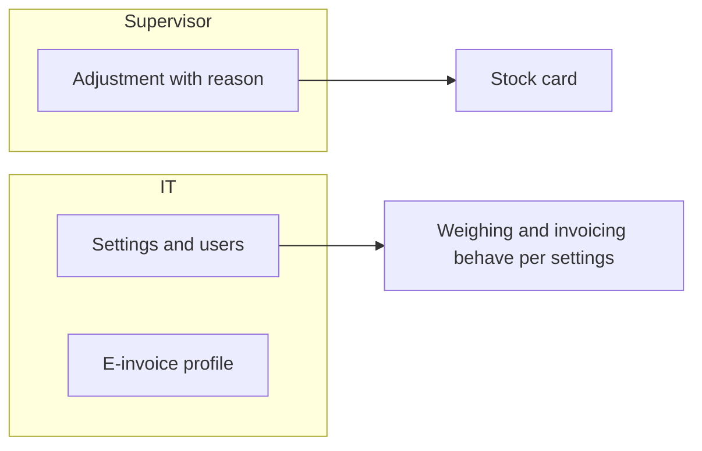
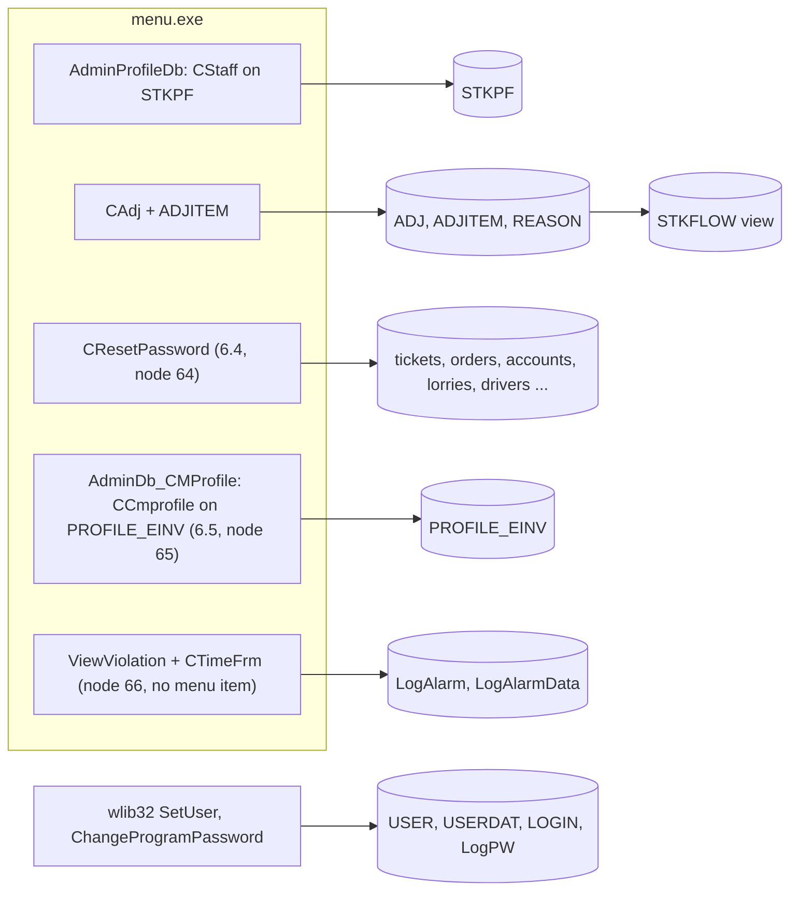
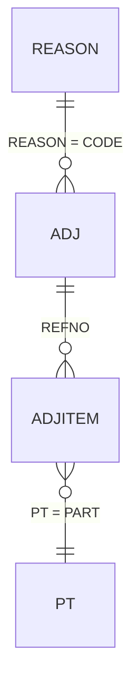

# Other and Stock (menus 6 and 7) - Module reference

> Part of the TradeWin module reference. Index and shared sections: [README](README.md).
> Menu items covered: 6.1 Set Password, 6.2 Company Profile, 6.3 Operator Information, 6.4 Reset Database, 6.5 E-Invoice Profile, 7.1 Adjustment Data Entry, 7.2 Reason Code. This app has **no Export menu 8 and no Backup menu 9** and **no program-update item**: the two export functions are menu items 3.3 and 3.4 and are described in [Invoice and Export](invoice-cashier.md); the backup call in `SubProgram` is commented out. The file name `other-stock-export.md` is kept so the family of references lines up file by file.
> Last verified against commit `2f77122`. Translation status: English only (no zh-CN copy yet).

## Contents

- [Part 1 - Business view](#part-1---business-view)
  - [1.1 In plain words](#11-in-plain-words)
  - [1.2 Who uses what](#12-who-uses-what)
  - [1.3 A day in the life](#13-a-day-in-the-life)
  - [1.4 Worked example](#14-worked-example)
  - [1.5 Screen tour](#15-screen-tour)
  - [1.6 Where does this number come from?](#16-where-does-this-number-come-from)
  - [1.7 Status meanings](#17-status-meanings)
  - [1.8 What happens if...](#18-what-happens-if)
  - [1.9 Messages you may see](#19-messages-you-may-see)
  - [1.10 Do and don't](#110-do-and-dont)
  - [1.11 Before you start](#111-before-you-start)
  - [1.12 Glossary](#112-glossary)
  - [1.13 Ask the AI](#113-ask-the-ai)
- [Part 2 - Technical view](#part-2---technical-view)
  - [2.1 Overview](#21-overview)
  - [2.2 Architecture and dependencies](#22-architecture-and-dependencies)
  - [2.3 Master data catalogue](#23-master-data-catalogue)
  - [2.4 Sub-table hierarchy](#24-sub-table-hierarchy)
  - [2.5 Modules and process flows](#25-modules-and-process-flows)
  - [2.6 End-to-end flows](#26-end-to-end-flows)
  - [2.7 Report catalogue](#27-report-catalogue)
  - [2.8 Integrations](#28-integrations)
  - [2.9 Configuration](#29-configuration)
  - [2.10 Maintenance](#210-maintenance)

---

# Part 1 - Business view

## 1.1 In plain words

- **Other** (menu 6) holds the system settings: the program password, the company and weighing settings, the user list, the **reset of the data** and the company's **e-invoice profile**.
- **Stock** (menu 7) lets you correct the stock of a product with an **adjustment** (for example after a stock count) and keeps the list of adjustment reasons. Stock itself is not typed in: it is worked out from tickets and adjustments.
- The month-end **export** to the accounts system is in the Invoice menu (3.3 and 3.4), see [Invoice and Export](invoice-cashier.md). There is no Backup menu item and no update item; the database backup is done with the framework's close-and-backup action or by IT on the server.
- If settings are wrong, weighing and invoicing behave wrongly; if the e-invoice profile is wrong or empty, e-invoices cannot be submitted; if stock is never adjusted after a count, the stock card drifts from the yard.
- Warning: **6.4 Reset Database really deletes data** (tickets of menus 1.1 and 1.2, orders, accounts, lorries, drivers and more, listed in 2.5). It asks for a reset password that IT holds. Never use it on a live system.

## 1.2 Who uses what

| Department | Menu item | Main tasks |
|---|---|---|
| IT / Admin | 6.1 to 6.5 | Passwords, company and weighing settings, users, the e-invoice profile, data reset (training data only) |
| Management | 6.3 (level 99 only) | Decide who may do what |
| Accounts | 6.5 E-Invoice Profile | Keep the company's own e-invoice identity |
| Weighbridge supervisor | 7.1 Adjustment, 7.2 Reason | Stock corrections |
| Warehouse / Yard | 7.1 | Stock count corrections |

**Start here - IT / Admin**
- Once: Company Profile (address, closing account code, zero and stable controls, tax number and date), Operator Information (users) and the E-Invoice Profile.

**Start here - Supervisor**
- After a stock count: Adjustment Data Entry with a reason.

## 1.3 A day in the life

**Stock count.** The yard counts the paper pile and finds 300 kg less than the stock card says. The supervisor opens 7.1, types today's date, picks the reason "STOCK COUNT" and adds a line with the product and the quantity -300 at the product's price. The stock card now shows the correction.

**A new user.** IT opens 6.3 Operator Information (level 99 only), adds the user with a code, a name, a password, a level and the menu items the user may not open.

**The company's e-invoice identity.** Before the first e-invoice, accounts or IT opens 6.5 E-Invoice Profile and fills the company name for e-invoices, the ROC number, SST number, MSIC code, TIN, e-mail, business activity, phone number and address codes, and the service credentials given by the e-invoice provider.
Swimlane:



*Caption: supervisor adjustments flow to the stock card; IT keeps settings, users and the e-invoice profile.*

## 1.4 Worked example

All values are made up.

| Step | Screen | What the user does | What the program does |
|---|---|---|---|
| 1 | 7.2 Reason Code | Adds `SC` "STOCK COUNT" | Saves |
| 2 | 7.1 Adjustment | Add, date 2026-10-31, reason `SC`, remarks "Yard count" | Header saved |
| 3 | Adjustment lines | Product `AL01`, quantity -300, price 2.000 | Amount = -300 x 2.000 = -600.00 |
| 4 | Product code screen (4.1.1) | Stock Flow button of `AL01` | Shows receipts, despatches, scale tickets and this adjustment (-300 in the "in" column) with a running balance |

Note: the adjustment screen is flagged "cannot add" in the code; if the New button is missing on your PC, adjustments cannot be created from this screen (see 2.10, finding 10).

## 1.5 Screen tour

### 6.1 Set Password

Changes the program (system) password. Only users of level 99 or more. A window shows the current password and asks for a new one.

### 6.2 Company Profile

**Purpose:** company and weighing settings. The program first asks for the program password.

| Field label | Meaning | Required? | Where the value comes from |
|---|---|---|---|
| Address (3 lines) | Printed on tickets | No | Typed |
| Closing Account Code | The cash customer account used by the invoice pick list | No | Typed or picked |
| Zero Weight Control | `Y` = the scale must show zero before OK in the weight window | Yes (Y or N) | Typed |
| Stable Weight Control | `Y` = the reading must be stable before OK | Yes (Y or N) | Typed |
| Variance Control | Allowed percentage difference between own net and party net (not enforced in this version) | No | Typed |
| GST NO, GST DATE | Tax number and the date tax starts (no tax before it) | No | Typed |

The company code box and the gatepass control exist on the form but are switched off. Nothing else is on the form: the "decimal weight" tick of the sister app is not here.

### 6.3 Operator Information

The user list (level 99 only): each user has a code, a description, a password, a level and lists of menu items the user may not open, may only view, or may only edit. Details of the window belong to the program framework.

### 6.4 Reset Database

Opens a small window "Reset all database" that asks for the **reset password**. The password is built from a rule in the program that IT knows (not written here). With the right password, **OK** deletes data at once, without any further question: the list is in 2.5 (tickets 1.1 and 1.2 and their first weights, orders, direct delivery, the invoices of the accounts side, the accounts list, lorries, transporters, drivers, product-list lines, staff, graders, report logs) and the running numbers of those tables restart at 1; at the end it says "Completed". The window has two more buttons: **Import**, which clears only the report log, and **Clean**, which does nothing. **Scale tickets, public-weighing tickets, the weighbridge invoices (menu 3), products, stock adjustments and settings are not touched.**

### 6.5 E-Invoice Profile

**Purpose:** the company's own data for e-invoice (one record, no password prompt). The labels on the form:

| Field label | Meaning |
|---|---|
| Gar Ver. | Version box of the connector (as labelled) |
| State, City, Postal Code, Country | Company address parts (State and Country are picked and show their names beside the box) |
| Company Name (E-Invoice) | The company name as registered for e-invoice |
| ROC (New) | Company registration number |
| SST No | Sales and service tax registration number |
| MSIC | Industry classification code |
| TIN Number | Company tax identification number |
| Tourism Tax Number | Tourism tax number, if any |
| Email | Company e-mail |
| Business Activity | Text describing the business (several lines) |
| Tel No | Phone number in the form +60-XXXXXXXXXX |
| Client ID, Secret ID 1, Secret ID 2 | Credentials for the e-invoice service (never copy them into documents or chat) |
| Digital Cert. | Certificate text; the box is switched off on the form |

### 7.1 Adjustment Data Entry

**Header**

| Field label | Meaning | Required? | Where the value comes from |
|---|---|---|---|
| Ref.no | Adjustment number | Yes (key) | Automatic |
| Date | Adjustment date | - | Today by default |
| Reason | Reason code | Yes | Picked |
| Remarks | Free text (up to 200 characters) | No | Typed |

**Lines (grid):** No, Product, Description, Quantity, U/price, Amount. Quantity is in kg; a negative quantity removes stock.

### 7.2 Reason Code

Code (key), Description, Remarks.

## 1.6 Where does this number come from?

- **Adjustment line amount** = quantity x unit price (negative quantity gives a negative amount). Example -300 x 2.000 = **-600.00**.
- **Stock card balance** = receipts (scale tickets of buying, receiving tickets, adjustments) minus despatches (scale despatch tickets, despatch tickets), running over date and ticket order; adjustments with a negative quantity reduce the balance. The scale lines count by their typed quantity, before bin and wastage. Which ticket tables the stock card includes is decided by a database view that is not in this repo (see 2.5).

## 1.7 Status meanings

| Document | Status | Meaning | Who changes it |
|---|---|---|---|
| Adjustment | none | A row exists | Save |
| Company Profile | single record | Settings take effect at the next weighing | Admin |

## 1.8 What happens if...

| Situation | What to do | Call IT when |
|---|---|---|
| Wrong adjustment | Edit or delete it (the stock card changes) | - |
| The reset window opens by mistake | Close it without typing the password | - |
| The e-invoice profile has to change | Edit it in 6.5 (the credentials belong to IT) | The service refuses the new values |
| User forgot the password | A level 99 user resets it in Operator Information | No level 99 user available |
| Weight light never turns green | Set Zero Weight Control to `N` | Always |
| You need to wipe the training data | 6.4 Reset Database with the reset password; it also deletes the accounts, lorries and drivers, so reload them afterwards | Always: IT does this, after a backup |

## 1.9 Messages you may see

| Message | What it means | What to do |
|---|---|---|
| `Database not open` | The settings table is not available | Call IT |
| `Dialog IDD not found` | The table has no screen | Call IT |
| `Incorret password` (spelling as shown) | Wrong password in the reset window | Do not guess; call IT |
| `Completed` | The reset or the report-log clean finished | - |
| The "no right" message | The user lacks level 99 or the menu item is restricted | Ask a level 99 user |

## 1.10 Do and don't

- Do back up before any bulk change, and always before a reset.
- Do keep the number of level 99 users small.
- Don't use 6.4 Reset Database on a live system: it deletes tickets, accounts, lorries and drivers and cannot be undone.
- Don't write the e-invoice credentials in e-mails or chat.
- Don't copy passwords into emails or chat.

## 1.11 Before you start

- For stock adjustment: products and reasons exist.
- For the e-invoice profile: the company's registration numbers and the service credentials from the provider.
- For the reset: a recent backup and the reset password from IT.
- For Operator Information and Set Password: a level 99 user.

## 1.12 Glossary

| Term | English | Malay | Chinese |
|---|---|---|---|
| Company profile | Company and weighing settings | Profil syarikat | 公司资料 |
| Operator | System user | Pengendali | 操作员 |
| User level | Number that decides what a user may do | Tahap pengguna | 用户级别 |
| Adjustment | Stock correction | Pelarasan | 调整 |
| Reason code | Why the stock was corrected | Kod sebab | 原因代码 |
| Backup | Copy of the database | Sandaran | 备份 |
| E-invoice profile | The company's own e-invoice identity | Profil e-Invois | 电子发票公司资料 |
| TIN | Tax identification number | Nombor pengenalan cukai | 税务识别号 |
| Zero / stable control | Switches that make the scale wait | Kawalan sifar / stabil | 归零 / 稳定控制 |

## 1.13 Ask the AI

1. How do I correct the stock of a product after a stock count?
2. What does the Zero Weight Control setting do?
3. What must I do before using Reset Database?
4. Who can add users and how are menu items blocked for a user?
5. Where do I enter the company's e-invoice data?
6. Where is the database backup?
7. How is an adjustment line amount worked out?
8. How do I see the stock card of one product?
9. What does the Closing Account Code do?
10. What does Reset Database delete and what does it leave?

---

# Part 2 - Technical view

## 2.1 Overview

- Application: TradeWin Metals weighbridge (VC6/MFC on wlib32, `menu.dsp`, `menu.exe`). See [README](README.md).
- This module: menus 6 and 7. Classes in this repo: `CAdj` (ADJ.H / ADJ.CPP), `CResetPassword` (ResetPassword.cpp), `CTimeFrm` (TIMEFRM.CPP). Everything else (password, user list) is wlib32; the Company Profile is a generic `CStaff` on `stkpf`; the E-Invoice Profile is the wlib32 class `CCmprofile` (header `Cmprofile.h`, dialog `IDD_CMPROFILE` in the shared `einv.rc`), started by `AdminDb_CMProfile` in MAIN.CPP:21-31.
- Compared with the sister app (Application_LekokPaper): node 64 (Reset Database) **has a menu item** here and node 65 is the E-Invoice Profile, not the program update; there is no `OnSystemUpgrade` call, no licence timer and no `LICENCE.CPP`.

## 2.2 Architecture and dependencies



*Caption: settings, the e-invoice profile and adjustments are local tables; users and passwords are wlib32 routines; the reset deletes data; the violation screen exists but no menu item opens it.*

- Libraries: wlib32 (generic screens, user and password dialogs, `CCmprofile`), MSFlexGrid, MSChart.
- Database: SQL Server; no schema repo for TradeWin (types below come from `SQL_LekokPaper`, a sister app, and are unverified for TradeWin unless stated).

## 2.3 Master data catalogue

### STKPF (Company Profile, menu 6.2)

- Fields and meanings: see [Weighing 2.3](weighing.md#23-master-data-catalogue) (the table is documented there with all columns).
- Screen: `AdminProfileDb(&stkpf)` (MAIN.CPP:123-138, case MAIN.CPP:371-374): asks `CAskPassword` (wlib32), then a `CStaff` with `OneRecordOnly = TRUE` on dialog `IDD_STKPF` (`stkpf.ID = IDD_STKPF`, MENU.CPP:409). If the table is empty at start the app inserts the row `COMPANY_NO = "1"` (MENU.CPP:410-414) and fills the `logo` row from it (MENU.CPP:417-427).
- The dialog shows `ADD1..3`, `ACCODE`, `ZERO`, `STABLE`, `VARIANCE`, `GST_NO` and `GST_DATE`; it has no box for `PT`, `PT1` or `Decimal_Weight` (the sister app's dialog has the decimal-weight tick; TradeWin's rc dropped it).

### LOGO

One-row print header table `LOGO` (sister script `LOGO.sql`; enum `logo` MENU.H:321). Written at start by `SetStdCompanyLogo` (MENU.CPP:361-383: `NAME` = the program title `TRADEWIN METALS SDN BHD`, address lines from `STKPF`, `PROGRAM_ID` = `Pref`, `GST_NO`, an `SST_NO` taken from the accounting profile column `RMCD` when it exists, the tax start date constant) and `logo.Update()` (MENU.CPP:426). Not edited from a menu.

| # | SQL column | data type | null | key | meaning |
|---|---|---|---|---|---|
| 1 | `CODE` | nvarchar(7) | no | PK | company code (copied from STKPF) |
| 2 | `NAME` | nvarchar(50) | yes |  | company name printed on forms and reports |
| 3 to 6 | `ADD1`, `ADD2`, `ADD3`, `ADD4` | nvarchar(50) | yes |  | address lines (ADD4 unused) |
| 7 to 9 | `DATE`, `DATE1`, `DATE2` | smalldatetime | yes |  | report date, from, to |
| 10, 11 | `TIME1`, `TIME2` | nvarchar(8) | yes |  | report times |
| 12 to 14 | `SELECT1..3` | nvarchar(80) | yes |  | report selection text |
| 15 | `RTITLE` | nvarchar(50) | yes |  | report title |
| 16 | `GROUP` | nvarchar(20) | yes |  | report group |
| 17, 18 | `USER`, `UNAME` | nvarchar(5), nvarchar(35) | yes |  | user code and name |
| 19 | `PROGRAM_ID` | nvarchar(6) | yes |  | program reference of the last menu item run |
| 20 | `ACCODE` | nvarchar(10) | yes |  | account filter |
| 21 | `BRANCH` | nvarchar(50) | yes |  | branch |
| 22 | `PCCODE` | nvarchar(10) | yes |  | profit centre filter |
| 23 | `GST_NO` | nvarchar(20) | yes |  | tax number |

### PROFILE_EINV (E-Invoice Profile, menu 6.5)

- Screen: `case M_OTHER*10+5` opens an `ado` object on the table `profile_einv` with dialog `IDD_CMPROFILE` and calls `AdminDb_CMProfile` (MAIN.CPP:381-388): `CCmprofile` (wlib32, a `CStaff`) with `OneRecordOnly = TRUE` and `LptNo = 0` (MAIN.CPP:21-31). The table is closed again when the window closes. **No password prompt and no level check** guard it (compare 6.2, which asks for the program password); only the per-user menu restriction lists apply.
- The table is not defined in any script available for TradeWin (the sister schema has none): **column names and types are unverified**. The dialog binds its boxes to the fields in this order:

| # | dialog label | type |
|---|---|---|
| 1 | (hidden key box) | unverified |
| 2 | State (code, name shown beside it) | unverified |
| 3 | City | unverified |
| 4 | Postal Code | unverified |
| 5 | Gar Ver. | unverified |
| 6 | Country (code, name shown beside it) | unverified |
| 7 | Company Name (E-Invoice) | unverified |
| 8 | ROC (New) | unverified |
| 9 | SST No | unverified |
| 10 | MSIC | unverified |
| 11 | TIN Number | unverified |
| 12 | Tourism Tax Number | unverified |
| 13 | Email | unverified |
| 14 | Business Activity (multi-line) | unverified |
| 15 | Tel No (format +60-XXXXXXXXXX) | unverified |
| 16 | Digital Cert. (hidden on the form) | unverified |
| 17 | Client ID (credential) | unverified |
| 18 | Secret ID 1 (credential) | unverified |
| 19 | Secret ID 2 (credential) | unverified |

- Nested sub-tables: none. Used by: the e-invoice database procedures (the company side of the submitted invoice; unverified).

### USER and related tables (menu 6.3, wlib32)

- Script `USER.sql`: `CODE` nvarchar(5) PK, `DESCRIPTION` nvarchar(25), `ACCESS` nvarchar(15) (the password), `LEVEL` nvarchar(5), `REMARKS`, `N01`..`N10`, `H01`..`H10`, `N11`..`N100` float(53). wlib32 reads node numbers from these columns: blocked menu nodes, view-only nodes, edit-only nodes (README, "User rights").
- Related: `USERDAT` (per-user table flags), `LOGIN` (`DATE`, `USER`, `ACCESS`, `TIMEIN`, `TIMEOUT`, `PKKEY`), `LogPW` (`date`, `user`, `OldPW` varchar(50), `NewPW` varchar(50), `pkkey`: the password change log has columns for the old and new password, see 2.10), `ExpiredPW`, `LogUserAccountSuspended`, `TableUserControl`, `FieldUserControl`.
- Only users of level 99 or more may open the user list or change the program password (wlib32 `SetUser`, `ChangeProgramPassword`).

### REASON (menu 7.2)

- Screen `AdminDb(&reason)` (MAIN.CPP:395-397); `IDD_REASON`; `ado(&reason,"reason")` (MENU.CPP:494). Sister script `REASON.sql`.

| # | SQL column | data type | null | key | meaning |
|---|---|---|---|---|---|
| 1 | `CODE` | nvarchar(5) | no | PK | reason code |
| 2 | `DESCRIPT` | nvarchar(50) | yes |  | description |
| 3 | `REMARK` | nvarchar(200) | yes |  | free text |
| 4 to 9 | `NEWUSER` nvarchar(5), `NEWTIME` datetime, `REC_STATUS` char(1), `MODIFYUSER` varchar(10), `MODIFYTIME` datetime, `Print Counter` int | | yes |  | framework audit |

### LogAlarm, LogAlarmData, TIMEFRM, WEIGHT_MAX_DATA (weight alarm log)

Sister scripts `LogAlarm.sql` (`DATE` datetime default getdate(), `VIOLATION` int, `VNAME1`, `VNAME2` nvarchar(150), `COMPUTER` nvarchar(50), `USER` nvarchar(10), `CLEARTIME` datetime, `CLEARBY` nvarchar(10), `VEHICLE` nvarchar(15), `TICKETWT` int, `PKKEY` int identity), `LogAlarmData.sql` (`ID` int, `DATE` datetime, `WT` int, `AW` int, `PKKEY`), `TIMEFRM.sql` (`DATE`, `WT`, `AW`, `PKKEY`), `WEIGHT_MAX_DATA.sql` (see [Weighing](weighing.md#25-modules-and-process-flows)). The alarm hooks of the application write them (2.5).

## 2.4 Sub-table hierarchy

### ADJ (stock adjustment header)

```text
ADJ (header, key REFNO)
  - ADJITEM  link: ADJITEM.REFNO = ADJ.REFNO   (key PKKEY identity, line number SQNO)
    Nested sub-tables: none
```



*Caption: an adjustment has item rows, each pointing to a product; the header points to a reason.*

- Screen `CAdj` (`CParent`, ADJ.CPP) with dialogs `IDD_ADJ` and `IDD_ADJITEM`; objects `adj(IDD_ADJ)`, `adjitem(IDD_ADJITEM)`, `reason(IDD_REASON)` (MENU.CPP:54); opened `tado(&adj,"adj",init_adj)`, `tado(&adjitem,"adjitem",init_adjitem)` (MENU.CPP:492-493). Entry `AdjustmentEntry()` (ADJ.CPP:122-129) sets `m_OpenLpt = FALSE`; `CAdj` sets `df->m_CannotAdd = TRUE` (ADJ.CPP:25).
- Link key: first field of the item (`REFNO`) equals the header; `init_adj` also sets `e->chain = &adjitem` and the browse dialog `IDD_BROWSE` (ADJ.CPP:111-120). Rows are saved by the `CParent` mechanism with the header. Header browse grid: Ref no, Date, Reason and the reason name (`ReplaceAdjGrid`, ADJ.CPP:86-97).
- Enums `adj` (MENU.H:338) and `adjitem` (MENU.H:339).

**ADJ** (sister script `ADJ.sql`)

| # | field (enum) | SQL column | data type | null | key | meaning |
|---|---|---|---|---|---|---|
| 1 | `Aj_REFNO` | `REFNO` | nvarchar(10) | no | PK | adjustment number |
| 2 | `Aj_DATE` | `DATE` | smalldatetime | yes |  | adjustment date |
| 3 | `Aj_REASON` | `REASON` | nvarchar(5) | yes | FK to `REASON.CODE` | reason code |
| 4 | `Aj_REMARKS` | `REMARKS` | nvarchar(200) | yes |  | free text |
| 5 to 10 | | `REC_STATUS`, `NEWUSER`, `NEWTIME`, `MODIFYUSER`, `MODIFYTIME`, `Print Counter` | char(1), char(5), smalldatetime, char(5), smalldatetime, int | yes |  | framework audit |

**ADJITEM** (sister script `ADJITEM.sql`)

| # | field (enum) | SQL column | data type | null | key | meaning |
|---|---|---|---|---|---|---|
| 1 | `ADJ_REFNO` | `REFNO` | nvarchar(10) | no | FK to `ADJ.REFNO` | parent number (link key) |
| 2 | `ADJ_SQNO` | `SQNO` | float(53) | yes |  | line number |
| 3 | `ADJ_ITEM` | `PT` | nvarchar(8) | yes |  | product code |
| 4 | `ADJ_QTY` | `QTY` | decimal(11,2) | yes |  | quantity in kg (positive adds stock, negative removes) |
| 5 | `ADJ_PRICE` | `PRICE` | decimal(10,3) | yes |  | unit price per kg |
| 6 | `ADJ_AMOUNT` | `AMOUNT` | decimal(10,2) | yes |  | quantity x price |
| 7 | `ADJ_PKKEY` | `PKKEY` | int | no | PK identity | row key |

- Rules: `start_adj` sets the date to today (ADJ.CPP:105-109); `tell_adjprodtype` (ADJITEM.CPP:8-19): amount = quantity x price recalculated on every change, amount field skipped; `tell_adj` skips the date once the adjustment has lines (`IsAdjStable`, ADJ.CPP:63-84).
- Cardinality 1..n. Nested sub-tables: none.

## 2.5 Modules and process flows

### Menu items and entry points

| Menu item (caption) | Node | Handler in `SubProgram` | Opens |
|---|---|---|---|
| 6.1 Set Password | 61 | frame message map `ON_COMMAND(ID00061, OnPassword)` (MAINFRM.CPP:64) calls the wlib32 password routine; `case M_OTHER*10+1: break;` is empty (MAIN.CPP:369-370) | wlib32 password window (level 99) |
| 6.2 Company Profile | 62 | `AdminProfileDb(&stkpf)` (MAIN.CPP:371-374) | password prompt, then one-record screen |
| 6.3 Operator Information | 63 | `SetUser()` (MAIN.CPP:375-377) | wlib32 user list |
| 6.4 Reset Database | 64 | `CleanDatabase()` (MAIN.CPP:378-380; ResetPassword.cpp:179) | `CResetPassword`, dialog `IDD_RESET_DATABASE` |
| 6.5 E-Invoice Profile | 65 | `AdminDb_CMProfile` on `profile_einv` (MAIN.CPP:381-388) | `CCmprofile`, dialog `IDD_CMPROFILE` |
| (no menu item) | 66 | `ViewViolation()` (MAIN.CPP:389-391; TIMEFRM.CPP:178) | `CTimeFrm` chart window |
| 7.1 Adjustment Data Entry | 71 | `AdjustmentEntry()` (MAIN.CPP:392-394) | `CAdj` |
| 7.2 Reason Code | 72 | `AdminDb(&reason)` (MAIN.CPP:395-397) | generic |

Menu items 6.1 to 6.5 have the IDs `ID00061` to `ID00065` (menu.rc:179-183 within the single resource `IDR_MAINMENU`); the frame maps them to the wlib32 handler (MAINFRM.CPP:64-69), which applies the user restriction lists and then `SubProgram`. No Export (8) or Backup (9) nodes exist; the `M_BACKUP` case and the old account cases (including their export calls) sit inside a comment block (MAIN.CPP:398-459).

### Flow: stock adjustment

1. `AdjustmentEntry` opens `CAdj` (header-detail). `Aj_DATE` defaults to today.
2. Each line: product picked (lookup `PT`), quantity and price typed, amount = quantity x price.
3. The stock card is the view `STKFLOW` (the code reads `select * from [stkflow] where [pt]=<code> order by [date],[ordertype],[refno]`, STKFLOW.CPP:19-22). The sister schema's script unions `ADJITEM` joined to `ADJ` and `REASON` (column `IN` = quantity, description = the reason text, type `ADJ`), the `DS`/`DP` ticket views, `RT`, and `SCALE`/`SCALESUB` (in) and `SCALEDW`/`SCALEDWSUB` (out); the live TradeWin view is not in this repo (unverified). A negative adjustment quantity appears as a negative "in".

### Flow: Company Profile

`AdminProfileDb` (MAIN.CPP:123-138) shows `CAskPassword`; on OK it runs `CStaff` on `stkpf` with `OneRecordOnly = TRUE`. The switches take effect at the next use: `STKPF.ZERO` and `STABLE` are read on every timer tick of the weight dialog (GETWT.CPP:200-212), and `GST_DATE` by `FindPercen`.

### Flow: update

There is no update flow in this program: the wlib32 `OnSystemUpgrade` call of the sister app is not in `SubProgram`. `ProgramVersionNo = 2` (MENU.CPP:127) and the folder file `IFOLDERAA.SYS` (content `CHYE`) remain from the framework; no version file (`CHYE.ver`) and no `HENGHUP.EXE` reference exist in the repo.

### Flow: Reset Database routine (menu 6.4, node 64)

1. `CleanDatabase` (ResetPassword.cpp:179-184) opens `CResetPassword` (dialog `IDD_RESET_DATABASE`, menu.rc:1553, caption "Reset all database"). `CResetPassword::OnOK` (ResetPassword.cpp:50-177) checks the typed password against a date-based rule held in the code (ResetPassword.cpp:56-60; not documented here); a wrong one shows `Incorret password`. There is **no confirmation question** after the correct password.
2. Runs, one `RunSql` per line with a progress bar: `truncate table [aroinv]`, `delete from [arinv]`, `truncate table [apoinv]`, `delete from [apinv]` (the accounting-side invoice objects), `truncate [wds]`, `[wdp]`, `[ds]`, `[dp]`, `[poitem]`, `delete from [po]`, `truncate [soitem]`, `delete from [so]`, `truncate [dtitem]`, `[dt]`, `[fc_dp]`, `[fc_ds]`, `[ic]` (the drivers), `[rptlog]`, `[spitem]`, `DELETE FROM [accode]` (all accounts), `truncate [lorry]`, `[transp]`, `[grade]`, `[staff]`, `[ReportFilterDescription]` (ResetPassword.cpp:63-145).
3. Then `update [ticketno] set [NEXTNO] = 1 where [recordset] = ...` for `ds`, `dp`, `wds`, `wdp`, `dt`, `arinv`, `apinv`, `so`, `po` (ResetPassword.cpp:147-172), and `Completed`.
4. **Not touched:** `SCALE`, `SCALESUB`, `SCALEDW`, `SCALEDWSUB`, `PR_NEW`, `WPR_NEW`, `RT`, `WRT`, `ARINV_WB`, `AROINV_WB`, `APINV_WB`, `APOINV_WB`, `ADJ`, `ADJITEM`, `PAYMENTDATE`, `PAYMENTDATED`, `PT`, `PTSUB`, `LOGERR`, `STKPF`, `PROFILE_EINV`, `EINV_API`: scale tickets, public-weighing tickets, return notes, the weighbridge invoices and the e-invoice log survive, while the tickets of menus 1.1 and 1.2, the accounts, lorries, drivers and their product lists are wiped. That leaves invoice lines (`DO`) pointing at deleted tickets.
5. `OnButton1` (ResetPassword.cpp:186-201) is bound to the dialog's button labelled **Import** (`IDC_BUTTON1`) and truncates only `rptlog`; the button labelled **Clean** (`IDC_BUTTON2`) has no handler.

### Flow: violation viewer (node 66, not on any menu)

`ViewViolation` (TIMEFRM.CPP:178-200) runs `select [date], vname1 as Violation_Description, vehicle, ticketWt, pkkey from logalarm where [date] >= '<today>' order by [date] desc`, lets the user pick a row and opens `CTimeFrm` (TIMEFRM.CPP:52-91, 104-161) with a chart (MSChart) of the weights of that alarm from `logAlarmData`, the maximum weight, the confirmed weight, the variance and the date of the maximum; buttons draw the full trace or only the top range (`m_wrange`, default 1000 kg). The rows are written by the alarm hooks `CMenuApp::OnLogAlram4DriveThrough` and `OnLogAlram4OverMaxWt` (MENU.CPP:614-658): "Drive through without weighing" (violation 0) and "Over max weight variance" (violation 1, when the maximum weight exceeds the ticket weight by `w_maxVar`), each copying the `timefrm` trace to `logAlarmData` and clearing `timefrm`.

### Tables read and written

| Table | Read | Written | Key |
|---|---|---|---|
| STKPF | all weighing and invoice code | Company Profile | `COMPANY_NO` |
| LOGO | print headers | at start | `CODE` |
| ADJ, ADJITEM, REASON | `CAdj`, STKFLOW | `CAdj`, Reason screen | `REFNO`, `PKKEY`, `CODE` |
| USER, USERDAT, LOGIN, LogPW | user list | wlib32 | `CODE` |
| LogAlarm, LogAlarmData, TIMEFRM | violation viewer | alarm hooks | `PKKEY` |
| many (see the reset list) | - | the reset routine | - |
| PROFILE_EINV | e-invoice procedures (unverified) | E-Invoice Profile | unverified |

### Running numbers

Adjustment numbers: the framework key assignment for table `adj` (TICKETNO row named `adj`; not in the reset list).

### Status transitions

None for these tables.

### Dependencies on other modules

- Stock card needs [Tickets](tickets.md), [Scale weighing](scale-weighing.md) and adjustments; settings feed [Weighing](weighing.md); the export is in [Invoice](invoice-cashier.md).

## 2.6 End-to-end flows

See [README](README.md#26-end-to-end-flows).

## 2.7 Report catalogue

- Stock reports in the picker: `00134` Physical Stock Report (`stkflow2.rpt`) and `00135` Stock Card Report (`stkflow.rpt`), see [Reports](reports.md).
- The product screen's Stock Flow button shows the stock card as a browse window (STKFLOW.CPP:17-37, form `stkflow.rep`).
- Adjustment forms `ADJ.RPT`, `adjdtl.rpt`, `ADJSUM.RPT` exist in the repo (the screen has no print button of its own: `m_OpenLpt = FALSE`).

## 2.8 Integrations

| Trigger | System | Payload | Audit | Failure handling |
|---|---|---|---|---|
| E-Invoice Profile | The e-invoice connector reads the table `profile_einv` (company identity and credentials) | company data | none | none (unverified) |
| Weight alarm (wlib32 comm layer) | `LogAlarm`, `LogAlarmData` | trace of readings | the tables | none |

No stock API views exist in this repo (unlike Seng Hiap Metal).

## 2.9 Configuration

- `STKPF` switches (see Weighing 2.3).
- win.ini and PROVIDER.SYS as described in [Weighing](weighing.md#29-configuration); `INIT_ADO_USER | INIT_ADO_PROGRAM_PASSWORD` login flags with `0x0002` (MENU.CPP:250).
- Program name and version text: window title "<title> VER 2.00" with the comment "E-Inv version" (MAINFRM.CPP:113); the title is the company constant `TRADEWIN METALS SDN BHD` (MENU.CPP:116), copied by `CMenuApp::Profile` (MENU.CPP:238-240); `ProgramVersionNo = 2` (MENU.CPP:127); an array `tcompany` holds an encoded company string that is not used (MENU.CPP:117-119).
- `HideStaffMenu = 99990` (MENU.CPP:273); `m_useDropDownBtnInsteadSrollbar = TRUE` (MENU.CPP:274).
- There is no licence timer in this program (the sister app's `OnTimer` and `LICENCE.CPP` are not in this repo).

## 2.10 Maintenance

- Update this file with any change to menus 6 and 7, the adjustment tables or the reset list.
- Changelog:

| Date | Commit | Who | What changed |
|---|---|---|---|
| 2026-10-19 | `2f77122` | Claude (draft for review) | First version for Application_TradeWin, started from the Application_LekokPaper reference; 6.4 is the real Reset Database, 6.5 is the E-Invoice Profile, no update item, no licence timer |

- Last verified against commit `2f77122`. Translation status: English only.

### Code findings (for the developer)

1. **6.4 Reset Database is live, destructive and unconfirmed.** After the date-based password it deletes without any question (ResetPassword.cpp:50-177): tickets of 1.1 and 1.2, the accounts, lorries, drivers, transporters and product-list lines, and several logs. Scale tickets, public-weighing tickets, the weighbridge invoices and the e-invoice log are left, so invoice lines can point at tickets that no longer exist. The accounting-side objects (`arinv`, `apinv`, `accode`) are deleted with `delete` and `truncate` statements through whatever the live objects are (a `truncate` on a view fails).
2. **The reset password is a date-based rule held in the source** (ResetPassword.cpp:56-60): anyone with the source can derive it. Replace it with a stored secret.
3. **Buttons mislabelled**: in the reset dialog the button labelled "Import" runs the clean of `rptlog` and the button labelled "Clean" has no handler.
4. **The E-Invoice Profile has no protection.** Menu 6.5 opens the company identity and the service credentials (Client ID, Secret ID 1 and 2) for any user who is allowed menu 65: there is no password prompt and no level check (MAIN.CPP:381-388), unlike 6.2. The credentials are stored in a table outside this repo; treat them as secrets and review who can open 6.5.
5. **`PROVIDER.SYS` holds database logins in plain text.** Line 1 carries a user name and a password and line 2 a user name (the file is read by wlib32 at start); the file is committed in the repo. The secret is not copied here: rotate the login and remove the file from the repository.
6. **The password log table has columns for the old and the new password** (`LogPW.OldPW`, `LogPW.NewPW` in the sister script); if wlib32 fills them, passwords are kept in readable form. Check the live table.
7. **Company name constants**: the program title and registry key are the plain company constant (MENU.CPP:238-240) while the unused `tcompany` array holds an encoded string (MENU.CPP:117-119); the company address strings in MENU.CPP:30-32 are site data compiled into the program.
8. **`ViewViolation` has no menu item**, although the alarm hooks keep writing `LogAlarm` rows.
9. **`CAdj` sets `m_CannotAdd = TRUE`** (ADJ.CPP:25). In wlib32 that flag disables the New function of the screen and makes an unknown number answer "Data Not found" (`CStaff`). Check on a running PC whether a new adjustment can be created from 7.1.
10. **No update path**: the program has no update item, so new versions are copied by hand (the file `IFOLDERAA.SYS` with the text `CHYE` is a leftover of another company's name).
