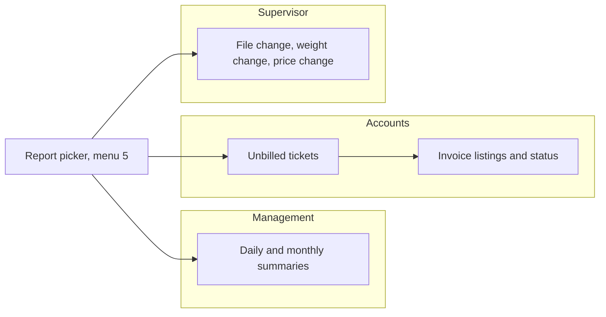
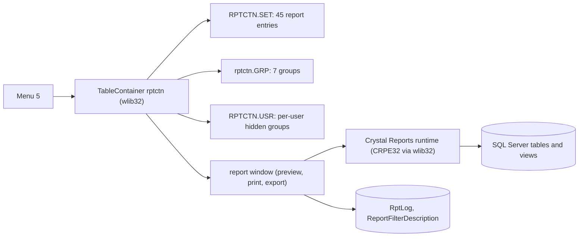
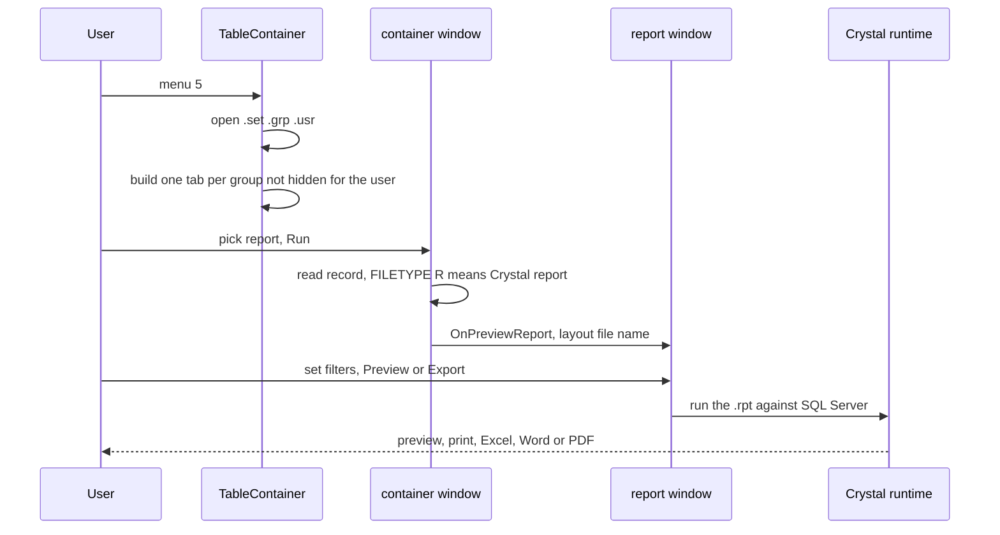

# Reports (menu 5) - Module reference

> Part of the TradeWin module reference. Index and shared sections: [README](README.md).
> Menu item covered: 5 Report. The ticket, invoice and list forms printed from other screens are described in their own modules.
> Last verified against commit `2f77122`. Translation status: English only (no zh-CN copy yet).

## Contents

- [Part 1 - Business view](#part-1---business-view)
  - [1.1 In plain words](#11-in-plain-words)
  - [1.2 Who uses what](#12-who-uses-what)
  - [1.3 A day in the life](#13-a-day-in-the-life)
  - [1.4 Worked example](#14-worked-example)
  - [1.5 Screen tour](#15-screen-tour)
  - [1.6 Where does this number come from?](#16-where-does-this-number-come-from)
  - [1.7 Status meanings](#17-status-meanings)
  - [1.8 What happens if...](#18-what-happens-if)
  - [1.9 Messages you may see](#19-messages-you-may-see)
  - [1.10 Do and don't](#110-do-and-dont)
  - [1.11 Before you start](#111-before-you-start)
  - [1.12 Glossary](#112-glossary)
  - [1.13 Ask the AI](#113-ask-the-ai)
- [Part 2 - Technical view](#part-2---technical-view)
  - [2.1 Overview](#21-overview)
  - [2.2 Architecture and dependencies](#22-architecture-and-dependencies)
  - [2.3 Master data catalogue](#23-master-data-catalogue)
  - [2.4 Sub-table hierarchy](#24-sub-table-hierarchy)
  - [2.5 Modules and process flows](#25-modules-and-process-flows)
  - [2.6 End-to-end flows](#26-end-to-end-flows)
  - [2.7 Report catalogue](#27-report-catalogue)
  - [2.8 Integrations](#28-integrations)
  - [2.9 Configuration](#29-configuration)
  - [2.10 Maintenance](#210-maintenance)

---

# Part 1 - Business view

## 1.1 In plain words

- Menu 5 opens the **report picker**: one window with the report groups on the left and the reports of the chosen group on the right.
- The reports answer the daily and month-end questions: how much paper came in and went out by product, supplier and buyer; what was invoiced; which tickets are not yet invoiced; what changed on a ticket after it was saved; what the stock position is; how much cash was bought and sold.
- Each report is a prepared layout. You choose the report, set the date range and filters in the window that opens, then preview, print or export it to Excel, Word or PDF.
- If reports are not run, management has no view of purchases, sales, stock or unbilled tickets, and cannot spot changed tickets.
- This picker lists **45 reports in 7 groups**. The entries named "Receiving" and "Despatch" read the receiving and despatch tickets (menus 1.1, 1.2, 2.1, 2.2); the ones that name "Scale" read the scale tickets; "Public Weighing" reads the public-weighing tickets.

## 1.2 Who uses what

| Department | Report group | Main tasks |
|---|---|---|
| Management | Receiving Report, Despatch Report, Security Report | Daily and monthly totals by product, supplier, buyer; stock card; physical stock |
| Accounts | Purchase Report, Sales Report, unbilled-ticket reports | Invoice listings and status, unbilled tickets, cash purchases and sales |
| Weighbridge supervisor | Audit Report, Public Weighing | Find tickets whose price or weight changed after saving; public-weighing detail |
| IT / Admin | all | Check the report list, report files and per-user visibility |

**Start here - Management**
- Daily: Receiving Product Summary Report and Despatch Product Summary Report for yesterday.
- Month-end: Stock Card Report and the product detail reports.

**Start here - Accounts**
- Daily: Receive Unbill Ticket and Despatch Unbill Ticket to see tickets still to invoice.
- Month-end: the invoice listings and status reports.

**Start here - Supervisor**
- Weekly: Audit Report group: Receiving and Despatch File Change, Weight Change and Price Change reports.

## 1.3 A day in the life

**Morning check.** The manager picks the group **Receiving Report**, then "Receiving Product Summary Report", sets yesterday's date and presses Preview. A second report in the same list shows the totals per supplier.

**Before invoicing.** Accounts pick **Despatch Report** and "Despatch Unbill Ticket" to list tickets that are not on an invoice yet.

**When a ticket looks wrong.** The supervisor picks the **Audit Report** group and the File Change report to see who changed which field of a ticket, from what value to what value, and when.

**Month-end.** Accounts run the invoice listings for purchase and sales and the stock reports for the closing balances.

Swimlane:

*Caption: everyone starts from the same picker; each department uses a different group of reports.*

## 1.4 Worked example

All values are made up.

| Step | Screen | What the user does | What the program does |
|---|---|---|---|
| 1 | Menu 5 Report | Opens the picker | Shows the groups on the left; the first group is selected |
| 2 | Picker | Clicks the group `Receiving Report`, selects "Scale Weighing Detail Report", presses Print on the toolbar | Opens the report window |
| 3 | Report window | Sets date from 2026-10-01 to 2026-10-31 | - |
| 4 | Report window | Presses Preview | Shows every scale ticket of the month with its lines, for example `AL01` 3,435 kg and amount 6,830.00 (from the ticket in the earlier examples) |
| 5 | Report window | Chooses Excel | Writes an Excel file and opens it |

## 1.5 Screen tour

### Report picker

**Purpose:** choose a report.

| Part | Meaning | Where it comes from |
|---|---|---|
| Left bar with group icons | One button per report group: Receiving Report, Despatch Report, Purchase Report, Sales Report, Public Weighing, Security Report, Audit Report | The group list file kept with the program |
| List of reports | Report name, e.g. "Scale Weighing Detail Report" | The report list file kept with the program |
| Toolbar: Back, Print | Back closes the picker; Print runs the selected report and opens the report window | - |
| Toolbar: Edit, New, Delete, Security | Maintain the report list and its user security; visible only to level 99 users | - |

Users can be blocked from some groups by an entry in the user list file kept with the program (see 2.9).

### Report window

| Field | Meaning | Where the value comes from |
|---|---|---|
| Date range, account, vehicle, product and other filters | Which records go into the report | Typed or picked; the available filters depend on the report |
| Preview / Print | See on screen or print | - |
| Export to Excel / Word / PDF | Save as a file | - |

### The groups

| Group | Entries | What it holds |
|---|---|---|
| Receiving Report | 15 | Product details and summaries of goods bought, supplier summaries, unbilled tickets, variance, scale weighing details (also with prices adjusted), detail by pay date, actual quantity reports |
| Despatch Report | 13 | The same for goods sold, scale despatch details |
| Purchase Report | 3 | Purchase invoice listing and status, cash purchase |
| Sales Report | 3 | Sales invoice listing and status, cash sales |
| Public Weighing | 1 | Public weighing detail |
| Security Report | 4 | Police reports for despatch and receiving, physical stock, stock card |
| Audit Report | 6 | File change, weight change and price change reports for receiving and despatch |

The full list with codes is in 2.7.

## 1.6 Where does this number come from?

- **Quantities and amounts** in the receiving and despatch reports come from the ticket lines (the receiving and despatch tickets and the scale tickets). The exact source of each layout is inside the layout file and was not verified here.
- **Unbilled ticket reports** list tickets whose number is not on any invoice line.
- **Invoice reports** use the invoice header and lines (see [Invoice](invoice-cashier.md#16-where-does-this-number-come-from)).
- **Stock reports** add the receipts and subtract the despatches of the stock card, plus stock adjustments (see [Other, Stock](other-stock-export.md)).
- **File, weight and price change reports** list each changed field with its old and new value, the user and the time (the change log of the receiving and despatch tickets).

## 1.7 Status meanings

Reports have no status. The only state is whether a user may see a group (set in the user list file) and whether the report layout file exists on the PC.

## 1.8 What happens if...

| Situation | What to do | Call IT when |
|---|---|---|
| The report window opens empty | Widen the date range; check the account and product filters | The report is empty for a range that has tickets |
| "file not found" | The report layout file is missing on this PC | Always: IT must copy the layout file |
| A ticket report is empty although tickets exist | Use the receiving and despatch reports for tickets of menus 1.1 and 1.2, the scale reports for scale tickets and the public-weighing report for public tickets | The right report is still empty |
| A user cannot see a group | The user list file hides it | IT edits the user list |
| Report totals disagree with invoices | Check whether tickets were changed after invoicing (the File Change reports show who changed what) | Differences remain |
| Power or network cut during a print | Run the report again | The window does not open |

## 1.9 Messages you may see

| Message | What it means | What to do |
|---|---|---|
| `<file> not found` (the file name is shown) | A report list file is missing in the program folder | Call IT |
| `Database not open` | A table the report needs is not open | Call IT |
| `Backgroud printing in progress...Please wait` (when closing the program) | A print job is still running | Wait, or answer Yes to terminate it |

The report window and the Crystal preview show their own messages, which are not part of this repository.

## 1.10 Do and don't

- Do check the date range before printing a large report.
- Do use the unbilled-ticket reports before month-end billing.
- Don't run month-end reports before the last tickets are finished.
- Don't use the Edit, New and Delete buttons of the picker unless IT is changing the list.

## 1.11 Before you start

- The tickets and invoices you want to report on are saved.
- The report layout files (`.rpt`) are in the program folder.
- The Crystal Reports runtime is installed on the PC.
- Your user is allowed to see the group.

## 1.12 Glossary

| Term | English | Malay | Chinese |
|---|---|---|---|
| Report | Printed or previewed summary | Laporan | 报表 |
| Summary / detail | Totals only / every ticket | Ringkasan / butiran | 汇总 / 明细 |
| Unbilled ticket | Ticket not on any invoice | Tiket belum bil | 未开发票磅单 |
| File change report | Audit of changed fields | Laporan perubahan | 修改记录 |
| Party | The other company | Pihak | 对方 |
| Stock card | Movement list of one product | Kad stok | 库存卡 |
| Physical stock | Stock counted | Stok fizikal | 实物库存 |

## 1.13 Ask the AI

1. How do I print yesterday's receiving summary by product?
2. Which report shows tickets that are not yet invoiced?
3. How can I see who changed a ticket after it was saved?
4. Which report lists the scale tickets of a month?
5. Why does a report in the list show nothing?
6. How do I export a report to Excel?
7. Which report shows the stock movement of one product?
8. How do I hide some report groups from a user?
9. Where do I find the cash purchase and cash sales reports?
10. Which report shows public weighing?

---

# Part 2 - Technical view

## 2.1 Overview

- Application: TradeWin Metals weighbridge (VC6/MFC on wlib32, `menu.dsp`, `menu.exe`). See [README](README.md).
- This module: menu 5 only. Menu 5 has no code of its own in this repo: `case M_REPORT: TableContainer("rptctn")` (MAIN.CPP:354-356) hands over to the wlib32 table container, which reads three data files kept in the repo (`RPTCTN.SET`, `rptctn.GRP`, `RPTCTN.USR`). The reports are Crystal Reports layouts (`.rpt`).
- The repo also contains older "DOS-style" report routines (Sdp.cpp, sv.cpp, Dpp.cpp, mnws.cpp, detail.cpp, Chkvar.cpp, fc.cpp) and their forms; most are not reachable from the menu (see 2.5).

## 2.2 Architecture and dependencies

*Caption: the picker reads three local data files; a report window runs a `.rpt` layout through the Crystal runtime against SQL Server and keeps a log of the formulas used.*

- Libraries: wlib32 (container, report window), Crystal Reports runtime.
- Database: SQL Server tables and views. The sister schema `SQL_LekokPaper` has container tables `rptctn_grp` and `rptctn_set`; this picker does not use them (it opens the files).
- No `.rdl` report and no ReportEngine call exists in this repo. Layout files in the repo root: 407 `.rpt`, 51 `.rep`, 24 `.FMT`, 38 `.scr` (counted by extension, case-insensitive). There are no `reportE` or `reportS` folders.

## 2.3 Master data catalogue

Container data files (not SQL tables). The files in this repo are **byte-identical to those of Application_LekokPaper** (`RPTCTN.SET`, `rptctn.GRP`, `RPTCTN.USR`, `RPTCTN_OLD.SET`, `WBCTN.usr`), so the lists below are the same. The files are dBase-style: a header with the field list, then fixed-length records; the record count in each header is smaller than the number of records physically in the file (see 2.10, finding 1).

| File | Fields (from the file header) | Role |
|---|---|---|
| `RPTCTN.SET` | `REFNO`(5), `NAME`(50), `REPORT`(30), `MODE`(60), `PREF`(5), `GROUP`(10), `FILETYPE`(20) | one record per report; `REPORT` is the layout file; `GROUP` selects the tab; `FILETYPE` begins with `R` (value `Report`) for a Crystal report |
| `rptctn.GRP` | `GROUP`(10), `NAME`(40), `USER_LEVEL`(5), `ADD`, `EDIT`, `DELETE` (1 each) | one record per tab; level 9 for the seven groups, level 999 for two repeated `SECURITY` rows (2.10, finding 1) |
| `RPTCTN.USR` | `CODE`, `NAME`, then flag columns `N01`..`N100` and `H01`..`H10` | per-user lists of hidden group numbers (wlib32 reads them by position); the file holds user names and is not reproduced here |
| `WBCTN.usr` | same layout | second user list kept with the program (not referenced by this repo's code) |
| `RPTCTN_OLD.SET` | same layout as `RPTCTN.SET` | an older copy: 40 entries per its header, including a "Security report" (`rep_ALLTRANmaxweight.rpt`) that the current file lacks; not read by the program |

Related SQL tables (types from the sister schema `SQL_LekokPaper`, unverified for TradeWin): `RptLog` (`NAME` varchar(50), `DATE` datetime, `USER` varchar(5), `formula` varchar(500); one row per run, no key), `ReportFilterDescription` (`Field`, `Table`, `Rpt`, `pref`, `Description`, `user`, `date`), `RptReportName` (`RPT` varchar(50) PK, `NAME` varchar(250)), `REPORT_FLD_SELECTION` (`REFNO`, `REP_FLD` to `REP_FLD11`, `REMARKS`, `VIEW`, `PKKEY`). The Reset Database routine (menu 6.4) truncates `rptlog` and `ReportFilterDescription` (ResetPassword.cpp:114, 144, 194).

## 2.4 Sub-table hierarchy

None: the picker is file based and reports read views directly. The views below are the ones the **sister schema** defines for these layouts (hint only: TradeWin has no schema repo, the live views are not available here and may differ; many unpivot the 8 + 8 product lines of a ticket into rows):

| View | Purpose |
|---|---|
| `DS_ALLPT`, `DS_ALLPT1`, `DS_ALLINVPT`, `DS_ALLINVPTNAME`, `DS_ALLPARTYSTK`, `DS_PT1` to `DS_PT8`, `DS_PT11` to `DS_PT18`, `DS_AMOUNT`, `DS_DIFF_AMT` | receiving ticket lines as rows (own, party, invoice-ready) |
| `DP_ALLPT`, `DP_ALLPT1`, `DP_ALLPTPARTY`, `DP_ALLINVPT`, `DP_ALLINVPTNAME`, `DP_ALLPARTYSTK`, `DP_PT1` to `DP_PT8`, `DP_PT11` to `DP_PT18`, `DP_AMOUNT`, `DP_DIFF_AMT`, `RT_ALLPT`, `RT_ALLPT1`, `RT_ALLPTPARTY`, `RT_ALLINVPT`, `DP_RT` | despatch and return tickets |
| `SC_ALLPT`, `SC_SUM`, `SCW_ALLPT`, `DSnSC_ALLPT`, `DPnSC_ALLPT`, `REP_DSnSCDETAIL`, `REP_RCVSCALE`, `DSINV_SCALE` | scale ticket reports (the sister views of the RECEIVE/DESPATCH tickets do not apply here) |
| `FC_DS_RPT`, `FC_DS_WT`, `FC_DS_PRICE`, `FC_DS_OTHER` and the `FC_DP_*` set | file change reports (rows come from tables `fc_ds`, `fc_dp`, `fc_scale`, `fc_scalesub`, ...) |
| `UNBILL_DS`, `UNBILL_DP`, `UNBILL_RT`, `UNPAID_DP`, `UNPAID_RT`, `unpaid_ds` | unbilled and unpaid tickets |
| `STKFLOW` | stock card |
| `REP_FMAXWEIGHT_*`, `REP_SMAXWEIGHT_*`, `rep_maxweight` | security weight reports |

## 2.5 Modules and process flows

### Entry point

| Menu item | Node | Handler | Opens |
|---|---|---|---|
| 5 Report | 5 | `TableContainer("rptctn")` (MAIN.CPP:354-356) | wlib32 container |

Also in `SubProgram` but not on any menu (nodes 51 to 54): `FileChangeReport(&ds)`, `FileChangeReport(&dp)`, `VarianceDetailReport(&ds)`, `VarianceDetailReport(&dp)` (MAIN.CPP:357-368). They use the legacy filter screens and the forms `fc_ds.scr`, `fc_dp.scr`, `daily.scr`.

### Flow: run a report

*Caption: the report type letter of the record decides what runs; for these 45 entries it is a Crystal report.*

1. `TableContainer` (wlib32) checks the user may view it, requires `rptctn.set` and `rptctn.grp` in the program folder (message `<file> not found` otherwise), opens `rptctn.usr` if present and builds one tab per group not hidden for the user.
2. The toolbar has Back and Print for everybody and Edit, New, Delete and Security only for users at level 99 or more.
3. The run branches on the first character of `FILETYPE`: `T` table, `E` exe, `O` object, `R` Crystal report, `S` simple dialog, `Q` stored procedure query, `I` Crystal with internal filter, `P` stored-procedure report, `B` batch, `H` HTML, `W` weighing setup (wlib32).
4. The report window offers preview, print and the three exports.
5. `CMenuApp::RptResetFiles` and `ConfirmCrystalTableFile` (MENU.CPP:132-181, 182-220) rename accounting table names to their purchase counterparts (`aripay` to `apipay` or `payment`, `debtor` to `supplier`, `arinv` to `apinv` or `purchase`, and so on) when `STCR` is not `St_CR`; they matter only for the dormant accounting reports.

### Legacy report code in the repo (compiled, mostly unreachable)

| File | What it does | Reachable? |
|---|---|---|
| Sdp.cpp, sv.cpp, Dpp.cpp, mnws.cpp, detail.cpp, Chkvar.cpp, fc.cpp | Old dot-matrix summaries and checks | only through hidden nodes 51 to 54 (variance and file change) |
| Daily.cpp, Month.cpp, One.cpp, Two.cpp, Tap.cpp, TSO.CPP, FChange.cpp | Criteria windows (`CDaily`, `CMonth`, `COne`, `CTwo`, `CTap`, `CTso`, `CFChange`) | `CTwo` is used by the export screens (menus 3.3 and 3.4) |
| STATE.CPP, A_STATE.CPP, B_state.cpp, S_STATE.CPP, VIEWCIQ.CPP, CIQ.CPP | Customer statements and enquiries (accounting) | no menu path (see README) |

### Tables read and written

| Table | Read | Written | Key |
|---|---|---|---|
| views listed in 2.4 | the layouts | - | - |
| RptLog, ReportFilterDescription | report window | report window | - |
| RPTCTN.SET, rptctn.GRP, RPTCTN.USR (files) | picker | level 99 maintenance buttons | - |

### Running numbers, status transitions

None.

### Dependencies on other modules

- All other modules: the reports read their tickets, invoices and stock.

## 2.6 End-to-end flows

See [README](README.md#26-end-to-end-flows).

## 2.7 Report catalogue

Source of the table: `RPTCTN.SET` (the 45 records counted by its header). Every layout file in the `REPORT` column exists in the repo root. Menu path for all: 5 Report > group. Parameters are chosen in the report window (date range and filters of the layout; not verified here). `MODE` and `PREF` are empty for every record.

| Code | Name | Layout file | Group |
|---|---|---|---|
| 00001 | Receiving Product Detail Report | `mnws.rpt` | RECEIVING |
| 00002 | Despatch Product Detail Report | `mmws.rpt` | DESPATCH |
| 00003 | Receiving Price Change Report | `fc_ds_price.rpt` | AUDIT |
| 00004 | Despatch Price Change Report | `fc_dp_price.rpt` | AUDIT |
| 00005 | Receiving Product Summary Report | `sds.rpt` | RECEIVING |
| 00006 | Supplier Product Summary Report | `dsp.rpt` | RECEIVING |
| 00007 | Receiving Detail Report | `des.rpt` | RECEIVING |
| 00008 | Supplier Summary | `ss.rpt` | RECEIVING |
| 00009 | Variance Receive Report | `chkvar.rpt` | RECEIVING |
| 00010 | Despatch Product Summary Report | `sdp.rpt` | DESPATCH |
| 00011 | Buyer Product Summary Report | `dpp.rpt` | DESPATCH |
| 00012 | Despatch Detail Report | `detail.rpt` | DESPATCH |
| 00013 | Buyer Summary | `sv.rpt` | DESPATCH |
| 00014 | Polis report (Despatch) | `Polis.rpt` | SECURITY |
| 00015 | Variance Despatch Report | `dchkvar.rpt` | DESPATCH |
| 00016 | Purchase Invoice Listing | `aplist.rpt` | PURCHASE |
| 00017 | Sales Invoice Listing | `arlist.rpt` | SALES |
| 00018 | Receive Unbill Ticket | `unbill_ds.rpt` | RECEIVING |
| 00019 | Despatch Unbill Ticket | `unbill_dp.rpt` | DESPATCH |
| 00020 | Receiving Category Product Summary Report | `sdsCAT.rpt` | RECEIVING |
| 00021 | Despatch Category Product Summary Report | `sdpCAT.rpt` | DESPATCH |
| 00022 | Actual Receiving Quantity Report | `Des2.rpt` | RECEIVING |
| 00023 | Actual Sales Quantity Report | `detail2.rpt` | DESPATCH |
| 00024 | Purchase Invoice Status Report | `apstt.rpt` | PURCHASE |
| 00025 | Sales Invoice Status Report | `arstt.rpt` | SALES |
| 00026 | Despatch File Change Report | `fc_dp.rpt` | AUDIT |
| 00027 | Receiving File Change Report | `fc_ds.rpt` | AUDIT |
| 00028 | Cash Sales Report | `Cashsale.rpt` | SALES |
| 00029 | Cash Purchase Report | `Cashpur.rpt` | PURCHASE |
| 00030 | Actual Receiving Report | `des3.rpt` | RECEIVING |
| 00031 | Actual Despatch Report | `detail3.rpt` | DESPATCH |
| 00032 | Receiving Weight Change Report | `fc_ds_wt.rpt` | AUDIT |
| 00033 | Despatch Weight Change Report | `fc_dp_wt.rpt` | AUDIT |
| 00034 | Actual Despatch Summary Report | `actsum_des.rpt` | DESPATCH |
| 00035 | Actual Receiving Summary Report | `actsum.rpt` | RECEIVING |
| 00036 | Public Weighing Detail Report | `pr_list.rpt` | PUBLIC |
| 00038 | Receiving and Scale Weighing Detail Report | `dsnsc.rpt` | RECEIVING |
| 00039 | Receiving Detail Report By Pay Date | `despd.rpt` | RECEIVING |
| 00040 | Scale Despatch Detail Report | `scdwdetail.rpt` | DESPATCH |
| 00133 | Polis Report (Receive) | `polis_rcv.rpt` | SECURITY |
| 00134 | Physical Stock Report | `stkflow2.rpt` | SECURITY |
| 00135 | Stock Card Report | `stkflow.rpt` | SECURITY |
| 00136 | Scale Weighing Detail Report | `scdetail.rpt` | RECEIVING |
| 00137 | Scale Weighing Detail Report (Price adjusted) | `scdetail_adjprice.rpt` | RECEIVING |
| 00138 | Scale Despatch Detail Report(Price adjusted) | `scdwdetail_adjprice.rpt` | DESPATCH |

Counts: RECEIVING 15, DESPATCH 13, AUDIT 6, SECURITY 4, PURCHASE 3, SALES 3, PUBLIC 1. The file also holds 28 trailing records after the 45 counted ones, all repeats of code `10093` "Scale Despatch Weighing Detail Report" (`scdwdetail.rpt`, group `Despatch` in mixed case), which no group matches.

Other forms printed from other screens: tickets and invoices (see [Weighing](weighing.md#27-report-catalogue), [Scale weighing](scale-weighing.md#27-report-catalogue), [Tickets](tickets.md#27-report-catalogue), [Invoice](invoice-cashier.md#27-report-catalogue)). Other report-like files in the repo root: `Upload.rpt`, `UploadReport.VIW` and the `.VIW` files (view scripts), `.rep` and `.FMT` dot-matrix forms; `DoUploadProcess` (MAIN.CPP:163-173), which would start a `WINCUT` program and print `Upload.rpt`, has no caller.

## 2.8 Integrations

None. (Excel, Word and PDF export are done by the report window.)

## 2.9 Configuration

- `RPTCTN.USR` per-user hidden groups; `USER_LEVEL` in `rptctn.GRP` (not used: this app does not override the container's group-level hook, so the 9 and 999 values have no effect here).
- Crystal runtime on every PC that previews reports.
- Layouts that name `*_GST` or `*_LINE` variants are chosen by wlib32 from dates and a `logo` flag.

## 2.10 Maintenance

- Update this file with any change to `RPTCTN.SET`, `rptctn.GRP` or a layout name. To regenerate the table in 2.7 read the 181-byte records of `RPTCTN.SET` after its 257-byte header.
- Changelog:

| Date | Commit | Who | What changed |
|---|---|---|---|
| 2026-10-19 | `2f77122` | Claude (draft for review) | First version for Application_TradeWin: the container files are identical to those of Application_LekokPaper (45 entries, 7 groups), file counts and line references re-checked against this repo |

- Last verified against commit `2f77122`. Translation status: English only.

### Code findings (for the developer)

1. **The container files hold more records than their headers count.** `RPTCTN.SET` has 45 counted records and 73 physical ones (28 repeats of code `10093`); `rptctn.GRP` has 7 counted and 9 physical (two repeated `SECURITY` rows with level 999); `RPTCTN.USR` has 7 counted users and 24 physical slots. Whether the framework reads the extra rows depends on its record-count logic (not verified); if it does, the picker shows 28 duplicate "Scale Despatch Weighing Detail Report" lines.
2. **The sister-app views behind the Receiving and Despatch entries do not apply as they are.** The entries 00001 to 00035 were built for the sister app's `RECEIVE`/`DESPATCH` and `DS`/`DP` tickets; TradeWin has the `DS`/`DP` tickets only, so which layouts still match the live views cannot be checked here (layout internals and live views not verified).

3. `RPTCTN_OLD.SET` and `WBCTN.usr` are in the repo but unreferenced.
