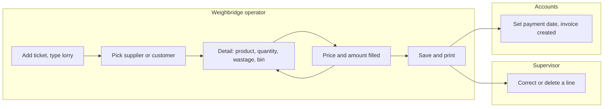
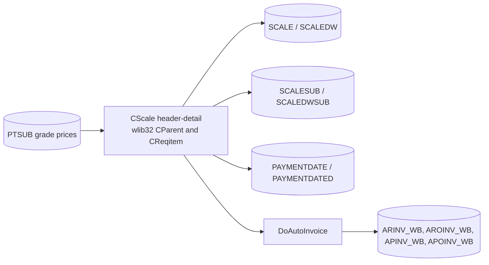
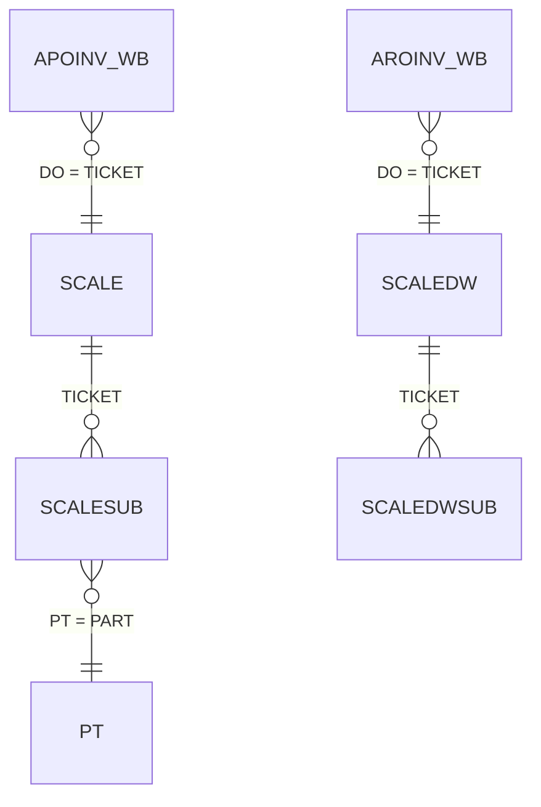
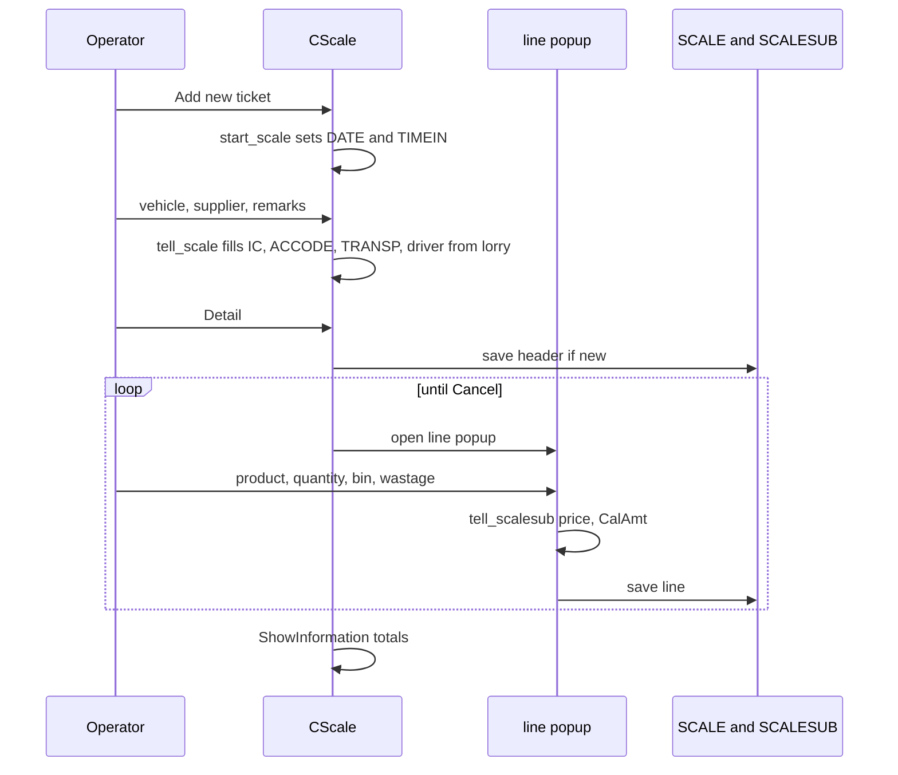
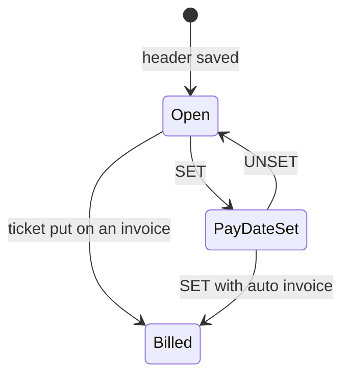

# Scale weighing (menus 1.6 and 1.7) - Module reference

> Part of the TradeWin module reference. Index and shared sections: [README](README.md).
> Menu items covered: 1.6 Scale Weighing (Unlimited Product Features) and 1.7 Scale Despatch Weighing (Unlimited Product Features). Compared with Application_LekokPaper, the scale screen here is the plain header-detail screen of wlib32: **no weight capture from the indicator, no bin-code master, no Cancel Ticket, no customer price list and no unlimited-product receiving and despatch forms**.
> Last verified against commit `2f77122`. Translation status: English only (no zh-CN copy yet).

## Contents

- [Part 1 - Business view](#part-1---business-view)
  - [1.1 In plain words](#11-in-plain-words)
  - [1.2 Who uses what](#12-who-uses-what)
  - [1.3 A day in the life](#13-a-day-in-the-life)
  - [1.4 Worked example](#14-worked-example)
  - [1.5 Screen tour](#15-screen-tour)
  - [1.6 Where does this number come from?](#16-where-does-this-number-come-from)
  - [1.7 Status meanings](#17-status-meanings)
  - [1.8 What happens if...](#18-what-happens-if)
  - [1.9 Messages you may see](#19-messages-you-may-see)
  - [1.10 Do and don't](#110-do-and-dont)
  - [1.11 Before you start](#111-before-you-start)
  - [1.12 Glossary](#112-glossary)
  - [1.13 Ask the AI](#113-ask-the-ai)
- [Part 2 - Technical view](#part-2---technical-view)
  - [2.1 Overview](#21-overview)
  - [2.2 Architecture and dependencies](#22-architecture-and-dependencies)
  - [2.3 Master data catalogue](#23-master-data-catalogue)
  - [2.4 Sub-table hierarchy](#24-sub-table-hierarchy)
  - [2.5 Modules and process flows](#25-modules-and-process-flows)
  - [2.6 End-to-end flows](#26-end-to-end-flows)
  - [2.7 Report catalogue](#27-report-catalogue)
  - [2.8 Integrations](#28-integrations)
  - [2.9 Configuration](#29-configuration)
  - [2.10 Maintenance](#210-maintenance)

---

# Part 1 - Business view

## 1.1 In plain words

- **Scale Weighing** is how this site records goods it **buys** product by product, typed in by the operator from the scale reading. **Scale Despatch Weighing** is how it records goods it **sells**. The two screens are the same; only the labels differ (the number is called "RN NO" when buying and "DN NO" when selling, and the other party is called "SUPPLIER" or "CUSTOMER").
- One ticket has a **header** (lorry, supplier or customer, pay type, transporter, driver, remarks) and any number of **product lines** (the product list is unlimited, hence the menu wording). For each line the operator picks the product and **types** the quantity (the weight in kg), and may type a **wastage** and a **bin** weight that are taken off. The program fills the **unit price** from the product and works out the **amount**.
- The ticket total is the sum of the line amounts. For a cash ticket the total is also shown again as a **final amount** rounded to a whole unit, with the rounding difference.
- The ticket is billed on a purchase or a sales invoice. A user of high level can press **SET** on the ticket to give it a payment date and create the invoice in one step (see [Invoice](invoice-cashier.md)).
- If the ticket is not saved there is nothing to bill, and stock and reports miss the goods.
- Unlike the two-weight tickets of [Weighing](weighing.md), a scale ticket has **no live link to the scale in this program**: the weight on each line is typed.

## 1.2 Who uses what

| Department | Menu item | Main tasks |
|---|---|---|
| Weighbridge operator | 1.6 Scale Weighing, 1.7 Scale Despatch Weighing | Open a ticket, pick supplier or customer, add product lines, save, print |
| Weighbridge supervisor | 1.6, 1.7 | Correct a line, delete a line or a ticket that is not billed |
| Accounts (level 99) | 1.6, 1.7 | Set the payment date, which creates the invoice (see [Invoice](invoice-cashier.md)) |
| IT / Admin | 4.1.1 Product Code | Keep the products and their prices |

**Start here - Weighbridge operator**
- Menu 1 > Scale Weighing (buying) or Scale Despatch Weighing (selling).
- Add a new ticket, type the lorry number (supplier, transporter and driver fill in from the lorry list), choose the supplier, then use the Detail button to add each product.
- For each product pick the code, type the quantity, check the price, press OK.
- Save and print.

**Start here - Supervisor**
- To correct a line: double-click the line, change the figure, OK. The ticket cannot be edited once it is on an invoice.

## 1.3 A day in the life

**A supplier delivers goods.** The operator picks 1.6 and adds a new ticket. The date and the time are filled in. The operator types the lorry number; the program fills the supplier, transporter, driver number and name from the lorry list. The operator presses the Detail button (the program saves the header with a new RN NO first) and a line window opens. The operator picks the product code (the unit price appears on its own), types the quantity read from the scale and, if needed, the wastage and the bin weight. OK saves the line and the window opens again for the next product. When the last line is done the operator presses Cancel in the line window, then saves and prints the ticket.

**A customer collects goods.** The same steps with 1.7. The ticket is then the basis for the sales invoice.

**A line was entered wrongly.** The supervisor opens the ticket, double-clicks the line, corrects it, OK. The ticket cannot be edited once it is on an invoice.

Swimlane:



*Caption: the operator adds lines until the goods are finished; the supervisor corrects; accounts bill the ticket.*

## 1.4 Worked example

All values are made up.

**Before:** supplier `S0001` "TEST METAL SUPPLIER SDN BHD" exists; lorry `WXX1234` has `S0001` as its second driver field; product `AL01` has a purchase price of 2.000 on its (first) grade line; product `CU01` has a purchase price of 0.335; the pay type of the ticket is `CASH`.

| Step | Screen | What the operator does | What the program does | Status after |
|---|---|---|---|---|
| 1 | 1.6 Scale Weighing | Add, types lorry `WXX1234` | Date and time in filled; supplier, transporter, driver filled from the lorry list | Header open |
| 2 | Header | Detail button | Saves the header with a new RN NO, then opens the line window | Header saved |
| 3 | Line 1 | Product `AL01`; types quantity 3,435; bin 20 | Unit price 2.000 from the product; amount = (3,435 - 0 - 20) x 2.000 = **6,830.00** | Line saved |
| 4 | Line 2 | Product `CU01`; quantity 1,200; wastage 50 | Unit price 0.335; amount = (1,200 - 50 - 0) x 0.335 = 385.25 (**385.25**) | Line saved |
| 5 | Header | Cancel in the line window | Grid shows two lines; Total 7,215.25; Rounding Adj -0.25; Final Amount 7,215.00 (cash ticket) | Ticket complete |
| 6 | Header | (level 99) SET, picks payment date, answers Yes to "Auto create Invoice?" | Creates a purchase invoice with one line for this ticket (see [Invoice](invoice-cashier.md#14-worked-example)) | Ticket billed |

## 1.5 Screen tour

### Scale ticket window (buying: "RN NO"; selling: "DN NO", "CUSTOMER")

**Purpose:** the header of the ticket, the list of its product lines, and the totals.

| Field label | Meaning | Required? | Where the value comes from |
|---|---|---|---|
| RN NO / DN NO | Ticket number | - | Automatic running number (a blank or `NEW` number means the ticket is not saved yet) |
| DATE | Ticket date; users below level 9 cannot change it | - | Today by default |
| TIME | Time the ticket was opened | - | Automatic |
| VEHICLE NO | Lorry number | Yes (the program refuses to save without it) | Typed or picked from the lorry list |
| SUPPLIER / CUSTOMER | Account of the other party | Yes for billing | Picked; filled from the lorry's second driver field |
| PAY TYPE | How the other party pays | No | Picked. **It is not defaulted** (the Lekok version starts as `CASH`); `01` or `CASH` makes the ticket a cash ticket |
| TRANSPORTER | Transport company | No | Picked; filled from the lorry |
| I/C NO, DRIVER | Driver number and name | No | Picked; filled from the lorry |
| REMARKS | Free text | No | Typed |
| PAY DATE | Date set by the SET button | - | Automatic |
| Print Counter | Number of times printed | - | Automatic |
| Total | Sum of all line amounts | - | Calculated |
| Rounding Adj, Final Amount | Cash tickets: the total rounded to a whole unit and the difference. Other tickets: adjustment 0.00 and the final amount equal to the total | - | Calculated |

Hidden fields (D/O NO, GATEPASS, UNIT, SCRAP G/NOTE) are on the form but switched off.

**Product line grid:** No, Product Code, Product Description, Quantity, Unit Price, `*` (the unit price differs from the original price), Amount.

**Buttons:** Detail (add lines), double-click a line (edit or delete it), Print, and for level 99 in edit mode **SET** and **UNSET** (payment date). The standard record buttons (Add, Edit, Save, Delete, Search, Previous, Next) come from the framework. There is no Cancel Ticket button here.

### Product line window

| Field label | Meaning | Required? | Where the value comes from |
|---|---|---|---|
| Product | Product code | Yes | Picked; fills the unit price |
| Qty | Weight in kg | Yes (cannot be negative or blank) | Typed |
| Wastage | Weight deducted for dirt; cannot exceed Qty | No | Typed |
| Bin | Weight of the bin or bag; cannot exceed Qty | No | Typed (there is no bin-code list in this program) |
| Unit Price | Price per kg | Yes (cannot be negative or blank) | Filled from the first grade line of the product (purchase price when buying, sales price when selling); can be typed over |
| `*` | Mark: the unit price differs from the original price | - | Automatic, but unreliable, see 1.8 |
| Amount | Line amount | - | Calculated, see 1.6 |

**Buttons:** OK, Cancel, Delete (framework). The line window has no Net Weight box and no Capture Weight button in this program.

## 1.6 Where does this number come from?

- **Line amount** = (Qty - Wastage - Bin) x Unit Price. It is **not rounded** per line. Example: (3,435 - 0 - 20) x 2.000 = **6,830.00**; (1,200 - 50 - 0) x 0.335 = **385.25**.
- **Unit price** = the first grade line of the product (menu 4.1.1): the purchase price when buying (1.6) and the sales price when selling (1.7). The customer's own price list (menu 4.2.1) is **not** used on scale tickets in this program. The grade line is picked without any ordering, so with several grade lines the price depends on the order the server returns them.
- **Ticket total** = sum of the line amounts.
- **Final Amount (cash tickets)** = the total rounded to the nearest whole unit; **Rounding Adj** = Final Amount minus Total. Example: total 7,215.25 gives Final Amount 7,215.00 and Rounding Adj -0.25. A cash ticket is one whose pay type code is `01` or `CASH`. For any other pay type the adjustment is 0.00 and the Final Amount box repeats the total.
- **Stock card:** each scale line counts as stock **in** (buying) or **out** (selling) by its quantity (see [Other, Stock](other-stock-export.md)).

## 1.7 Status meanings

| Document | Status | Meaning | Who or what changes it | What can still be edited |
|---|---|---|---|---|
| Scale ticket | Open | Saved, not billed | Save | Fields allowed for the user's level; lines can be added, edited and deleted |
| Scale ticket | Pay date set | A payment date exists for the ticket | SET button (level 99) | Same |
| Scale ticket | Billed | The ticket number is on an invoice line | Invoice screen or SET | Locked: the program says the ticket is issued to an invoice and refuses edits and deletion |

There is no "cancelled" status for scale tickets in this program.

## 1.8 What happens if...

| Situation | What to do | Call IT when |
|---|---|---|
| The quantity on a line is blank | The program will not save a blank or negative quantity; type the weight | - |
| Wrong weight on a line | Double-click the line, change the quantity, OK | - |
| Wrong product on a line | Double-click the line and use Delete, then add it again | - |
| Wrong customer or price | Edit the header or the line before billing; once billed the ticket is locked | - |
| Ticket already on an invoice | Ask accounts to remove the ticket from the invoice first | - |
| Ticket made by mistake | Delete it while it is not billed (there is no Cancel Ticket) | - |
| Power or network cut | A saved line stays; the header is saved when you first press Detail on a new ticket | Server not reachable after restart |
| Price is 0 | The product has no grade price: fill one in (menu 4.1.1), or type the price on the line | - |
| Every line shows `*` in the price column | The original price is never stored by the program, so the mark is not reliable | Always (known issue) |

## 1.9 Messages you may see

| Message | What it means | What to do |
|---|---|---|
| `Please key in vehicle no` | Ticket saved without a lorry number | Type it |
| `Please select Product` | Line has no product | Pick one |
| `Quantity is Zero.` + `Not allowed to save.` | Quantity blank or negative | Type the weight |
| `Unit Price is Zero.` + `Not allowed to save.` | Unit price blank or negative | Fill the price |
| `Bin cannot more than quantity` | Bin weight is above the quantity; the bin box is cleared | Check the figure |
| `Wastage cannot more than quantity` | Wastage is above the quantity; the box is cleared | Check the figure |
| `Ticket is issued to Invoice:<no>` + `Not allow modify.` | The ticket is on an invoice | See 1.8 |
| `Error Message` + `Cannot delete Ticket No: <no>` + `because this ticket already Invoiced.` | Delete refused | - |
| `Auto create Invoice?` | After SET | Yes creates the invoice |
| `Ticket No : <no> already existed in Invoice : <inv>.` + `Please rectify` | The ticket is already billed | - |
| `RECORD COMPLETE` | The pay date was saved | - |
| `UNSET COMPLETED` / `RECORD DOES NOT EXIST` | UNSET removed the payment date, or none existed | - |

## 1.10 Do and don't

- Do read the weight from the scale carefully: nothing checks the typed quantity.
- Do check the price column before saving; a missing price means a zero amount.
- Don't weigh two products in one line.
- Don't expect the `*` price mark to tell you whether a price was changed (see 1.8).
- Don't press SET on a ticket before the lines are final: SET creates the invoice from the ticket total.

## 1.11 Before you start

- Supplier or customer accounts and products with at least one grade line exist, and pay types.
- Lorries with their drivers, supplier and transporter are in the lorry list if you want the header filled in.

## 1.12 Glossary

| Term | English | Malay | Chinese |
|---|---|---|---|
| Scale weighing | Weighing goods product by product on the scale | Timbang skala | 磅秤称重 |
| RN / DN | Receiving note / delivery note number | No. terimaan / hantaran | 收货 / 送货单号 |
| Bin / bag | Container whose weight is deducted | Bakul / beg | 容器 |
| Wastage | Weight deducted for dirt or moisture | Susut | 扣重 |
| Grade | Quality level of a product with its own prices | Gred | 等级 |
| Final amount | Total after rounding | Jumlah akhir | 最终金额 |
| Pay date | Date set for payment of the ticket | Tarikh bayaran | 付款日期 |

## 1.13 Ask the AI

1. How do I record goods that a supplier brings in on the scale?
2. How do I add a second product to the same ticket?
3. How is the amount of a product line worked out?
4. Where does the unit price on a line come from?
5. What are Rounding Adj and Final Amount on a cash ticket?
6. What do the bin and wastage boxes do?
7. How do I correct a weight on a line?
8. How do I undo a ticket made by mistake?
9. What does the SET button do and who can press it?
10. What is the difference between Scale Weighing and Scale Despatch Weighing?

---

# Part 2 - Technical view

## 2.1 Overview

- Application: TradeWin Metals weighbridge (VC6/MFC on wlib32, `menu.dsp`, `menu.exe`). See [README](README.md).
- This module: the scale ticket screen `CScale` (SCALE.CPP, header-detail on `CParent`) and its line tables. The line popup is the generic wlib32 `CReqitem` on dialog `IDD_SCALESUB` (menu.rc:241); the repo has no line-editor class of its own (the Lekok `CScaleSub`, `CCWT`, `CConfirmWeight`, `CWb`, `CReceive`, `CFgw_Wb` files are not in this repo).
- The same class serves buying and selling: `Purchase_Flag` is TRUE for 1.6 and FALSE for 1.7 (MAIN.CPP:209, 213).

## 2.2 Architecture and dependencies



*Caption: the screen reads the grade prices, stores the ticket and its lines and, on SET, hands the ticket to the auto-invoice routine.*

- Libraries: wlib32 (`CParent`, `CReqitem`, `MGRID`, `DB`, ticket numbering), MSFlexGrid.
- Database: SQL Server; no schema repo for TradeWin.
- Indicator: **none**. This module never reads the scale.
- QR / e-wallet code: SCALE.CPP:8-243 and 247-315 hold commented-out code for a mobile-wallet payment QR code on the scale ticket (encrypting the ticket data, generating `qrcode.jpg` with an external `qrcode.exe`, storing it through `CMyJpg` in the table `scale_qrcode` and calling a web payment API). It is dead code; `scale_qrcode` is not opened (MENU.CPP:435). The repo root still holds `qrcode.jpg`. No key or endpoint is copied here.

## 2.3 Master data catalogue

### PAYMENTDATE and PAYMENTDATED (pay date per ticket)

Types: from `SQL_LekokPaper` scripts `PAYMENTDATE.sql`, `PAYMENTDATED.sql` (sister app), unverified for TradeWin: `TICKET` nvarchar(10) PK, `PAYDATE` smalldatetime. `AdminDbScale` opens `paymentdate` for the scale table and `paymentdated` for the others (SCALE.CPP:571-578); `CSETPAYDATEU` writes the row (SETPAYDATEU.cpp:45-61).

There is no bin master in this program: the Lekok `BIN_BAG` table and its dialog are not here, and the line's `BIN` is a typed weight.

## 2.4 Sub-table hierarchy

```text
SCALE   (header, key TICKET)         SCALEDW  (header, key TICKET)
  - SCALESUB     link: TICKET          - SCALEDWSUB   link: TICKET
    Nested sub-tables: none              Nested sub-tables: none
```



*Caption: a scale ticket has product-line rows keyed by the ticket number; an invoice line points back to the ticket through its `DO` column.*

- Link key: the first field of the sub-table (`TICKET`) equals the header ticket (wlib32 `OnAddSub` copies `df->dat[1]` into `sub->dat[1]`). The sub tables are opened with `tado(&scalesub,"scalesub",init_scalesub)` and `tado(&scaledwsub,"scaledwsub",init_scalesub)` (MENU.CPP:436, 438); `AdminDbScale` sets `p1.sub = sub` (SCALE.CPP:580).
- Saving: the header is saved by the wlib32 `CParent` mechanism, and a **new** header is saved as soon as the user presses Detail (`CParent::OnAddSub` calls `db_save(df,0)` before the line popup opens; wlib32, not traced line by line); each line is then saved on its own when OK is pressed in the popup. Line number `SQNO` is assigned by the framework.

### SCALE and SCALEDW (headers)

Types: from `SQL_LekokPaper` scripts `SCALE.sql`, `SCALEDW.sql` (sister app, same layout), unverified for TradeWin; enum `scale` (MENU.H:804) names fields 1 to 17.

| # | field (enum) | SQL column | data type | null | key | meaning |
|---|---|---|---|---|---|---|
| 1 | `SCA_TICKET` | `TICKET` | nvarchar(10) | no | PK | ticket number |
| 2 | `SCA_SERIAL` | `SERIAL` | nvarchar(10) | yes |  | serial (field hidden on the form) |
| 3 | `SCA_DATE` | `DATE` | smalldatetime | yes |  | ticket date |
| 4 | `SCA_VEHICLE` | `VEHICLE` | nvarchar(10) | yes |  | lorry number |
| 5 | `SCA_UNIT` | `UNIT` | nvarchar(6) | yes |  | unit (hidden) |
| 6 | `SCA_ACCODE` | `ACCODE` | nvarchar(10) | yes |  | supplier or customer account |
| 7 | `SCA_PTYPE` | `PTYPE` | nvarchar(5) | yes |  | pay type; `01` and `CASH` are cash |
| 8 | `SCA_TRANSP` | `TRANSP` | nvarchar(5) | yes |  | transporter |
| 9 | `SCA_DO` | `DO` | nvarchar(12) | yes |  | delivery order number (hidden) |
| 10 | `SCA_SCRAP` | `SCRAP` | nvarchar(20) | yes |  | scrap grading note (hidden) |
| 11 | `SCA_IC` | `ICNO` in the sister script; `IC` in the TradeWin code | nvarchar(12) / unverified | yes |  | driver number (the commented code reads the column by the name `IC`, SCALE.CPP:258) |
| 12 | `SCA_DRIVER` | `DRIVER` | nvarchar(50) | yes |  | driver name |
| 13 | `SCA_REMARKS` | `REMARKS` | nvarchar(40) | yes |  | remarks |
| 14 | `SCA_TIMEIN` | `TIMEIN` | nvarchar(8) | yes |  | time the ticket was opened |
| 15 | `SCA_SUBTOTAL` | `SUBTOTAL` | decimal(18) | yes |  | sum of the line amounts; the update in `after_save` compares the table name case-sensitively with `SCALE` while the table is opened as `scale`, so it probably never runs (SCALE.CPP:399, MENU.CPP:439; see 2.10) |
| 16 | `SCA_API_SCANNED_QR` | `API_SCANNED_QR` | datetime | yes |  | QR scan time written by an outside system (no active code here) |
| 17 | `SCA_API_DISPENSED` | `API_DISPENSED` | decimal(18,2) | yes |  | amount dispensed by an outside system (no active code here) |
| 18 to 23 | | `REC_STATUS`, `NEWUSER`, `NEWTIME`, `MODIFYUSER`, `MODIFYTIME`, `Print Counter` | | yes |  | framework audit; nothing writes `REC_STATUS = 1` on scale tickets in this program |

The sister script has more columns (`FIRST_WT`); the live TradeWin table may also carry `Encrypted_Data` and `jpgkey` (named only in commented code, SCALE.CPP:289, 291). Unverified.

### SCALESUB and SCALEDWSUB (product lines)

Types: from `SQL_LekokPaper` scripts `SCALESUB.sql`, `SCALEDWSUB.sql` (sister app), unverified for TradeWin. Enum `scalesub` (MENU.H:807) has **10** entries here, so the sister script (12 columns with `BIN_BAG` at position 9 and `QTY_MODIFIED` at position 11) does not match this program's column order; the table below follows the TradeWin enum and uses the sister types only as a hint.

| # | field (enum) | SQL column | data type | null | key | meaning |
|---|---|---|---|---|---|---|
| 1 | `SCASB_TICKET` | `TICKET` | nvarchar(10) | no |  | parent ticket (link key) |
| 2 | `SCASB_SQNO` | `SQNO` | float(53) | yes |  | line number |
| 3 | `SCASB_PT` | `PT` | nvarchar(8) | yes |  | product code |
| 4 | `SCASB_QTY` | `QTY` | decimal(18,2) | yes |  | quantity (weight in kg), typed |
| 5 | `SCASB_UPRICE` | `UPRICE` | decimal(18,3) | yes |  | unit price per kg |
| 6 | `SCASB_AMT` | `AMT` | decimal(18,2) | yes |  | line amount |
| 7 | `SCASB_UPRICE_ORI` | `UPRICE_ORI` | decimal(18,3) | yes |  | original price (never written by the program) |
| 8 | `SCASB_WASTAGE` | `WASTAGE` | decimal(18,2) | yes |  | wastage kg |
| 9 | `SCASB_BIN` | `BIN` | decimal(18,2) | yes |  | bin weight kg, typed |
| 10 | `SCASB_PKKEY` | `PKKEY` | int | no | PK identity | row key |

- Cardinality 1..n per ticket. Nested sub-tables: none.
- Lookups: `PT` (product master) for the description, `PTSUB` (grade prices) for the price.

## 2.5 Modules and process flows

### Menu items and entry points

| Menu item | Node | Handler | Opens |
|---|---|---|---|
| 1.6 Scale Weighing (Unlimited Product Features) | 16 | `Purchase_Flag = TRUE; AdminDbScale(&scale,&scalesub)` (MAIN.CPP:208-211) | `CScale`, dialog `IDD_SCALE` (menu.rc:269), line dialog `IDD_SCALESUB` |
| 1.7 Scale Despatch Weighing (Unlimited Product Features) | 17 | `Purchase_Flag = FALSE; AdminDbScale(&scaledw,&scaledwsub)` (MAIN.CPP:212-215) | same with `scaledw` |

### Flow: adding a scale ticket



*Caption: the header is saved when the first line is started; each line is saved on its own.*

1. `start_scale` (SCALE.CPP:675-680): date = today, `TIMEIN` = now. No pay type is defaulted.
2. `tell_scale` (SCALE.CPP:596-663): on a changed lorry it reads `lorry` and sets driver number (`LO_DRIVER1`), **account** (`LO_DRIVER2`), transporter and the driver name (`driver.dat[2]`, the `driver` object is the table `ic`, MENU.CPP:464); on a changed driver number it refreshes the name.
3. `CScale::OnDetail` (SCALE.CPP:518-521) only calls the wlib32 `CParent::OnDetail` / `OnAddSub`, which saves a new header and loops the line popup until Cancel. Double-click on a grid row opens the same popup for that row (wlib32); the popup's `IsSaveConditionOk` runs `scalesub_save`.
4. `OnReqitemInitDialog` (SCALE.CPP:460-478) sets the `*` text in the popup when `UPRICE` differs from `UPRICE_ORI`. `ReplaceSubGrid` (SCALE.CPP:542-561) fills the grid row (product code and description, quantity, unit price, `*`, amount) and adds the amount to `subtotal_amt`; the grid titles are in `ShowInitFrame` (SCALE.CPP:523-540).
5. `tell_scalesub` (SCALE.CPP:736-778): product picked: `ScalesubChangePrice` sets `UPRICE` from `Select COST,SALES from PTSUB where PART='<product>'` (the first row, no ordering): `COST` when `Purchase_Flag`, else `SALES` (SCALE.CPP:713-733; the grade-and-customer lookup is commented out "revert back for tradewin"). Bin: refuses a bin above the quantity (SCALE.CPP:752-762). Wastage: refuses wastage above the quantity (SCALE.CPP:763-773). Every change calls `CalAmt`.
6. `scalesub_save` (SCALE.CPP:780-800): product, quantity (>= 0, not blank) and unit price (>= 0, not blank) are required; then `CalAmt`.
7. `CalAmt` (SCALE.CPP:808-816): amount = (QTY - WASTAGE - BIN) x UPRICE, stored as is; there is no rounding of the line.
8. `Get_Adjustment(subtotal)` (SCALE.CPP:409-414) rounds to a whole unit with the wlib32 formatter `dtoa(subtotal, ..., 12, 0)`, which uses `fcvt` (nearest). The version in the sister app takes a method number; this one does not.
9. `CScale::ShowInformation` (SCALE.CPP:431-458): refreshes the grid, shows the pay date from `paymentdate`; for pay types `01   ` and `CASH ` shows Rounding Adj and Final Amount from `Get_Rounding_Adjustment(sum)` and `Get_Final_Amount(sum)` (SCALE.CPP:447-451); for other types Rounding Adj `0.00` and Final Amount equal to the total box (SCALE.CPP:452-456). There is no "Ticket Cancelled" text.

### Flow: edit lock, delete, pay date

- **Edit lock:** `CScale::IsCannotEdit` (SCALE.CPP:340-363) looks the ticket up in `apoinv_wb` (table `scale`) or `aroinv_wb` (others) by `DO`; a hit shows `Ticket is issued to Invoice:<no>` and blocks editing.
- **Delete:** the screen's delete hook is `Delete_ds` (SCALE.CPP:703; DS.CPP:1013-1026), which refuses when `IsTicketAlreadyBilled` (DS.CPP:994-1011) finds an invoice line for the ticket (`dp`, `rt` and `scaledw` look in `aroinv_wb`, the others in `apoinv_wb`).
- **SET / UNSET** (`OnSetpaydate` SCALE.CPP:818-838, `OnUnset` SCALE.CPP:840-853): both buttons are shown only in edit mode to users of level 99 or above (`SetAttribute`, SCALE.CPP:365-386). SET opens `CSETPAYDATEU`, which writes `PAYMENTDATE` (or `PAYMENTDATED`), then calls `DoAutoInvoice` for the purchase or the sales tables (see [Invoice](invoice-cashier.md#25-modules-and-process-flows)). UNSET deletes the pay-date row.
- **Print:** `CScale::OnPrint` (SCALE.CPP:245-319) is the wrapper whose body is commented out, so it just calls `CParent::OnPrint` (SCALE.CPP:318); the form is the Crystal layout of the table (`SCALE.rpt`, `SCALEDW.rpt` are in the repo; the choice is made by wlib32 and was not checked here).
- `scale_initial` (SCALE.CPP:586-594): the date is read-only below level 9.
- `scale_save` (SCALE.CPP:665-673): refuses a blank lorry number with `Please key in vehicle no`.

### Tables read and written

| Table | Read | Written | Key |
|---|---|---|---|
| SCALE / SCALEDW | `CScale` | header insert, update | `TICKET` nvarchar(10) |
| SCALESUB / SCALEDWSUB | line grid, totals | line insert, update, delete | `PKKEY` int identity |
| LORRY, `driver` (table `ic`) | defaults on lorry change | - | see [Control tables](control-tables.md) |
| PT, PTSUB | names and prices | - | |
| PAYMENTDATE / PAYMENTDATED | pay date | SET / UNSET | `TICKET` |
| APINV_WB, APOINV_WB, ARINV_WB, AROINV_WB | edit and delete lock | `DoAutoInvoice` | see [Invoice](invoice-cashier.md) |
| TICKETNO | next number | increment | `RecordSet` |

Key types are from the sister app and unverified for TradeWin.

### Running numbers

TICKETNO rows named after the tables (`scale`, `scaledw`); the wlib32 save of a new header counts the number. The prefix and length are site data.

### Status transitions



*Caption: billing locks edits and deletion. There is no cancel status for scale tickets in this program.*

### Dependencies on other modules

- [Control tables](control-tables.md): product with grades, lorry, driver, pay type.
- [Invoice](invoice-cashier.md): the ticket is billed by its `TICKET` number.
- [Other, Stock](other-stock-export.md): stock card and adjustments.

## 2.6 End-to-end flows

See [README](README.md#26-end-to-end-flows).

## 2.7 Report catalogue

- Picker entries for scale tickets: `00136` Scale Weighing Detail Report (`scdetail.rpt`), `00137` the same with price adjusted (`scdetail_adjprice.rpt`), `00040` and `00138` Scale Despatch Detail Report (`scdwdetail.rpt`, `scdwdetail_adjprice.rpt`), `00038` Receiving and Scale Weighing Detail Report (`dsnsc.rpt`); see [Reports](reports.md).
- Ticket forms: `SCALE.rpt`, `SCALEDW.rpt` (and the `_logo` and backup variants in the repo, not referenced by code).

## 2.8 Integrations

| Trigger | System | Detail | Failure handling |
|---|---|---|---|
| SET | Invoice tables | `DoAutoInvoice` writes `ARINV_WB` / `APINV_WB` and their lines | message, rollback of the failed insert |
| `API_SCANNED_QR`, `API_DISPENSED` columns | an outside dispensing or QR system | columns only; no active code in this repo reads or writes them | - |

## 2.9 Configuration

- No settings are specific to this module. `Purchase_Flag` selects buying or selling (MAIN.CPP:209, 213).

## 2.10 Maintenance

- Update this file with any change to the scale tables, `CScale`, the price rules or the rounding.
- Changelog:

| Date | Commit | Who | What changed |
|---|---|---|---|
| 2026-10-19 | `2f77122` | Claude (draft for review) | First version for Application_TradeWin, started from the Application_LekokPaper scale reference and verified against this repo's code (scale lines simplified, no unlimited-product forms) |

- Last verified against commit `2f77122`. Translation status: English only.

### Code findings (for the developer)

1. **Scale tickets cannot be cancelled and nothing records the intent**: the Cancel Ticket button and status text of the sister app are removed from `CScale` and the dialog. A wrong ticket can only be deleted (blocked once billed).
2. **`UPRICE_ORI` is never written**: the assignments are commented out (SCALE.CPP:744-745), while `ReplaceSubGrid` and `OnReqitemInitDialog` compare it with `UPRICE` (SCALE.CPP:468, 550), so every priced line shows the `*` mark.
3. **`SUBTOTAL` is probably never filled**: `after_save` tests `strcmp(df->name, "SCALE")` (SCALE.CPP:399) but the table is opened with the lower-case name `scale` (MENU.CPP:439) and wlib32 copies the name as given.
4. **Unit price picks the first `PTSUB` row without ordering** (SCALE.CPP:728): with several grade lines per product the price depends on the server's row order. The customer price list is not consulted (SCALE.CPP:719-727 commented out).
5. **Dormant e-wallet QR payment code** in SCALE.CPP (lines 8-243 and 247-315, commented out) holds an embedded public key, a payment-gateway base address and a bill-making call; if it is revived the key and address must move to configuration. `scale_qrcode` is not opened and `qrcode.jpg` sits in the repo root.
6. **`scale_save` only checks the lorry number** (SCALE.CPP:665-673): a ticket can be saved with no supplier or customer.
7. **The pay type is no longer defaulted to `CASH`** (SCALE.CPP:675-680), so a ticket saved without a pay type is not treated as cash and gets no rounding.
