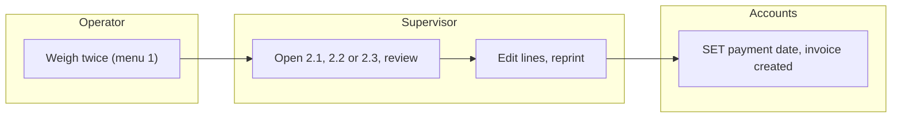
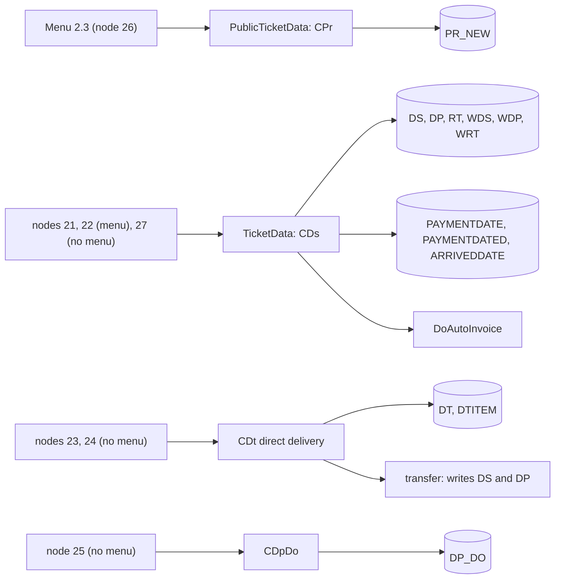
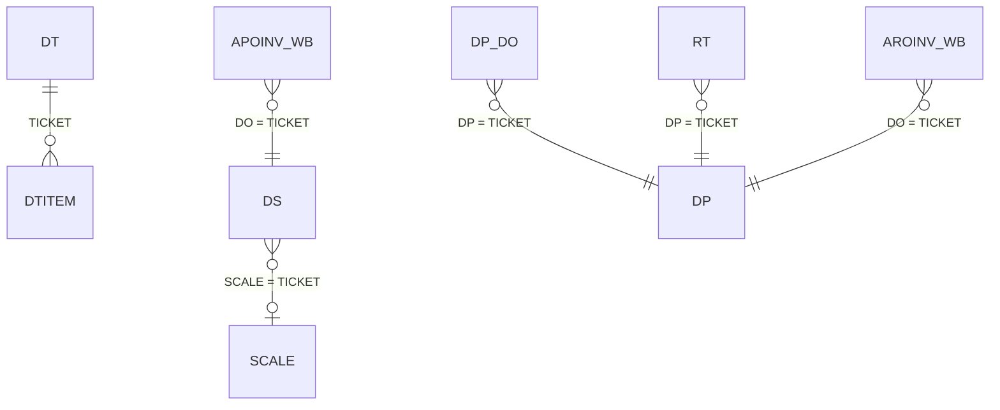
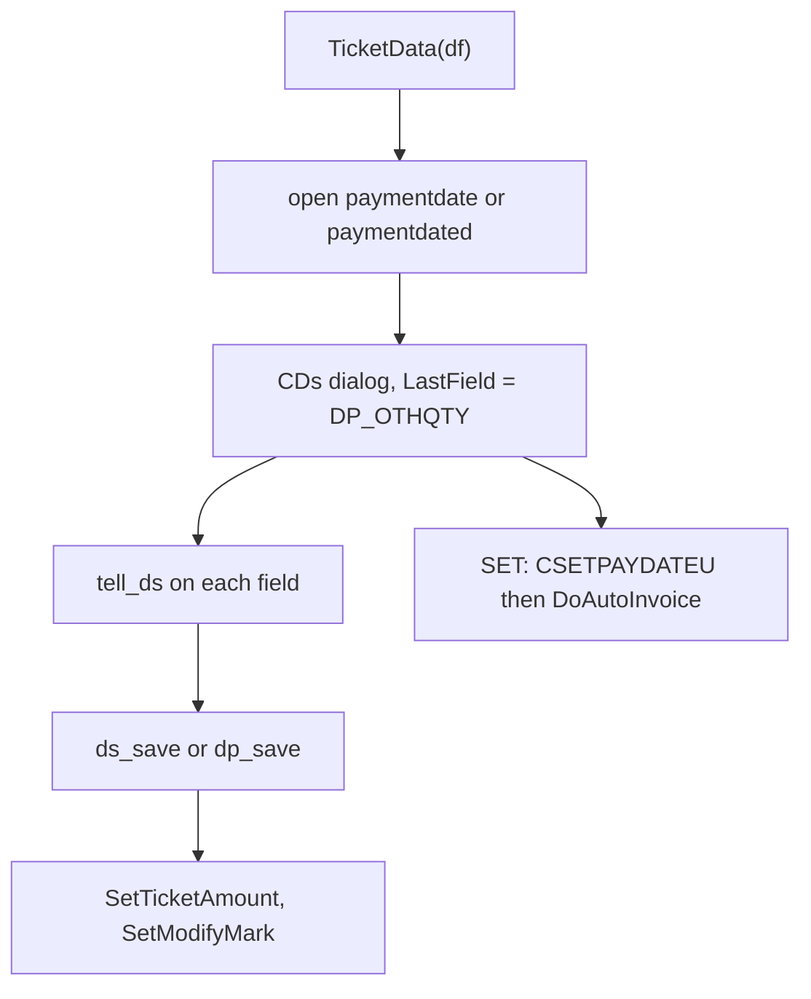
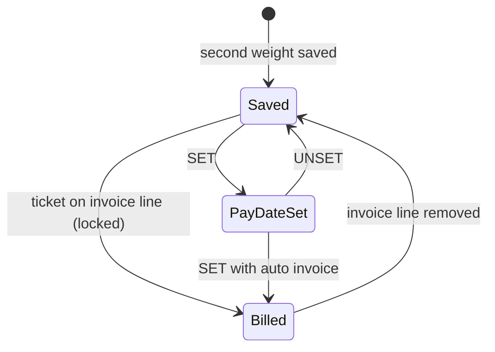

# Tickets (menu 2) - Module reference

> Part of the TradeWin module reference. Index and shared sections: [README](README.md).
> Menu items covered: 2.1 RECEIVING NOTE, 2.2 DESPATCH and 2.3 Public Weighing; and the ticket nodes that have no menu item at all: 23 Direct delivery ticket, 24 Direct delivery pricing update, 25 Despatch D/O, 27 Return note. Scale tickets (SCALE, SCALEDW) are opened from the weighing menu, see [Scale weighing](scale-weighing.md).
> Last verified against commit `2f77122`. Translation status: English only (no zh-CN copy yet).

## Contents

- [Part 1 - Business view](#part-1---business-view)
  - [1.1 In plain words](#11-in-plain-words)
  - [1.2 Who uses what](#12-who-uses-what)
  - [1.3 A day in the life](#13-a-day-in-the-life)
  - [1.4 Worked example](#14-worked-example)
  - [1.5 Screen tour](#15-screen-tour)
  - [1.6 Where does this number come from?](#16-where-does-this-number-come-from)
  - [1.7 Status meanings](#17-status-meanings)
  - [1.8 What happens if...](#18-what-happens-if)
  - [1.9 Messages you may see](#19-messages-you-may-see)
  - [1.10 Do and don't](#110-do-and-dont)
  - [1.11 Before you start](#111-before-you-start)
  - [1.12 Glossary](#112-glossary)
  - [1.13 Ask the AI](#113-ask-the-ai)
- [Part 2 - Technical view](#part-2---technical-view)
  - [2.1 Overview](#21-overview)
  - [2.2 Architecture and dependencies](#22-architecture-and-dependencies)
  - [2.3 Master data catalogue](#23-master-data-catalogue)
  - [2.4 Sub-table hierarchy](#24-sub-table-hierarchy)
  - [2.5 Modules and process flows](#25-modules-and-process-flows)
  - [2.6 End-to-end flows](#26-end-to-end-flows)
  - [2.7 Report catalogue](#27-report-catalogue)
  - [2.8 Integrations](#28-integrations)
  - [2.9 Configuration](#29-configuration)
  - [2.10 Maintenance](#210-maintenance)

---

# Part 1 - Business view

## 1.1 In plain words

- A **ticket** is the weighing document. The Ticket menu has three items: **2.1 Receiving Note** (goods bought in), **2.2 Despatch** (goods sold out) and **2.3 Public Weighing** (the walk-in service where the customer only pays for using the scale). They open the finished tickets so they can be looked at, corrected, printed, billed or given a payment date. Public weighing is not billed on an invoice.
- Receiving and despatch tickets have a header (lorry, party, order, driver and so on), **eight product lines** (product, percentage of the net weight, quantity, unit price and amount) and **eight lines for the other party's own figures** (the party grading). They are billed on purchase and sales invoices.
- Tickets for buying and selling goods product by product on the scale (the **scale tickets**) are opened from the Weighing menu, see [Scale weighing](scale-weighing.md).
- Four more ticket screens exist in the program but have **no menu item**: a **direct delivery ticket** (goods that go straight from the supplier's lorry to the buyer), the **pricing update** of direct deliveries, a **delivery order** form and the **return note**. They are described below because the program contains them; a site cannot open them from the menu unless the menu is changed.
- If tickets are wrong, the stock, the reports and the invoices are wrong.

## 1.2 Who uses what

| Department | Menu item | Main tasks |
|---|---|---|
| Weighbridge supervisor | 2.1 Receiving Note, 2.2 Despatch, 2.3 Public Weighing | Look at a ticket, fix a typed field, enter the product lines and prices, capture a weight again (public weighing), print |
| Weighbridge operator | 2.1, 2.2, 2.3 | Reprint a ticket |
| Accounts | 2.1, 2.2 (SET button), [Invoice](invoice-cashier.md) | Give a ticket a payment date and create its invoice; billing of tickets happens on the invoice screens |
| IT / Admin | Other > Company Profile | Settings that affect the weight window |

**Start here - Supervisor**
- Several times a day: Ticket > Receiving Note, Despatch and Public Weighing to review the day's tickets.
- Check that every receiving and despatch ticket has its product lines, unit prices and amounts before accounts bill it.

## 1.3 A day in the life

**Reprint a ticket.** The operator opens 2.1, 2.2 or 2.3, finds the ticket with the Search or arrow buttons and presses Print. The "Print Counter" box counts the prints.

**Complete a ticket.** After the second weight the supervisor opens the ticket from 2.1 or 2.2, presses Edit and fills or corrects the product lines (the percentage of each product, the unit price) and the other party's lines, then presses Save. The program checks that the line quantities add up to the net weight.

**Give a payment date and bill.** Accounts presses **SET** on the ticket, picks the payment date and answers Yes to "Auto create Invoice?". The program creates the purchase or sales invoice for that ticket (see [Invoice](invoice-cashier.md)).

**Fix a mistake.** The supervisor opens the ticket, presses Edit, changes the field and presses Save. An invoiced ticket cannot be edited.

Swimlane:



*Caption: the operator creates the ticket by weighing; the supervisor reviews and completes it in the Ticket menu; accounts bill it.*

## 1.4 Worked example

Continuing the receiving weighing of [Weighing](weighing.md#14-worked-example): ticket for lorry `WXX1234`, supplier `S0001`, first weight 18,500 kg, second weight 8,500 kg, wastage 100 kg, net 9,900 kg.

| Step | Screen | What the user does | What the program does | Status after |
|---|---|---|---|---|
| 1 | 2.1 Receiving Note | Opens the ticket, presses Edit | Shows both weights, both times, both users and NETT WEIGHT 9,900 | Open for edit |
| 2 | Same | Product line 1: `P001`, percentage 100, unit price 2.00 | Quantity = 100 x 9,900 / 100 = 9,900; amount = 9,900 x 2.00 = 19,800.00; TOTAL 19,800.00 | Lines filled |
| 3 | Same | Presses Save | Checks the quantities add up to 9,900, saves | Saved |
| 4 | Same | Presses Print | Prints the ticket form and adds 1 to Print Counter | Printed 1 time |
| 5 | Same | (accounts) presses SET, picks the payment date, answers Yes to "Auto create Invoice?" | Writes the payment date and creates the purchase invoice with one line for this ticket | Billed |

**Result:** one receiving ticket, net 9,900 kg, amount 19,800.00, on a purchase invoice. After step 5 the ticket is locked: changes are refused.

## 1.5 Screen tour

### 2.3 Public Weighing (ticket window)

**Purpose:** view, correct and print a finished public-weighing ticket.

| Field label | Meaning | Required? | Where the value comes from |
|---|---|---|---|
| RN NO. | Ticket number | - | Automatic |
| Date | Weighing date | No | Date of the second weighing; meant to be changeable only by users of level 9 or more (see 2.10, finding 1: the restriction is not applied) |
| Vehicle No. | Lorry | Yes | From the weighing |
| Driver Name | Driver | No | Typed or from the lorry list |
| Customer | Customer account | No | Typed or picked |
| Product | Free text | No | Typed |
| Remarks | Free text | No | Typed |
| Print Counter | How many times printed | - | Automatic |
| Weight Modify | Mark set when a weight was changed after saving | - | Automatic |
| FIRST / SECOND: time, weight, user | The two weighings | No | Automatic |
| NETT WEIGHT (KG) | Net of the load | - | Calculated, see 1.6 |
| CHARGES AMOUNT | Charge for the use of the scale | No | Typed |

**Buttons:** Add, Edit, Save, Delete, Search, Previous, Next, Print (the standard record buttons); **Capture 1st Weight** and **Capture 2nd Weight** (shown while the record is only being viewed): copy the live scale reading into the first or second weight with the current time and the user. There is no Cancel Ticket button.

### 2.1 Receiving Note and 2.2 Despatch (ticket windows)

The screen is almost the same for both; on despatch the party is called "Customer" and the ticket number "DN NO", on receiving the first-weight forms say "Supplier" and "RN NO". These are the fields that are **visible** on the form (the dialog also holds switched-off boxes, see below).

| Field label | Meaning | Required? | Where the value comes from |
|---|---|---|---|
| Ticket No, Date, Vehicle No | Number, date, lorry | Yes (lorry) | Automatic / from the weighing |
| Supplier / Customer | Account (its name is shown beside it) | Yes before a product can be picked | Filled from the lorry list, or picked |
| Pay Type | Cash or credit | No | Picked (it is **not** defaulted to cash in this program) |
| Transporter, I/C No, Driver | Transport company, driver number and name | No | Filled from the lorry list, or picked |
| Party Gross, Tare, Wastage | Weights the other party claims | No | Typed |
| First (gross) and second (tare) weight, times, users | Own weighings | - | Automatic |
| Wastage (less wastage) | Weight deducted | No | Typed |
| Product lines 1 to 8: Product, %, Qty, U/Price and the amount | What was in the load | At least line 1 when the second weight exists | Product picked; % typed; quantity calculated; **unit price typed** (nothing in this program fills it); amount calculated |
| Remarks | Free text | No | Typed |
| NETT, PARTY NETT, GROSS DIFF, TARE DIFF, VAR, TOTAL, total % and total quantity | Calculated boxes | - | See 1.6 |
| Print Counter, Weight Modify, Manual | How often printed; mark that a weight was edited; mark that a reading was typed instead of read from the scale | - | Automatic |
| PAY DATE | Payment date | No | SET and UNSET buttons (final tickets only) |

**Buttons:** **THIRD PARTY GRADING** (opens the other party's eight product lines), **SET** (payment date, then the automatic invoice) and **UNSET** (final tickets 2.1 and 2.2). The `*` marker in a line shows when the price differs from its original (it is not reliable, see 2.10).

**Switched off on the form** (present but hidden): purchase or sales order, unit, serial, sub-contractor, D/O number, scrap note, contract, grader, stock-return note number and date, basis, other quantity, scale ticket, salesman, vehicle type, the D/O Entry button, the arrived-date SET and UNSET buttons and the card-scan button. The program still carries these fields in the record; they cannot be typed on this screen.

### Direct delivery ticket (node 23, no menu item)

Header: Ticket No, Date, Vehicle No, Purchase Order No and Supplier, Sales Order No and Buyer, Driver IC No and name, Remarks, SRN No, weights (first, second, less wastage) for the purchase side and for the sales side with their times, and the calculated nett weights and variances. Lines: Code and Particular with Qty (Purchase), Price, Amount, and Code and Particular with Qty (Sales), Price, Amount. Buttons: **Transfer ticket to Main system**, **Update Price**.

### Direct delivery pricing update (node 24, no menu item)

REF NO, DATE FROM, TO, UPDATE PRICE (tick = purchase price, no tick = sales price), ACCODE, PRODUCT, PRICE, Update (Y/N).

### Despatch D/O (node 25, no menu item)

DO No, Date, Despatch ticket, PO number, L/C number, Delivery To (with the address), lorry condition (Raining, Water, Tyre Dirty, Gas Cylinder, Absorber or Explosive Matter with the number of cylinders, Others) and remarks.

### Return note (nodes 18, 19 and 27, no menu item)

Same layout as the despatch ticket, with a required "Despatch Ticket" link: the first weight screen offers the despatch tickets of the same lorry in the last 10 days.

## 1.6 Where does this number come from?

- **Net weight of a public-weighing ticket** = |second weight - first weight|. Example 14,200 and 6,700 give **7,500 kg**.
- **Own net of a receiving or despatch ticket** = |tare - gross| - wastage. **Party net** = |party tare - party gross| - party wastage. **VAR** = own net - party net. **GROSS DIFF** = own gross - party gross; **TARE DIFF** = own tare - party tare. Example: gross 18,500, tare 8,500, wastage 100 gives **9,900 kg**.
- **Line quantity** = % x own net / 100 (the other party's lines use the party net when it is above zero, otherwise the own net). Example: 100 % of 9,900 gives 9,900 kg.
- **Line amount** = quantity x unit price, **not rounded** by the program (the column keeps two decimals). Example: 6,060 kg x 0.355 = **2,151.30**. The Lekok-style cut down to a whole number is not applied here.
- **Total** = sum of the line amounts. The program also stores this total in a SUBTOTAL column when the table has one (see 2.10, finding 10).
- **Unit price** is typed on the line; the program does not look it up (the lookup of the grade price, the customer price list and the order price is commented out in the ticket screens).
- **Direct delivery:** amount = quantity x price on each side; the lines of a side may not exceed that side's net weight (first - second - wastage).

## 1.7 Status meanings

| Document | Status | Meaning | Who or what changes it | What can still be edited |
|---|---|---|---|---|
| Public-weighing ticket | Saved | Final ticket | Weighing | Fields the user's level allows |
| Receiving / despatch ticket | Saved | Final ticket | Second weight | Fields by level: below 5 no weights and times, below 9 no date (see 2.10, finding 11 on the level lists) |
| Receiving / despatch ticket | Pay date set | A payment date exists | SET button | Same |
| Receiving / despatch ticket | Billed | On an invoice line | Invoice or SET | Locked: edits refused, delete refused |
| Direct delivery ticket | Transferred | Both a receiving and a despatch ticket exist | Transfer button | Locked: "Already Transfer to Main System! can not be modified" |
| Pricing update | Updated | Update = `Y` | Posting | Locked: "Price Updated.Modification Not Allow" |

There is no cancelled status for tickets in this program.

## 1.8 What happens if...

| Situation | What to do | Call IT when |
|---|---|---|
| Wrong customer or product on a public ticket | Edit and Save | - |
| Wrong weight on a public ticket | Edit; press Capture 1st Weight or Capture 2nd Weight on the live scale (or type it); Save | The scale reading is wrong |
| Ticket made by mistake | Delete it while it is not billed; there is no Cancel Ticket | - |
| Ticket printed wrongly | Print again | The form is missing |
| Line quantities do not add up | The program refuses to save: fix the percentages | - |
| Edit after invoicing (receiving, despatch, scale tickets) | Not allowed; accounts must take the ticket off the invoice | - |
| Delete a ticket that is on an invoice | Refused | - |
| Receiving or despatch ticket has no unit price | Type the price on each line before saving; accounts need the amounts | - |
| Public ticket printing asks nothing after the second weight | Normal: print from the ticket screen | - |

## 1.9 Messages you may see

| Message | What it means | What to do |
|---|---|---|
| `Ticket is issued to Invoice:<no>` + `Not allow modify.` | Ticket is on an invoice | Ask accounts |
| `Cannot delete Ticket No: <no> because this ticket already Invoiced.` | Delete refused | - |
| `Total Qty is not tally with Nett weight.` | Line quantities do not add up to the own net | Fix the lines |
| `Please key in vehicle no` / `zero weight` / `Please key in product` | Required data missing | Fill it |
| `Duplicate Product Code` | The same product on two lines | Merge the lines |
| `Percentage over 100` | Line percentages add up above 100 | The program corrects the line |
| `Supplier Code is empty, please key in supplier code` / `Customer Code is empty, please key in customer code` | Product picked before the account | Pick the account first |
| `Supplier Code <code> not regiestered yet` / `Customer Code <code> not regiestered yet` (spelling as shown) | Unknown account | Register it |
| `Pay Type Change to Cash.` + `Do you want to refresh Amount` | Pay type changed to cash on a ticket with amounts | Yes recalculates |
| `View Only` + `Any Changes to Ticket Information need to edit the ticket First` | Party Grading opened on a read-only ticket | Edit first |
| `Despatch Ticket cannot empty` / `Despatch Ticket No. Not Existed` | Return note without a valid despatch ticket | Fill it |
| `D/O No <no> existed in system. Please revise.` | D/O number already used | Use another |
| `DESPATCH TICKET : <no> already existed at DO NO : <no>` | The ticket already has a delivery order | - |
| `Despatch Ticket Not Existed` | D/O refers to an unknown ticket | Check the number |
| `PURCHASE OVERLOAD` / `SALES OVERLOAD` / `PURCHASE QTY OVERLOADED` / `SALES QTY OVERLOADED` | Direct delivery quantities exceed the side's net weight | Reduce them |
| `Please key in vehicle no.` | Direct delivery transfer without a lorry | Fill it |
| `Ticket <no> already Existed at Receive Data Entry` / `at Despatch Data Entry` | Transfer finds an earlier copy | - |
| `Transfer Completed` | Transfer done | - |
| `Update Completed` | Pricing update posted | - |
| `Unit Price <= 0` / `Please key in product` / `Please key in ACCODE` | Pricing update entry incomplete | Fill it |
| `Auto create Invoice?` | After SET on a receiving or despatch ticket | Yes creates the invoice (see [Invoice](invoice-cashier.md)) |
| `RECORD COMPLETE` | The payment date was saved | - |
| `UNSET COMPLETED` / `RECORD DOES NOT EXIST` | UNSET result | - |

## 1.10 Do and don't

- Do reprint from the ticket screen rather than weighing again.
- Do check the product text of a public ticket before printing; it is free text.
- Don't delete a ticket unless you are sure: a deleted ticket cannot be brought back from the screen.
- Don't leave the unit price of a line blank: nothing in the program fills it in, so the amount stays 0.
- Don't press Capture 1st Weight or Capture 2nd Weight on an old ticket unless the lorry is on the scale: it overwrites the weight with the live reading.

## 1.11 Before you start

- The weighing exists (public tickets are created by menu 1.5, receiving and despatch tickets by 1.1 and 1.2).
- Accounts (suppliers and customers), products and pay types exist, and you know the unit price of each product line.

## 1.12 Glossary

| Term | English | Malay | Chinese |
|---|---|---|---|
| Ticket | Weighing document | Tiket | 磅单 |
| Public weighing | Weighing service for outsiders | Timbang awam | 公众过磅 |
| Print counter | How many times a ticket was printed | Kiraan cetak | 打印次数 |
| Party grading | The other party's own product figures | Penggredan pihak | 对方等级 |
| D/O | Delivery order | Pesanan penghantaran | 送货单 |
| Direct delivery | Straight from supplier to buyer | Penghantaran terus | 直送 |
| Return note | Goods returned against a despatch ticket | Nota pulangan | 退货单 |
| Variance | Own net minus party net | Varians | 差异 |

## 1.13 Ask the AI

1. How do I reprint a public-weighing ticket?
2. How do I correct the weight of a public-weighing ticket?
3. How is the net weight of a receiving ticket worked out?
4. What do the Capture 1st Weight and Capture 2nd Weight buttons do?
5. Why can I not edit a ticket that is on an invoice?
6. Where does the price on a receiving ticket line come from?
7. What does "Total Qty is not tally with Nett weight" mean?
8. How is a line amount worked out on a receiving ticket?
9. What is a direct delivery ticket?
10. What does the SET button on a ticket do?

---

# Part 2 - Technical view

## 2.1 Overview

- Application: TradeWin Metals weighbridge (VC6/MFC on wlib32, `menu.dsp`, `menu.exe`). See [README](README.md).
- This module: `CPr` (Pr.cpp, public-weighing ticket, base `CStaff`), `CDs` (DS.CPP) and `CDp` (DP.CPP) for the two-weight tickets, `CDt` (DT.CPP, `CParent`) for direct delivery, `CSetPrice` (SetPrice.cpp), `CDpDo` (DpDo.cpp), `CTransferDirectTicketToMainSystem` (TransferDirectTicketToMainSystem.cpp), `CPartyGrading` (PartyGrading.cpp, `CFEdit`) and `CSETPAYDATEU` (SETPAYDATEU.cpp).
- `CDs` is used for every ticket table: `TicketData(df)` (MAIN.CPP:47-72) always creates `CDs`; `CDp` is compiled but never instantiated (its handlers are dead code).
- The menu reaches `TicketData(&ds)` (node 21), `TicketData(&dp)` (node 22) and `PublicTicketData(&pr_new)` (MAIN.CPP:33-45, node 26).

## 2.2 Architecture and dependencies



*Caption: the three ticket menu items reach the public-weighing screen and the two-weight ticket screen; direct delivery, pricing update and delivery order exist in code but have no menu item.*

- Libraries: wlib32 (`CStaff`, `CParent`, `CFEdit`, ticket numbering, print code), winlib, wtlib32.
- Database: SQL Server; no schema repo for TradeWin (types below come from `SQL_LekokPaper`, a sister app, and are unverified for TradeWin).
- Reports: Crystal layouts named after the tables (`PR_NEW.rpt`, `ds.rpt`, `dp.rpt`, `dt.rpt`, `dp_do.rpt`) and dot-matrix forms; no `.rdl`.

## 2.3 Master data catalogue

### PAYMENTDATE, PAYMENTDATED, ARRIVEDDATE

Types in this chapter are from the `SQL_LekokPaper` scripts (sister app) and unverified for TradeWin unless stated. `PAYMENTDATE` (receiving side) and `PAYMENTDATED` (despatch side), scripts `PAYMENTDATE.sql`, `PAYMENTDATED.sql`: `TICKET` nvarchar(10) PK, `PAYDATE` smalldatetime. `ARRIVEDDATE` (script `ARRIVEDDATE.sql`, opened with `tado(&arriveddate,"ARRIVEDDATE")`, MENU.CPP:508) holds the arrival date per ticket in the same shape. `TicketData` opens `paymentdate` for tables `wds` and `ds`, `paymentdated` for the others (MAIN.CPP:53-57).

### DP_DO (despatch delivery order)

Script `DP_DO.sql` (sister app); enum `dp_do` (MENU.H:802); dialog `IDD_DP_DO`. Opened `tado(&dp_do,"dp_do",init_dp_do)` (MENU.CPP:447).

| # | field (enum) | SQL column | data type | null | key | meaning |
|---|---|---|---|---|---|---|
| 1 | `DPDO_DO` | `DP_DO` | nvarchar(12) | no | PK | delivery order number |
| 2 | `DPDO_DATE` | `DATE` | smalldatetime | yes |  | date |
| 3 | `DPDO_DP` | `DP` | nvarchar(10) | no | unique (`IX_DP_DO_1`) | despatch ticket (one order per ticket) |
| 4 | `DPDO_PO_NO` | `PO_NO` | nvarchar(20) | yes |  | PO number |
| 5 | `DPDO_LC_NO` | `LC_NO` | nvarchar(20) | yes |  | L/C number |
| 6 | `DPDO_DELIVERY` | `ACCODE` | nvarchar(10) | yes |  | delivery-to account (address shown on the form) |
| 7 | `DPDO_REMARK` | `REMARK` | nvarchar(100) | yes |  | remarks |
| 8 to 11 | `DPDO_RAINING`, `DPDO_WATER`, `DPDO_TYPEDIRTY`, `DPDO_GAS` | `RAINING`, `WATER`, `TYPERDIRTY`, `GAS` | bit | yes |  | lorry condition ticks |
| 12 | `DPDO_GASNO` | `GASNO` | int | yes |  | number of gas cylinders |
| 13 | `DPDO_OTHERS` | `OTHERS` | nvarchar(50) | yes |  | other conditions |
| 14 to 19 | | audit columns | | yes |  | `REC_STATUS`, `NEWUSER`, `NEWTIME`, `MODIFYUSER`, `MODIFYTIME`, `Print Counter` |

Rules: `dp_do_save` requires an existing despatch ticket and refuses a second order for the same ticket (DpDo.cpp:109-124); `tell_dp_do` skips the cylinder-number field when the gas tick is `N` or `F`, that is, unticked (DpDo.cpp:87-91); `CDpDo::ShowInformation` shows the ticket's date, times, lorry, account, gross, tare and net (DpDo.cpp:43-82; the "Tare" and "Gross" boxes are filled from the first and the second weight in that order, 59-60).

### SETPRICE (direct delivery price update log)

Script `SETPRICE.sql` (sister app); enum `setprice` (MENU.H:342); opened locally by `DirectDeliveryPricingUpdate` (SetPrice.cpp:179-188).

| # | field (enum) | SQL column | data type | null | key | meaning |
|---|---|---|---|---|---|---|
| 1 | `ML_REFNO` | `REFNO` | nvarchar(10) | no | PK | reference |
| 2, 3 | `ML_DATE1`, `ML_DATE2` | `DATE1`, `DATE2` | smalldatetime | yes |  | date range of the tickets |
| 4 | `ML_ACCODETYPE` | `TYPE` | bit | yes |  | tick = purchase side, blank = sales side |
| 5 | `ML_ACCODE` | `ACCODE` | nvarchar(10) | yes |  | account |
| 6 | `ML_PT` | `PT` | nvarchar(8) | yes |  | product |
| 7 | `ML_PRICE` | `PRICE` | float(53) | yes |  | new price |
| 8 | `ML_UPDATE` | `UPDATE` | char(1) | yes |  | `Y` once posted |
| 9 to 14 | | audit columns | | yes |  | `REC_STATUS`, `NEWUSER`, `NEWTIME`, `MODIFYUSER`, `MODIFYTIME`, `Print Counter` |

## 2.4 Sub-table hierarchy

```text
DS / DP / RT / WDS / WDP / WRT   (flat: 8 own lines + 8 party lines as columns)
PR_NEW / WPR_NEW                 (flat)
DT   (direct delivery header, key TICKET)
  - DTITEM   link: DTITEM.TICKET = DT.TICKET   (key PKKEY identity, line number SQNO)
    Nested sub-tables: none
```



*Caption: only direct delivery has child rows; the other tables are flat and link to each other by ticket number.*

### DS and DP (two-weight tickets)

Sister-app scripts `DS.sql`, `DP.sql`, `WDS.sql`, `WDP.sql`, `RT.sql`, `WRT.sql` (unverified for TradeWin); enum `dp` (MENU.H:284) has 144 names, used for all six tables. For `DS`, `DP`, `WDP` positions 1 to 144 match the script (field 5 is `PO` in DS and `SO` in DP, field 14 `ICNO`); `WDS` has three extra columns (`SUBTOTAL`, `API_SCANNED_QR`, `API_DISPENSED`) before `REC_STATUS`; `RT` and `WRT` have 128 columns: no `ORI_WT` columns, and field 65 (`DP_SCALE`) is the column `DP`, the despatch ticket the return belongs to.

| # | field (enum) | SQL column (DS) | data type | meaning |
|---|---|---|---|---|
| 1 | `DP_TICKET` | `TICKET` | nvarchar(10) PK | ticket number |
| 2 | `DP_SERIAL` | `SERIAL` | nvarchar(10) | serial |
| 3 | `DP_DATE` | `DATE` | smalldatetime not null | date |
| 4 | `DP_VEHICLE` | `VEHICLE` | nvarchar(10) not null | lorry |
| 5 | `DP_PO` | `PO` (DP: `SO`) | nvarchar(10) | purchase (sales) order |
| 6 | `DP_UNIT` | `UNIT` | nvarchar(6) | unit |
| 7 | `DP_ACCODE` | `ACCODE` | nvarchar(10) | supplier / customer |
| 8 | `DP_PTYPE` | `PTYPE` | nvarchar(5) | pay type (`01` or `CASH` = cash) |
| 9 | `DP_SUBCON` | `SUBCON` | nvarchar(40) | sub-contractor |
| 10 | `DP_TRANSP` | `TRANSP` | nvarchar(5) | transporter |
| 11 | `DP_DO` | `DO` | nvarchar(12) | delivery order number |
| 12 | `DP_SCRAP` | `SCRAP` | nvarchar(20) | scrap grading note |
| 13 | `DP_CONTRACT` | `CONTRACT` | nvarchar(20) | contract |
| 14 | `DP_IC` | `ICNO` | nvarchar(14) | driver number |
| 15 | `DP_DRIVER` | `DRIVER` | nvarchar(35) | driver name |
| 16 to 47 | `DP_PT1`, `DP_PCENT1`, `DP_QTY1`, `DP_WT1` ... `DP_PT8` to `DP_WT8` | `PT1..8` nvarchar(8), `PCENT1..8` decimal(18), `QTY1..8` decimal(18), `WT1..8` decimal(18,3) | | own lines: product, percent, quantity, unit price |
| 48 | `DP_REMARKS` | `REMARKS` | nvarchar(60) | remarks |
| 49 | `DP_MODIFY` | `MODIFY` | nvarchar(3) | weight-edited marker |
| 50, 51 | `DP_TIMEIN`, `DP_TIMEOUT` | `TIMEIN`, `TIMEOUT` | nvarchar(8) not null | times |
| 52 to 54 | `DP_CGROSS`, `DP_CTARE`, `DP_CWASTAGE` | `CGROSS`, `CTARE`, `CWASTAGE` | decimal(18) | party gross, tare, wastage |
| 55 to 57 | `DP_SGROSS`, `DP_STARE`, `DP_WASTAGE` | `SGROSS`, `STARE`, `WASTAGE` | decimal(18) | own gross, tare, wastage |
| 58, 59 | `DP_USER1`, `DP_USER2` | `USER1`, `USER2` | nvarchar(5) | users |
| 60, 61 | `DP_SRNNO`, `DP_SRNDATE` | `SRNNO`, `SRNDATE` | nvarchar(20), smalldatetime | stock return note |
| 62 | `DP_BASIS` | `BASIS` | char(1) | basis (unused) |
| 63 | `DP_NOTSHOW` | `NOTSHOW` | bit | hide flag |
| 64 | `DP_GRADE` | `GRADE` | nvarchar(5) | grader code |
| 65 | `DP_SCALE` | `SCALE` (RT, WRT: `DP`) | nvarchar(10) | linked scale ticket (return notes: the despatch ticket) |
| 66, 67 | `DP_SALESMAN`, `DP_VTYPE` | `SALESMAN`, `VTYPE` | nvarchar(15) | salesman, vehicle type |
| 68 | `DP_OTHQTY` | `OTHQTY` | int | other quantity |
| 69 to 72 | `DP_W1`, `DP_W2`, `DP_Z1`, `DP_Z2` | `W1`, `W2`, `Z1`, `Z2` | decimal(18) | raw and deducted readings |
| 73 to 104 | `DP_PT11` ... `DP_WT18` | `PT11..18`, `PCENT11..18`, `QTY11..18`, `WT11..18` | same types | party lines |
| 105 to 120 | `DP_AMT1..8`, `DP_AMT11..18` | `AMT1..8`, `AMT11..18` | decimal(18,2) | line amounts |
| 121, 122 | `DP_PUSER`, `DP_TNG` | `PUSER`, `TNG` | nvarchar(5), nvarchar(10) | print user, tag card |
| 123 to 138 | `DP_ORI_WT1..8`, `DP_ORI_WT11..18` | `ORI_WT1..8`, `ORI_WT11..18` | decimal(18,3) | original prices (never written by the program) |
| 139 to 144 | | `REC_STATUS` ... `Print Counter` | | audit columns |

- Own and party lines are columns, so there is no sub-table. Nested sub-tables: none.

### DT and DTITEM (direct delivery)

Sister-app scripts `DT.sql`, `DTITEM.sql`; enums `dt` (MENU.H:328) and `dtitem` (MENU.H:330); dialogs `IDD_DT`, `IDD_DTITEM`. Opened `tado(&dt,"dt",init_dt)`, `tado(&dtitem,"dtitem",init_dtitem)` (MENU.CPP:484-485).

**DT**

| # | field (enum) | SQL column | data type | meaning |
|---|---|---|---|---|
| 1 | `Dt_TICKET` | `TICKET` | nvarchar(10) PK | ticket number |
| 2 | `Dt_DATE` | `DATE` | smalldatetime | date |
| 3 | `Dt_VEHICLE` | `VEHICLE` | nvarchar(10) | lorry |
| 4 | `Dt_PO` | `PO` | nvarchar(10) | purchase order |
| 5 | `Dt_SUPPLIER` | `ACCODE` | nvarchar(10) | supplier |
| 6 | `Dt_SO` | `SO` | nvarchar(10) | sales order |
| 7 | `Dt_BUYER` | `ACCODE2` | nvarchar(10) | buyer |
| 8, 9 | `Dt_IC`, `Dt_DRIVER` | `IC`, `DRIVER` | nvarchar(14), nvarchar(40) | driver |
| 10 | `Dt_REMARKS` | `REMARKS` | nvarchar(50) | remarks |
| 11 | `Dt_DO` | `DO` | nvarchar(10) | D/O number |
| 12, 13 | `Dt_TIMEIN`, `Dt_TIMEOUT` | `TIMEIN`, `TIMEOUT` | nvarchar(8) | times |
| 14 to 16 | `Dt_PW1`, `Dt_PW2`, `Dt_PW3` | `PW1`, `PW2`, `PW3` | float(53) | purchase side first, second weight, wastage |
| 17 to 19 | `Dt_SW1`, `Dt_SW2`, `Dt_SW3` | `SW1`, `SW2`, `SW3` | float(53) | sales side first, second weight, wastage |
| 20 to 25 | | audit columns | | `REC_STATUS`, `NEWUSER`, `NEWTIME`, `MODIFYUSER`, `MODIFYTIME`, `Print Counter` |

The form also shows an "SRN No" box (field 11 of the dialog is bound to `DO`; the enum has no SRN field).

**DTITEM**

| # | field (enum) | SQL column | data type | meaning |
|---|---|---|---|---|
| 1 | `Dti_REFNO` | `TICKET` | nvarchar(10) | parent ticket (link key) |
| 2 | `Dti_SQNO` | `SQNO` | float(53) | line number |
| 3 | `Dti_ITEM` | `PT` | nvarchar(8) | purchase product |
| 4 | `Dti_QTY1` | `QTY1` | float(53) | purchase quantity |
| 5 | `Dti_PRICE1` | `PRICE1` | decimal(18,5) | purchase price |
| 6 | `Dti_AMOUNT1` | `AMOUNT1` | decimal(24,3) | purchase amount |
| 7 | `Dti_ITEM2` | `PT2` | nvarchar(8) | sales product |
| 8 | `Dti_QTY2` | `QTY2` | float(53) | sales quantity |
| 9 | `Dti_PRICE2` | `PRICE2` | decimal(18,5) | sales price |
| 10 | `Dti_AMOUNT2` | `AMOUNT2` | decimal(24,3) | sales amount |
| 11 | | `PKKEY` | int PK identity | row key |

- Cardinality 1..n. Rows are saved by the `CParent` mechanism with the header. Nested sub-tables: none.

## 2.5 Modules and process flows

### Menu items and entry points

| Menu item | Node | Handler | Opens | In the menu? |
|---|---|---|---|---|
| 2.1 RECEIVING NOTE | 21 | `Purchase_Flag = TRUE; TicketData(&ds)` (MAIN.CPP:224-227) | `CDs` on `ds`, dialog `IDD_DS` | yes |
| 2.2 DESPATCH | 22 | `Purchase_Flag = FALSE; TicketData(&dp)` (MAIN.CPP:228-231) | `CDs` on `dp`, dialog `IDD_DP` | yes |
| (no item) | 23 | `DirectDeliveryTicket()` (MAIN.CPP:232-234; DT.CPP:344) | `CDt` | no |
| (no item) | 24 | `DirectDeliveryPricingUpdate()` (MAIN.CPP:235-237; SetPrice.cpp:179) | `CSetPrice` | no |
| (no item) | 25 | `Despatch_DO(&dp_do)` with `dpKey = 0` (MAIN.CPP:238-242; MAIN.CPP:152) | `CDpDo` | no |
| 2.3 Public Weighing | 26 | `PublicTicketData(&pr_new)` (MAIN.CPP:243-245; MAIN.CPP:33-45) | `CPr`, dialog `IDD_PR_NEW` | yes (caption "2.3", ID `ID00026`) |
| (no item) | 27 | `TicketData(&rt)` (MAIN.CPP:246-249) | `CDs` on `rt` | no |

The caption "2.3" belongs to node **26**: the menu text numbers do not follow the node numbers here.

### Flow: public-weighing ticket (`CPr`)

1. `PublicTicketData` (MAIN.CPP:33-45): `CPr p1(df->ID, df, df->f[1].idx & 0x01)`, `p1.LastField = PR_USER2`, `DoModal`.
2. `CPr::OnInitDialog` returns at once; the comm-thread code after it is unreachable (Pr.cpp:50-65). `OnDestroy` calls `CloseCommThread()` (Pr.cpp:109-114).
3. `CPr::SetAttribute` shows **Capture 1st Weight** and **Capture 2nd Weight** when the record is not in edit mode and hides them in edit mode (Pr.cpp:67-80).
4. `OnFirst` / `OnSecond` (Pr.cpp:91-107): `ltodb(GetCurrenctCommWeight(1), df, PR_SGROSS or PR_STARE)` (the wlib32 comm layer), time = now, user = current user, `ShowInformation`. No preset deduction is applied and no marker is set at this point.
5. `ShowInformation` (Pr.cpp:81-89): `getprmet` gives the net |STARE - SGROSS| (Wpr.cpp:44-51) shown in the NETT box. There is no cancel button or "Ticket Cancelled" text in this program.
6. Save runs `pr_save` (Wpr.cpp:196-207): re-stamps `USER1` / `USER2` when a weight changed and, for table `pr_new`, sets the `MODIFY` marker through `SetModifyMark`.
7. The `pr_initial` read-only list is not applied (see [Weighing](weighing.md#210-maintenance), finding 2).

### Flow: two-weight ticket (`CDs`)



*Caption: field rules run on every change; the save hook validates and recalculates the amounts.*

- `getmet` (DS.CPP:116-163): `m[2]` = SGROSS, `m[5]` = STARE, `m[1]` = CGROSS, `m[4]` = CTARE (both branches of each compare assign the same way), `m[7]` = CWASTAGE, `m[8]` = WASTAGE, `m[10]` = |m[4]-m[1]| - m[7] (party net), `m[11]` = |m[5]-m[2]| - m[8] (own net), `m[3]` = m[2]-m[1], `m[6]` = m[5]-m[4], `m[12]` = m[11]-m[10].
- `CDs::ShowInformation` (DS.CPP:239-347): shows gross diff, tare diff, VAR, party nett, nett; for each own line amount = QTY x WT stored as is in `DP_AMT1..8` (DS.CPP:285; the cash-ticket branch with `Get_Adjustment` is commented out, DS.CPP:278-283); totals of percent, quantity and amount; pay date; `IsManual` marker (`*` when either raw reading `W1` / `W2` is blank, DS.CPP:331, 1277-1287; never for the first-weight tables).
- `SetTicketAmount` (DS.CPP:446-481): for every line with a product on either side, amount = QTY x WT (own) and the same for the party line, stored with `dtodb` in `DP_AMT1..8` and `DP_AMT11..18`; the own total is written to the column named `SUBTOTAL` through `GetDbFieldNo` (DS.CPP:476-479), which returns 0 when the table has no such column (see 2.10, finding 10).
- `tell_ds` (DS.CPP:483-792): lorry change fills IC, account, transporter and driver from the lorry and driver lists (DS.CPP:495-510); PO change copies the order's supplier (`UpdatePoInformation`, DS.CPP:517-523; DP.CPP:140); gross or tare change recomputes every line's quantity = % x own net / 100 and the amounts (DS.CPP:533-548); percent change checks the total against 100 and, when above, shows `Percentage over 100` and corrects the line (DS.CPP:552-582); quantity change recomputes from the percent (DS.CPP:584-607); price change recalculates amounts (DS.CPP:608-622); product change (DS.CPP:623-675) requires an account (messages) and limits the product list to the order's lines when an order number is typed, **but sets no price** (the price lookup lines are commented out, DS.CPP:668-674); party lines (DS.CPP:676-755) clamp the percent to 100 and compute quantity from the party net when it is above zero; a pay-type change to cash offers to refresh the amounts (DS.CPP:768-787). `ClearContent` blanks percent, quantity and price of lines whose product does not exist (DS.CPP:374-388, called at DS.CPP:790). Despatch uses `tell_dp` (DP.CPP:145-440) with the same rules and the customer / sales-order wording (product case DP.CPP:274-326).
- `ds_save` (DS.CPP:876-981): in order: (1) sum of `QTY1..8` must equal the own net, else `Total Qty is not tally with Nett weight.` (DS.CPP:881-885; in this program the check runs for every table that uses `ds_save`, `ds` and `wds`); (2) lorry required (DS.CPP:887-891); (3) own net must not be 0 (`zero weight`, DS.CPP:893-897); (4) when `STARE` is filled product 1 must exist (DS.CPP:927-933); (5) duplicate product check (loop `j < 9` reads field 48, the remarks, as a ninth product, see 2.10); (6) `CheckVarianceWeightParty` and (7) `CheckVarianceNetWeight` (they only build a message; the sign-in is commented out, so they never block, DP.CPP:492-524, DS.CPP:1123-1146; DS.CPP:960-963); (8) `FindProductCategorySerialNo` returns at its first line (DS.CPP:72); (9) `SetTicketAmount` (DS.CPP:965); (10) clears the tag-card variables and re-applies the read-only list (DS.CPP:967-973); (11) for table `ds` sets the `MODIFY` marker when a weight changed (DS.CPP:975-979).
- `dp_save` (DP.CPP:526-609): the same checks except `CheckVarianceNetWeight`; for `wrt` and `rt` the despatch ticket must be filled and exist (DP.CPP:584-597); for table `dp` sets the modify marker (DP.CPP:603-607).
- Read-only lists: `Ds_initial` (DS.CPP:794-827) and `Dp_initial` (DP.CPP:442-463) fill the list by index from 0: `MODIFY` below level 999, then **overwritten** by `DATE` below level 9, then below 5 `STARE`, `SGROSS`, `TIMEIN`, `TIMEOUT` at indexes 1 to 4; so a level 5 to 8 user can edit `MODIFY`, and a level 9 to 998 user cannot (see 2.10, finding 11). The percent boxes are editable. `Wds_initial` makes `STARE` and `TIMEOUT` read-only on a first weight (DS.CPP:829-848).
- Start values: neither `init_ds` nor `init_dp` has a start hook, so the pay type is not defaulted (DS.CPP:1028-1039, DP.CPP:611-621).
- Edit lock: `CDs::IsCannotEdit` (DS.CPP:198-221) refuses when the ticket is on an invoice line (`apoinv_wb` for `ds`, `aroinv_wb` otherwise): `Ticket is issued to Invoice:<no>`.
- Delete: `Delete_ds` (DS.CPP:1013-1026) refuses when billed.
- Party Grading (`CDs::OnPartyGrading`, DS.CPP:1103-1121): opens `CPartyGrading` over fields `DP_PT11` to `DP_WT18` with `isCheck = FALSE`; its `ShowInformation` shows each party amount (qty x price) and the `*` price mark from `DP_ORI_WT11..` (PartyGrading.cpp:52-94). The dialog button reads "THIRD PARTY GRADING".
- SET / UNSET (`OnSetpaydate` DS.CPP:1148-1178, `OnUnset` DS.CPP:1180-1201): the SET button opens `CSETPAYDATEU` (`RECORD COMPLETE` when saved), then `DoAutoInvoice` (purchase for receiving, sales for despatch, with the question `Auto create Invoice?`). On the first-weight forms `W2Saved` asks "Set Payment Date" and calls the same routine (WDS.CPP:127-148, WDP.CPP:245-251). No user-level check guards these buttons here (the level 99 check exists only on scale tickets, SCALE.CPP:369).
- D/O button (`CDs::OnDo`, DS.CPP:1204-1243) and arrived-date buttons (`OnSetarrdate` DS.CPP:1245-1255, `OnUnsetarr` DS.CPP:1257-1270): the code exists, but the buttons are switched off in the dialog (`NOT WS_VISIBLE`: `IDC_DO` also disabled, `IDC_SETARRDATE`, `IDC_UNSETARR`), so the user cannot press them. `OnDo` would look up the despatch ticket's D/O record (`dp_do`), refuse a D/O number already used by another ticket, then open `CDpDo` for that ticket.

### Flow: direct delivery (`CDt`, no menu item)

- `CDt::SetAttribute` shows **Transfer ticket to Main system** in edit mode unless both a `ds` and a `dp` row already exist for the ticket (DT.CPP:77-94); `IsCannotEdit` blocks editing when both exist: `Already Transfer to Main System! can not be modified` (96-105).
- `getdirect` (DT.CPP:107-138) is `getmet` for the `Dt_*` fields (purchase net in `m[11]`, sales net in `m[10]`); `tell_dt` stores the allowed quantity of each side: `check_qty1 = |PW1 - PW2| - PW3`, `check_qty2 = |SW1 - SW2| - SW3` (254-255).
- `dt_save` (259-286) and `dtitem_save` (288-319) refuse when the sum of line quantities exceeds the side's allowed quantity (messages in 1.9). Line amount = quantity x price on each side (`tell_dtitem`, 236-239).
- `OnTransferToMain` (DT.CPP:356-388) requires a lorry; then `CTransferDirectTicketToMainSystem::OnOK` (TransferDirectTicketToMainSystem.cpp:44-134) creates, when absent, a `ds` row (purchase side: products `PT`, quantities, prices, amounts, unit `KG`, `SGROSS` = total quantity, account = supplier, order = PO) and a `dp` row (sales side: `PT2`, ..., account = buyer, order = SO) with the same ticket number, up to 8 lines each, then `Transfer Completed`.
- `OnUpdatePrice` opens the pricing-update screen (DT.CPP:395-399).

### Flow: pricing update (`CSetPrice`)

`setprice_save` (SetPrice.cpp:147-164) requires price above 0, an existing product and an existing account. After Save the program asks "Posting Data" (`choice_menu`); on OK `upp_pm` (SetPrice.cpp:45-123) runs `UPDATE dtitem SET PRICE1 = <price>, AMOUNT1 = QTY1 * <price>` (tick = purchase side, filtered on `DT.ACCODE`, `DTITEM.PT`) or `PRICE2` / `AMOUNT2` (sales side, `DT.ACCODE2`, `DTITEM.PT2`) for tickets in the date range that are not yet in `DS` (or `DP`), shows the affected rows, sets `UPDATE = 'Y'` and the screen becomes read-only (`CSetPrice::IsCannotEdit`, 125-132).

### Tables read and written

| Table | Read | Written | Key |
|---|---|---|---|
| PR_NEW | `CPr` | `CPr` | `TICKET` nvarchar(10) |
| DS, DP, RT, WDS, WDP, WRT | `CDs` | `CDs`; direct-delivery transfer writes DS and DP | `TICKET` |
| PAYMENTDATE(D), ARRIVEDDATE | pay and arrival dates | SET, UNSET | `TICKET` |
| DP_DO | `CDpDo`, `CDs::OnDo` | `CDpDo` | `DP_DO`, unique `DP` |
| DT, DTITEM | `CDt` | `CDt`, `CSetPrice` | `TICKET`, `PKKEY` |
| SETPRICE | `CSetPrice` | `CSetPrice` | `REFNO` |
| APOINV_WB, AROINV_WB | edit and delete locks | `DoAutoInvoice` | see [Invoice](invoice-cashier.md) |
| PO, POITEM, SO, SOITEM, PT, ACCODE (view), LORRY, `driver` (table `ic`) | lookups | - | |

### Running numbers

Each ticket table has its TICKETNO row; `CountTicketNo` increments on save (wlib32). The direct-delivery transfer copies the direct ticket number to the receiving and despatch rows.

### Status transitions



*Caption: billing locks edits and deletion; there is no cancel status for tickets in this program.*

### Dependencies on other modules

- [Weighing](weighing.md): creates the tickets; [Scale weighing](scale-weighing.md): scale tickets.
- [Invoice](invoice-cashier.md): billing and locks.
- [Control tables](control-tables.md): accounts, products and grade prices, lorries, drivers, pay types.

## 2.6 End-to-end flows

See [README](README.md#26-end-to-end-flows).

## 2.7 Report catalogue

- Ticket forms: `PR_NEW.rpt`, `ds.rpt`, `wds.rpt`, `dp.rpt`, `dt.rpt`, `dp_do.rpt`, `dp_dolorry.rpt`, `pr_list.rpt` in the repo root. `CDs` and `CDp` do not assign a print routine (`init_ds` has the assignments commented out, DS.CPP:1030-1031; `init_dp`, DP.CPP:613), so the print button uses the wlib32 default for the table. The first-weight tables `wds` and `wdp` are set to `unprint` (DS.CPP:1047, DP.CPP:628).
- Reports over tickets are listed in [Reports](reports.md).

## 2.8 Integrations

None. (The columns `API_SCANNED_QR` and `API_DISPENSED` of `WDS` and `WDP` are written by an outside system; no code in this repo uses them.)

## 2.9 Configuration

- `STKPF.VARIANCE` (percent) is read but, because the sign-in is disabled, only builds a message.
- `isCheck` (DS.CPP:31) is switched off while Party Grading is open.
- User-level literals: 5 (weights and times), 9 (date), 99 (SET and UNSET buttons on scale tickets only), 999 (`MODIFY`).

## 2.10 Maintenance

- Update this file with any change to tickets, the ticket tables or the direct-delivery and D/O screens.
- Changelog:

| Date | Commit | Who | What changed |
|---|---|---|---|
| 2026-10-19 | `2f77122` | Claude (draft for review) | First version for Application_TradeWin, started from the Application_LekokPaper reference and verified against this repo's code (ticket menu 2.1 to 2.3 live, no cancel, no rounding, unit price typed) |
- Last verified against commit `2f77122`. Translation status: English only.

### Code findings (for the developer)

1. **The level checks on the public-weighing ticket do nothing** (see [Weighing](weighing.md#210-maintenance), finding 2): the date, modify and time boxes are editable by every user.
2. **The capture buttons overwrite weights without a trail**: `CPr::OnFirst` / `OnSecond` (Pr.cpp:91-107) write the live reading (channel 1) straight into the record; only a later save sets the modify marker.
3. **No approval is ever asked.** The sign-ins for weight variance (`UserPasswordLoginAccepted(df,5,...)`) are inside comments (DS.CPP:1138, DP.CPP:516); `CheckVarianceNetWeight` and `CheckVarianceWeightParty` always return 1.
4. **Duplicate-product loop runs one index too far** (`for (j = i + 1; j < 9; j++)`, DS.CPP:944, DP.CPP:569): `z` = field 48 (`DP_REMARKS`) for `j = 8`, so a product code equal to the remarks text raises `Duplicate Product Code`.
5. **`getmet` has identical branches** (DS.CPP:130-151): the "larger first" sorting the code seems to intend never happens; a negative gross-minus-tare is handled only by the `labs` in the nets.
6. **`CDp` is dead code** (never instantiated); its handlers duplicate `CDs`.
7. **`CDpDo::ShowInformation` swaps the weights**: tare box = `DP_SGROSS`, gross box = `DP_STARE` (DpDo.cpp:59-60).
8. **No price is ever filled on the ticket lines.** The grade, price-list and order price lookups are commented out in `tell_ds` and `tell_dp` (DS.CPP:668-674, DP.CPP:319-325) and `ChangePrice` is commented out (DS.CPP:422), so a line saved without a typed price has amount 0.00, and the `ORI_WT` columns (the `*` price marks) are never written.
9. **Hidden controls that still carry data**: purchase or sales order, D/O number, scrap note, contract, salesman and vehicle type are switched off in `IDD_DS`, `IDD_DP`, `IDD_WDS` and `IDD_WDP`, and the D/O Entry, arrived-date and card-scan buttons are hidden, so `CDs::OnDo`, `OnSetarrdate` and `OnUnsetarr` cannot be used (DS.CPP:1204-1270), the despatch D/O number is proposed by `CWeighing::OnAddedit` into a box the operator cannot see (WEIGHING.CPP:153-163), and an order cannot be typed on this screen.
10. **`SetTicketAmount` writes `SUBTOTAL` by name** (DS.CPP:476-479). `GetDbFieldNo` returns 0 when the table has no such column (the sister scripts have it on `WDS` only), which would store the total in the record's index-0 buffer; check the live `DS` and `DP` tables.
11. **The read-only level lists overwrite each other**: `Ds_initial` and `Dp_initial` assign index 0 three times (DS.CPP:796-806, DP.CPP:444-453), so below level 9 the date is locked but `MODIFY` is not; the first-weight form list `Wds_initial` is correct (DS.CPP:829-848).
12. **The total-quantity check now also runs on first and second weight of receiving** because `ds_save` no longer limits it to the table `DS` (DS.CPP:881; the sister app compares the table name with `DS` case-sensitively, so there it never ran).
13. **Own-line percent clamp now works** (DS.CPP:563-570): `Percentage over 100` corrects the line; in the sister app that code was unreachable.
