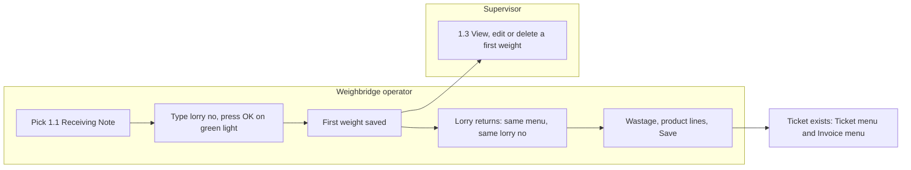
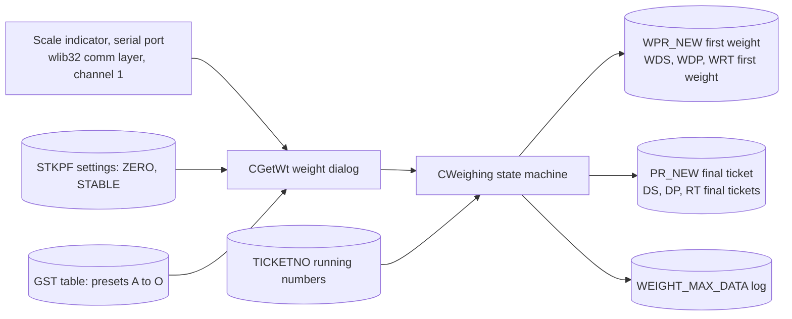
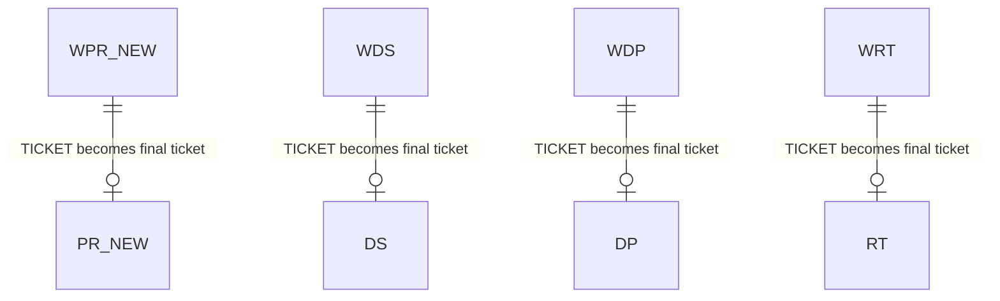
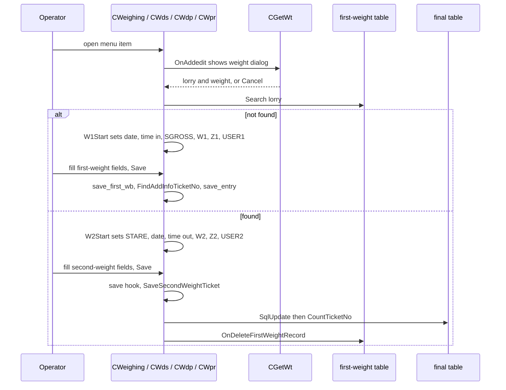
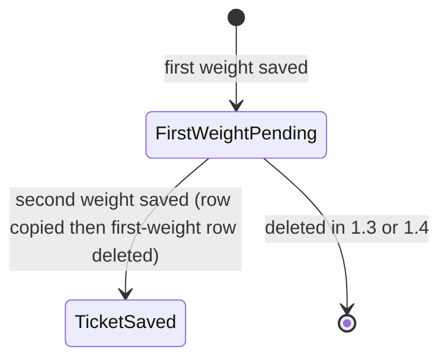

# Weighing (menu 1, two-weight weighing and public weighing) - Module reference

> Part of the TradeWin module reference. Index and shared sections: [README](README.md).
> Menu items covered here: 1.1 RECEIVING NOTE and 1.2 DESPATCH (first weight and second weight), 1.3 and 1.4 View/Edit/Delete First Weight, 1.5 Public Weighing, and the return-note weighing that has no menu item (nodes 18 and 19). **Scale Weighing (1.6) and Scale Despatch Weighing (1.7)** have their own file: [scale-weighing.md](scale-weighing.md).
> Last verified against commit `2f77122`. Translation status: English only (no zh-CN copy yet).

## Contents

- [Part 1 - Business view](#part-1---business-view)
  - [1.1 In plain words](#11-in-plain-words)
  - [1.2 Who uses what](#12-who-uses-what)
  - [1.3 A day in the life](#13-a-day-in-the-life)
  - [1.4 Worked example](#14-worked-example)
  - [1.5 Screen tour](#15-screen-tour)
  - [1.6 Where does this number come from?](#16-where-does-this-number-come-from)
  - [1.7 Status meanings](#17-status-meanings)
  - [1.8 What happens if...](#18-what-happens-if)
  - [1.9 Messages you may see](#19-messages-you-may-see)
  - [1.10 Do and don't](#110-do-and-dont)
  - [1.11 Before you start](#111-before-you-start)
  - [1.12 Glossary](#112-glossary)
  - [1.13 Ask the AI](#113-ask-the-ai)
- [Part 2 - Technical view](#part-2---technical-view)
  - [2.1 Overview](#21-overview)
  - [2.2 Architecture and dependencies](#22-architecture-and-dependencies)
  - [2.3 Master data catalogue](#23-master-data-catalogue)
  - [2.4 Sub-table hierarchy](#24-sub-table-hierarchy)
  - [2.5 Modules and process flows](#25-modules-and-process-flows)
  - [2.6 End-to-end flows](#26-end-to-end-flows)
  - [2.7 Report catalogue](#27-report-catalogue)
  - [2.8 Integrations](#28-integrations)
  - [2.9 Configuration](#29-configuration)
  - [2.10 Maintenance](#210-maintenance)

---

# Part 1 - Business view

## 1.1 In plain words

- The Weighing menu of this metal-trading weighbridge has seven items. **Receiving note** (goods bought in) and **Despatch** (goods sold out) are weighed **twice**: the first weighing (usually the full lorry) is saved as a **first-weight record**, which means the lorry is "in the yard"; when the lorry comes back the second weighing completes the job, the program works out the **net weight** and the ticket exists. **Public weighing** works the same way for a walk-in customer who only pays for the use of the scale.
- Two further items, **Scale Weighing** and **Scale Despatch Weighing**, weigh goods product by product and are described in [Scale weighing](scale-weighing.md).
- Two items, 1.3 and 1.4, open the list of first-weight records of receiving and of despatch, so a supervisor can look at them, correct them or delete one (for example a lorry that never came back).
- If a weighing is not completed there is no ticket. A lorry left "in the yard" with no second weight stays in the in-yard list until someone finishes the job or deletes the record.

## 1.2 Who uses what

| Department | Menu item | Main tasks |
|---|---|---|
| Weighbridge operator | 1.1 Receiving Note, 1.2 Despatch, 1.5 Public Weighing | First and second weighing of a lorry, typing the party, driver, products and wastage |
| Weighbridge supervisor | 1.3 and 1.4 View/Edit/Delete First Weight | Correct or delete a first-weight record that is still waiting for the lorry |
| IT / Admin | 6.2 Company Profile, 4.1.9 GWST | Switch the zero-weight and stable-weight controls, set the preset deduction weights, check the indicator |

**Start here - Weighbridge operator**
- For every lorry: Weighing > Receiving Note (buying) or Despatch (selling) or Public Weighing, type the lorry number, press OK when the traffic light is green.
- When the lorry comes back: the same menu item and the same lorry number. The program recognises it and goes to the second weight.
- Fill the product lines (receiving and despatch) and Save.

**Start here - Supervisor**
- Open 1.3 or 1.4 to see the lorries still in the yard; delete a record only after checking that the lorry will not return.

**Start here - IT / Admin**
- Once: check the weight shown on screen agrees with the indicator, and set the zero and stable controls in the Company Profile.

## 1.3 A day in the life

**A lorry delivers scrap (receiving).** The loaded lorry stops on the scale. The operator picks 1.1. A small window shows the live scale reading, a red or green light, the "Status" (stable or unstable), the "zero status" (yes or no) and the list of lorries already in the yard. The operator types the lorry number and presses OK when the light is green. The first-weight form opens with the date, the time in, the first weight and the user filled in; the lorry's usual driver, supplier and transporter are copied from the lorry list. The operator checks the supplier and the pay type and presses Save. The lorry unloads and comes back empty. The operator picks 1.1 again and types the same lorry number. This time the second weight, the time out and the user are filled in; the operator enters the wastage and the product lines (percentage per product) and presses Save. The first-weight record disappears and the receiving ticket exists. The program then asks "Set Payment Date".

**A lorry never comes back.** The first-weight record stays in the in-yard list. The supervisor opens 1.3 (receiving) or 1.4 (despatch), finds the record and deletes it.

Swimlane of one receiving weighing:

*Caption: the operator's lane runs through the two weighings; a first weight that waits too long is handled by the supervisor in 1.3 or 1.4; the finished ticket goes on to the Ticket and Invoice menus.*

## 1.4 Worked example

All values are made up.

**Before:** supplier `S0001` "TEST METAL SDN BHD" exists; product `P001` "ALUMINIUM SCRAP" exists with a purchase price of 2.00 per kg; lorry `WXX1234` exists in the lorry list; the indicator is connected.

| Step | Screen | What the operator does | What the program does | Status after |
|---|---|---|---|---|
| 1 | 1.1, weight window | Types lorry `WXX1234`, scale shows 18,500 kg, light is green, presses OK | Finds no first-weight record for this lorry, copies the lorry's usual driver, supplier and transporter, fills first weight 18,500 kg, time in, today's date and the user | First-weight form open |
| 2 | First-weight form | Checks supplier `S0001` and pay type `CASH`, Save | Saves the first-weight record with a new number | First weight pending (lorry in yard) |
| 3 | 1.1 again | Types `WXX1234`, scale now shows 8,500 kg, OK | Finds the pending record, fills second weight 8,500 kg, time out, user | Second weight in progress |
| 4 | Second-weight form | Types wastage 100, product line 1 `P001` at 100 percent, Save | Net = 18,500 - 8,500 - 100 = 9,900 kg; line quantity 9,900 kg; amount 9,900 x 2.00 = 19,800.00; creates the receiving ticket and removes the first-weight record | Ticket saved |
| 5 | Question box | Answers No to "Set Payment Date" | Nothing is posted | Ticket open for billing |

**Result:** one receiving ticket, net 9,900 kg, amount 19,800.00, ready to be billed on a purchase invoice. Details of the ticket and of billing are in [Tickets](tickets.md) and [Invoice](invoice-cashier.md).

## 1.5 Screen tour

### Weight window (opens first, every time)

**Purpose:** shows the live scale weight and decides whether this weighing may be confirmed.

| Field label | Meaning | Required? | Where the value comes from |
|---|---|---|---|
| Vehicle No | Lorry number. Same number as an in-yard lorry means "second weight". | Yes (or pick a row of the list) | Typed, or picked by clicking a row of the list |
| Weight (large figure) | Scale reading. On Receiving Note only, a preset deduction is subtracted from readings above 1,000 kg. | - | Automatic from the scale indicator |
| Status | `Unstable` or `stable`: stable when the reading equals the previous reading | - | Automatic |
| zero status | `No` or `Yes`: whether the scale went back to zero | - | Automatic |
| Traffic light | Green means OK may be pressed | - | Automatic, from the zero and stable controls in the Company Profile |
| In-yard list: No, Vehicle No, Date, Time In, Wt.In(Kg) | Lorries with a first weight and no second weight | - | Automatic |
| Total Vehicle In Yard | Count of that list | - | Automatic |

**Buttons and keys**
- **OK / Enter:** confirm. Blocked when the light is red.
- **Cancel / Esc:** leave without weighing.
- **Click a row of the list:** copies that lorry number into the box. Double-click also confirms.
- **Ctrl+A to Ctrl+O in the lorry box, with Scroll Lock switched on:** choose preset deduction A to O (the weight of a crane, empty pallets and so on, kept in 4.1.9 GWST). The program subtracts it from every reading above 1,000 kg, **but only on 1.1 Receiving Note**; the other weighing screens ignore it. Pressing space twice clears it, and so does typing any key with Scroll Lock off.

### Public weighing form (1.5, first and second weight)

**Purpose:** record who the lorry belongs to and what it carried.

| Field label | Meaning | Required? | Where the value comes from |
|---|---|---|---|
| RN NO. | Number of this record | - | Automatic running number |
| Date | Weighing date. The second weight writes today's date again. | - | Automatic |
| Vehicle No. | Lorry number | Yes | From the weight window |
| Driver Name | Driver, filled from the lorry's first driver | No | Typed, or filled when the lorry is picked |
| Customer | Customer account | No | Filled from the lorry's second driver field, or typed |
| Product | Free text, up to 50 characters | No | Typed |
| Remarks | Free text | No | Typed |
| Weight Modify | Marker that a weight was edited after saving | - | Automatic |
| WEIGHT(KG) FIRST / SECOND, TIME, USER | First and second weight, the time of each, the user of each | - | Automatic from the scale |
| NETT WEIGHT (KG) | Net of the load | - | Calculated, see 1.6 |
| CHARGES AMOUNT | The charge for using the scale | No | Typed |

**Buttons:** Save, Cancel. The two buttons **Capture 1st Weight** and **Capture 2nd Weight** belong to the ticket screen (menu 2.3), not to this form. There is no Cancel Ticket button on public weighing in this program.

### Receiving and despatch weighing forms (1.1 and 1.2)

The first-weight form shows: supplier or customer (filled from the lorry list), pay type, transporter, driver IC and name, lorry number and, on receiving only, the party's gross, tare and wastage. The second-weight form adds: wastage, eight product lines with percentage, quantity and unit price, remarks, and the other party's eight product lines (button **THIRD PARTY GRADING**). Several more boxes are carried in the record but switched off on these forms: purchase or sales order, unit, serial, sub-contractor, D/O number, scrap note, contract, grader, vehicle type, salesman, stock-return note, basis, other quantity and scale ticket. The **SET** and **UNSET** buttons (payment date) are on the final tickets, not on the first-weight forms. All fields, amounts and checks are explained in [Tickets](tickets.md).

### 1.3 and 1.4 View/Edit/Delete First Weight

These open the ticket screen (see [Tickets](tickets.md)) on the first-weight table: search, view, edit and delete a first-weight record. The second-weight boxes are read-only on a first-weight record.

## 1.6 Where does this number come from?

- **Net weight of public weighing** = the difference between first and second weight, whichever is larger first. Example: 14,200 and 6,700 give **7,500 kg**.
- **Weight shown in the weight window** = scale reading, minus the chosen preset deduction (receiving note only, and only when the reading is above 1,000 kg).
- **Net weight of a receiving or despatch ticket** = difference of the two weights minus the wastage typed; the other party's net = difference of the party gross and tare minus party wastage; the variance is own net minus party net. Details in [Tickets](tickets.md#16-where-does-this-number-come-from). Example: 18,500 - 8,500 - 100 = **9,900 kg**.

## 1.7 Status meanings

| Document | Status | Meaning | Who or what changes it | What can still be edited |
|---|---|---|---|---|
| First-weight record | Pending (in yard) | First weight saved, lorry not yet back | Saving the first weight | The first-weight form; menus 1.3 and 1.4 |
| First-weight record | Gone | Removed after the second weight is saved, or deleted in 1.3 / 1.4 | Saving the second weight, or the Delete button | - |
| Final ticket | Saved | Final ticket | Saving the second weight | See [Tickets](tickets.md) |

## 1.8 What happens if...

| Situation | What to do | Call IT when |
|---|---|---|
| The weight window shows `00,000` | Check the indicator cable and the indicator settings on the PC | Always |
| Wrong lorry number on the first weight | Supervisor deletes the first-weight record in 1.3 or 1.4 (receiving, despatch); for public weighing IT removes the record | Always for public weighing |
| Lorry leaves without second weight | Same as above | - |
| The same lorry number is typed on a new job while an old first weight is pending | The program treats it as the second weight of the old job | - |
| Power or network is cut while weighing | Nothing is saved until Save. A saved first weight stays in the in-yard list | Server not reachable after restart |
| Light stays red | Wait until Status shows stable. If the Zero Weight Control in the Company Profile is `Y`, the light may never turn green in the current program version (the zero signal is not delivered, see 2.10): ask IT to set that control to `N` | Always if it never turns green |
| Ticket was printed wrongly | Reprint from the ticket screen | - |

## 1.9 Messages you may see

| Message | What it means | What to do |
|---|---|---|
| `Error Message` with `Indicator weight unstable` | The reading is still moving | Wait until Status shows stable |
| `Weight indicator must need start with zero during weighing process.` | The scale did not return to zero since the last lorry | Let the scale clear |
| `Can not save` | The form is read only | Re-open the weighing |
| `Do you want to save your data !` (title `Save`) | You pressed Enter on the last field | Yes saves, No starts again |
| `Do you want to print` (title `option`) | Second weight saved and the table has a print form | Yes prints |
| `Set Payment Date` (question) | After the second weight of receiving or despatch | Yes opens the payment-date window (see [Tickets](tickets.md)) |
| `Despatch Ticket Not Found` | Return-note first weight: no despatch ticket of this lorry in the last 10 days | Check the lorry number |
| `<lorry> Vehicle not found` | The first-weight record could not be found when it had to be removed | Call IT |
| `Can not change code no` | The ticket number cannot be edited | - |
| `Out of range` | A click outside the in-yard list | - |
| `Error Opening LPT1.` | The ticket printer port could not be opened | Call IT |

## 1.10 Do and don't

- Do check that the green light is on before pressing OK.
- Do type the lorry number the same way both times.
- Don't confirm a weight while the figure is moving.
- Don't use a preset deduction (Ctrl+A to Ctrl+O with Scroll Lock on) unless you know what it stands for: on receiving it silently lowers every reading above 1,000 kg. Switch Scroll Lock off when you finish.

## 1.11 Before you start

- The scale indicator is connected and its reading appears in the weight window.
- Suppliers and customers exist in the account master, and lorries (with their usual driver, account and transporter) in the lorry list if you want them filled in.
- Products with grade prices exist if you will fill product lines.
- Preset deduction weights are set in 4.1.9 GWST if you use them.

## 1.12 Glossary

| Term | English | Malay | Chinese |
|---|---|---|---|
| Weighbridge | Truck scale | Jambatan timbang | 地磅 |
| Public weighing | Weighing service for outsiders | Timbang awam | 公众过磅 |
| First weight / second weight | The two weighings of one trip | Timbangan pertama / kedua | 第一次 / 第二次过磅 |
| In the yard | First weight saved, second weight not yet done | Dalam yard | 在场内 |
| Net weight | Difference of the two weights | Berat bersih | 净重 |
| Preset deduction (GWST) | Fixed weight taken off every reading | Potongan berat | 预设扣重 |
| Wastage | Weight taken off for dirt or moisture | Susut | 扣重 / 损耗 |
| Party | The other company (supplier or buyer) | Pihak | 对方 |

## 1.13 Ask the AI

1. How do I weigh a lorry that brings scrap in (receiving)?
2. The lorry came back but the program shows a new job instead of the second weight. Why?
3. How is the net weight of a weighing worked out?
4. What does the red traffic light in the weight window mean?
5. What are the Ctrl+A to Ctrl+O keys and why do they need Scroll Lock?
6. Why does the weight window show 00,000?
7. How do I delete a first weight for a lorry that never came back?
8. What do the zero and stable controls in the Company Profile do?
9. Where is the public-weighing ticket printed?
10. Why does a preset deduction not apply on the despatch screen?

---

# Part 2 - Technical view

## 2.1 Overview

- Application: the weighbridge system of TradeWin Metals Sdn Bhd (company text in the code), a VC6/MFC app on the wlib32 framework. Build: VC6 project `menu.dsp`, main exe `menu.exe`. See [README](README.md).
- This module: the menu 1 items that use the two-weight engine `CWeighing`. `CWds` (WDS.CPP, receiving, node 11), `CWdp` (WDP.CPP, despatch node 12 and return note node 18) and `CWpr` (Wpr.cpp, public weighing, node 15) derive from it. Nodes 13 and 14 open the first-weight tables on the ticket screen `CDs` (`TicketData`, MAIN.CPP:47).
- Class chain: `CWeighing` (WEIGHING.CPP, base `CStaff`). The weight dialog is `CGetWt` (GETWT.CPP); the edit box for the lorry number is `CGwEdit` (GWEDIT.CPP).

## 2.2 Architecture and dependencies

*Caption: the weight dialog reads the indicator, the zero and stable switches and the preset deductions; the state machine writes the first-weight table, then the final ticket table, and logs each confirmed weight.*

- Libraries: wlib32 (`CStaff`, ticket numbering, `DB` class, comm layer), winlib, wtlib32.
- Database: SQL Server. `PROVIDER.SYS` (lines 1 and 2 hold connection lines, each with a login; line 1 also holds a plain-text password, see [README code findings](README.md#code-findings); not copied here) names a catalog on each line, `tradewin_dev` on the first and `tradewin2` on the second. There is no schema repo for TradeWin. No camera, image database or tyre-sensor code exists in this repo.
- Indicator: this repo has **no reader thread of its own** (Lekok's `THREAD.CPP` is not here). `CGetWt::OnGw` reads the weight through the wlib32 comm layer, `GetCurrenctCommWeight(1)` (GETWT.CPP:105), and the `CPr` capture buttons do the same (Pr.cpp:93, 102). The indicator port, baud rate and `device=` mask come from the win.ini section `[Indicator]` read by wlib32 (names only; see the `wlib32-indicator-mask` skill). `CMainFrame` sets `bCommOpen = TRUE` (MAINFRM.CPP:114); `CMainFrame::OnOpenOtherFiles` opens no comm channel itself (MAINFRM.CPP:117-153). The reading is -1 when wlib32 has had no data for 5 seconds. In a **Debug** build the reader is replaced by a simulator: 17,000 kg with Scroll Lock on, 12,000 kg off, and the zero flag forced on (GETWT.CPP:107-111). The wlib32 comm layer also calls `ToDisplay` on the application object each time a weight arrives; the application's `CMenuApp::ToDisplay` (MENU.CPP:289) would set the flag `IsWBZeroWt` used by the traffic light, but see 2.10, finding 1: its signature differs from the wlib32 virtual, so it is not called.

## 2.3 Master data catalogue

### STKPF (Company Profile, menu 6.2) - fields used by weighing

Types: from `SQL_LekokPaper` script `STKPF.sql` (sister app), unverified for TradeWin. The full screen is in [Other, Stock](other-stock-export.md). One row, created by the program at start if missing (MENU.CPP:408-414).

| # | field (enum) | SQL column | data type | null | key | meaning |
|---|---|---|---|---|---|---|
| 1 | `PRO_CODE` | `COMPANY_NO` | nvarchar(10) | no | PK | company code (single row) |
| 2 to 4 | `PRO_ADD1..3` | `ADD1`, `ADD2`, `ADD3` | nvarchar(60) | yes |  | address lines (printed on tickets) |
| 5 | `PRO_ACCODE` | `ACCODE` | nvarchar(7) | yes |  | closing account code: the cash customer used by the invoice list (ARINV_WB.CPP:340) |
| 6 | `PRO_ZERO` | `ZERO` | nvarchar(3) | yes |  | `Y` = the scale must show zero before OK |
| 7 | `PRO_STABLE` | `STABLE` | nvarchar(3) | yes |  | `Y` = the reading must be stable before OK |
| 8 | `PRO_GATEPASS` | `GATEPASS` | nvarchar(3) | yes |  | gatepass switch (field hidden on the screen; no code reads it in this repo) |
| 9 | `PRO_VARIANCE` | `VARIANCE` | decimal(18) | yes |  | allowed own-vs-party net difference in percent (default 5); read by `CheckVarianceNetWeight` (DS.CPP:1132) which never blocks (see [Tickets](tickets.md)) |
| 10 | `PRO_GST_NO` | `GST_NO` | nvarchar(20) | yes |  | tax registration number |
| 11 | `PRO_GST_DATE` | `GST_DATE` | smalldatetime | yes |  | tax start date: an invoice dated before it gets 0 percent (TAXCODE.CPP:46) |

Columns 12 to 17 are the framework audit columns (`REC_STATUS`, `NEWUSER`, `NEWTIME`, `MODIFYUSER`, `MODIFYTIME`, `Print Counter`). The sister script has three more columns (`PT`, `PT1`, `Decimal_Weight`); no code in this repo uses them and the Company Profile dialog of TradeWin has no control for them, so whether they exist in the TradeWin table is unverified.

### GST (G.W.S.T, menu 4.1.9) - preset deductions

Single-record table (type from `SQL_LekokPaper` script `GST.sql`, unverified for TradeWin): `CODE` int PK, then `A` to `O` float(53) (fifteen weights in kg), then the audit columns. `CGwEdit::OnChar` reads `gst.dat[nChar + 1]` (GWEDIT.CPP:67): Ctrl+A is field 2 (`A`), and so on to Ctrl+O. The screen is described in [Control tables](control-tables.md).

## 2.4 Sub-table hierarchy

The weighing tables are **flat**: each public-weighing row has no child rows, and each two-weight ticket row carries eight own product lines and eight party product lines as columns (`PT1..8`, `PT11..18`).

*Caption: a first-weight row is replaced by a final row when the second weight is saved.*

- Nested sub-tables: none.
- **No foreign key links the two weights.** `CWeighing::OnAddedit` searches the first-weight table for the same lorry value (WEIGHING.CPP:120, `df->Search(df->dat[vehicle_fld],vehicle_fld, TRUE)`); a hit means "second weight". The first-weight row is removed with `DELETE FROM [<table>] WHERE [<vehicle column>] = '<lorry>'` (WEIGHING.CPP:265-271).

### PR_NEW and WPR_NEW (public weighing)

Types: from `SQL_LekokPaper` scripts `PR_NEW.sql` (final) and `WPR_NEW.sql` (first weight), unverified for TradeWin. Enum `pr_new` (MENU.H:277). Both are opened by `tado(..., "pr_new", init_pr)` and `tado(..., "wpr_new", init_wpr)` (MENU.CPP:442-443); the dialog for both is `IDD_PR_NEW`.

| # | field (enum) | SQL column PR_NEW / WPR_NEW | data type | null | key | meaning |
|---|---|---|---|---|---|---|
| 1 | `PR_TICKET` | `TICKET` | nvarchar(10) | no | PK | running number |
| 2 | `PR_SERIAL` | `SERIAL` | nvarchar(10) | yes |  | serial (field hidden on the form: gatepass box) |
| 3 | `PR_DATE` | `DATE` | smalldatetime | no / yes |  | date |
| 4 | `PR_VEHICLE` | `LORRY` / `VEHICLE_MANUAL` | nvarchar(50) / nvarchar(10) | yes |  | lorry number |
| 5 | `PR_DRIVER` | `ICNO` | nvarchar(12) | yes |  | driver (label "Driver Name"); `pr_tell` writes the driver's name here (Wpr.cpp:184-185), so a name longer than 12 characters is cut (if the TradeWin column has that width: unverified) |
| 6 | `PR_ACCODE` | `ACCODE_MANUAL` | nvarchar(10) | yes |  | customer account |
| 7 | `PR_PRODUCT` | `PRODUCT` | nvarchar(50) | yes |  | product, free text |
| 8 | `PR_REMARKS` | `REMARKS` | nvarchar(40) | yes |  | remarks |
| 9 | `PR_MODIFY` | `MODIFY` | nvarchar(3) | yes |  | weight-edited marker (set by `SetModifyMark`, Wpr.cpp:204-205) |
| 10 | `PR_TIMEIN` | `TIMEIN` | nvarchar(8) | yes |  | time of first weight |
| 11 | `PR_TIMEOUT` | `TIMEOUT` | nvarchar(8) | yes |  | time of second weight |
| 12 | `PR_SGROSS` | `SGROSS` | decimal(18) | yes |  | first weight (kg) |
| 13 | `PR_STARE` | `STARE` | decimal(18) | yes |  | second weight (kg) |
| 14 | `PR_AMOUNT` | `AMOUNT` | decimal(18,2) | yes |  | charges amount |
| 15 | `PR_USER1` | `USER1` | nvarchar(5) | yes |  | user of first weight |
| 16 | `PR_USER2` | `USER2` | nvarchar(5) | yes |  | user of second weight |
| 17 | `PR_W1` | `W1` | decimal(18) | yes |  | raw first reading before any deduction |
| 18 | `PR_W2` | `W2` | decimal(18) | yes |  | raw second reading |
| 19 | `PR_Z1` | `Z1` | decimal(18) | yes |  | first weight after deduction |
| 20 | `PR_Z2` | `Z2` | decimal(18) | yes |  | second weight after deduction |
| 21 | | `REC_STATUS` | char(1) | yes |  | in the sister app `1` = ticket cancelled; **nothing in TradeWin writes it** (the Cancel Ticket button of the sister app is not here) |
| 22 to 25 | | `NEWUSER`, `NEWTIME`, `MODIFYUSER`, `MODIFYTIME` | char(5), smalldatetime | yes |  | audit |
| 26 | | `Print Counter` | int | yes |  | print counter |

- Lookups: lorry master (`LORRY`), driver master (`driver`, opened on the table `ic`, MENU.CPP:464), customer (`ACCODE` view).
- Used by: menu 2.3 (`CPr`), reports `pr_list.rpt` (picker entry 00036, see [Reports](reports.md)).
- The enum `pr_new` has 20 entries and matches columns 1 to 20; the audit columns have no enum. The column list is unverified for TradeWin (no script).

### Two-weight tables DS, DP, WDS, WDP, RT, WRT

Documented in [Tickets](tickets.md#24-sub-table-hierarchy) (enum `dp`, 144 fields).

## 2.5 Modules and process flows

### Menu items and entry points

There is one menu resource, `IDR_MAINMENU` (menu.rc:126); `CMenuApp::Domain` creates the document template with it (MENU.CPP:245-270, see [README](README.md#menu-map-and-coverage)). The menu ID `ID000nn` becomes node `nn`; `ExecuteNode` applies the user's restriction list and calls `CMenuApp::SubProgram` (MAIN.CPP:176).

| Menu item | Node | Handler in `SubProgram` | Opens |
|---|---|---|---|
| 1.1 RECEIVING NOTE | 11 | `Purchase_Flag = TRUE; WeighingProcess(&ds,&wds)` (MAIN.CPP:188-191; WDS.CPP:161) | `CWds`, dialog `IDD_WDS` |
| 1.2 DESPATCH | 12 | `Purchase_Flag = FALSE; Weighing_Despatch(&dp,&wdp)` (MAIN.CPP:192-195; WDP.CPP:203) | `CWdp`, dialog `IDD_WDP` |
| 1.3 View/Edit/Delete First Weight RECEIVING NOTE | 13 | `TicketData(&wds)` (MAIN.CPP:196-200) | `CDs` on `wds` |
| 1.4 View/Edit/Delete First Weight DESPATCH | 14 | `TicketData(&wdp)` (MAIN.CPP:201-204) | `CDs` on `wdp` |
| 1.5 Public Weighing | 15 | `PublicWeighingProcess(&pr_new,&wpr_new)` (MAIN.CPP:205-207; Wpr.cpp:139) | `CWpr`, dialog `IDD_PR_NEW` |
| 1.6 Scale Weighing (Unlimited Product Features) | 16 | `AdminDbScale(&scale,&scalesub)` (MAIN.CPP:208-211) | [Scale weighing](scale-weighing.md) |
| 1.7 Scale Despatch Weighing (Unlimited Product Features) | 17 | `AdminDbScale(&scaledw,&scaledwsub)` (MAIN.CPP:212-215) | same |
| (no menu item) | 18 | `Weighing_Despatch(&rt,&wrt)` (MAIN.CPP:216-219) | return note first weight, `CWdp` on `wrt` |
| (no menu item) | 19 | `TicketData(&wrt)` (MAIN.CPP:220-223) | `CDs` on `wrt` |

The frame's own message map (MAINFRM.CPP:23-93) lists only some of the IDs; the others reach `On00001` through the wlib32 base class. Company numbers 2 to 9 in `menu.ini` hide nodes 11 to 17 and node 2 ("small scale only", MAINFRM.CPP:119-129).

### Flow: first and second weight (`CWeighing`)

*Caption: the lorry search decides first or second weight; the final ticket is created only by the second weight.*

Step by step:
1. `CWeighing::OnInitDialog` refuses to start unless the subclass supplied the lorry field, both tables and both field arrays (WEIGHING.CPP:436-464), calls `CStaff::OnInitDialog` and then returns TRUE (WEIGHING.CPP:466-468; comment "user not allow to enter weighing entry - 20211004 JF"); the `SetCommThread` call after it is unreachable (WEIGHING.CPP:476). **Unlike the sister app, `CWds` and `CWdp` have no `OnInitDialog` of their own**: the first weight dialog is started by the wlib32 `CStaff` start-up, which calls the virtual `OnAddedit` (WEIGHING.CPP:88) and `GetRecord` (WEIGHING.CPP:496, which calls `OnAddedit` again). How many times the start-up reaches it is in wlib32 and was not traced.
2. `OnAddedit` (WEIGHING.CPP:88) blanks the record, runs `df->e->start`, shows `CGetWt` (WEIGHING.CPP:95-98). Cancel sets `SaveFlag = CANNOTSAVE` and closes (WEIGHING.CPP:100-104). A blank lorry makes the user pick from `ShowField1Table` (WEIGHING.CPP:107-116).
3. `df->Search(..., TRUE)` on the lorry column (WEIGHING.CPP:120). No hit: for `wpr_new` the account and driver are looked up from `lorry` (WEIGHING.CPP:125-130), for the others IC, account, transporter and driver (WEIGHING.CPP:131-138); `SaveFlag = NEWFILE`, editable list `w1_array`, `W1Start`. Hit: `SaveFlag = OLDFILE`, `FindAddInfoTicketNo(m_mfile)` pre-assigns the final number (WEIGHING.CPP:149-150), list `w2_array`, `W2Start`; for table `wdp` the next free numeric D/O number is also proposed: `SELECT TOP 1 DO FROM dbo.DP WHERE (ISNUMERIC(DO) = 1) ORDER BY DO DESC` plus one (WEIGHING.CPP:153-163).
4. `CWeighing::OnSave` (WEIGHING.CPP:315). NEWFILE (WEIGHING.CPP:323-339): `save_first_wb`, lock, `FindAddInfoTicketNo(df)`, `save_entry(NONEXIST,...)`, `W1Saved` (empty in this repo, WEIGHING.CPP:241-243), `SaveWeightMaxDataWB`, `CountTicketNo(df,1)`, then `OnAddedit` for the next lorry. OLDFILE (WEIGHING.CPP:340-366): the `e->save` hook, lock both tables, `SaveSecondWeightTicket` (WEIGHING.CPP:203-223: `fetch`, `FindAddInfoTicketNo`, `FindProductCategorySerialNo`, `SqlUpdate(TRUE)`, `CountTicketNo`), `W2Saved`, `OnDeleteFirstWeightRecord`, then the print prompt only when the final table's `prec` is not `unprint`, using `<table>.RPT` (WEIGHING.CPP:352-362), `SaveWeightMaxDataWB`.
5. `CWpr::OnSave` (Wpr.cpp:64-99) is a copy for public weighing: no `SaveWeightMaxDataWB` call, no `CountTicketNo(df,1)` on the first weight (compare WEIGHING.CPP:337), the second weight uses its own `SaveSecondWeightTicket` (Wpr.cpp:53-61) and prints through `OnPrintTicket` (LPT1) when the final table has a print routine (Wpr.cpp:90-94).

Per-front-end behaviour:

| Front end | W1 sets | W2 sets | First-weight editable fields | Final save hook |
|---|---|---|---|---|
| `CWpr` (public) | SGROSS, W1, Z1, TIMEIN, USER1, date (Wpr.cpp:101-109) | STARE, date, TIMEOUT, W2, Z2, USER2 (Wpr.cpp:111-119) | SERIAL, DRIVER, ACCODE, PRODUCT, REMARKS, AMOUNT, VEHICLE (`PrFirstArray`, Wpr.cpp:137); second weight: the same without VEHICLE (`PrArray`, Wpr.cpp:138) | `pr_save` (Wpr.cpp:196-207): re-stamps USER1 / USER2 when a weight was edited and sets the weight-modify marker |
| `CWds` (receiving) | SGROSS, W1, Z1, TIMEIN, USER1 (WDS.CPP:48-56) | STARE, W2, Z2, TIMEOUT, USER2 (WDS.CPP:58-66) | `FirstArray` (WDS.CPP:151); second weight `DSWeighingArray` for table `wds` (WDS.CPP:157, 168) | `ds_save` (DS.CPP:876); W2Saved asks "Set Payment Date" (WDS.CPP:127-148) |
| `CWdp` (despatch) | same; for `wrt` it first asks for the matching despatch ticket of the last 10 days (WDP.CPP:48-110) | same | `FirstArr` (WDP.CPP:198) | `dp_save` (DP.CPP:526); W2Saved asks "Set Payment Date" (WDP.CPP:245-251) |

`pr_initial` (Wpr.cpp:155-174) sets the read-only field list, but it leaves index 2 of the list unset, and the framework stops reading the list at the first 0 (`ReadOnlyArray` loops in wlib32); the date, modify and time restrictions at indexes 3 to 6 are therefore never applied (see 2.10).

### Flow: weight dialog (`CGetWt`)

- 100 ms timer (GETWT.CPP:75) calls `OnGw` (GETWT.CPP:90): shows `Unstable` / `stable` and `No` / `Yes`, reads `GetCurrenctCommWeight(1)` (GETWT.CPP:105), `ActualWeight = weight` (GETWT.CPP:113), and **only when the table is `wds`** (`strcmp(df->m_strTable,"wds")`, comment "only receiving") and `(weight > 1000 && GwstWeight > 0) || GwstWeight < 0` subtracts `GwstWeight` (GETWT.CPP:114-118).
- Stable = the reading equals the previous tick (`hwt[0]`, GETWT.CPP:184-186). Zero = the global `IsWBZeroWt` (GETWT.CPP:189-194), which only `CMenuApp::ToDisplay` can set to TRUE (after two consecutive zero readings, MENU.CPP:295-304); the saved weighing clears it (WEIGHING.CPP:336, 364).
- Confirm rule from `STKPF.ZERO` and `STKPF.STABLE` (GETWT.CPP:200-211): N/N always; Y/N needs zero; N/Y needs stable; Y/Y needs both. The result drives the traffic-light icon (GETWT.CPP:214-222).
- `OnOK` (GETWT.CPP:133): the minimum-weight test is commented out (GETWT.CPP:136-142); if the light is red it shows `Error Message` with the reasons and stops (GETWT.CPP:143-153); otherwise copies the typed lorry number and closes.
- `CGwEdit` (GWEDIT.CPP): the preset deduction works only while Scroll Lock is on (`GetKeyState(VK_SCROLL)`, GWEDIT.CPP:57); control characters 1 to 15 (Ctrl+A to Ctrl+O) set `GwstWeight = atol(gst.dat[nChar + 1])` when `FacileFlag == 1` (GWEDIT.CPP:67; `FacileFlag` is set at MENU.CPP:58); Backspace and Enter are passed through (GWEDIT.CPP:59-65); space pressed twice clears it (GWEDIT.CPP:73-75); any key down with Scroll Lock off resets it (GWEDIT.CPP:45-51). The Lekok-style `GWST_Code` letter is not recorded in TradeWin.
- The in-yard grid shows every row of the first-weight table (`ShowGridContent`, GETWT.CPP:273-286), with columns No, Vehicle No, Date, Time In, Wt.In(Kg) (GETWT.CPP:249-259).

### Tables read and written

| Table | Read | Written | Key |
|---|---|---|---|
| WPR_NEW / WDS / WDP / WRT | in-yard grid, lorry search | first weight insert, delete after second weight | `TICKET` nvarchar(10) |
| PR_NEW / DS / DP / RT | - | final ticket insert | `TICKET` nvarchar(10) |
| TICKETNO | next number, prefix | `NextNo` increment | `RecordSet` nvarchar(20) |
| STKPF | `ZERO`, `STABLE` | - | `COMPANY_NO` |
| GST | presets | - | `CODE` |
| LORRY, `driver` (table `ic`), ACCODE view | defaults on a new first weight | - | see [Control tables](control-tables.md) |
| WEIGHT_MAX_DATA | - | one row per confirmed first or second weight (not for `CWpr`) | `PKKEY` int identity |
| TIMEFRM, LogAlarm, LogAlarmData | - | wlib32 weight-trace and alarm logging through the `CMenuApp` hooks | `PKKEY` |

Key types are from the sister app and unverified for TradeWin. `SaveWeightMaxDataWB` (WEIGHING.CPP:280-313) appends a line to the file `wt.log` and inserts into `weight_max_data` (user, WBNO `'A'`, ticket, lorry, weight, first ticket, table name), then sets the globals the over-weight alarm compares (`TicketVehicleNo`, `TicketWt`, `WbTicketSaved`). `CheckMaxWeight` (WEIGHING.CPP:368-388) is dead code (its call is commented out, WEIGHING.CPP:319).

### Running numbers

- Each weighing table has a row in TICKETNO (`RecordSet` = table name); numbers come from `FindAddInfoTicketNo` and `CountTicketNo` (wlib32). The prefix and length are site data. The reset routine (node 64, 6.4 Reset Database) is described in [Other, Stock](other-stock-export.md#210-maintenance).

### Status transitions

*Caption: the only automatic transition is first weight to ticket; a waiting first weight can also be deleted by a supervisor. Cancelling a finished ticket is not a status in this program.*

### Dependencies on other modules

- Tickets: the saved ticket is viewed, corrected and printed there ([Tickets](tickets.md)).
- Control tables: lorry, driver, account, GWST ([Control tables](control-tables.md)).
- Invoice: receiving and despatch tickets are billed on the invoice screens; public weighing tickets are **not** billed ([Invoice](invoice-cashier.md)).

## 2.6 End-to-end flows

See [README](README.md#26-end-to-end-flows).

## 2.7 Report catalogue

- Public weighing: report picker entry `00036` "Public Weighing Detail Report" (`pr_list.rpt`); see [Reports](reports.md).
- The ticket forms `pr_new.rpt`, `ds.rpt`, `dp.rpt` and the first-weight form `wds.rpt` exist in the repo. For the final tables the form name follows the table name through the wlib32 print code (`<table>.RPT`, WEIGHING.CPP:352-362; not traced further). The first-weight table `wds` has `prec = unprint` (DS.CPP:1047), so **no first-weight form is printed here** (the sister app prints `wds.rpt`). The routine `PrintPublicTicket` (ppublic.cpp:38, dot-matrix form `ppublic.rep`) is compiled but never assigned to a table (`init_pr` has the assignment commented out, Wpr.cpp:213).

## 2.8 Integrations

| Trigger | System | Detail | Failure handling |
|---|---|---|---|
| Every weight read | Scale indicator through wlib32 | `GetCurrenctCommWeight(1)`, configured in win.ini `[Indicator]` | window shows 00,000; -1 after 5 s without data |
| Each confirmed first and second weight (two-weight forms) | `weight_max_data` table and `wt.log` file | lorry, weight, table | none |
| Alarm hooks | `logAlarm`, `logAlarmData`, `timefrm` | `OnLogAlram4DriveThrough`, `OnLogAlram4OverMaxWt` insert alarm rows and send command `ID00099` to the main window (MENU.CPP:614-658) | none |

No outbound web API, camera or sensor box is used by this module.

## 2.9 Configuration

- `STKPF.ZERO`, `STKPF.STABLE` (names only).
- win.ini: the wlib32 `[Indicator]` section with key `device` (names only).
- PROVIDER.SYS: database connection (contents not documented).
- Code constants: `FacileFlag = 1` (MENU.CPP:58); `bCommOpen = TRUE` (MAINFRM.CPP:114). There are no `Program4` or `isUnlimited_Product` build constants in this repo.
- `menu.ini` (empty in the repo) is read by `CMenuApp::Profile` for a company number 0 to 15 (MENU.CPP:222-234); `company_no` 2 to 9 hides nodes 11 to 17 and 2 through `ProfileHiddenMenu` ("small scale only", MAINFRM.CPP:119-129).

## 2.10 Maintenance

- Update this file together with any change to menu 1, the weighing classes or the tables above.
- Changelog:

| Date | Commit | Who | What changed |
|---|---|---|---|
| 2026-10-19 | `2f77122` | Claude (draft for review) | First version for Application_TradeWin, started from the Application_LekokPaper reference and verified against this repo's code |

- Last verified against commit `2f77122`. Translation status: English only.

### Code findings (for the developer)

1. **`CMenuApp::ToDisplay` is never called.** The wlib32 virtual is `ToDisplay(HANDLE, long, long &GwstWeight)` (wlib32 MYAPP.H) and wlib32 calls it through the base signature; the application declares `ToDisplay(HANDLE, long, long GwstWeight)` (MENU.H:831, MENU.CPP:289), a different signature that hides instead of overriding. As a result `IsWBZeroWt` and `IsStableWt` are never set from it. With `STKPF.ZERO = 'Y'` the traffic light in the weight window can never turn green (GETWT.CPP:189-211) in a Release build. Re-check against the wlib32 copy used on the build PC.
2. **The level-based read-only settings of public weighing are dead.** `pr_initial` leaves index 2 of the list unset (Wpr.cpp:155-174), so the framework stops after `PR_USER1` and `PR_USER2`; date, modify and time-in/out stay editable for every level.
3. **`CWpr::OnSave` does not call `CountTicketNo` for the first weight** (Wpr.cpp:71-83; `CWeighing::OnSave` does, WEIGHING.CPP:337). Whether the first-weight series still advances depends on `save_entry`; check `TICKETNO` for `wpr_new` on the live database.
4. **`PR_DRIVER` receives the driver name** (Wpr.cpp:184-185) although the sister script has a 12-character `ICNO` column; check the TradeWin column width.
5. **The preset deduction applies only to receiving.** `CGetWt::OnGw` limits it to table `wds` (GETWT.CPP:114-118) while `CGwEdit` accepts Ctrl+A to Ctrl+O on every weighing screen, so on the other screens the operator can pick a deduction that is silently ignored.
6. **Debug builds do not read the scale** (GETWT.CPP:107-111): a Debug exe shows 17,000 or 12,000 kg depending on Scroll Lock. Never ship a Debug build.
7. `CWeighing::OnInitDialog` returns before `SetCommThread` (WEIGHING.CPP:466-476); the code after it is unreachable.
8. **Public weighing has no cancel.** The sister app's Cancel Ticket button and "Ticket Cancelled" label were removed from the dialog and from `CPr` / `CWpr`; a wrong public ticket can only be edited or deleted.
