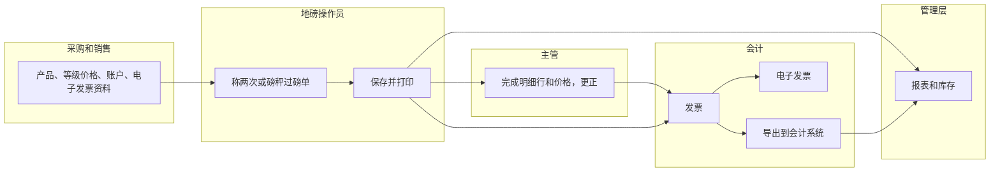
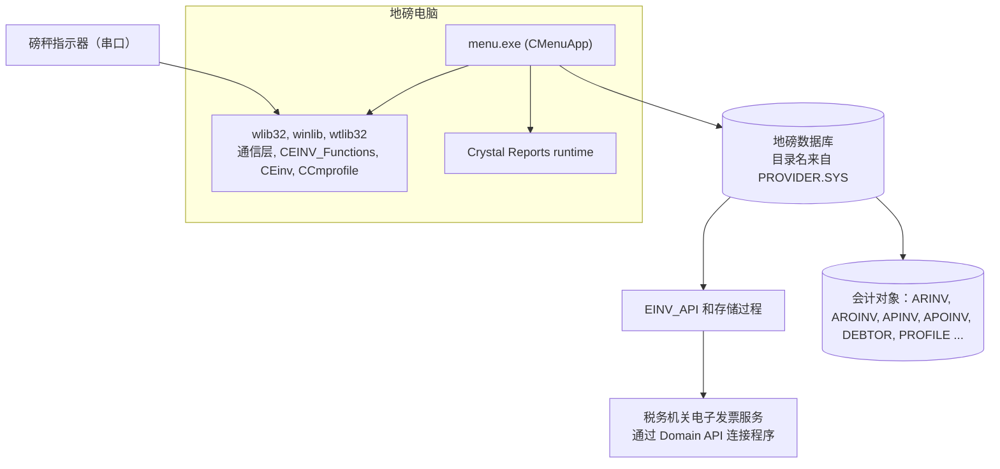
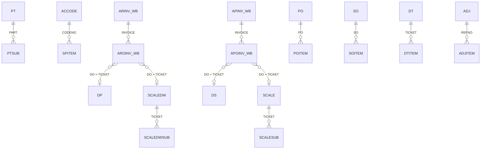
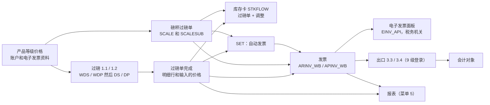

# TradeWin Metals 地磅系统 - 模块参考（索引）

> 英文版为准。同步自英文版 commit c76cd62（2026-10-30）。

本文是这个应用唯一的参考文档。**第一部分**用通俗的话，向不了解这个程序的人说明怎么使用它。**第二部分**向程序员和支持人员说明代码里每样东西在哪里。每个菜单组的细节放在各自的文件里（见下面的清单）；每个菜单组的文件都有同样的两个部分。

- 仓库：`Domain-Application/Application_TradeWin`，分支 `main`。**没有结构仓库**（没有 `SQL_TradeWin`），本仓库里也没有 `.sql` 文件：这些文件里的字段类型标注为“类型来自 SQL_LekokPaper（姊妹应用），TradeWin 未核实”或“类型：未核实”。
- 最后核对的 commit 为 `2f77122`（“E-Invoice enhancement”）。
- 翻译状态：英文版见 [../README.md](../README.md)；本中文版同步于 2026-10-30（commit c76cd62）。
- 规则：任何改变行为、表、字段、屏幕、报表或计算的修改，都必须在同一个 commit 里更新本参考文档。
- 本仓库没有 `User_Guide`，也没有其他 `docs/` 文件，所以没有截图可以链接；这里也没有虚构任何截图。
- **这是 SengHiap 系列的一员**（Application_SengHiap_Metal 的副本）。它的源码与 Application_LekokPaper 最接近（226 个共有的源码、头文件、资源和项目文件里有 192 个逐字节相同，本仓库没有 Lekok 所缺的文件），并增加了 2026 年 2 月的**电子发票增强功能**。见[与 Application_LekokPaper 的差异](#与-application_lekokpaper-的差异)。
- **名称：**仓库叫 TradeWin；代码里的公司常量是 `TRADEWIN METALS SDN BHD`；`PROVIDER.SYS` 列出的库是 `tradewin_dev`（第 1 行）和 `tradewin2`（第 2 行）；程序标题是 `<company> VER 2.00`（版本号标志着电子发票版本）。

## 目录

- [模块文件](#模块文件)
- [菜单图和覆盖范围](#菜单图和覆盖范围)
- [第一部分 - 业务视图（整个应用）](#第一部分---业务视图整个应用)
  - [1.1 简单说明](#11-简单说明)
  - [1.2 谁用什么](#12-谁用什么)
  - [1.3 一天的工作](#13-一天的工作)
  - [1.4 用户级别和批准](#14-用户级别和批准)
  - [1.5 词汇表](#15-词汇表)
  - [1.6 问AI](#16-问ai)
- [第二部分 - 技术视图（整个应用）](#第二部分---技术视图整个应用)
  - [与 Application_LekokPaper 的差异](#与-application_lekokpaper-的差异)
  - [2.1 概览](#21-概览)
  - [2.2 架构和依赖](#22-架构和依赖)
  - [2.3 主数据目录](#23-主数据目录)
  - [2.4 子表层级](#24-子表层级)
  - [2.5 模块和处理流程](#25-模块和处理流程)
  - [2.6 端到端流程](#26-端到端流程)
  - [2.7 报表目录](#27-报表目录)
  - [2.8 集成](#28-集成)
  - [2.9 配置](#29-配置)
  - [2.10 维护](#210-维护)
- [休眠代码](#休眠代码)
- [用户权限](#用户权限)
- [尚未记录](#尚未记录)
- [代码发现](#代码发现)

## 模块文件

| 文件 | 菜单组 | 涵盖内容 |
|---|---|---|
| [weighing.md](weighing.md) | 1.1 Receiving Note、1.2 Despatch、1.3 和 1.4 View/Edit/Delete First Weight、1.5 Public Weighing（以及退货单称重，节点 18 和 19） | 重量窗口、第一次和第二次重量、场内清单、预设扣重、公共过磅、经 wlib32 读取的指示器 |
| [scale-weighing.md](scale-weighing.md) | 1.6 Scale Weighing、1.7 Scale Despatch Weighing | 带无限产品明细行的磅秤过磅单（输入数量、损耗、箱子、第一行等级价格、现金过磅单合计取整到整数单位）、SET 付款日期和自动发票 |
| [tickets.md](tickets.md) | 2.1 Receiving Note、2.2 Despatch、2.3 Public Weighing；没有菜单项的节点 23、24、25、27 | 带本方八行和对方八行产品明细行的收货和发货过磅单、公共过磅单、直接送货、送货单、退货单 |
| [invoice-cashier.md](invoice-cashier.md) | 3.1 到 3.4 和电子发票面板 | 采购和销售发票、自动发票、税额、分类代码、**电子发票面板**、向会计系统导出。文件名沿用基础版本；这里没有收银 |
| [control-tables.md](control-tables.md) | 4.1 表 1、4.2 表 2 | 带等级价格的产品、货车、带产品清单和**电子发票资料**的账户、司机、运输商、税码、GWST 和简单清单 |
| [reports.md](reports.md) | 5 Report | 报表选择窗口、7 个分组、45 个报表条目、报表文件 |
| [other-stock-export.md](other-stock-export.md) | 6 Other、7 Stock | 密码、公司资料、用户、**Reset Database**、**E-Invoice Profile**、库存调整、原因代码。文件名沿用基础版本；导出在菜单 3 里，没有备份菜单 |

## 菜单图和覆盖范围

只有**一个**菜单资源 `IDR_MAINMENU`（`menu.rc:126-194`，35 个项目），由 `CMenuApp::Domain` 创建（MENU.CPP:257-263）。第二个资源 `IDR_PIREQ`（`menu.rc:196-204`，Invoice、Cash Bill、Delivery Order）从不加载。菜单 ID `ID000nn` 就是节点 `nn`；`CMenuApp::SubProgram`（MAIN.CPP:176）按节点分支。下面每个项目都在所示的文件里说明。标题是 `menu.rc` 里的标题；标题里的编号不一定等于节点（2.3 是节点 26）。

| 菜单路径（标题） | 节点 | 处理程序 | 文件 |
|---|---|---|---|
| 1.1 RECEIVING NOTE | 11 | `Purchase_Flag = TRUE; WeighingProcess(&ds,&wds)`（MAIN.CPP:188-191） | [weighing](weighing.md) |
| 1.2 DESPATCH | 12 | `Weighing_Despatch(&dp,&wdp)`（MAIN.CPP:192-195） | [weighing](weighing.md) |
| 1.3 View/Edit/Delete First Weight RECEIVING NOTE | 13 | `TicketData(&wds)`（MAIN.CPP:196-200） | [weighing](weighing.md) |
| 1.4 View/Edit/Delete First Weight DESPATCH | 14 | `TicketData(&wdp)`（MAIN.CPP:201-204） | [weighing](weighing.md) |
| 1.5 Public Weighing | 15 | `PublicWeighingProcess(&pr_new,&wpr_new)`（MAIN.CPP:205-207） | [weighing](weighing.md) |
| 1.6 Scale Weighing (Unlimited Product Features) | 16 | `AdminDbScale(&scale,&scalesub)`（MAIN.CPP:208-211） | [scale-weighing](scale-weighing.md) |
| 1.7 Scale Despatch Weighing (Unlimited Product Features) | 17 | `AdminDbScale(&scaledw,&scaledwsub)`（MAIN.CPP:212-215） | [scale-weighing](scale-weighing.md) |
| （没有菜单项） | 18 | `Weighing_Despatch(&rt,&wrt)`（MAIN.CPP:216-219） | [weighing](weighing.md) |
| （没有菜单项） | 19 | `TicketData(&wrt)`（MAIN.CPP:220-223） | [weighing](weighing.md) |
| 2.1 RECEIVING NOTE | 21 | `TicketData(&ds)`（MAIN.CPP:224-227） | [tickets](tickets.md) |
| 2.2 DESPATCH | 22 | `TicketData(&dp)`（MAIN.CPP:228-231） | [tickets](tickets.md) |
| （没有菜单项） | 23 | `DirectDeliveryTicket()`（MAIN.CPP:232-234） | [tickets](tickets.md) |
| （没有菜单项） | 24 | `DirectDeliveryPricingUpdate()`（MAIN.CPP:235-237） | [tickets](tickets.md) |
| （没有菜单项） | 25 | `Despatch_DO(&dp_do)`（MAIN.CPP:238-242） | [tickets](tickets.md) |
| 2.3 Public Weighing | **26** | `PublicTicketData(&pr_new)`（MAIN.CPP:243-245） | [tickets](tickets.md) |
| （没有菜单项） | 27 | `TicketData(&rt)`（MAIN.CPP:246-249） | [tickets](tickets.md) |
| 3.1 Purchase Invoice | 31 | `PurchaseInvoiceWb()`（MAIN.CPP:250-252） | [invoice-cashier](invoice-cashier.md) |
| 3.2 Sales Invoice | 32 | `SalesInvoiceWb()`（MAIN.CPP:253-255） | [invoice-cashier](invoice-cashier.md) |
| 3.3 Export Purchase Invoice | 33 | `ExportPurchaseInvoiceTransactions()`（MAIN.CPP:256-258） | [invoice-cashier](invoice-cashier.md) |
| 3.4 Export Sales Invoice | 34 | `ExportInvoiceTransactions()`（MAIN.CPP:259-261） | [invoice-cashier](invoice-cashier.md) |
| 4.1.1 Product Code | 411 | `AdminDbPtentry(&prodtype,&ptsub)`（MAIN.CPP:262-264） | [control-tables](control-tables.md) |
| 4.1.2 Lorry Data Maintenance | 412 | `AdminDb(&lorry)`（MAIN.CPP:265-267） | [control-tables](control-tables.md) |
| 4.1.3 Category Code | 413 | `AdminDb(&category)`（MAIN.CPP:268-270） | [control-tables](control-tables.md) |
| 4.1.4 Unit Code | 414 | `AdminDb(&unit)`（MAIN.CPP:271-273） | [control-tables](control-tables.md) |
| 4.1.5 Product Grade | 415 | `prodgrade.Run()`（MAIN.CPP:274-276） | [control-tables](control-tables.md) |
| 4.1.6 Pay Type | 416 | `AdminDbPTYPE(&ptype)`（MAIN.CPP:277-280） | [control-tables](control-tables.md) |
| 4.1.7 Country Code | 417 | `AdminDb(&country)`（MAIN.CPP:281-283） | [control-tables](control-tables.md) |
| 4.1.8 Product Group | 418 | `AdminDb(&ptgroup)`（MAIN.CPP:284-286） | [control-tables](control-tables.md) |
| 4.1.9 GWST | 419 | `AdminDb(&gst)`（MAIN.CPP:287-289） | [control-tables](control-tables.md) |
| 4.2.1 Buyer/Seller Code | 421 | `AccodeMaintenance()`（MAIN.CPP:290-292） | [control-tables](control-tables.md) |
| 4.2.2 Driver Code | 422 | `AdminDb(&driver)`（MAIN.CPP:293-295） | [control-tables](control-tables.md) |
| 4.2.3 Transporter | 423 | `AdminDb(&transp)`（MAIN.CPP:296-298） | [control-tables](control-tables.md) |
| 4.2.4 Tax Code | 424 | `taxcode.Run()`（MAIN.CPP:299-301） | [control-tables](control-tables.md) |
| （没有菜单项） | 425 to 429 | 分级员、发票状态、业务员、车辆类型清单；429 是空的 case（MAIN.CPP:302-318） | [control-tables](control-tables.md) |
| （没有菜单项） | 431, 432 | `PurchaseOrderData()`、`SalesOrderData()`（MAIN.CPP:319-324） | [control-tables](control-tables.md) |
| （没有菜单项） | 441 to 449 | 会计维护：债务人、债权人、付款方式、前缀、区域、TT、银行、总账代码、总账分组（MAIN.CPP:325-353） | [休眠代码](#休眠代码) |
| 5 Report | 5 | `TableContainer("rptctn")`（MAIN.CPP:354-356） | [reports](reports.md) |
| （没有菜单项） | 51 to 54 | `FileChangeReport(&ds/&dp)`、`VarianceDetailReport(&ds/&dp)`（MAIN.CPP:357-368） | [reports](reports.md) |
| 6.1 Set Password | 61 | `OnPassword`（主框架消息映射，MAINFRM.CPP:64） | [other-stock-export](other-stock-export.md) |
| 6.2 Company Profile | 62 | `AdminProfileDb(&stkpf)`（MAIN.CPP:371-374） | [other-stock-export](other-stock-export.md) |
| 6.3 Operator Information | 63 | `SetUser()`（MAIN.CPP:375-377） | [other-stock-export](other-stock-export.md) |
| 6.4 Reset Database | 64 | `CleanDatabase()`（MAIN.CPP:378-380） | [other-stock-export](other-stock-export.md) |
| 6.5 E-Invoice Profile | 65 | `profile_einv` 上的 `AdminDb_CMProfile`（MAIN.CPP:381-388） | [other-stock-export](other-stock-export.md) |
| （没有菜单项） | 66 | `ViewViolation()`（MAIN.CPP:389-391） | [other-stock-export](other-stock-export.md) |
| 7.1 Adjustment Data Entry | 71 | `AdjustmentEntry()`（MAIN.CPP:392-394） | [other-stock-export](other-stock-export.md) |
| 7.2 Reason Code | 72 | `AdminDb(&reason)`（MAIN.CPP:395-397） | [other-stock-export](other-stock-export.md) |

`SubProgram` 有 27 个菜单到达不了的 case（18、19、23、24、25、27、425 到 429、431、432、441 到 449、51 到 54、66）；菜单有 35 个项目。生成的清单（`_inventory/Application_TradeWin`）只作为线索：它漏掉了多行的菜单项 1.7，它的菜单树是直接从 `menu.rc` 构建的，上面的表就是按它排列。旧的会计 case（发票、付款、贷项通知单等）和备份 case 在一个注释块里（MAIN.CPP:398-459）。

---

# 第一部分 - 业务视图（整个应用）

## 1.1 简单说明

- 这个程序运行 TradeWin Metals 的**地磅和贸易办公室**。货车把货运进来（买进，称为**收货**）、把货运走（卖出，称为**发货**），或者只使用磅秤（**公共过磅**）。
- 收货和发货要**称两次**（满载的货车和空车）；程序算出净重，操作员再按百分比把它分成**产品明细行**。另一种方式是**磅秤过磅单**：操作员每个产品加一行，并输入数量。
- 过磅单在**发票**上开票：买进的货开采购发票，卖出的货开销售发票。用户可以用一个按钮从过磅单生成发票。每张发票有一个**电子发票面板**，用来提交到税务机关的电子发票服务。发票通过发票菜单的两个 **Export** 项目送到会计系统。
- 带等级价格的产品、客户（连同它们的电子发票资料）、货车、司机和税码这样的清单，保存在**控制表**里。
- **报表**显示采购、销售、未开发票的过磅单和库存。**库存**由过磅单算出来，并用调整来更正。
- 如果日常工作被跳过，过磅单就会缺失，发票就会迟开，电子发票就不会申报，库存就会不对，会计系统也会过时。

## 1.2 谁用什么

| 部门 | 模块 | 主要工作 |
|---|---|---|
| 地磅操作员 | [过磅](weighing.md)、[磅秤过磅](scale-weighing.md) | 给货车称两次、打开磅秤和公共过磅单、采集重量、打印 |
| 地磅主管 | [过磅单](tickets.md)、[过磅](weighing.md)、[控制表](control-tables.md)、[其他、库存](other-stock-export.md) | 完成和更正过磅单（明细行、价格）、删除第一次重量、维护货车、司机和运输商、库存调整 |
| 采购 / 销售 | [控制表](control-tables.md) | 带等级价格的产品、账户及其产品清单和电子发票资料 |
| 会计 / 财务 | [发票和导出](invoice-cashier.md)、[报表](reports.md)、[控制表](control-tables.md) | 发票、电子发票、导出到会计、税码、报表 |
| 管理层 | [报表](reports.md) | 合计、库存、未开发票的过磅单、被修改的过磅单 |
| IT / 管理员 | [其他、库存](other-stock-export.md) | 设置、用户、电子发票资料、指示器、数据重置（只限培训） |

**从这里开始（每个部门一行）**
- 操作员：货物用 Weighing > Receiving Note 或 Despatch；逐个产品的过磅单用 Scale Weighing 或 Scale Despatch Weighing；散客用 Public Weighing。
- 主管：从过磅单菜单打开过磅单来完成或更正；Weighing > 1.3 / 1.4 处理仍在等待的第一次重量。
- 采购 / 销售：Table 1 > Product Code；Table 2 > Buyer/Seller Code（及其 E-Invoices 按钮）。
- 会计：Invoice；提交电子发票；月底 Export Purchase Invoice 和 Export Sales Invoice。
- 管理层：Report。
- IT：Other > Company Profile 和 E-Invoice Profile；检查指示器。

## 1.3 一天的工作

早上：IT 或主管检查磅秤读数。白天：操作员给货车称重；主管完成过磅单（产品明细行和价格）；采购维护各种清单。晚上或月底：会计根据过磅单生成发票，提交电子发票并运行两个导出，管理层运行报表。整个流程的泳道图：



*说明：各种清单为称重提供资料；过磅单进入完成、发票和报表；发票最终到达电子发票服务和会计系统。*

## 1.4 用户级别和批准

每个用户有一个数字，叫**级别**。在本程序里起作用的级别：

| 级别 | 允许做什么 |
|---|---|
| 5 级以下 | 不能修改收货、发货过磅单上的重量和时间 |
| 9 级以下 | 不能修改磅秤、收货、发货和公共过磅单的日期（清单有缺陷，见代码发现）、发票的日期、发票状态或税额 |
| 9 或以上 | 可以登录，确认向会计系统的出口 |
| 99 | Operator Information（用户）、Set Password、发票上的 Unlock Period 按钮、**磅秤**过磅单上的 SET 和 UNSET 按钮、报表维护按钮 |
| 999 | 可以编辑过磅单的“重量已修改”标记 |

本版本里**没有批准窗口**：要求主管批准重量差异的登录确认已在代码里关闭。导出确认是唯一的登录确认，Reset Database 窗口有自己的重置密码。E-Invoice Profile（6.5）**没有**密码或级别检查。

除了级别，每个用户还可以被用户记录上的清单禁止使用某些菜单项（或者限制为只能查看或只能编辑），每张表还有表的访问清单。见 [用户权限](#用户权限)。

## 1.5 词汇表

| 术语 | 英文 | 马来文 | 中文 |
|---|---|---|---|
| Weighbridge | Truck scale | Jambatan timbang | 地磅 |
| Ticket | Weighing document | Tiket | 磅单 |
| Receiving | Goods bought in | Terimaan | 收货 |
| Despatch | Goods sold out | Penghantaran | 发货 |
| Public weighing | Weighing service for outsiders | Timbang awam | 公众过磅 |
| Scale weighing | Weighing goods product by product | Timbang skala | 磅秤称重 |
| Product grade | Quality level of a product with its own prices | Gred produk | 产品等级 |
| Invoice | Bill | Invois | 发票 |
| E-invoice | Electronic invoice reported to the tax authority | e-Invois | 电子发票 |
| TIN | Tax identification number | Nombor pengenalan cukai | 税务识别号 |
| Net weight | Weight of the load | Berat bersih | 净重 |
| Party | The other company | Pihak | 对方 |
| Adjustment | Stock correction | Pelarasan | 调整 |
| Export | Send invoices to accounts | Eksport | 导出 |

每个模块文件有它自己术语的词汇表。

## 1.6 问AI

1. 地磅操作员的日常工作是什么？
2. 货车怎样从磅秤走到发票？
3. 更正过磅单要用哪个菜单项？
4. 99 级用户能做什么，而 9 级用户不能做？
5. 我怎样填完客户的电子发票资料？
6. 我怎样把发票作为电子发票提交？
7. 怎样把本月的发票送到会计系统？
8. 只为使用磅秤付费的上门客户，怎样过磅？
9. 哪些报表显示未开发票的过磅单？
10. Reset Database 会删除什么？

---

# 第二部分 - 技术视图（整个应用）

## 与 Application_LekokPaper 的差异

本仓库是 Application_LekokPaper 的兄弟：两边都有的 226 个源码、头文件、`.rc` 和 `.dsp` 文件名里，31 个内容不同，195 个相同；没有只在这里存在的文件，29 个只在 Lekok 存在。这个系列共同的基础是 Application_SengHiap_Metal（比较见下）。对照 Paper 和 Alloy 副本的较新功能检查：**子表产品明细行**：磅秤过磅单有（`SCALESUB`），两次称重的过磅单没有（平铺的列）；**登记**：没有；**取整**：只有现金磅秤过磅单合计取整到整数单位（Lekok 有多种方法，而且明细行也取整）；**电子发票**：有，精简版（见下）；**闸门自动化、摄像头、传感器**：没有。

**1. 菜单和节点**
- 一个菜单资源，35 个项目（Lekok：由 `Program4` / `isUnlimited_Product` 选择的四种可加载版面，发布的那个有 28 个项目）。两次称重的模块是有效的：**1.1 Receiving Note、1.2 Despatch、1.3 和 1.4 View/Edit/Delete First Weight、2.1 Receiving Note、2.2 Despatch**。Public Weighing（1.5、2.3 = 节点 26）和 Scale Weighing（1.6、1.7）与 Lekok 相同。
- **6.4 Reset Database 是真正的重置**（节点 64，`CleanDatabase`）；在 Lekok 里这个标题属于程序更新。**6.5 E-Invoice Profile**（节点 65）是新的；没有更新项，也没有 `OnSystemUpgrade` 调用。

**2. 过磅和磅秤硬件**
- 没有自己的读取线程（没有 `THREAD.CPP`、`COMM1/2.CPP`、`Program4`）：指示器通过 wlib32 通信层读取（`GetCurrenctCommWeight(1)`）。Debug 构建会模拟重量（GETWT.CPP:107-111）。
- 重量对话框**只在 1.1 Receiving Note 上**应用预设扣重；这里没有 `GWST_Code` 和 17 个字母的转换。
- 公共过磅**没有 Cancel Ticket**，也没有“Ticket Cancelled”文字；`CWds` 和 `CWdp` 没有自己的 `OnInitDialog`；第一次重量表单 `wds.rpt` 不打印（`prec = unprint`）。
- 没有 `RECEIVE` / `DESPATCH` / `RDATA` / `DDATA` / `WB` 表单，没有 `BIN_BAG`，没有 `ICNO` 司机身份记录，没有快速搜索。

**3. 磅秤过磅单**
- 普通的 wlib32 表头加明细屏幕：输入数量，**没有 Capture Weight**，没有箱子代码，没有 `QTY_MODIFIED` 标记，没有 Cancel Ticket，没有净重框；价格只取第一行等级（没有客户价目表）；明细行不取整；现金过磅单的合计取整到整数单位（Lekok：去尾到 0.1，并有多种方法）；付款方式没有默认为 `CASH`。
- 磅秤过磅单上有已被注释掉的电子钱包付款二维码代码（SCALE.CPP:8-243, 247-315）。

**4. 过磅单**
- 收货和发货过磅单（`CDs`）：明细行**不取整**，没有 `Get_Adjustment(...,3)`；价格是**输入的**（没有 PTSUB 成本查找，没有剩余重量填充）；百分比框可以编辑；没有起始值 `CASH`；总数量检查对每张使用 `ds_save` 的表都运行；级别清单使用较旧的覆盖方式；第二次重量的“Set Payment Date”提问和自动发票是**有效的**（在 Lekok 里被注释掉）。

**5. 发票和电子发票**
- 销售和采购发票对话框上有内嵌的**电子发票面板**（`CEINV_Functions`，共用的 wlib32 类）、明细行上有 **Classification** 列（默认 `022`）、一个 **Transaction Type** 框和 `SetTransactionType`（从不被调用）。wlib32 的 `CEinv` 账户窗口和 `CCmprofile` 公司资料屏幕支撑菜单 6.5 和账户按钮。Lekok 没有这些。

**6. 控制表**
- 没有等级价格触发器（`ptsub_Triggers` 已移除），`SPITEM` 没有价格也没有 `tell_spitem`，没有 `ACCODE` 银行账号，**账户屏幕上的 Add 已关闭**，司机是普通的表 `ic`，对话框是 `IDD_DRIVER`（没有 `ICNO`，没有 MyKad 导入，没有快照），账户上有 **E-Invoices** 按钮。

**7. 报表**
- `RPTCTN.SET`、`rptctn.GRP`、`RPTCTN.USR` 和其他容器文件与 Lekok 的**逐字节相同**：7 个分组共 45 个条目。仓库根目录的版面文件：407 个 `.rpt`、51 个 `.rep`、24 个 `.FMT`、38 个 `.scr`；没有 `.rdl`。

**8. 设置（`STKPF`）和公司**
- Company Profile 对话框没有“小数重量”勾选。公司名称是字面值 `TRADEWIN METALS SDN BHD`（未使用的 `tcompany` 数组里放着一个编码的字符串）。窗口标题 `<company> VER 2.00`。没有授权计时器，没有 `LICENCE.CPP`，没有 `szLicenceKey`。

**9. 集成**
- 通过 SQL Server 存储过程和 Domain API 连接程序的电子发票（面板和公司资料）；二维码查看辅助程序；没有其他对外的内容。休眠的电子钱包代码没有启用。

**10. 规模**
- 142 个 `.cpp` 文件（26,563 行），`menu.dsp` 里有 118 个 `.cpp` 条目（一共 184 个 `SOURCE=` 条目），79 个头文件，154 个对话框模板，`menu.rc` 9,581 行，MENU.H 里有 76 个枚举块（Lekok：160 个文件、31,537 行，项目里 134 个，90 个头文件，167 个对话框，`menu.rc` 11,176 行，79 个枚举块）。`Receive.h` 是零字节文件。

**与 Lekok 相同的**（除换行符外内容相同），例子：`Two.cpp`、`PASS.CPP`、`Logerr.cpp`、`fc.cpp`、`Chkvar.cpp`、`mnws.cpp`、`detail.cpp`、`Dpp.cpp`、`Sdp.cpp`、`sv.cpp`、`Month.cpp`、`Daily.cpp`、`One.cpp`、`Tap.cpp`、`DT.CPP`、`DpDo.cpp`、`SetPrice.cpp`、`PartyGrading.cpp`、`TAXCODE.CPP`、`Exp_inv.cpp`、`Exp_ap.cpp`、`SETPAYDATEU.cpp`、`ADJ.CPP`、`PO.CPP`、`STKFLOW.CPP`、`TIMEFRM.CPP`、`ResetPassword.cpp`、`lorry.cpp`，以及[休眠代码](#休眠代码)下列出的所有会计屏幕。

**与 Application_SengHiap_Metal（基础版本）的简短比较**
- 两边都有的 199 个文件名里，71 个不同，128 个相同；27 个文件只在这里存在（`SCALE`、`Pr`、`DpDo`、`Incentive`、`TIMEFRM`、`TNG`、`MIFARE`、`MICODE`、`Scan`、`WELCOME`、`FormatSmartCard`、`HexEdit`、`PtEntry_old`、`PTYPE.H`、`ExportFunc.h` 等），29 个只在 Metal 存在。
- 这里缺少：收银（`Closing.cpp`，菜单 4.4）、导出菜单 8 和备份菜单 9（导出是菜单 3.3 / 3.4）、合约 / 销售订单菜单 4.3、传感器、摄像头和闸门文件（`ADAM.CPP`、`SENSOR.CPP`、`STATUS.CPP`、`HHMVIEW.CPP`、`CCTVVIEW.CPP`、`SHOWJPG.CPP`）、`COMM.CPP`、`RUNSQL.CPP`、`TICKET.CPP`、`MYFRM.CPP`、`ProductAmount.cpp`、`GridSheet_Party_Grading.cpp`，以及基础版本自己的 `EINV.CPP`、`Cmprofile.cpp`（这里的电子发票类用的是共用库）。
- 电子发票：Metal 有 `CEinv` 和 `OnSubmitEinv`，发票屏幕上有完整的按钮（Submit、Refresh、Email），Transaction Type 根据账户的自开发票标志设置；TradeWin 在内嵌面板（Submit、Refresh、QRCODE、View Msg；Email 隐藏）后面有同样的存储过程、同样的 Classification 列，以及表 `profile_einv` 上的资料屏幕（菜单 6.5；Metal：会计资料上的 6.6）。
- 这里有而 Metal 没有的：Scale Weighing（菜单 1.6、1.7）、无限产品的过磅单明细行、送货单和退货单，与 Lekok 相同。

**基础参考文档的检查清单，已回答**
1. 文件比较：与 Lekok 差别较大的在 `menu.rc`、`SCALE.CPP`、`DS.CPP`、`ARINV_WB.CPP`、`MAIN.CPP`、`MAINFRM.CPP`、`MENU.CPP`、`MENU.H`、`SPITEM.CPP`。
2. 菜单和 `SubProgram`：见上。
3. MENU.H 枚举：`dp`（144 个名称，MENU.H:284）、`pr_new`（20）、`scale`（17）、`scalesub`（**10**）、`spitem`（**5**）、`ptsub`、`dp_do`、`stkpf`（11）、`accode`（12，MENU.H:270-272）、`profile`（会计资料）；声明 `malaysia_state`、`malaysia_city`、`postcode`、`classification` 和 `SetTransactionType` 是新的（MENU.H:21-23）。
4. `OpenAllDataFile`（MENU.CPP:386）：打开 `profile`、`stkpf`、`logo`、四张电子发票查找表、`scale`、`scaledw`、`scalesub`、`scaledwsub`、`ptsub`、`pr_new`、`wpr_new`、`wrt`、`rt`、`dp_do`、`dp`、`ds`、`wds`、`wdp`、`driver`（表 `ic`）、各个控制表和会计对象；没有 `receive`、`rdata`、`despatch`、`ddata`、`bin_bag`、`icno`；前面那个 `return;`（MENU.CPP:556）之后的代码是无效的。
5. `RPTCTN.SET`、`rptctn.GRP`：[reports](reports.md#27-报表目录)。
6. 公司文字：字面值（MENU.CPP:116, 238-240）。
7. 硬件：只有 wlib32 通信；没有 `TotalCamera`，没有 ADAM。
8. 集成：电子发票面板和存储过程、二维码辅助程序、导出和会计对象。

## 2.1 概览

- **是什么：**TradeWin Metals Sdn Bhd 的地磅和贸易程序，建立在共用库 wlib32、winlib 和 wtlib32 上的 Visual C++ 6 / MFC 应用。主程序 `menu.exe`，由 `menu.dsp` 构建（Debug 和 Release；Release 的链接行有 `wlib32.lib wininet.lib`，menu.dsp:56；Debug 只用 `dlib32.lib`，menu.dsp:82）。窗口标题 `<company> VER 2.00`（MAINFRM.CPP:113，注释写的是“E-Inv version”）。
- **代码规模：**142 个 `.cpp` 文件（26,563 行），`menu.dsp` 里 118 个 `.cpp` 条目（一共 184 个 `SOURCE=` 条目），79 个头文件，`menu.rc` 里 154 个对话框模板（9,581 行），MENU.H 里 76 个枚举块，另外 MAIN.CPP:15-16 里还有给菜单节点用的 `enum menu` 和 `enum kkk`。电子发票资源来自由 `RES/MENU.RC2` 引入的共用 `einv.rc`。
- **公司：**程序标题和注册表键使用常量 `TRADEWIN METALS SDN BHD`（MENU.CPP:116, 238-240）；地址文字常量在 MENU.CPP:30-32（站点数据，这里不复制）。
- **启动：**`CMenuApp::Domain`（MENU.CPP:245）显示登录对话框 `CStart`，标志为 `0x0002 | INIT_ADO_USER | INIT_ADO_PROGRAM_PASSWORD`（MENU.CPP:250），然后 `UserLogin`，再在 `IDR_MAINMENU` 上用 `CMenuView` 创建 SDI 框架 `CMainFrame`（MENU.CPP:257-263）；`HideStaffMenu = 99990` 和 `m_useDropDownBtnInsteadSrollbar = TRUE`（MENU.CPP:273-274）。`CMainFrame::OnOpenOtherFiles`（MAINFRM.CPP:117-153）打开 `one.scr` 和 `two.scr` 并设置隐藏菜单清单；`bCommOpen = TRUE`（MAINFRM.CPP:114）让 wlib32 打开指示器；`CMenuApp::OpenAllDataFile`（MENU.CPP:386）打开每张表（`tado` / `ado`），并在缺少时创建单行的 `stkpf` 和 `logo` 行。
- **菜单分发：**wlib32 的 `CMyFrame::OnCommand` 把菜单 ID 变成节点，`On00001` 调用 `CMyApp::ExecuteNode`，它应用用户限制并调用 `CMenuApp::SubProgram`（MAIN.CPP:176）。

## 2.2 架构和依赖



*说明：exe 通过共用的通信层读取磅秤，通过 SQL Server 读取地磅数据库；电子发票经存储过程发送到税务机关服务；客户、发票和税务资料也放在会计对象里。*

- **库：**wlib32（DB 类、屏幕基类 `CStaff`、`CParent`、`CChild`、`CBrowse`、`CTio`、过磅单编号、通信层、表格容器、用户和密码对话框、电子发票类）、winlib、wtlib32。仓库里有一些框架风格文件的本地拷贝；只有 `menu.dsp` 里的才会被编译。
- **数据库：**SQL Server。`PROVIDER.SYS` 有两条连接行（库 `tradewin_dev` 和 `tradewin2`；**每一行都带一个登录，第一行还带明文密码**：这个文件不作说明，见代码发现）。没有结构仓库。
- **会计对象：**`ARINV`、`AROINV`、`APINV`、`APOINV`、`DEBTOR`、`CREDITOR`、`SUPPLIER`、`PROFILE`、`GLCODE`、`GLGROUP` 等由 `OpenAllDataFile`（MENU.CPP:386-555）打开；它们的定义不在本仓库里（未核实）。
- **报表：**Crystal `.rpt`（仓库根目录 407 个文件，选择窗口 45 个条目）、针式打印机 `.rep` / `.FMT` 表单；没有 `.rdl`。
- **外部服务：**电子发票存储过程和 Domain API 连接程序（见[发票 2.8](invoice-cashier.md#28-集成)）；辅助程序 `QRCODE\QR.exe`。本仓库里没有有效的对外 HTTP 代码（链接 `wininet.lib` 是为了 wlib32 的辅助程序；MAIN.CPP 包含 `wininet.h`；SCALE.CPP 里的电子钱包代码已被注释掉）。
- **硬件：**磅秤指示器（win.ini 的 `[Indicator]` 段、`device=` 掩码、wlib32 COMM）；针式打印机和 A4 打印机。

### 与其他应用和系统的关系

| 系统 | 关系 | 依据 |
|---|---|---|
| 会计应用及其数据库 | 拥有客户、供应商、税务资料、总账和会计发票对象。本应用读取它们，并在导出时、在账户屏幕上和 Reset Database 时写入它们。 | `OpenAllDataFile`；Exp_inv.cpp 和 Exp_ap.cpp 里的导出代码；ResetPassword.cpp |
| 电子发票连接程序（Domain API）和税务机关服务 | 通过存储过程接收发票；答复用 Refresh 读回 | `CEINV_Functions`（共用库）、[发票](invoice-cashier.md#25-模块和处理流程) |
| 发放或二维码系统（外部） | 在磅秤表上写入 `API_SCANNED_QR` 和 `API_DISPENSED` | 枚举 `scale`（MENU.H:804）；这里没有有效代码 |
| Crystal Reports | 所有打印的报表以及 A4 的过磅单和发票表单 | `.rpt` 文件、wlib32 表格容器 |
| ReportEngine / SSRS（`.rdl`） | 本应用不使用 | 没有 `.rdl` 文件 |
| 磅秤指示器 | 由 wlib32 通信层读取 | GETWT.CPP:105 |
| 系列里的其他 Domain 应用 | 代码血统相同；`PROVIDER.SYS` 仍列出另一个库 | 见[差异](#与-application_lekokpaper-的差异) |

## 2.3 主数据目录

每张表都在使用它的模块里说明。程序打开（`OpenAllDataFile`，MENU.CPP:386-555）或它的代码读取的表的索引：

| 表或视图 | 作用 | 记录在 |
|---|---|---|
| `SCALE`, `SCALEDW`, `SCALESUB`, `SCALEDWSUB` | 磅秤过磅单及其明细行 | [scale-weighing](scale-weighing.md#24-子表层级) |
| `WPR_NEW`, `PR_NEW` | 公众过磅的第一次重量和最终过磅单 | [weighing](weighing.md#24-子表层级) |
| `WDS`, `WDP`, `WRT`, `DS`, `DP`, `RT` | 两次称重的过磅单 | [tickets](tickets.md#24-子表层级) |
| `DT`, `DTITEM`, `SETPRICE`, `DP_DO` | 直送、价格更新、送货单 | [tickets](tickets.md#23-主数据目录) |
| `PAYMENTDATE`, `PAYMENTDATED`, `ARRIVEDDATE` | 每张过磅单的付款和到达日期 | [tickets](tickets.md#23-主数据目录) |
| `ARINV_WB`, `AROINV_WB`, `APINV_WB`, `APOINV_WB` | 地磅发票 | [invoice-cashier](invoice-cashier.md#24-子表层级) |
| 视图 `DSINV_NOPO`, `DPINV_NOSO`, `ALL_DS`, `ALL_DP`, `DPINV_EXPINV`（线上定义不明） | 未开发票的过磅单和导出 | [invoice-cashier](invoice-cashier.md#24-子表层级) |
| `EINV_API`, `EINVOICE_TIN`, `accode_einv` 视图, `profile_einv`, `malaysia_state`, `malaysia_city`, `postcode`, `classification` | 电子发票日志、TIN 查找、账户和公司的电子发票资料、查找表（没有一个在 TradeWin 的脚本里） | [invoice-cashier](invoice-cashier.md#23-主数据目录)、[control-tables](control-tables.md#23-主数据目录)、[other-stock-export](other-stock-export.md#23-主数据目录) |
| `PT`, `PTSUB`, `PTGROUP`, `CATEGORY`, `UNIT`, `PRODGRADE` | 产品主档 | [control-tables](control-tables.md#23-主数据目录) |
| `LORRY`, `IC`（对象 `driver`）, `TRANSP`, `GST` | 地磅主档 | [control-tables](control-tables.md#23-主数据目录) |
| `ACCODE`, `SPITEM` | 客户和供应商账户及其产品清单 | [control-tables](control-tables.md#23-主数据目录) |
| `PTYPE`, `COUNTRY`, `STATUS`, `TAXCODE`, `TAX_GRP`, `GRADE`, `SALESMAN`, `VTYPE`, `ACCODEHQ`, `INCENTIVE` | 查找表 | [control-tables](control-tables.md#23-主数据目录) |
| `PO`, `POITEM`, `SO`, `SOITEM` | 采购和销售订单（没有菜单项） | [control-tables](control-tables.md#23-主数据目录) |
| `STKPF`, `LOGO`, `PROFILE`, `USER`, `LOGIN`, `LogPW` | 设置和用户 | [other-stock-export](other-stock-export.md#23-主数据目录) |
| `ADJ`, `ADJITEM`, `REASON`，视图 `STKFLOW` | 库存调整和库存卡 | [other-stock-export](other-stock-export.md#24-子表层级) |
| `TICKETNO` | 流水号和屏幕设置 | [weighing](weighing.md#25-模块和处理流程) |
| `LOGERR`, `LogAlarm`, `LogAlarmData`, `TIMEFRM`, `WEIGHT_MAX_DATA` | 批准日志、重量报警、重量日志 | [weighing](weighing.md#25-模块和处理流程)、[other-stock-export](other-stock-export.md#23-主数据目录) |
| `RptLog`, `ReportFilterDescription`, `rptctn_*` | 报表 | [reports](reports.md#23-主数据目录) |
| `TableUserControl`, `FieldUserControl`, `USERDAT` | 权限 | [用户权限](#用户权限) |
| 打开了但没有菜单路径的会计对象（`glcode`、`glgroup`、`ctrl_ac`、`tac`、`currency`、`period`、`bank`、`prefix`、`emode`、`scheme`、`wac`、`wacitem`、`debtor`、`creditor`、`supplier`、`aripay`、`arrc`、`arcr` 以及对应的 `ap` 表） | 休眠的会计代码 | [休眠代码](#休眠代码) |

常见的审计列（`REC_STATUS`、`NEWUSER`、`NEWTIME`、`MODIFYUSER`、`MODIFYTIME`、`Print Counter`）存在于大多数表（姊妹结构）；类型因表而异。TradeWin 里没有任何东西写 `REC_STATUS = 1`（没有取消功能）。

**字段编号规则（wlib32）：**字段编号就是列在结果集里的位置，所以 MENU.H 里的枚举只有在表的列顺序一致时才有效。因为 TradeWin 没有结构仓库，所以没有一个枚举能对照线上的表核对；已知或可能的不一致列在[代码发现](#代码发现)里。

## 2.4 子表层级

所有的树及其链接键（细节在各模块文件里）：

```text
SCALE / SCALEDW   (header, key TICKET)
  SCALESUB / SCALEDWSUB   TICKET = TICKET
PT   - PTSUB      PART = PART                ACCODE - SPITEM   ACCODE = CODENO
ARINV_WB - AROINV_WB   INVOICE = INVOICE     APINV_WB - APOINV_WB   INVOICE = INVOICE
PO - POITEM   PO = PO                        SO - SOITEM   SO = SO
DT - DTITEM   TICKET = TICKET
ADJ - ADJITEM   REFNO = REFNO
DS / DP / RT / WDS / WDP / WRT / PR_NEW / WPR_NEW   (flat: product lines are columns)
Nested sub-tables: none. Every tree stops at the first level.
```



*说明：应用里每一对上级-下级；发票明细行通过 `DO` 列链接到过磅单；没有任何一对有第三层。*

## 2.5 模块和处理流程

每个菜单组的流程、处理程序、表、流水号、状态转换和 `file:line` 引用，都在它的模块文件里：

| 菜单组 | 模块文件 |
|---|---|
| 1 Weighing：1.1 到 1.5 | [weighing](weighing.md#25-模块和处理流程) |
| 1.6、1.7 Scale | [scale-weighing](scale-weighing.md#25-模块和处理流程) |
| 2 Ticket | [tickets](tickets.md#25-模块和处理流程) |
| 3 Invoice and Export，电子发票 | [invoice-cashier](invoice-cashier.md#25-模块和处理流程) |
| 4.1、4.2 控制表 | [control-tables](control-tables.md#25-模块和处理流程) |
| 5 Report | [reports](reports.md#25-模块和处理流程) |
| 6, 7 | [other-stock-export](other-stock-export.md#25-模块和处理流程) |

**屏幕类对照表**（类、基类、文件）：

| 类 | 基类 | 文件 | 模块 |
|---|---|---|---|
| `CWeighing` | `CStaff` | WEIGHING.CPP | weighing |
| `CWds`, `CWdp`, `CWpr` | `CWeighing` | WDS.CPP, WDP.CPP, Wpr.cpp | weighing |
| `CGetWt`, `CGwEdit` | `CDialog`, `CEdit` | GETWT.CPP, GWEDIT.CPP | weighing |
| `CScale` | `CParent` | SCALE.CPP | scale-weighing |
| `CPr` | `CStaff` | Pr.cpp | tickets |
| `CDs`, `CDp` | `CStaff` | DS.CPP, DP.CPP | tickets |
| `CDt` | `CParent` | DT.CPP | tickets |
| `CSetPrice`, `CDpDo` | `CStaff` | SetPrice.cpp, DpDo.cpp | tickets |
| `CPartyGrading` | `CFEdit` | PartyGrading.cpp | tickets |
| `CTransferDirectTicketToMainSystem`, `CSETPAYDATEU` | `CDialog` | TransferDirectTicketToMainSystem.cpp, SETPAYDATEU.cpp | tickets |
| `CArinvWb` | `CParent` | ARINV_WB.CPP | invoice |
| `CEINV_Functions`, `CEinv`, `CCmprofile` | `CDialog`, `CFEdit`, `CStaff` | wlib32（EINV_Functions.cpp、EINV.CPP、Cmprofile.cpp） | 发票、控制表、其他 |
| `CARINV_UNLOCK`, `CLogerr` | `CDialog` | ARINV_UNLOCK.cpp, Logerr.cpp | invoice |
| `CTwo` | `CTio` | Two.cpp | invoice（出口条件） |
| `CPtentry`, `CPTYPE`, `CSpitem` | `CParent` | PTENTRY.CPP, PTYPE.CPP, SPITEM.CPP | 控制表 |
| `CPO` | `CParent` | PO.CPP | 控制表 |
| `CAdj` | `CParent` | ADJ.CPP | other |
| `CResetPassword`, `CTimeFrm` | `CDialog` | ResetPassword.cpp, TIMEFRM.CPP | other |
| `CMainFrame` | `CMyFrame` | MAINFRM.CPP | 全部 |

## 2.6 端到端流程



*说明：价格和账户资料为过磅单提供数据；过磅单进入库存、发票和报表；发票进入电子发票服务和会计系统。*

- 从称重到过磅单：[过磅 2.5](weighing.md#25-模块和处理流程)、[磅秤过磅 2.5](scale-weighing.md#25-模块和处理流程)、[过磅单 2.5](tickets.md#25-模块和处理流程)。
- 从过磅单到发票：未开发票的过磅单视图 `DSINV_NOPO` / `DPINV_NOSO`，然后是[发票 2.5](invoice-cashier.md#25-模块和处理流程)。
- 从发票到税务机关和会计：[发票 2.5，电子发票面板和导出](invoice-cashier.md#25-模块和处理流程)。

## 2.7 报表目录

见[报表 2.7](reports.md#27-报表目录)：7 个分组共 45 个选择窗口条目，407 个 Crystal 版面，51 个针式打印机 `.rep` 表单，24 个 `.FMT` 格式。过磅单和发票表单列在[过磅 2.7](weighing.md#27-报表目录)、[磅秤过磅 2.7](scale-weighing.md#27-报表目录)、[过磅单 2.7](tickets.md#27-报表目录)和[发票 2.7](invoice-cashier.md#27-报表目录)里。

## 2.8 集成

| 触发 | 系统 | 内容 | 审计表 | 故障处理 |
|---|---|---|---|---|
| 每次读取重量 | 经 wlib32 的磅秤指示器 | 重量 | - | 窗口显示 00,000；5 秒没有数据时为 -1 |
| 每次确认重量（两次过磅表单） | `weight_max_data` 和 `wt.log` | 车牌、重量、表 | 这张表 | 无 |
| 重量报警（wlib32） | `LogAlarm`, `LogAlarmData` | 读数轨迹 | 这些表 | 无 |
| Submit E-Invoice, Refresh (3.1, 3.2) | 存储过程和通往税务机关服务的 Domain API 连接程序 | 发票号、动作 NEW 或 CANCEL | `EINV_API` | 预检查清单；重置、重试、删除提示 |
| Search TIN（账户窗口） | `dt_SearchTinApi`, `EINVOICE_TIN` | 身份证号或 ROC 号 | `EINVOICE_TIN` | 消息 |
| 导出（3.3、3.4） | 会计对象 | 发票表头和过账明细 | `LOGERR` | 跳过已存在的，消息 |
| 过磅单上的 SET | 发票表 | 一张过磅单的发票 | - | 回滚 |
| E-Invoice Profile (6.5) | 表 `profile_einv` | 公司身份和凭据 | 无 | 无 |

## 2.9 配置

- **win.ini：**wlib32 的 `[Indicator]` 段，键 `device`；段 `Program` 的键 `Expiry`、`sqllog`、`SqlCmdTrace`、`SQl_Database`、`UserDefault`、`user`；段 `Files` 的键 `Open`（wlib32）。只写名称。
- **PROVIDER.SYS：**数据库的连接行（不作说明）。**menu.ini：**仓库里是空的；`CMenuApp::Profile` 从中读取 0 到 15 的公司编号（MENU.CPP:222-234）；编号 2 到 9 会隐藏节点 11 到 17 和 2（“small scale only”，MAINFRM.CPP:119-129）。
- **STKPF 标志：**`ZERO`、`STABLE`、`GATEPASS`（未使用）、`VARIANCE`、`ACCODE`、`GST_NO`、`GST_DATE`（见[过磅](weighing.md#23-主数据目录)）。
- **会计设置（`PF_*`）：**`PF_SALES`、`PF_PURCHASE`、`PF_PC`、`PF_CURRENCY`、`PF_TAX`、`PF_MINIMUM`、`PF_ADD1..3`（见 [发票](invoice-cashier.md#23-主数据目录)）。
- **电子发票：**表 `profile_einv`（菜单 6.5）；默认分类 `022`（ARINV_WB.CPP:364、AutoInvoice.cpp:77）；exe 旁边的辅助文件夹 `QRCODE\`。
- **代码常量：**`FacileFlag = 1`（MENU.CPP:58）、`price_unit = 1`（MENU.CPP:100）、`txtSST_StartDate = 20180901`（MENU.CPP:382）、`ProgramVersionNo = 2`（MENU.CPP:127）、批准和登录级别 5、9、99、999、`HideStaffMenu = 99990`。
- **TICKETNO 列**（按记录集）：`NextNo`、`Prefix`、`Len`、`Suffix` 以及许多屏幕选项（姊妹脚本 `TicketNo.sql`）；实际的前缀和长度是站点数据。
- **exe 旁边的文件夹：**`PDF\`、`QRCODE\`、`EMAIL\`（后两个只给电子发票辅助程序用）。日志文件：`wt.log`（重量）、`pref.log`（最后的菜单节点，由 wlib32 写入）。

## 2.10 维护

- 怎样更新：修改拥有这个屏幕、表或报表的模块文件；添加或删除菜单项、表或类时，也要修改本索引。报表清单变化时，根据 `RPTCTN.SET` 重新生成 `reports.md` 里的报表表。
- 修改记录：

| 日期 | Commit | 作者 | 修改内容 |
|---|---|---|---|
| 2026-10-19 | `2f77122` | Claude（草稿待审阅） | Application_TradeWin 模块参考的第一版（索引和七个模块文件），以 Application_LekokPaper 的参考为起点，并对照本仓库的代码和共用的 wlib32 电子发票类核实 |

- 最后核对的 commit 为 `2f77122`。
- 翻译状态：zh-CN 已完成，同步于 2026-10-30。

## 休眠代码

编译进 `menu.exe`（或放在仓库里）、但菜单上没有路径到达的代码。它来自这个程序的总账 / 应收 / 应付祖先。如果某个站点在 `RUNBUTTON` / `MENUITEM` 表里配置了额外的按钮，它仍可能被到达；本仓库无法判断。

- **没有菜单项的 `SubProgram` case：**27 个 case（见[菜单图](#菜单图和覆盖范围)）；其中节点 441 到 449（债务人、债权人、付款方式、前缀、区域、TT、银行、总账代码、总账分组维护，MAIN.CPP:325-353）属于会计祖先。旧的应收 / 应付 case（发票、付款、贷项通知单、退票、客户查询、对账单、货柜、导出）在一个注释块里（MAIN.CPP:398-459）。
- **已编译的屏幕和程序：**`CArinv`（ARINV.CPP）、`CCr`（CR.CPP）、`CIpay`（IPAY.CPP）、`CDebtor`（DEBTOR.CPP）、`CGldat`（GLDAT.CPP）、`OINV.CPP`、`GLCODE.CPP`、`WAC.CPP` / `WACITEM.CPP`、`CReminder`、`CPayAllocate`、`CChequeNo`、`CChequeReturnRegister`、`CDuplicateCR`、`CAutoOffsetInvoice`、`CAdjOffset`、`CDiscAmt`、`COffsetAmt`、`CEmodeAmt`、`CEmode`、`CCiq` / `CViewCiq` / `CViewInv` / `CEnqBank` / `CBlist`、STATE.CPP / A_STATE.CPP / B_state.cpp / S_STATE.CPP、PPAY.CPP、PCR.CPP、PDR.CPP、INIT_CR.CPP、INIT_INV.CPP、INIT_PAY.CPP、INIT_WAC.CPP、PBANKR.CPP、BANKR.CPP；另外还有 `CIncentive`（Incentive.cpp；`incentive.Run()` 已被注释掉，MAIN.CPP:303）、`CScan`（Scan.cpp，只在被注释掉的代码里使用）、MIFARE.CPP / MICODE.CPP（智能卡）、`PrintLogo`（MAIN.CPP:471，只被休眠的 PCR.CPP 和 PDR.CPP 调用）、`DoUploadProcess`（MAIN.CPP:163-173）、`ViewData` 和 `ProfileData`（MAIN.CPP:74, 101）、`SetTransactionType`（ARINV_WB.CPP:427-436；从不被调用）、`CPtEntry` 的旧拷贝（PtEntry_old.cpp，不在项目里）。
- **休眠代码里的子表链接：**付款和收据（INIT_PAY.CPP）、贷项通知单（CR.CPP）、会计发票（ARINV.CPP）、记账凭证（`wacitem`）；从菜单都到不了。
- **打开但未使用的对象：**`OpenARData()` 在启动时被调用（MENU.CPP:550），设置应收表的指针；应收和应付的表被打开（MENU.CPP:496-553），但没有可到达的屏幕使用它们。MENU.CPP:556 处那个提前的 `return;` 之后的代码（`ido`、带 `init_pt` 的 `pt`、`locate`、`acccat`）是无效的。
- **不在 `menu.dsp` 里的源文件（24 个）：**CHECK.CPP、CrSelection.cpp、DB.CPP、DBSCR.CPP、EditToolBar.cpp、Editcombo.cpp、FormatSmartCard.cpp、HexEdit.cpp、Logo.cpp、M_ANIMATION.cpp、M_EDIT.CPP、PRODTYPE.CPP、PtEntry_old.cpp、STDSHOW.CPP、SVBAK.CPP、SetPaymentDate.cpp、TNG.CPP、Tscr.cpp、WELCOME.CPP、WLIST.CPP、bakgetwt.cpp、seller.cpp、test1.cpp、wdes.cpp。它们是现在放在 wlib32 里的代码的较旧拷贝，或者没有被使用。仓库里还有：`menu_20190319.rc`（资源文件的旧拷贝）、`test.rc`、`PtEntry_old.h` 和一个空的 `Receive.h`。
- **已声明但从未打开的**（MENU.CPP:22-114）：`tso`、`acr`、`acrdat`、`cnq`、`cnqdat`、`gl_init`、`glitem`、`itemrec`、`tmo`、`daily`、`st`、`st1`、`st2`、`tww`。
- 过磅单对话框上的**隐藏控件**和没有菜单项的电子发票查找屏幕，列在[过磅单](tickets.md#15-界面导览)和[发票](invoice-cashier.md#23-主数据目录)里。

## 用户权限

- **菜单级别：**wlib32 的 `CMyApp::ExecuteNode` 用用户的清单调用 `IsRestrictNode(node)`：`USER` 列 `N01` 到 `N20` 和 `N101` 到 `N110` 里的节点编号被阻止，`N31` 到 `N39` 只能查看，`N41` 到 `N49` 只能编辑；被阻止的父节点（node / 10）会阻止它的子节点。显示的消息是标准的“没有权限”文字。框架在 `ProfileHiddenMenu` 和 `HideStaffMenu` 里隐藏节点（MAINFRM.CPP:119-129、MENU.CPP:273）。
- **表级别：**通用的主档屏幕读取 `TableUserControl`（每张表的 `ACCESS`、`VIEW`、`EDIT`、`ADD`、`PRINT`、`DELETE`、`FILTER`、`SEARCH`、`DUPLICATE`）和 `FieldUserControl`。
- **代码里的级别数字：**见 [1.4](#14-用户级别和批准)；检查用的是字面值：`UserLevel()` 和 `user.dat[UR_LEVEL]`，数值 5、9、99 和 999（DS.CPP:794-827、DP.CPP:442-463、Wpr.cpp:155-174、SCALE.CPP:369 和 586-594、ARINV_WB.CPP:176, 216-223, 260，Exp_inv.cpp:258 和 Exp_ap.cpp:220 里 `level = 9` 的 `CLogerr`）；99 级用 `SetUser` 和 `ChangeProgramPassword`（wlib32）。
- **没有保护：**菜单 6.5 E-Invoice Profile 没有密码或级别检查（MAIN.CPP:381-388）；6.4 Reset Database 只有它按日期生成的密码。
- **批准日志：**登录窗口 `CLogerr` 写入 `LOGERR`（日期、用户、过磅单、目的文字、程序编号）；本版本里只有出口使用它。

## 尚未记录

| 项目 | 原因 |
|---|---|
| wlib32 内部（通信层协议、用户对话框、表格容器、过磅单编号算法、Crystal 版面的打印选择、`CEINV_Functions`、`CEinv` 和 `CCmprofile` 类中模块文件没有概括的部分） | 属于共用库；只作概括。见 `wlib32-kb` 文档 |
| 数据表的现有内容（TICKETNO 前缀、USER 各行、`RPTCTN.USR` 清单、PROVIDER.SYS） | 站点数据，不在仓库里；有些包含机密或个人姓名 |
| TradeWin 数据库所有的列名和类型 | 没有结构仓库，也没有 `.sql` 文件；姊妹结构 `SQL_LekokPaper` 只作提示，并且标明如此 |
| 电子发票数据库对象（`EINV_API`、`EINVOICE_TIN`、存储过程 `dt_export_einv_api`、`dt_RunEinvApi`、`dt_SearchTinApi`、函数 `PostAREinvError`、视图 `accode_einv`、`profile_einv`） | 定义在本仓库之外；名称取自共用的面板代码 |
| 线上视图的定义（`DSINV_NOPO`、`DPINV_NOSO`、`ALL_DS`、`ALL_DP`、`STKFLOW`、`ACCODE`、`PROFILE`） | 不在本仓库里；必须从线上数据库读取 |
| 407 个 `.rpt` 文件的 Crystal 版面内部（字段、参数） | 二进制文件；只给出名称 |
| 休眠的会计屏幕和报表（见 [休眠代码](#休眠代码)） | 从菜单到达不了 |
| 姊妹结构里在本仓库没有代码的表 | 旧的；因为这里没有结构，所以不逐个列出 |
| zh-CN 翻译 | 已完成，同步于 2026-10-30 |
| 截图 | 仓库里没有，而且为了写本文档没有运行过应用 |

## 代码发现

阅读代码时发现的（细节在各模块文件里；都没有修改）：

1. **仓库里的机密**：`PROVIDER.SYS` 在它的每条连接行（第 1 和第 2 行）上都带一个 SQL 登录，第一行还带明文密码；`RPTCTN.USR` 带员工姓名；重置密码是源码里一条按日期生成的规则（ResetPassword.cpp:56-60）；`SCALE.CPP` 里有一个被注释掉的公钥和付款网关地址。应更换登录，把这些文件从仓库里删除，并替换代码里的规则。
2. **6.4 Reset Database 是有效的、破坏性的，而且没有确认**：输入一次密码之后，它就删除过磅单、账户、货车、司机等，却保留磅秤过磅单、公共过磅单和地磅发票（[其他 2.10](other-stock-export.md#210-维护)）。
3. **6.5 E-Invoice Profile 没有保护**，而它里面放着服务凭据（[其他 2.10](other-stock-export.md#210-维护)）。
4. **`CMenuApp::ToDisplay` 的签名与 wlib32 的虚函数不同，从不被调用**，所以零位标志从不被设置，Release 构建里 `STKPF.ZERO = 'Y'` 会让灯一直是红色（[过磅 2.10](weighing.md#210-维护)）。
5. **按级别的只读清单从未按预期工作**：公共过磅在清单里留了一个空位，收货和发货的清单对序号 0 覆盖了好几次（[过磅 2.10](weighing.md#210-维护)、[过磅单 2.10](tickets.md#210-维护)）。
6. **从不要求批准**：主管对重量和净重差异的登录确认在注释里（[过磅单 2.10](tickets.md#210-维护)）。
7. **收货和发货过磅单明细行上不填价格**，账户的产品清单也没有价格；磅秤明细行取第一行等级，不排序（[过磅单 2.10](tickets.md#210-维护)、[磅秤 2.10](scale-weighing.md#210-维护)、[控制表 2.10](control-tables.md#210-维护)）。
8. **4.2.1 上不能新增账户**（Add 已关闭），而且当 `accode_einv` 视图里没有这个账户的行时，电子发票按钮静默什么也不做（[控制表 2.10](control-tables.md#210-维护)）。
9. **电子发票细节**：`SetTransactionType` 从不被调用，分类代码被写死为 `022`，共用面板按名称从列未核实的表里读取 `DEBTOR` 和 `SUB_ACCODE`，而且面板对象从不被释放（[发票 2.10](invoice-cashier.md#210-维护)）。
10. **导出问题**：采购导出对每一行过账累计合计，并且每一行用同一个行号；销售导出没有初始化行号；税额不导出（[发票 2.10](invoice-cashier.md#210-维护)）。
11. **隐藏的过磅单字段和按钮仍然带着数据**（订单、D/O 号、业务员、车辆类型、D/O Entry、到货日期），而且不能使用（[过磅单 2.10](tickets.md#210-维护)）。
12. **`UPRICE_ORI` 和 `ORI_WT*` 从不被写入**，所以每一行有价格的明细行都显示 `*` 价格标记（[磅秤 2.10](scale-weighing.md#210-维护)）。
13. **`SetTicketAmount` 按名称写入 `SUBTOTAL`**，而且 `CScale::after_save` 按区分大小写的方式比较表名，所以保存的合计可能是错的或缺失的（[过磅单 2.10](tickets.md#210-维护)、[磅秤 2.10](scale-weighing.md#210-维护)）。
14. **Debug 构建不读取磅秤**（模拟的 12,000 或 17,000 kg）（[过磅 2.10](weighing.md#210-维护)）。
15. **报表容器文件里的物理记录比文件头计数的更多**（28 条重复的报表行；这些文件与 Lekok 的相同）（[报表 2.10](reports.md#210-维护)）。
16. **调整屏幕被标为“不能添加”**：请检查能否新建调整（[其他 2.10](other-stock-export.md#210-维护)）。
17. **采购发票明细行对话框上的 Quantity 和 Amount 标签对调了**（[发票 2.10](invoice-cashier.md#210-维护)）。
