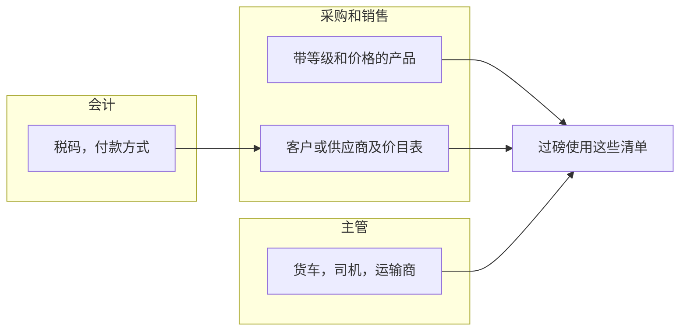
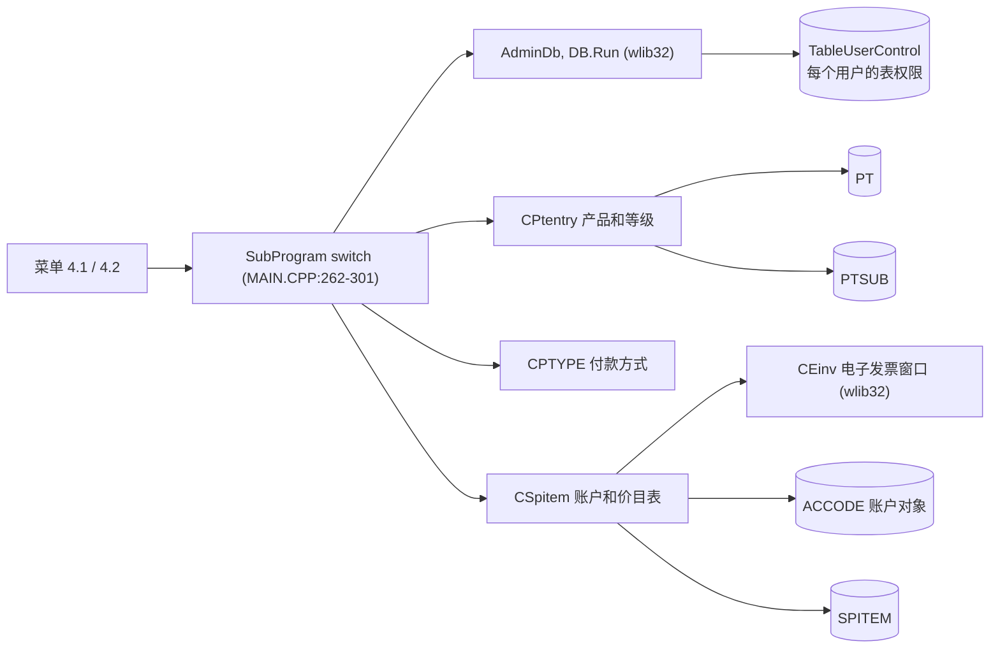
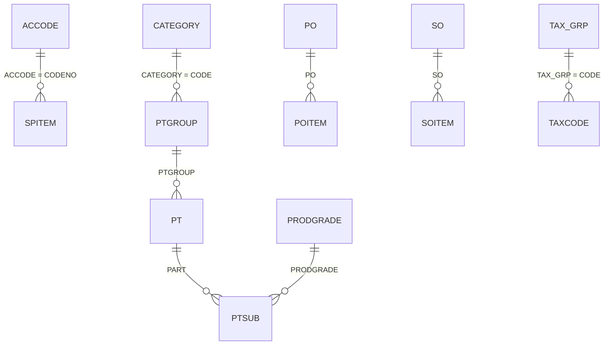
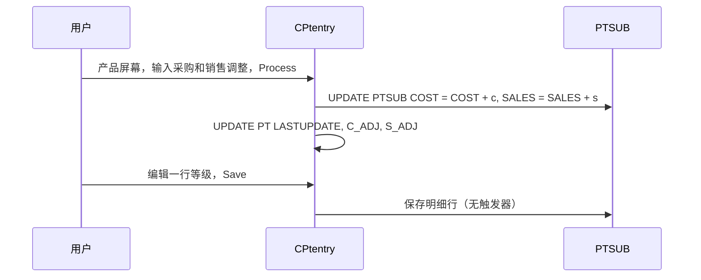

# 控制表（菜单 4.1 和 4.2）- 模块参考

> 英文版为准。同步自英文版 commit c76cd62（2026-10-30）。

> 本文是 TradeWin 模块参考的一部分。索引和共用章节见：[README](README.md)。
> 涵盖的菜单项：4.1.1 Product Code、4.1.2 Lorry Data Maintenance、4.1.3 Category Code、4.1.4 Unit Code、4.1.5 Product Grade、4.1.6 Pay Type、4.1.7 Country Code、4.1.8 Product Group、4.1.9 GWST、4.2.1 Buyer/Seller Code、4.2.2 Driver Code、4.2.3 Transporter、4.2.4 Tax Code。本应用**没有菜单 4.3（Contract / Sales Order）**，菜单上也没有 Gatepass、Yard、Marketing 或 Actual Code 表；采购订单和销售订单屏幕以及另外几张表在代码里存在，但没有菜单项（在 2.5 里列出）。账户屏幕（4.2.1）还带有电子发票增强功能的**电子发票资料**按钮。
> 最后核对的 commit 为 `2f77122`。翻译状态：英文版见 [../control-tables.md](../control-tables.md)；本中文版同步于 2026-10-30（commit c76cd62）。

## 目录

- [第一部分 - 业务视图](#第一部分---业务视图)
  - [1.1 简单说明](#11-简单说明)
  - [1.2 谁用什么](#12-谁用什么)
  - [1.3 一天的工作](#13-一天的工作)
  - [1.4 实例演示](#14-实例演示)
  - [1.5 界面导览](#15-界面导览)
  - [1.6 这个数字从哪里来？](#16-这个数字从哪里来)
  - [1.7 状态含义](#17-状态含义)
  - [1.8 如果发生以下情况](#18-如果发生以下情况)
  - [1.9 你可能看到的消息](#19-你可能看到的消息)
  - [1.10 该做和不该做](#110-该做和不该做)
  - [1.11 开始之前](#111-开始之前)
  - [1.12 词汇表](#112-词汇表)
  - [1.13 问AI](#113-问ai)
- [第二部分 - 技术视图](#第二部分---技术视图)
  - [2.1 概览](#21-概览)
  - [2.2 架构和依赖](#22-架构和依赖)
  - [2.3 主数据目录](#23-主数据目录)
  - [2.4 子表层级](#24-子表层级)
  - [2.5 模块和处理流程](#25-模块和处理流程)
  - [2.6 端到端流程](#26-端到端流程)
  - [2.7 报表目录](#27-报表目录)
  - [2.8 集成](#28-集成)
  - [2.9 配置](#29-配置)
  - [2.10 维护](#210-维护)

---

# 第一部分 - 业务视图

## 1.1 简单说明

- **控制表**是其他屏幕从中选择的清单：产品、货车、客户和供应商、司机、运输商、税码等等。它们设置一次，只有出现新东西时才修改。
- **表 1** 放产品一侧（产品代码及其**等级和价格**、产品组、类别、单位、等级清单）、货车清单、预设扣重（GWST）、付款方式和国家。**表 2** 放客户和供应商账户及其产品清单和**电子发票资料**、司机、运输商和税码。
- 产品**按等级**定价：每个产品有一行或多行等级，每行有采购价和销售价。磅秤过磅单上，程序从产品的第一行等级取价格；收货和发货过磅单上，价格是输入的。本程序里客户或供应商的产品清单只放产品、等级和这个账户自己对产品的叫法，**没有价格**。
- 每个客户或供应商还有**电子发票资料**（TIN、身份证或注册号、地址代码、电子发票用的电子邮件），必须填完整，发票才能作为电子发票提交。
- 控制资料有误或缺失，到处都会出问题：缺价格会使金额为零，税码错了发票就错，缺 TIN 电子发票就会失败。

## 1.2 谁用什么

| 部门 | 菜单项 | 主要工作 |
|---|---|---|
| 采购 / 销售 | 4.2.1 带产品清单和电子发票资料的客户和供应商、4.1.1 Product Code | 维护每个账户的产品清单和电子发票资料、设置等级价格、调整价格 |
| 地磅主管 | 4.1.2 Lorry、4.2.2 Driver、4.2.3 Transporter | 让货车、司机和运输商保持最新 |
| 会计 | 4.2.4 Tax Code、4.1.6 Pay Type、4.2.1 电子发票资料 | 维护税务和付款设置以及 TIN 资料 |
| IT / 管理员 | 4.1.5 Product Grade、4.1.8 Product Group、4.1.3 Category、4.1.4 Unit、4.1.7 Country、4.1.9 GWST | 技术清单 |
| 管理层 | 全部 | 查询 |

**从这里开始 - 采购 / 销售**
- 现有的客户或供应商：4.2.1，检查税码，添加产品清单行，按 E-Invoices，把 TIN、地址和电子邮件填完整。
- 新产品：先做 4.1.8 产品组和 4.1.5 等级，然后做 4.1.1，填写等级行和价格。
- 对所有客户调价：4.1.1，在 Price Adjustment 框里输入金额，然后按 Process。

**从这里开始 - 主管**
- 新的常用货车或司机：4.1.2 和 4.2.2，这样操作员可以选择它们，过磅单会自动填入。

**从这里开始 - IT / 管理员**
- 一次性：GWST 预设值、产品组、类别、单位、等级、国家。

## 1.3 一天的工作

**现有的供应商需要电子发票。**采购打开 4.2.1，找到供应商，按 **E-Invoices**。一个小窗口打开。文员输入 TIN，或输入身份证号或公司注册号（ROC），按 **Search TIN**；程序向电子发票服务查询，并填入 TIN。文员还要填写州、城市、邮编、国家和电子发票用的电子邮件，按 Update。注意**这个屏幕不能新增账户**（程序里账户的 Add 功能已关闭）；新账户必须在保存账户清单的地方创建。

**产品涨价。**采购部打开 4.1.1，选择产品，在 **Price Adjustment** 的 Purchase 和 Sales 框里输入涨价金额，然后按 **Process**；该产品的每一行等级都加上这个金额，“Last Update Information”框显示日期和金额。

**新货车。**主管添加货车（车牌、常用司机、常用客户或供应商、运输商、空车重量）。之后在过磅单上，司机、账户和运输商就会自动填入。
泳道图：



*说明：每一组人都在维护过磅、过磅单和发票所读取的清单。*

## 1.4 实例演示

所有数值都是虚构的。

| 步骤 | 屏幕 | 用户做什么 | 程序做什么 |
|---|---|---|---|
| 1 | 4.1.8 Product Group | 添加组 `MET` “METAL SCRAP”，类别 `01` | 保存 |
| 2 | 4.1.5 Product Grade | 添加等级 `GA` “GRADE A” | 保存 |
| 3 | 4.1.1 Product Code | 添加 `AL01` “ALUMINIUM SCRAP”，组 `MET`，单位 `KG`；等级行 `GA`，采购价 2.000，销售价 2.500 | 保存产品和等级行 |
| 4 | 4.2.1 账户 | 打开现有供应商 `S0001`，添加产品清单行 item `AL01`，等级 `GA`，供应商自己的叫法“ALU SCRAP A” | 保存这一行（行上不保存价格） |
| 5 | 4.2.1，E-Invoices | 输入个体经营者的身份证号，按 Search TIN；填写州、城市、邮编、国家、电子邮件；Update | 程序查找 TIN 并保存资料 |
| 6 | 4.1.1 | 产品 `AL01`：Purchase 0.100，Sales 0.100，Process，Yes | `AL01` 的每一行等级都加 0.100（2.100、2.600），并保存日期 |

第 6 步之后，`AL01` 的磅秤过磅单取 2.100 作为采购价。

## 1.5 界面导览

所有主档屏幕共用同一个框架：一侧是字段，另一侧是标准的记录按钮 Add、Edit、Save、Delete、Search、Previous、Next、Print。用户可以用哪些按钮，按表由表的访问清单控制（见 README，“用户权限”）。

### 4.1.1 Product Code（“Product Data Entry”）

| 字段标签 | 含义 | 必填？ | 值的来源 |
|---|---|---|---|
| SCRAP CODE | 产品代码（最多 8 个字符） | 是（主键） | 输入 |
| DESCRIPTION | 产品名称 | 否 | 输入 |
| SHORT NAME | 简称 | 否 | 输入 |
| PRODUCT GROUP | 组 | 否 | 选择 |
| UNIT | 单位 | 否 | 选择 |
| REMARKS | 自由文字 | 否 | 输入 |
| SALES GLCODE, PURCHASE GLCODE | 销售和采购过账的账户 | 否 | 选择（会计代码） |
| PURCHASE PRICE, SALES PRICE | 旧的单一价格；这些框是关闭的 | - | - |

**等级行（表格）：**No、Code（等级）、Product Grade Description、Purchase Price、Sales Price。一个产品不能有两行相同的等级。

**Price Adjustment：**Purchase 和 Sales 两个框加 **Process** 按钮（只在记录处于查看状态时显示）：把输入的金额（正数或负数）加到该产品的每一行等级上，并记录在“Last Update Information”（Date、Purchase、Sales）里。两个框都是零：显示“Zero value on both Purchase and Sales adjustment column.”，什么都不会发生。

**Stock Flow 按钮：**产品的库存卡：日期、参考号、进出数量、描述和类型，以及连续的余额。

### 4.1.2 Lorry Data Maintenance

| 字段标签 | 含义 | 必填？ | 来源 |
|---|---|---|---|
| LORRY | 车牌 | 是（主键） | 输入 |
| DRIVER | 常用司机（司机代码） | 否 | 从司机清单选择 |
| ACCODE | 常用客户或供应商 | 否 | 选择 |
| TRANSPORTER | 运输公司 | 否 | 选择 |
| TARE WT(KG) | 空车重量 | 否 | 输入 |
| REMARKS | 自由文字 | 否 | 输入 |

### 4.1.3 到 4.1.9 简单清单

| 屏幕 | 字段 | 说明 |
|---|---|---|
| 4.1.3 Category Code | PRODUCT CATEGORY（主键）、DESCRIPTION、TICKET PREFIX、REMARKS | 流水号的前缀（本程序里流水号程序是关闭的） |
| 4.1.4 Unit Code | UNIT（主键）、DESCRIPTION、REMARKS | - |
| 4.1.5 Product Grade | Code（主键）、Description、Remark | 产品和价目表的等级行从这里选择 |
| 4.1.6 Pay Type | PAY TYPE（主键）、DESCRIPTION、REMARKS | 代码 `01` 和 `CASH` 在过磅单和发票里被当作**现金** |
| 4.1.7 Country Code | CODE（主键）、COUNTRY、REMARKS | - |
| 4.1.8 Product Group | PRODUCT GROUP（主键）、DESCRIPTION、PRODUCT CATEGORY | - |
| 4.1.9 GWST | “G.W.S.T RATE SETTING”：十五个框 A 到 O，每个是一个重量，单位 kg | 在 1.1 Receiving Note 的重量窗口里（仅此处），Scroll Lock 打开时，Ctrl+A 到 Ctrl+O 选择其中一个作为扣重 |

### 4.2.1 Buyer/Seller Code（客户和供应商账户，“Customer Data Entry”）

| 字段标签 | 含义 | 必填？ | 值的来源 |
|---|---|---|---|
| CODE NO | 账户代码（最多 10 个字符） | 是（主键） | 输入 |
| NAME | 账户名称 | 过磅单和发票必填 | 输入 |
| ADDRESS (3 lines) | 地址 | 否 | 输入 |
| TEL. NO, FAX NO, CONTACT | 联系资料 | 否 | 输入 |
| AREA | 区域代码 | 否 | 选择 |
| REMARKS | 自由文字 | 否 | 输入 |
| GST NO | 税务登记号 | 否 | 输入 |
| Tax code | 发票上的默认税码 | 开发票必填 | 选择 |

**产品清单（表格，常被称为价目表）：**Item Code、Product Grade、Buyer Product Name。明细行窗口显示 Item Code、Product Grade 和 Buyer Product Description；**没有价格框**。一个产品只能出现一次。

**E-Invoices 按钮：**为这个账户打开窗口“Set E-invoice data”：

| 字段标签 | 含义 | 必填？ | 值的来源 |
|---|---|---|---|
| Tin (*) | 税务识别号 | 电子发票必填 | 输入，或由 Search TIN 填入 |
| New I/C No., Passport No., ROC No., Exempt No. | 对方的身份或注册号码 | 查找 TIN 时其中之一 | 输入 |
| No einv flag | 勾选：这一方不开电子发票 | 否 | 勾选框 |
| Self Bill | 勾选：自开发票方（程序在这个框上写的文字是“Not Self Bill”） | 否 | 勾选框 |
| State, City, Postcode, Country | 地址代码；选择邮编会填入州和城市；国家一开始是 `MYS` | 电子发票必填 | 选择 |
| Einv email | 对方用于电子发票的电子邮件地址 | 否 | 输入 |

按钮：**Search TIN**（需要身份证号或 ROC 号，且 TIN 为空；向电子发票服务查询，最多等待 5 秒的答复）、**Update**（保存）。窗口里提示了固定的 TIN 值：没有 TIN 的买方（`EI00000000010`）、外国买方（`EI00000000020`）、自开发票的外国方（`EI00000000030`）和免税方（`EI00000000040`）。

账户清单不能用添加的方式编辑：这个屏幕上的 Add 功能已关闭。

### 4.2.2 Driver Code

司机的简单记录：NRIC（键，最多 14 个字符）、NAME、NEW IC NO、REMARKS 和 ADDRESS（三行）。只有标准的记录按钮。货车清单和过磅单按 NRIC 代码选择司机并显示姓名。

### 4.2.3 Transporter

CODE NO（主键）、FULL NAME、SHORT NAME、TEL. NO、FAX. NO、ADDRESS（3 行）、CONTACT、OWNER（Y/N 标志）、REMARKS。

### 4.2.4 Tax Code

| 字段标签 | 含义 | 必填？ | 来源 |
|---|---|---|---|
| Tax Code | 代码 | 是（主键） | 输入 |
| Description | 名称 | 否 | 输入 |
| Tax Percen | 税率百分比 | 有税的代码必填 | 输入 |
| Tax Group | 组 | 否 | 选择 |
| Remark | 自由文字 | 否 | 输入 |
| G/L Code | 过账账户 | 在表里是必填 | 输入 |
| Tax Type | 一个字母：`I` 进项，`O` 销项，`C` | 在表里是必填 | 输入 |
| GST03 | 对应代码 | 否 | 输入 |
| Inactive | 勾选后停用这个代码 | 否 | 勾选框 |

## 1.6 这个数字从哪里来？

- **磅秤过磅单明细行的价格**：产品的第一行等级价格（买进用采购价，卖出用销售价）- 见[磅秤过磅](scale-weighing.md#16-这个数字从哪里来)。
- **收货或发货过磅单明细行的价格**：输入的；程序不去查找。
- **Price Adjustment 之后的等级价格** = 旧价格 + 输入的金额。例子：0.627 + 0.010 = **0.637**。
- **发票上的税额：**账户税码的百分比（见 [发票](invoice-cashier.md#16-这个数字从哪里来)）。

## 1.7 状态含义

| 单据 | 状态 | 含义 | 谁来修改 |
|---|---|---|---|
| 主档（产品、货车、账户、司机等） | 无 | 记录存在或不存在 | 有编辑权限的用户 |
| Tax code | Inactive | 已停用的代码（使用它的过磅单一侧查找不属于本程序的菜单） | 勾选框 |
| 价格调整 | Last update | 最近一次 Process 的日期和金额 | Process 按钮 |

## 1.8 如果发生以下情况

| 情况 | 怎么办 | 什么时候找 IT |
|---|---|---|
| 同一个客户用不同的代码输入了两次 | 用其中一个；如果过磅单用过另一个，就不要删除它 | 必须合并过磅单时 |
| 某个产品的价格变了 | 4.1.1 Price Adjustment、Process，或编辑等级行；已保存的过磅单保留原来的价格 | - |
| 客户想要自己的价格 | 本程序的账户屏幕做不到；在过磅单明细行上输入价格 | - |
| Search TIN 说找不到 TIN | 检查身份证号或 ROC 号；如果对方没有 TIN，输入窗口里显示的固定 TIN 值之一 | 服务一直不回答 |
| 产品代码必须更改 | 添加新代码；不要重命名已使用的代码 | - |
| 删除过磅单用过的主档 | 不要这样做：过磅单保留代码，但查找会失败 | - |
| Contract、Sales Order、Gatepass | 不在本程序的菜单上 | - |

## 1.9 你可能看到的消息

| 消息 | 含义 | 怎么办 |
|---|---|---|
| `Zero value on both Purchase and Sales adjustment column.` + `Not allowed to proceed.` | 两个框都是空的就按了 Process | 输入金额 |
| `Do you want to adjust value <n> on Purchase Price` + `and <n> on Sales Price` | Process 的确认 | Yes 就执行 |
| `Data Not found` | 在 4.2.1 输入了不存在的账户代码（添加已关闭，工具栏只提供编辑） | 在保存账户的地方创建账户 |
| `Confirm Search Tin? If TIN is not blank, please remove it!` | 已经输入了 TIN 还按了 Search TIN | 先清除 TIN |
| `TIN is not blank!` | 同上，光标移到 TIN 框 | 清除 TIN |
| `Pls key in IC or ROC no.!` | Search TIN 时既没有身份证号也没有 ROC 号 | 输入其中之一 |
| `Sorry, can't find the TIN!` | 电子发票服务没有这个号码的 TIN | 检查号码，或使用固定的 TIN 值 |
| `Database not open` | 这张表不可用 | 找 IT |
| `Please key in Registered Account Code.` | 采购或销售订单没有注册账户 | 选择一个 |

## 1.10 该做和不该做

- 每个账户在第一次开发票之前，都要给它一个税码。
- 每家真实的公司只用一个代码。
- 账户第一张电子发票之前，务必把它的 TIN、地址和电子邮件填完整。
- 不要把一个产品代码重复用于另一个产品。
- 不要删除已经出现在过磅单上的主档。

## 1.11 开始之前

- 先有产品组、单位和等级，再有产品。
- 先有付款方式、税码和区域，再有账户。
- 货车需要司机清单和运输商清单。

## 1.12 词汇表

| 术语 | 英文 | 马来文 | 中文 |
|---|---|---|---|
| Control table | List used by other screens | Jadual kawalan | 控制表 |
| Scrap code / product code | Code of the paper or scrap type | Kod bahan | 货品代码 |
| Product grade | Quality level of a product, with its own prices | Gred produk | 产品等级 |
| Product group / category | Grouping of products | Kumpulan / kategori | 货品组 / 类别 |
| Pay type | Cash or credit code | Jenis bayaran | 付款方式 |
| Tax code | Rate code | Kod cukai | 税码 |
| GWST | Preset weight deductions | Potongan berat | 预设扣重 |
| Product list | The products a customer or supplier trades, with its own names | Senarai produk | 产品清单 |
| TIN | Tax identification number used on e-invoices | Nombor pengenalan cukai | 税务识别号 |
| E-invoice | Electronic invoice reported to the tax authority | e-Invois | 电子发票 |
| Account code | Code of a customer or supplier | Kod akaun | 账户代码 |

## 1.13 问AI

1. 我怎样填完客户的电子发票资料？
2. 付款方式 01 和 CASH 是什么？
3. 怎样设置带等级和价格的新产品？
4. 怎样对所有客户提高某个产品的价格？
5. GWST 表有什么作用？Ctrl 键是什么？
6. 为什么在 4.2.1 里不能新增客户？
7. 怎样添加司机和货车，让过磅单自动填入？
8. 谁可以修改这些主档？
9. Search TIN 找不到 TIN 时我该怎么办？
10. 产品等级和产品组有什么不同？

---

# 第二部分 - 技术视图

## 2.1 概览

- 应用程序：TradeWin Metals 地磅系统（wlib32 上的 VC6/MFC，`menu.dsp`、`menu.exe`）。见 [README](README.md)。
- 本模块：菜单 4.1 和 4.2 上的主表。大多数屏幕在本仓库里没有自己的类：它们通过 wlib32 的通用屏幕运行，即 `AdminDb(&table)`（表头加明细的 `CParent`，用这张表自己的对话框）、`DB::Run()`（`prodgrade`、`taxcode`、`salesman`、`vtype`）或 `AdminOneRecord(&table)`（`OneRecordOnly` 的 `CStaff`，MAIN.CPP:140-150）。本仓库里的类：`CPtentry`（带等级的产品，PtEntry.cpp）、`CPTYPE`（付款方式，PTYPE.CPP）、`CSpitem`（带产品清单和电子发票按钮的账户，SPITEM.CPP）、`CPO`（订单，PO.CPP，没有菜单项）。司机（4.2.2）没有类：它是表 `ic` 上的通用屏幕，对话框是 `IDD_DRIVER`。
- `CMenuApp::SetDBNodeNo` 给主表分配节点编号，用于用户权限检查：产品 411、货车 412、单位 414、付款方式 416、账户 421、司机 422、运输商 423（MENU.CPP:597-611）；对产品、付款方式和账户，它还设置 `e->ReportFlag = 1`（代码注释称之为“not allow create new record”；在 wlib32 里，`ReportFlag` 的第 1 位使其他屏幕的字段不能通过输入未知代码来新建这张表的条目，不是指主表屏幕自己的 Add 按钮）。
- 本模块的电子发票增强部分：账户屏幕的 **E-Invoices** 按钮（`CSpitem::OnEinv`，SPITEM.CPP:154-185）、视图钩子 `tell_einv_view`（SPITEM.CPP:132-152）和 `CSpitem::DoDataExchange` 里的 `df->m_CannotAdd = TRUE`（SPITEM.CPP:33），它关闭账户屏幕上的 Add。窗口本身（`CEinv`，对话框 `IDD_FN_EINV`）在共用的 wlib32 库里。

## 2.2 架构和依赖



*说明：产品和账户屏幕有自己的类；其他主表用通用框架；账户屏幕还会打开电子发票资料窗口。*

- 库：wlib32（通用屏幕、表权限、`CParent`、`CStaff`）、MSFlexGrid。
- 数据库：SQL Server；TradeWin 没有结构仓库（下面的类型来自姊妹应用 `SQL_LekokPaper`，除非特别说明，TradeWin 未核实）。`accode` 以 `ado(&accode,"accode",init_accodes)` 打开（MENU.CPP:461）；它是不是会计数据库上的视图，这里看不出来。`CREDITOR`、`SUPPLIER` 和 `DEBTOR` 作为独立的对象打开（MENU.CPP:551-553）。
- 权限：`TableUserControl` 和 `FieldUserControl`（wlib32）以及用户的节点清单（见 README）。

## 2.3 主数据目录

下面每张表都在 `OpenAllDataFile`（MENU.CPP:436-555）里用 `ado(&x,"table",init)` 打开。类型来自 `SQL_LekokPaper`（姊妹应用），TradeWin 未核实。每张主表上的审计列（`REC_STATUS`、`NEWUSER`、`NEWTIME`、`MODIFYUSER`、`MODIFYTIME`、`Print Counter`）每张表只在最后一行列出一次。姊妹脚本是那个结构里的 `<TABLE>.sql` 文件。

### PT（产品，菜单 4.1.1）

屏幕 `AdminDbPtentry(&prodtype,&ptsub)`（MAIN.CPP:262-264；PtEntry.cpp:120-130）：对话框 `IDD_PT` 上的 `CPtentry`（`CParent`），带 `PTSUB` 的等级行（`NonDupArray[0] = PTSB_PRODGRADE`）。以 `ado(&prodtype,"pt",init_ptentry)` 打开（MENU.CPP:462；`init_ptentry` 是空的，PtEntry.cpp:164-167）。枚举 `pt`（MENU.H:316）。

| # | field (enum) | SQL column | data type | null | key | 含义 |
|---|---|---|---|---|---|---|
| 1 | `PT_PART` | `PART` | nvarchar(8) | no | PK | 产品代码 |
| 2 | `PT_NAME` | `NAME` | nvarchar(40) | yes |  | 描述 |
| 3 | `PT_SNAME` | `SNAME` | nvarchar(20) | yes |  | 简称 |
| 4 | `PT_PTGROUP` | `PTGROUP` | nvarchar(8) | yes |  | 产品组 |
| 5 | `PT_UNIT` | `UNIT` | nvarchar(6) | yes |  | 单位 |
| 6 | `PT_COST` | `COST` | float(53) | yes |  | 采购价（表单上这个框是隐藏的） |
| 7 | `PT_SALES` | `SALES` | float(53) | yes |  | 销售价（框是隐藏的） |
| 8 | `PT_REMARKS` | `REMARKS` | nvarchar(60) | yes |  | 备注 |
| 9 | `PT_SALESGL` | `GLCODE1` | int | yes |  | 销售过账账户（销售出口使用） |
| 10 | `PT_PURCHASEGL` | `GLCODE2` | int | yes |  | 采购过账账户 |
| 11 | `PT_LASTUPDATE` | `LASTUPDATE` | datetime | yes |  | 最近一次 Process 的日期 |
| 12 | `PT_C_ADJ` | `C_ADJ` | decimal(18,5) | yes |  | 最近一次采购调整 |
| 13 | `PT_S_ADJ` | `S_ADJ` | decimal(18,5) | yes |  | 最近一次销售调整 |
| 14 to 19 | | 审计列 | | yes |  | |

- 查找：`PTGROUP`、`UNIT`、`GLCODE` 视图。使用者：磅秤、收货和发货明细行、账户产品清单、调整、库存卡。

### PTSUB（产品等级行）

链接键：`PTSUB.PART = PT.PART`；枚举 `ptsub`（MENU.H:803）；表格标题 No、Code、Product Grade Description、Purchase Price、Sales Price（PtEntry.cpp:103-117）；对话框 `IDD_PTSUB`；以 `tado(&ptsub,"ptsub")` 打开，**没有 init 函数**（MENU.CPP:440）；`prodtype.sub = &ptsub`（MENU.CPP:566）。

| # | field (enum) | SQL column | data type | null | key | 含义 |
|---|---|---|---|---|---|---|
| 1 | `PTSB_PART` | `PART` | nvarchar(8) | no |  | 产品代码（链接键） |
| 2 | `PTSB_SQNO` | `SQNO` | float(53) | yes |  | 行号 |
| 3 | `PTSB_PRODGRADE` | `PRODGRADE` | nvarchar(10) | yes |  | 等级（主档 `PRODGRADE`） |
| 4 | `PTSB_COST` | `COST` | decimal(18,5) | yes |  | 采购价 |
| 5 | `PTSB_SALES` | `SALES` | decimal(18,5) | yes |  | 销售价 |
| 6 | `PTSB_PKKEY` | `PKKEY` | int | no | PK identity | 行键 |

- 每个产品的基数为 1..n；嵌套子表：无。与表头一起由 `CParent` 机制保存。
- **没有触发器：**姊妹应用在保存等级行之后会运行一个触发器，覆盖每个账户的价目表；TradeWin 没有这样的代码（`ptsub_Triggers` 和 `init_ptsub` 在 PtEntry.cpp 里不存在，该文件到第 166 行结束）。
- **Process 按钮**（`CPtentry::OnProcess`，PtEntry.cpp:138-162）：在 Yes/No 提问之后（PtEntry.cpp:142-155）执行 `UPDATE PTSUB SET COST = COST + c, SALES = SALES + s WHERE PART = '<code>'`，然后执行 `UPDATE PT SET LASTUPDATE = getdate(), C_ADJ = c, S_ADJ = s WHERE PART = '<code>'`。这个按钮只在查看模式下显示（`SetAttribute`，PtEntry.cpp:66-76）。
- Stock Flow 按钮：`ViewStockFlow`（STKFLOW.CPP:17-37）运行 `select * from [stkflow] where [pt]=<code> order by [date],[ordertype],[refno]`，并通过表单 `stkflow.rep` 显示，第 4 和第 8 列带滚动余额。

### 账户（ACCODE）及其产品清单（SPITEM）和电子发票资料

屏幕 `AccodeMaintenance()`（SPITEM.CPP:73-81）：`CSpitem p1(IDD_ACCODE,&accode,1)`，`sub = &spitem`，`IDD_SUB = IDD_SPITEM`，`NonDupArray[0] = Sp_ITEM`，`m_WinPrint = TRUE`。以 `ado(&accode,"accode",init_accodes)` 打开（MENU.CPP:461），并以 `tado(&spitem,"spitem")` 打开，没有 init 函数（MENU.CPP:477）。**Add 已关闭**（`df->m_CannotAdd = TRUE`，SPITEM.CPP:33）：在 wlib32 里，工具栏因此只提供编辑，输入未知代码会回答 `Data Not found`。

**ACCODE。**对话框 `IDD_ACCODE` 按枚举 `accode` 的顺序绑定前 12 个字段（MENU.H:270-272）：框编号 `IDC_EDIT1` 到 `IDC_EDIT12` 跟随枚举（它上面较旧的 18 项枚举已被注释掉，MENU.H:265-269；`ACCODE_AREA` 定义为 `ACCODE_COUNTRY`）。线上对象的列名和类型**未核实**（没有脚本）；对话框和枚举给出含义：

| # | field (enum) | 对话框标签 | 含义 |
|---|---|---|---|
| 1 | `ACCODE_CODENO` | CODE NO | 账户代码（键） |
| 2 | `ACCODE_CUSTOMER` | NAME | 名称 |
| 3 to 5 | `ACCODE_ADD1..3` | ADDRESS（3 行） | 地址 |
| 6 | `ACCODE_TEL` | TEL. NO | 电话 |
| 7 | `ACCODE_FAX` | FAX NO | 传真 |
| 8 | `ACCODE_CONTACT` | CONTACT | 联系人 |
| 9 | `ACCODE_COUNTRY`（别名 `ACCODE_AREA`） | AREA | 区域代码 |
| 10 | `ACCODE_REMARKS` | REMARKS | 备注 |
| 11 | `ACCODE_GST_NO` | GST NO | 税务注册号 |
| 12 | `ACCODE_TAXCODE` | Tax code | 默认税码 |

`init_accodes` 安装 `accodes_save`（返回 1）和 `tell_accode`（返回 1）：没有任何规则（SPITEM.CPP:83-130）。枚举必须与线上对象的列顺序一致；这一点没有核对（姊妹应用的枚举与它的视图不一致，见[发票](invoice-cashier.md#210-维护)）。

**电子发票资料（按钮 E-Invoices）。**`CSpitem::OnEinv`（SPITEM.CPP:154-185）：需要时先保存新记录，构造名称 `<table>_einv`（账户屏幕是 `accode_einv`），把 `select * from accode_einv where <key field> = '<code>'` 运行到一个临时对象里（`ado(&adoTmp, dbName, init_einv_view, strSQL)`），视图里没有这个账户的行时静默关闭，否则在那一行上显示 `CEinv`（对话框 `IDD_FN_EINV`，wlib32），`isFFBProgram = TRUE`；OK 用 `fetch(df, &adoTmp)` 把字段复制回去。源码注释说，这个视图必须带账户代码以及从 TIN 到电子发票电子邮件的字段来创建。`tell_einv_view`（视图上的钩子，字段 10 = 邮编）：选择邮编会从 `postcode` 表填入 `MALAYSIA_STATE` 和 `MALAYSIA_CITY`（`STATE` 列 `MALAYSIA_STATE`，城市列 `CITY_NAME`）。`CEinv` 按名称读取列 `NICNO`（新身份证）、`TIN` 和 `REGNO`（ROC），把 `COUNTRY` 默认为 `MYS`，它的 Search TIN 按钮调用存储过程 `dt_SearchTinApi` 并读取表 `EINVOICE_TIN`（见[发票](invoice-cashier.md#28-集成)）。视图 `accode_einv`、这个存储过程和这张表都不在本仓库里（未核实）。

**SPITEM**（账户的产品清单；姊妹脚本 `SPITEM.sql`；枚举 `spitem` MENU.H:325 有 **5** 个条目；表格标题 No、Item Code、Product Grade、Buyer Product Name，SPITEM.CPP:53-60）

| # | field (enum) | SQL column | data type | null | key | 含义 |
|---|---|---|---|---|---|---|
| 1 | `Sp_CUSTOMER` | `ACCODE` | nvarchar(10) | no |  | 账户（到 `ACCODE.CODENO` 的链接键） |
| 2 | `Sp_SQNO` | `SQNO` | float(53) | yes |  | 行号 |
| 3 | `Sp_ITEM` | `PT` | nvarchar(8) | no |  | 产品代码 |
| 4 | `Sp_PRODGRADE` | `PRODGRADE` | nvarchar(10) | yes |  | 等级 |
| 5 | `Sp_BUYERPTNAME` | `ACCPTNAME` | nvarchar(50) | yes |  | 账户自己对这个产品的称呼 |
| 6 | | `PKKEY` | int | no | PK identity | 行键（姊妹脚本里的位置，`COST`、`SALES` 在第 6 和第 7 位；TradeWin 的对话框 `IDD_SPITEM` 没有价格框，所以这些列是否存在未核实） |

- 基数每个账户 1..n；嵌套子表：无。本程序里**没有** `tell_spitem`，也没有 `init_spitem`：选择一个 item 不会复制任何东西，这一行也不带价格。
- 使用者：针式打印机的小票打印按账户和产品读取 `ACCPTNAME`（SLIP1.CPP:47）。以前使用 `SPITEM` 的价格查找都已被注释掉或从未被调用：磅秤明细行价格（SCALE.CPP:719-727）、`ChangePrice`（DS.CPP:422-443）、`FindSellerPrice`（DT.CPP:195-210，它的调用在 DT.CPP:219 被注释掉）和 `FindSpitem`（PO.CPP:79-89，调用在 PO.CPP:101 被注释掉）。

### LORRY（菜单 4.1.2）

`AdminDb(&lorry)`（MAIN.CPP:265-267）；`ado(&lorry,"lorry",init_lorry)`（MENU.CPP:465；`init_lorry` 是空的）；对象 `vehicle` 是同一张表的第二个句柄（`ado(&vehicle,"vehicle",init_lorry)`，MENU.CPP:466；视图 `VEHICLE` = `SELECT LORRY.* FROM LORRY`）。枚举 `lorry`（MENU.H:315）。`SetDBRelations` 把字段 3 取别名为“ACCODE”（MENU.CPP:570）。脚本 `LORRY.sql`。

| # | field (enum) | SQL column | data type | null | key | 含义 |
|---|---|---|---|---|---|---|
| 1 | `LO_VEHICLE` | `LORRY` | nvarchar(10) | no | PK | 车牌 |
| 2 | `LO_DRIVER1` | `ICNO`（姊妹脚本） | nvarchar(14) | yes |  | 常用司机（司机代码，即 `ic` 表的 NRIC） |
| 3 | `LO_DRIVER2` | `IC2` | nvarchar(14) | yes |  | **常用客户或供应商的账户代码**（别名“ACCODE”；表单标签写的是 ACCODE） |
| 4 | `LO_TRANSP` | `TRANSP` | nvarchar(5) | yes |  | 运输商 |
| 5 | `LO_TARE` | `TARE` | float(53) | yes |  | 空车重量 |
| 6 | `LO_REMARKS` | `REMARKS` | nvarchar(40) | yes |  | 备注 |
| 7 to 12 | | 审计列 | | yes |  | |

### IC（司机，菜单 4.2.2）

`AdminDb(&driver)`（MAIN.CPP:293-295）：对象 `driver` 上的通用表头屏幕，以 `ado(&driver,"ic")` 打开（MENU.CPP:464），**没有 init 函数**（driver.cpp 里的 `init_driver` 的打印行已被注释掉，也没有接上）；对话框 `IDD_DRIVER`（menu.rc:4316，标题“Driver Data Entry”）；节点编号 422（MENU.CPP:608）。本程序里没有 `ICNO` 表、类或 MyKad 导入。过磅单屏幕复制的是 `driver.dat[2]`（姓名）。

可见字段：NRIC（`IDC_EDIT1`，键）、NAME（2）、NEW IC NO（3）、REMARKS（4）、ADDRESS（5 到 7）。类型来自姊妹脚本 `IC.sql`（姊妹应用，TradeWin 未核实；它的审计列里用户是 `varchar(10)`）：

| # | 对话框标签 | SQL column | data type | null | key | 含义 |
|---|---|---|---|---|---|---|
| 1 | NRIC | `NRIC` | nvarchar(14) | no | PK | 司机代码 |
| 2 | NAME | `NAME` | nvarchar(35) | yes |  | 姓名 |
| 3 | NEW IC NO | `NERIC` | nvarchar(14) | no |  | 新身份证号码 |
| 4 | REMARKS | `REMARKS` | nvarchar(35) | yes |  | 备注 |
| 5 to 7 | ADDRESS | `ADD1..3` | nvarchar(40) | yes |  | 地址 |
| （不在表单上） | | `CONTACT` | nvarchar(20) | yes |  | 联系方式（只在姊妹脚本里） |
| | | 审计列 | | yes |  | `REC_STATUS`、`NEWUSER`、`NEWTIME`、`MODIFYUSER`、`MODIFYTIME`、`Print Counter` |

- 使用者：货车（`LO_DRIVER1`）、过磅单屏幕（`qd(df->dat[DP_IC], &driver)` 填入司机姓名，例如 DS.CPP:502-503、SCALE.CPP:617-618、Wpr.cpp:184-185）。
- 嵌套子表：无。

### TRANSP（菜单 4.2.3）

`AdminDb(&transp)`（MAIN.CPP:296-298）；`ado(&transp,"transp",init_transp)`（MENU.CPP:467）；枚举 `transp`（MENU.H:317）；脚本 `TRANSP.sql`。

| # | field (enum) | SQL column | data type | null | key | 含义 |
|---|---|---|---|---|---|---|
| 1 | `Trn_TR_NO` | `TR_NO` | nvarchar(5) | no | PK | 代码 |
| 2, 3 | `Trn_NAME`, `Trn_SNAME` | `TR_NAME`, `TR_SNAME` | nvarchar(40), nvarchar(20) | yes |  | 全名和简称 |
| 4, 5 | `Trn_TR_TEL`, `Trn_TR_FAX` | `TR_TEL`, `TR_FAX` | nvarchar(15) | yes |  | 电话、传真 |
| 6 to 8 | `Trn_TR_ADD1..3` | `TR_ADD1..3` | nvarchar(30) | yes |  | 地址 |
| 9 | `Trn_CONTACT` | `CONTACT` | nvarchar(30) | yes |  | 联系人 |
| 10 | `Trn_COMPUTE` | `COMPUTE` | nvarchar(1) | yes |  | 表单标签“OWNER”（Y/N） |
| 11 | `Trn_REM` | `REM` | nvarchar(30) | yes |  | 备注 |
| 12 to 17 | | 审计列 | | yes |  | |

### TAXCODE 和 TAX_GRP（菜单 4.2.4）

`taxcode.Run()`（MAIN.CPP:299-301）；`ado(&taxcode,"taxcode")`（MENU.CPP:555），对话框 `IDD_TAXCODE`。脚本 `TAXCODE.sql`、`TAX_GRP.sql`。

| # | SQL column | data type | null | key | 含义 |
|---|---|---|---|---|---|
| 1 | `CODE` | nvarchar(10) | no | PK | 税码 |
| 2 | `DESCRIPTION` | nvarchar(150) | yes |  | 描述 |
| 3 | `PERCEN` | decimal(5,2) | yes |  | 百分比（第 3 个字段，由 `FindPercen` 读取） |
| 4 | `TAX_GRP` | nvarchar(10) | yes | FK to `TAX_GRP.CODE` | 税组（默认 0） |
| 5 | `REMARK` | nvarchar(50) | yes |  | 备注 |
| 6 | `GLCODE` | nvarchar(8) | no |  | 过账账户 |
| 7 | `TAX_TYPE` | nvarchar(1) | no |  | `I`、`O` 或 `C`（检查约束） |
| 8 | `GST03` | nvarchar(10) | yes |  | 对应代码 |
| 9 | `INACTIVE` | bit | yes |  | 已停用 |
| 10 to 15 | 审计列 | | yes |  | |

`TAX_GRP`：`CODE` nvarchar(10) 主键、`DESCRIPTION` nvarchar(50)、`REMARK` nvarchar(50)、审计列。

### 简单清单

| 菜单 | 处理程序（MAIN.CPP） | 表和脚本 | 列 |
|---|---|---|---|
| 4.1.3 Category | `AdminDb(&category)`（MAIN.CPP:268-270） | `CATEGORY.sql` | `CODE` nvarchar(5) 主键，`DESC` nvarchar(40)，`PREFIX` nvarchar(10)，`REMARKS` nvarchar(200)，审计 |
| 4.1.4 Unit | `AdminDb(&unit)`（MAIN.CPP:271-273） | `UNIT.sql` | `CODE` nvarchar(6) 主键，`UNIT` nvarchar(12)，`REMARKS` nvarchar(12)，审计 |
| 4.1.5 Product Grade | `prodgrade.Run()`（MAIN.CPP:274-276） | `PRODGRADE.sql` | `PRODGRADE` nvarchar(10) 主键，`DESCRIPTION` nvarchar(50)，`REMARK` nvarchar(50)，审计 |
| 4.1.6 Pay Type | `AdminDbPTYPE(&ptype)`（MAIN.CPP:277-280；PTYPE.CPP:51-61） | `PTYPE.sql` | `CODE` nvarchar(5) 主键，`DECRIBE` nvarchar(30)（拼写照脚本），`REMARKS` nvarchar(30)，审计 |
| 4.1.7 Country | `AdminDb(&country)`（MAIN.CPP:281-283） | `COUNTRY.sql` | `CODE` nvarchar(5) 主键，`COUNTRY` nvarchar(30)，`REMARKS` nvarchar(40)，审计 |
| 4.1.8 Product Group | `AdminDb(&ptgroup)`（MAIN.CPP:284-286） | `PTGROUP.sql` | `PTGROUP` nvarchar(8) 主键，`DESCRIPTION` nvarchar(50)，`CATEGORY` nvarchar(5)，审计 |
| 4.1.9 GWST | `AdminDb(&gst)`（MAIN.CPP:287-289） | `GST.sql` | `CODE` int 主键，`A` 到 `O` float(53)，审计 |

`ado(&category,"category",init_category)`、`init_country`、`init_grade`、`init_ptype` 和 `init_unit` 已声明，但函数体是空的或已被注释掉（CATEGORY.CPP:19、COUNTRY.CPP:19 等）；`gst` 用 `readrec(1,&gst)` 打开（MENU.CPP:470-472），所以 Ctrl 预设读取第一行。`CPTYPE` 是普通的 `CParent`，没有额外代码。

### 有代码但没有菜单项的表

| 节点 | 处理程序 | 表和脚本 | 说明 |
|---|---|---|---|
| 425 | `AdminDb(&grade)`（MAIN.CPP:302-305） | `GRADE.sql`：`CODE` nvarchar(5) 主键，`NAME` nvarchar(30)，`REMARKS` nvarchar(40)，审计 | 分级员清单（“Grader Code Data Maintenance”） |
| 426 | `AdminDb(&status)`（MAIN.CPP:306-308） | `STATUS.sql`：`CODE` char(1) 主键，`NAME` nvarchar(20)，`REMARK` nvarchar(30)，审计 | “INVOICE STATUS”清单 |
| 427 | `salesman.Run()`（MAIN.CPP:309-311） | `SALESMAN.sql`：`SALESMAN` nvarchar(15) 主键，`NAME` nvarchar(50)，`REMARK` nvarchar(50)，审计 | 业务员 |
| 428 | `vtype.Run()`（MAIN.CPP:312-315） | `VTYPE.sql`：`VTYPE` nvarchar(15) 主键，`NAME` nvarchar(50)，`REMARK` nvarchar(50)，审计 | 车辆类型 |
| 429 | `accodehq`（MAIN.CPP:316-318） | `ACCODEHQ.sql` | 调用已被注释掉；这个 case 什么也不做 |
| 431, 432 | `PurchaseOrderData()`、`SalesOrderData()`（MAIN.CPP:319-324） | `PO.sql`、`POITEM.sql`、`SO.sql`、`SOITEM.sql` | 采购订单和销售订单，见下 |
| 441 to 449 | 会计维护（MAIN.CPP:325-353） | 视图 | 见 README“休眠代码” |

### PO / POITEM 和 SO / SOITEM（订单，没有菜单项）

`CPO`（PO.CPP，`CParent`）在 `IDD_PO` 上，明细行用 `IDD_POITEM`；`PurchaseOrderData()`（PO.CPP:133-143）设置 `Purchase_Flag = TRUE`，`SalesOrderData()`（145-153）设置 `FALSE`；两者都用 `NonDupArray[0] = POD_ITEM`（每张订单里一个产品只能出现一次）。以 `ado(&po,"po",init_po)`、`tado(&poitem,...)`、`ado(&so,"so",init_po)`、`tado(&soitem,...)` 打开（MENU.CPP:480-483）。订单从菜单上到达不了，而且过磅单对话框上那个会把过磅单的产品清单限制在订单明细行里的 PO / SO 框已关闭（[过磅单](tickets.md)）。

**PO / SO**（脚本 `PO.sql`、`SO.sql`；枚举 `po` MENU.H:326）：`PO` 或 `SO` nvarchar(10) 主键、`DATE`、`ETA` smalldatetime、`ACCODE` nvarchar(10)（供应商或买方）、`TERMS` nvarchar(50)、`REMARKS` nvarchar(50)、审计列。账户没有登记之前，`CPO::OnDetail` 拒绝添加明细行（`Please key in Registered Account Code.`，PO.CPP:62-70）。

**POITEM / SOITEM**（脚本 `POITEM.sql`、`SOITEM.sql`；枚举 `poitem` MENU.H:327）：`PO` / `SO` nvarchar(10)（链接键）、`SQNO` float(53)、`PT` nvarchar(8)、`NAME` varchar(40)、`CATEGORY` nvarchar(5)、`QTY` float(53)、`PRICE` float(53)、`AMOUNT` float(53)、`PKKEY` int 主键 identity（采购一侧有 `FK_POITEM_PO`）。`tell_poitem`（PO.CPP:93-114）：选择产品会填入名称和它所在组的类别；每次改动，金额 = 数量 x 价格。价格不查找（`FindSpitem` 的调用已被注释掉，PO.CPP:101）。

## 2.4 子表层级

```text
PT       (key PART)
  - PTSUB   link: PTSUB.PART = PT.PART    (key PKKEY identity, line number SQNO)
    Nested sub-tables: none
ACCODE   (view, key CODENO)
  - SPITEM  link: SPITEM.ACCODE = ACCODE.CODENO    (key PKKEY identity, line number SQNO)
    Nested sub-tables: none
PO / SO  - POITEM / SOITEM   link: PO / SO number    (key PKKEY identity)
    Nested sub-tables: none
```



*说明：产品有等级行；账户有产品清单行；本程序里没有任何东西在它们之间复制价格。*

- 每个子表的链接键是它的第一个字段（上级代码）；屏幕按这个键从子表刷新表格。各行由 `CParent` 机制与表头一起保存。

## 2.5 模块和处理流程

### 菜单项和入口

| 菜单项 | 节点 | `SubProgram` 里的处理程序 | 打开 |
|---|---|---|---|
| 4.1.1 Product Code | 411 | `AdminDbPtentry(&prodtype,&ptsub)`（MAIN.CPP:262-264） | `CPtentry` |
| 4.1.2 Lorry Data Maintenance | 412 | `AdminDb(&lorry)`（MAIN.CPP:265-267） | 通用 |
| 4.1.3 Category Code | 413 | `AdminDb(&category)`（MAIN.CPP:268-270） | 通用 |
| 4.1.4 Unit Code | 414 | `AdminDb(&unit)`（MAIN.CPP:271-273） | 通用 |
| 4.1.5 Product Grade | 415 | `prodgrade.Run()`（MAIN.CPP:274-276） | `DB::Run` |
| 4.1.6 Pay Type | 416 | `AdminDbPTYPE(&ptype)`（MAIN.CPP:277-280） | `CPTYPE` |
| 4.1.7 Country Code | 417 | `AdminDb(&country)`（MAIN.CPP:281-283） | 通用 |
| 4.1.8 Product Group | 418 | `AdminDb(&ptgroup)`（MAIN.CPP:284-286） | 通用 |
| 4.1.9 GWST | 419 | `AdminDb(&gst)`（MAIN.CPP:287-289） | 通用 |
| 4.2.1 Buyer/Seller Code | 421 | `AccodeMaintenance()`（MAIN.CPP:290-292） | `CSpitem` |
| 4.2.2 Driver Code | 422 | `AdminDb(&driver)`（MAIN.CPP:293-295） | 通用 |
| 4.2.3 Transporter | 423 | `AdminDb(&transp)`（MAIN.CPP:296-298） | 通用 |
| 4.2.4 Tax Code | 424 | `taxcode.Run()`（MAIN.CPP:299-301） | `DB::Run` |

4.1.5（“Product Grade”）和 4.1.9（“GWST”）的标题与本程序的菜单一致；在 Seng Hiap Metal 的参考文档里，4.1.5 是 GWST，4.2.4 是 Grade Code。菜单是单一资源 `IDR_MAINMENU`（menu.rc:154-175 是 Control Table 弹出菜单及其两个子菜单 41 和 42）。

### 流程：产品价格调整



*说明：Process 会修改产品的每一行等级并记录这次调整；之后编辑某一行等级只改那一行。没有任何东西触及账户的产品清单。*

### 读写的表

| 表 | 读 | 写 | 键 |
|---|---|---|---|
| PT, PTSUB | 产品屏幕、磅秤价格查找 | `CPtentry`、Process | `PART`、`PKKEY` |
| SPITEM | 小票打印（`ACCPTNAME`） | `CSpitem` | `PKKEY` |
| ACCODE, DEBTOR, CREDITOR | 账户 | `CSpitem`（只能编辑，Add 已关闭） | `CODENO` |
| `accode_einv`（视图）、POSTCODE、EINVOICE_TIN | 电子发票窗口 | 通过视图的 `CEinv` | 未核实 |
| LORRY, `ic`（司机） | 过磅单默认值 | 它们各自的屏幕 | `LORRY`、`NRIC` |
| TRANSP, TAXCODE, TAX_GRP, PTYPE, COUNTRY, CATEGORY, UNIT, PTGROUP, PRODGRADE, GST | 查找 | 它们各自的屏幕 | 代码 |

### 流水号

无：这些表里的每个代码都由用户输入。（`CATEGORY.PREFIX` 曾是流水号程序 `FindProductCategorySerialNo` 的前缀，该程序在第一行就返回，DS.CPP:72。）

### 状态转换

无。

### 对其他模块的依赖

- 过磅、磅秤、过磅单和发票都读取所有这些表；见其他模块文件。

## 2.6 端到端流程

见 [README](README.md#26-端到端流程)。

## 2.7 报表目录

- 仓库里有几张主表的清单表单（`lorry.rpt`、`ic.rpt`、`.rep` 表单），但各个 init 函数里的 `prec` 赋值已被注释掉（CATEGORY.CPP:19、COUNTRY.CPP:19、GRADE.CPP:19、PRODTYPE.CPP:19、lorry.cpp:49、transp.cpp:20、unit.cpp:19、PTYPE.CPP:74），所以这些屏幕的 Print 按钮使用 wlib32 的默认清单。`PrintLorryCode`（lorry.cpp:18-44）没有被使用。
- 主档相关的报表在 [报表](reports.md) 里。

## 2.8 集成

- 账户电子发票资料：窗口通过视图 `accode_einv` 读写，**Search TIN** 运行存储过程 `dt_SearchTinApi` 并读取表 `EINVOICE_TIN`（全部定义在本仓库之外）。见[发票](invoice-cashier.md#28-集成)。
- 账户清单和税务资料可能放在会计数据库里；4.2.1 上的编辑写入 `accode` 对象。

## 2.9 配置

- `TableUserControl`、`FieldUserControl`（wlib32）；节点号在 `SetDBNodeNo` 里设置。
- `SetDBRelations`：`prodtype.sub = &ptsub`；`lorry` 字段 3 的字段别名 `ACCODE`（MENU.CPP:564-570）。
- 本程序没有配置图片文件夹或 MyKad 路径。

## 2.10 维护

- 修改主档屏幕或表时，要更新本文件。
- 修改记录：

| 日期 | Commit | 作者 | 修改内容 |
|---|---|---|---|
| 2026-10-19 | `2f77122` | Claude（草稿待审阅） | Application_TradeWin 的第一版，以 Application_LekokPaper 的参考为起点；简单的司机表，没有价格但带电子发票资料的账户屏幕，没有等级价格触发器 |

- 最后核对的 commit 为 `2f77122`。翻译状态：zh-CN 已完成，同步于 2026-10-30。

### 代码发现（给开发人员）

1. **菜单 4.1.5 和 4.1.9 的标题与姐妹应用的节点含义不同：**这里节点 415 是 Product Grade，419 是 GWST；权限清单（`N01..N20`，只能查看的 `N31..N39`）使用这些节点号。
2. **4.2.1 上不能新增账户**（`df->m_CannotAdd = TRUE`，SPITEM.CPP:33），所以新客户或供应商必须在别处创建；这个屏幕只能编辑现有账户、它们的产品清单和电子发票窗口。代码里没有说明新账户在哪里创建。
3. **账户的产品清单不带价格，也不用于取价格。**姊妹应用的价格列和 `tell_spitem` 复制已经没有了（枚举 `spitem` 有 5 个条目，MENU.H:325），所有读取 `SPITEM` 价格的查找都已被注释掉（SCALE.CPP:719-727、DS.CPP:422-443、DT.CPP:219、PO.CPP:101）。磅秤明细行取第一行 `PTSUB`，不排序；收货和发货明细行需要输入价格。
4. **枚举 `accode` 必须与线上的 `accode` 对象一致**（12 个字段，MENU.H:270-272）；姊妹应用的枚举与它的视图不一致，这里没有任何东西检查。`DpDo` 和小票读取 `ACCODE_ADD1..3`（DpDo.cpp:78-80）。
5. **没有任何菜单项维护分级员清单、业务员清单、车辆类型清单、订单表或电子发票查找表**（`malaysia_state`、`malaysia_city`、`postcode`、`classification`），尽管它们的屏幕存在（电子发票的在共用资源里）。
6. **几张主表的 `init_*` 钩子是空的**，而 `AdminDb` 仍然提供 Print；`PrintLorryCode` 和 `PrintDriver` 这样的打印程序没有接上。
7. **电子发票窗口依赖一个名为 `accode_einv` 的视图**：代码打开 `<table>_einv`，视图里没有这个账户的行时静默什么也不做（SPITEM.CPP:163-173）。如果视图缺失或对某个账户为空，按 E-Invoices 看起来就像什么都没发生。
8. **`CSpitem::OnEinv` 用 `fetch(df, &adoTmp)` 把窗口的字段复制回去**，但之后从不保存账户（SPITEM.CPP:179-182）；电子发票窗口本身是否写入视图，在共用库里。
