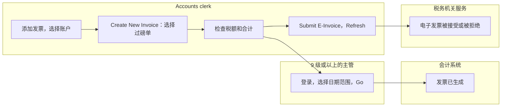
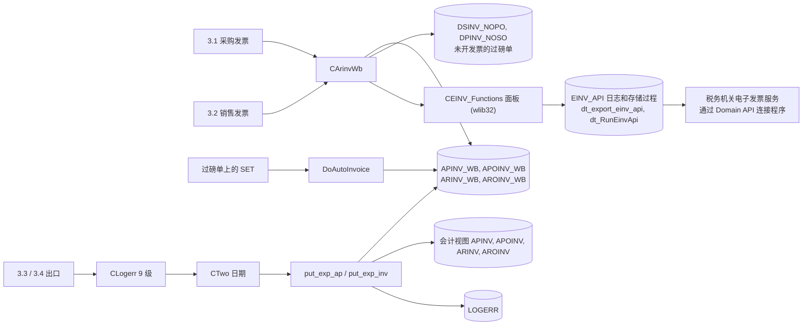
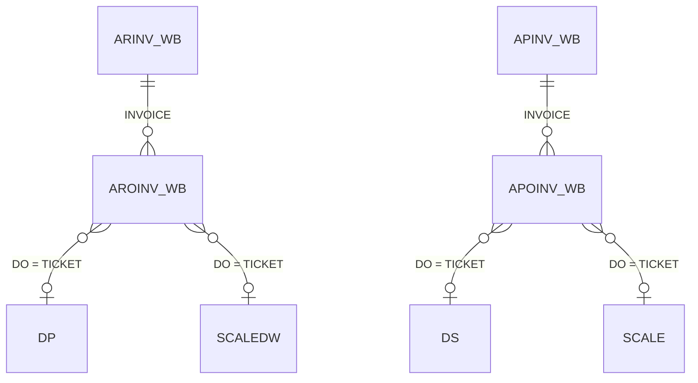
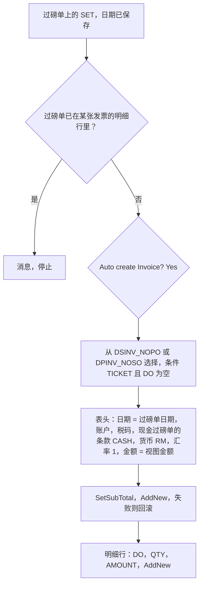
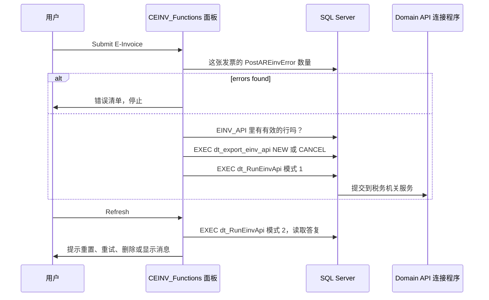
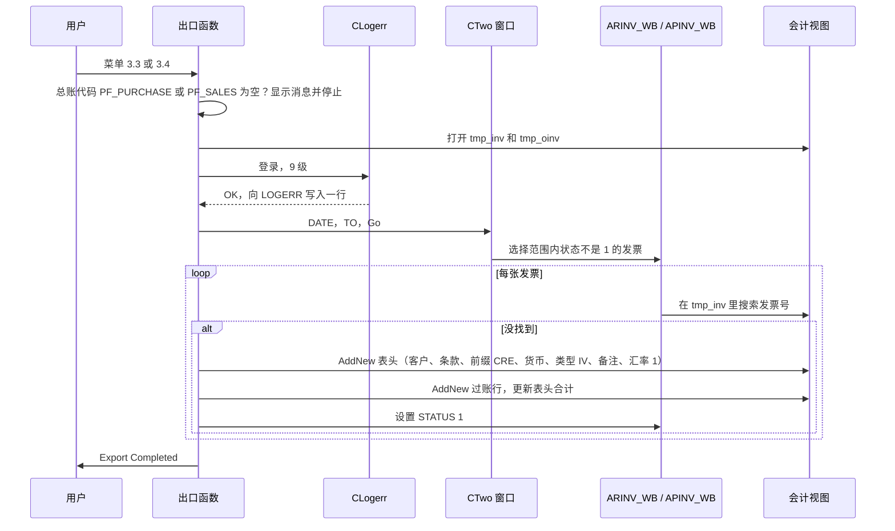
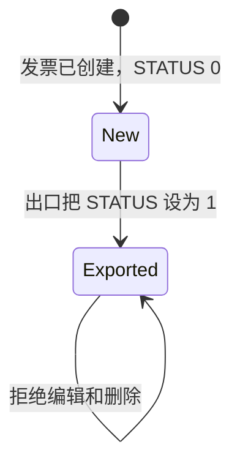

# 发票和导出（菜单 3）- 模块参考

> 英文版为准。同步自英文版 commit c76cd62（2026-10-30）。

> 本文是 TradeWin 模块参考的一部分。索引和共用章节见：[README](README.md)。
> 涵盖的菜单项：3.1 Purchase Invoice、3.2 Sales Invoice、3.3 Export Purchase Invoice、3.4 Export Sales Invoice，以及两个发票屏幕上的**电子发票面板**（本程序是“E-Invoice enhancement”版本，程序标题 `VER 2.00`）。本应用**没有收银模块**（没有 Seng Hiap Metal 作为 4.4 的 End Day Closing、付款支出和备用金）；文件名 `invoice-cashier.md` 保持不变，让各个参考文档的文件名一一对应。
> 最后核对的 commit 为 `2f77122`。翻译状态：英文版见 [../invoice-cashier.md](../invoice-cashier.md)；本中文版同步于 2026-10-30（commit c76cd62）。

## 目录

- [第一部分 - 业务视图](#第一部分---业务视图)
  - [1.1 简单说明](#11-简单说明)
  - [1.2 谁用什么](#12-谁用什么)
  - [1.3 一天的工作](#13-一天的工作)
  - [1.4 实例演示](#14-实例演示)
  - [1.5 界面导览](#15-界面导览)
  - [1.6 这个数字从哪里来？](#16-这个数字从哪里来)
  - [1.7 状态含义](#17-状态含义)
  - [1.8 如果发生以下情况](#18-如果发生以下情况)
  - [1.9 你可能看到的消息](#19-你可能看到的消息)
  - [1.10 该做和不该做](#110-该做和不该做)
  - [1.11 开始之前](#111-开始之前)
  - [1.12 词汇表](#112-词汇表)
  - [1.13 问AI](#113-问ai)
- [第二部分 - 技术视图](#第二部分---技术视图)
  - [2.1 概览](#21-概览)
  - [2.2 架构和依赖](#22-架构和依赖)
  - [2.3 主数据目录](#23-主数据目录)
  - [2.4 子表层级](#24-子表层级)
  - [2.5 模块和处理流程](#25-模块和处理流程)
  - [2.6 端到端流程](#26-端到端流程)
  - [2.7 报表目录](#27-报表目录)
  - [2.8 集成](#28-集成)
  - [2.9 配置](#29-配置)
  - [2.10 维护](#210-维护)

---

# 第一部分 - 业务视图

## 1.1 简单说明

- **发票**给已完成的过磅单开票。**采购发票**（3.1）是我们为买进的货欠供应商的钱；**销售发票**（3.2）是客户为卖出的货欠我们的钱。一张发票可以带多张过磅单；一张过磅单只能在一张发票上。
- 发票有两种做法：会计文员打开发票，按 **Create New Invoice** 选择还没开票的过磅单；或者用户在过磅单上按 **SET**（见[过磅单](tickets.md)和[磅秤过磅](scale-weighing.md)），自动生成只有一张过磅单的发票。
- 税额根据客户或供应商的税码计算。
- 每一行发票明细都带一个**分类代码**（税务机关对货物的分类）；新的明细行默认使用代码 `022`。
- 每个发票屏幕都有一个**电子发票面板**：**Submit E-Invoice** 通过程序的连接程序，把发票发送到税务机关的电子发票服务；**Refresh** 读取答复；**QRCODE** 显示验证码；**View Msg** 显示消息。每个按钮的作用见界面导览。
- **出口**（3.3 和 3.4）把某个日期范围的发票送到会计系统，采购发票出口一次，销售发票出口一次。必须由 9 级或以上的用户登录确认。
- 如果过磅单不开票，就没有人付款或收款；如果发票不作为电子发票提交，就没有向税务机关申报；如果发票不导出，会计系统就不完整。

## 1.2 谁用什么

| 部门 | 菜单项 | 主要工作 |
|---|---|---|
| 会计 / 财务 | 3.1 Purchase Invoice、3.2 Sales Invoice | 根据过磅单生成发票、检查税务、更正表头、提交电子发票并读取答复 |
| 会计（99 级） | Unlock Period 按钮 | 重新打开某个期间的发票 |
| 会计主管（9 级或以上） | 3.3、3.4 Export | 确认并运行向会计系统的出口 |
| IT / 管理员 | 6.5 E-Invoice Profile、4.2.1 账户电子发票资料 | 维护公司的电子发票身份资料和每个客户的 TIN 资料（见[其他、库存](other-stock-export.md)、[控制表](control-tables.md)） |
| 管理层 | [报表](reports.md) | 发票清单和未开发票的过磅单报表 |

**从这里开始 - 会计**
- 每天或每周：供应商用 3.1，客户用 3.2：添加发票，选择账户，Create New Invoice，选择过磅单，检查合计，按 Submit E-Invoice。
- 每周：对已提交的发票按 Refresh，看是否被接受。
- 月底：先运行未开发票的过磅单报表，然后对本月运行 3.3 和 3.4。

## 1.3 一天的工作

**给供应商开票。**文员打开 3.1，添加新发票，输入日期并选择供应商。程序填入币种（`RM`）、汇率（1）和供应商的税码。文员按 **Create New Invoice**。一个清单显示这个供应商在发票日期之前、还不在任何发票上的过磅单。文员选择一张；它变成一行，带有过磅单号、数量、金额和分类代码 `022`。清单再次打开，选择下一张过磅单；Cancel 结束。每加一行，小计、税额和净合计都会更新。

**向现金客户开发票。**对于 Company Profile 里设置的结账（现金）账户，清单显示截至该日期、任何客户的所有现金过磅单。

**发送电子发票。**在已保存的发票上，文员按 **Submit E-Invoice**。如果检查发现问题，会打开一个错误清单。否则程序要求确认，发送请求并等待。之后文员按 **Refresh** 读取答复；**QRCODE** 显示验证码，用来打印或给客户看。

**月底出口。**主管打开 3.3，用 9 级或以上的用户 ID 和密码登录，输入日期范围并按 Go。范围内每张还没出口的采购发票都会在会计系统里生成；程序显示“Export Completed”。然后用 3.4 出口销售发票。

**导出之后发现错误。**已导出的发票被锁定（“already post to ACC”）。会计必须在会计系统里更正。已提交的电子发票通过取消来更正（Submit E-Invoice 会提供取消），然后重新提交。

泳道图：



*说明：文员根据过磅单生成发票并提交电子发票；主管登录并导出；会计系统和税务机关服务各自收到一份。*

## 1.4 实例演示

所有数值都是虚构的。接着[磅秤过磅](scale-weighing.md#14-实例演示)里的磅秤过磅单（合计 7,215.25，数量 4,635 kg）。供应商 `S0001` 的税码是 `TX8`，税率 8%，不含税。

| 步骤 | 屏幕 | 用户做什么 | 程序做什么 | 之后的状态 |
|---|---|---|---|---|
| 1 | 3.1 Purchase Invoice | Add，日期 2026-10-31，供应商 `S0001` | 币种 `RM`，汇率 1，状态 `0`；税码 `TX8` 和税率 8% 从供应商填入 | 新发票 |
| 2 | 同上 | Create New Invoice，选择这张磅秤过磅单 | 添加一行：过磅单、数量 4,635 kg、金额 7,215.25、分类代码 `022` | 一行 |
| 3 | 同上 | - | Sub Total 7,215.25；税额 = 7,215.25 x 8 / 100 = 577.22；Net Total = 7,215.25 + 577.22 = 7,792.47 | 已保存 |
| 4 | 同上，电子发票面板 | 按 Submit E-Invoice，回答 Yes | 运行检查，发送请求，显示“Done!”；状态文字从 `NEW` 变成连接程序的备注 | 电子发票已提交 |
| 5 | 3.3 Export Purchase Invoice | 登录（9 级或以上），日期 2026-10-01 到 2026-10-31，Go | 在会计系统里创建发票，有一行 7,215.25 的过账明细记入采购账户；把发票状态设为 `1`；消息“Export Completed” | 已导出 |
| 6 | 3.1 | 尝试编辑这张发票 | “This invoice already post to ACC”和“Modification Not Allow” | 已锁定 |

注意：出口的金额是各行金额之和，**不含税**（见 1.6）。

## 1.5 界面导览

### 3.1 Purchase Invoice 和 3.2 Sales Invoice

**用途：**发票表头、它的过磅单明细行和税额合计。

| 字段标签 | 含义 | 必填？ | 值的来源 |
|---|---|---|---|
| Invoice No | 发票号 | 是（主键） | 自动流水号 |
| Date of Invoice | 发票日期；低于 9 级的用户不能修改 | 是 | 输入 |
| Supplier / Customer | 账户 | 是 | 选择；自动填入税码和税率 |
| Terms | 信用条款文字 | 否 | 输入（现金过磅单的自动发票会填入 `CASH`） |
| Supplier Inv. No (purchase) / Your Ref. (sales) | 对方的参考号 | 否 | 输入 |
| Our Ref. | 我们的参考号 | 否 | 输入 |
| Remarks | 自由文字 | 否 | 输入 |
| Date of Payment | 付款日期 | 否 | 输入 |
| Status | `0` 新建，`1` 已出口；低于 9 级的用户不能修改 | - | 自动 |
| Currency, Rate | 货币和汇率 | - | 默认 `RM` 和 1 |
| PO (sales form only) | 订单参考号 | 否 | 输入 |
| Sub Total | 各行金额之和 | - | 计算 |
| Tax % | 税码的税率 | - | 来自税码 |
| GST Amt. | 税额；这个框已关闭，谁也不能在里面输入 | - | 计算 |
| Net Total | 小计加税额 | - | 计算 |
| Total Qty, Sub Total (bottom) | 明细表格的合计 | - | 计算 |
| Rounding Adj, Final Amount (purchase form only) | 表单上显示，但程序不计算它们：不要依赖它们 | - | - |
| Transaction Type | 电子发票的发票类型（表单上显示这个框；程序里有一个会为自开发票账户设置 `IV` 或 `S` 的程序，但没有任何东西调用它，所以除非输入，否则一直是空白） | - | 输入 |
| E-invoice status（面板） | 电子发票连接程序对这张发票的最新备注，从未提交过则是 `NEW` | - | 显示发票时从电子发票日志表读取 |

税码框在表单上可见。Sub Total、Tax %、GST Amt. 和 Net Total 这几个框（采购表单上还有 Rounding Adj）已关闭：谁也不能在里面输入。

**这些屏幕上隐藏的内容。**发票记录里还有更多字段（“GST Inclusive”勾选和“Upload To HQ On Hold”勾选），但本程序的发票屏幕不显示它们，所以无法使用。

**明细行表格：**No、Ticket No、Date、Vehicle No、D/O No、Qty(Kg)、Amount、Classification Code（日期、货车和 D/O 号来自过磅单；每个新明细行的分类代码一开始是 `022`）。双击一行打开它：Ticket No、Quantity、Amount、Classification。

**按钮：**Create New Invoice（选择未开发票的过磅单）、**Unlock Period**（99 级；询问日期范围，并重新打开该期间的发票供编辑）、Print，以及标准的记录按钮。

**电子发票面板**（两个屏幕的右上角；它对当前显示的发票起作用，所以要先保存）：
- **Submit E-Invoice：**先对这张发票运行数据库检查；发现任何错误就显示“E-invoice error, please check error message !”并打开错误清单。如果发票从未提交过，它询问是否提交一份 NEW 电子发票；如果已有有效的一份，则询问是否 CANCEL 它。回答 Yes 都会发送请求，程序等待（最多 1 到 2 分钟）后显示“Done!”。
- **Refresh：**读取电子发票服务的答复。答复不是最终结果或无效时，它提供：重置提交数据（只限无效的）、不改数据再试一次，或删除提交数据；然后提供显示接口消息。
- **QRCODE：**如果二维码辅助程序安装在 exe 旁边，就启动外部二维码查看器，打开这张发票的验证链接。
- **View Msg：**显示这张发票的接口消息和单据消息。
- 面板上有一个 **Email** 按钮，但在本程序里已关闭。

### 3.3 Export Purchase Invoice 和 3.4 Export Sales Invoice

1. 登录窗口要求输入用户 ID、密码，并显示目的（“CONFIRM EXPORT INVOICE TO AP”或“TO AR”）；用户必须是 9 级或以上。这次尝试会被记录。
2. 一个窗口询问 **DATE** 和 **TO**（还有一个没有使用的 PAGE 框），带有警告“ALL DATA TRANSACTIONS WILL TRANSFER TO ACCOUNT SYSTEM”和提示“PLEASE BACKUP DATA BEFORE RUN THIS PROCESS.”
3. 按 Go 运行出口。

## 1.6 这个数字从哪里来？

- **行金额和数量**在添加这一行时从过磅单复制（当时过磅单上的金额）。
- **Sub Total** = 各行金额之和。例子 7,215.25。
- **Tax %** = 账户税码的百分比，**日期早于 Company Profile 里设置的开始征税日期的发票为 0**。
- **GST Amt.** = Sub Total x Tax % / 100（含税时：Sub Total x % / (100 + %)）。例子 7,215.25 x 8 / 100 = **577.22**。
- **Net Total** = Sub Total + GST Amt.（含税时不再加税）。例子 **7,792.47**。发票上不做取整。
- **发票的税码：**从 2018 年 9 月 1 日起用账户自己的税码；在此之前，采购用 `NR`，销售用 `SR`。
- **出口金额** = 各行金额之和，不含税。销售发票按产品的每个总账代码（来自产品主档）各出一行过账，采购发票每张过磅单出一行。

## 1.7 状态含义

| 单据 | 状态 | 含义 | 谁或什么来修改 | 还能编辑什么 |
|---|---|---|---|---|
| 发票 | `0` | 新建，未出口 | 创建发票 | 用户级别允许的所有字段 |
| 发票 | `1` | 已出口到会计系统 | 出口 | 已锁定：“already post to ACC”；拒绝删除 |
| 发票期间 | 已解锁 | 某个日期范围的记录锁定标志被清除 | Unlock Period（99 级） | 这个期间的发票可以再次编辑 |

## 1.8 如果发生以下情况

| 情况 | 怎么办 | 什么时候找 IT |
|---|---|---|
| 选择清单里缺少一张过磅单 | 它已经在某张发票上，或它的日期晚于发票日期，或它属于另一个账户；用未开发票的过磅单报表核对 | 这张过磅单既没开发票，也没出现在清单里 |
| 选择清单上的过磅单是错的 | 本程序里过磅单不能取消；先更正或删除过磅单，再重新打开选择清单 | - |
| Submit E-Invoice 显示错误清单 | 更正清单里指出的数据（TIN、地址、分类、电话等），保存，再次提交 | 清单看不懂 |
| 电子发票一直没有答复 | 稍后按 Refresh；按照 Refresh 对话框里的提示操作 | 状态文字一直不变 |
| 已提交的电子发票需要更正 | 再按一次 Submit E-Invoice，对 CANCEL 回答 Yes，更正数据，然后提交一份 NEW | 取消失败 |
| 某一行金额错误 | 金额是过磅单上的：更正过磅单（放在发票上之后不允许），或者删除这一行再重新添加 | - |
| 出口运行了两次 | 第二次会跳过会计系统里已存在的发票 | 合计看起来翻了倍 |
| 出口说总账代码没有设置 | 会计设置里没有销售或采购的过账账户 | 总是 |
| 某张发票出口失败 | 出现“Invoice : <no> export to ACC fail. Please re-do”，发票保持状态 0 | 消息反复出现 |
| 税额与会计系统显示的不同 | 只出口各行金额，不出口税额 | - |
| 低于 9 级的用户尝试出口 | 登录时显示“not authorised” | - |

## 1.9 你可能看到的消息

| 消息 | 含义 | 怎么办 |
|---|---|---|
| `This invoice already post to ACC` + `Modification Not Allow` | 这张发票已在会计系统里 | 在那边更正 |
| `Error Message` + `Cannot delete Invoice No: <no>` + `because this invoice already Post to ACC.` | 拒绝删除 | - |
| `Ticket No : <no> already existed in Invoice : <inv>.` + `Please rectify` | 这张过磅单已经开过发票（在 SET 之后） | - |
| `Auto create Invoice?` | 在磅秤过磅单上按 SET 之后 | Yes 就创建发票 |
| `SALES GLCODE NOT SET.PLEASE CHECK ACC PROFILE` / `PURCHASE GLCODE NOT SET.PLEASE CHECK ACC PROFILE` | 缺少过账账户 | IT 在会计设置里设置 |
| `User ID not found` / `Password incorrect` / `not authorised` | 登录被拒绝 | 用 9 级的用户 |
| `No Record Found` | 采购出口在该范围内没有找到发票 | 检查日期 |
| `Invoice :<no> export to ACC fail. Please re-do` | 会计系统拒绝了这张发票 | 重新运行 |
| `Export Completed` | 出口完成 | - |
| `E-invoice error, please check error message !` | 预检查发现了错误 | 阅读打开的清单 |
| `You woule like to submit this NEW E-Invoice? Please be patience submit may take 1 to 2 mins!` | 确认提交（拼写照屏幕所示） | Yes 并等待 |
| `You woule like to CANCEL this E-Invoice? Please be patience submit may take 1 to 2 mins!` | 确认取消 | 只有确实要取消才选 Yes |
| `Done!` | 请求已发送 | 稍后按 Refresh |
| `Do you want to reset data for submission! *Only Invalid Status*` | Refresh 发现答复无效 | Yes 清除它并准备新的提交 |
| `You would like to try to submit this E-Invoice without data changed? Please be patience submit may take 1 to 2 mins!` | 不改数据重试 | Yes 重试 |
| `Do you want to delete submission data of this invoice in Domain API?` / `Deleted!` | 删除待处理的提交 | 只有打算重新开始才选 Yes |
| `Do you want to view this invoice API Message?` | 显示连接程序的消息 | Yes 阅读它们 |

## 1.10 该做和不该做

- 月底之前，要运行未开发票的过磅单报表。
- 发票定稿之后，整月一次性出口。
- 检查合计之前不要出口：出口之后发票就被锁定了。
- 客户的 TIN、地址和分类还没填好之前，不要提交电子发票（见[控制表](control-tables.md)）。
- 第一个请求还在运行时，不要按两次 Submit E-Invoice。
- 不要指望出口会带上税额：它不会。

## 1.11 开始之前

- 过磅单已存在并已保存；供应商和客户已存在，并带有税码。
- 税码（菜单 4.2.4）已存在，并带有税率。
- 做出口：会计设置里有销售和采购的过账账户，会计数据库可以连上，并且有 9 级或以上的用户在场。

## 1.12 词汇表

| 术语 | 英文 | 马来文 | 中文 |
|---|---|---|---|
| Purchase invoice | Bill from a supplier | Invois belian | 采购发票 |
| Sales invoice | Bill to a customer | Invois jualan | 销售发票 |
| Unbilled ticket | Ticket not on any invoice | Tiket belum bil | 未开发票磅单 |
| Tax code | Rate code | Kod cukai | 税码 |
| Net total | Sub total plus tax | Jumlah bersih | 净总额 |
| Export | Send to the accounts system | Eksport | 导出 |
| Unlock period | Re-open invoices of a date range | Buka kunci tempoh | 解锁期间 |
| Posting account (GL code) | Account the amount is posted to | Akaun lejar | 总账代码 |

## 1.13 问AI

1. 怎样根据过磅单做采购发票？
2. 为什么 Create New Invoice 清单里缺少一张过磅单？
3. 发票上的税额是怎么算出来的？
4. 我怎样提交电子发票并确认它被接受？
5. 电子发票说有错误。我该怎么办？
6. 我怎样把当月的发票导出到会计系统？
7. 谁可以运行导出？
8. 为什么我不能编辑发票？
9. Unlock Period 有什么作用？谁可以使用？
10. 发票明细行上的分类代码是什么？

---

# 第二部分 - 技术视图

## 2.1 概览

- 应用程序：TradeWin Metals 地磅系统（wlib32 上的 VC6/MFC，`menu.dsp`、`menu.exe`）。见 [README](README.md)。
- 本模块：采购和销售共用的发票屏幕 `CArinvWb`（ARINV_WB.CPP，基类 `CParent`）、`CARINV_UNLOCK`（ARINV_UNLOCK.cpp）、自动发票（AutoInvoice.cpp）、税码辅助程序（TAXCODE.CPP）、两个出口程序（Exp_inv.cpp、Exp_ap.cpp），以及条件窗口 `CTwo`（Two.cpp，基类 `CTio`）和登录窗口 `CLogerr`（Logerr.cpp）。
- 电子发票：“E-Invoice enhancement”提交在本仓库里增加了内嵌面板（`CArinvWb::OnCreate_Einv_UI`）、Classification 列和 `SetTransactionType`；面板类 `CEINV_Functions` 本身、账户资料窗口 `CEinv` 和公司资料屏幕 `CCmprofile` 在共用的 wlib32 库里（头文件 `EINV_Functions.h`、`EINV.H`、`Cmprofile.h`，资源 `einv.rc` 由 `RES/MENU.RC2` 引入），不在本仓库里。
- 本应用里没有：`CClosing`、付款支出和备用金；这些文件都不存在。

## 2.2 架构和依赖



*说明：发票存放在地磅的表里；电子发票面板写入与税务机关服务通信的 SQL Server 存储过程；导出通过视图把发票复制到会计数据库。*

- 库：wlib32（`CParent`、`CTio`、`MGRID`、过磅单编号、`CEINV_Functions`）、MSFlexGrid。
- 数据库：SQL Server；TradeWin 没有结构仓库（下面的类型来自姊妹应用 `SQL_LekokPaper`，TradeWin 未核实）。**会计数据库：**会计对象（`ARINV`、`AROINV`、`APINV`、`APOINV`、`DEBTOR`、`PROFILE` ...）是视图或表，它们的真实定义不在本仓库里；`PROVIDER.SYS` 有第二条连接行，指向库 `tradewin2`。`CREDITOR`、`SUPPLIER` 和 `ACCODE` 作为独立的对象打开（MENU.CPP:551-553）。
- **电子发票数据库对象**（共用面板使用的名称；没有一个在 TradeWin 的脚本里，所以它们是否存在和定义都未核实）：表 `EINV_API`（每次提交一行：`REFNO`、`DOMAIN_REMARK`、`API_FLAG`、`DOCUMENT_FLAG`、`CANCEL_USER`、`REJECT_USER`、`IRB_URL`、`MSG`、`DOCUMENT_MSG`、...），返回错误清单的函数 `dbo.PostAREinvError(@refno, @accode, @sub_accode)`，存储过程 `dbo.dt_export_einv_api(@refno, @table, @type, @user)`（类型 `NEW` 或 `CANCEL`）和 `dbo.dt_RunEinvApi(@refno, @mode)`（模式 1 发送，模式 2 读取答复）。作为提示，姊妹结构 `SQL_SengHiap_Paper` 里有同名的脚本（它的函数检查的内容包括：已提交过、超过 60 天、未来日期、缺分类、缺 SST 号、缺卖方或买方的 TIN、地址、电话和账号）。
- 面板按名称读取发票表头的列 `DEBTOR` 和 `SUB_ACCODE`；TradeWin 的枚举 `arinv_wb`（MENU.H:333）没有列出它们，所以线上的 `ARINV_WB` 和 `APINV_WB` 表里必须有它们（未核实）；如果缺少某一列，查找返回字段 0，检查就用空白值运行。

## 2.3 主数据目录

### TAXCODE 和 TAX_GRP（菜单 4.2.4）、CLASSIFICATION 和马来西亚地址表

记录在 [控制表](control-tables.md#23-主数据目录)。这里由 `FindPercen` 使用（税率 = `TAXCODE` 的第 3 个字段）。

电子发票增强功能还在启动时打开四张查找表：`malaysia_state`、`malaysia_city`、`postcode` 和 `classification`（MENU.CPP:430-433，作为没有 init 函数的 `ado` 对象）。它们的维护屏幕（`IDD_EINV_CLASSIFICATION`、`IDD_EINV_MALAYSIA_STATE`、`IDD_EINV_MALAYSIA_CITY`、`IDD_EINV_POSTCODE`、`IDD_EINV_COUNTRY`）在共用库的资源里，但本程序里**没有菜单项打开它们**。列未核实（代码使用 `postcode` 的 `POSTCODE`、`MALAYSIA_STATE`、`CITY_NAME`，SPITEM.CPP:138-140）。发票明细行的列 `CLASSIFICATION` 放的是 `classification` 里的代码。

### PROFILE（会计设置，视图）

`profile` 以 `ado(&profile,"profile")` 打开（MENU.CPP:388）；Debug 构建用对话框 `IDD_ACCPF`，Release 用 `IDD_PROFILE2`（MENU.CPP:389-393）；没有菜单项编辑它。本仓库读取：`PF_SALES` 和 `PF_PURCHASE`（导出）、`PF_PC`（休眠的自动付款）、`PF_CURRENCY`、`PF_ADD1..3`（MENU.CPP:396-398）、`PF_MINIMUM`（MENU.CPP:395）和 `PF_TAX`（MAIN.CPP:182）。它的列清单属于会计数据库，不在本仓库里；枚举 `profile`（MENU.H:654）可能和它不一致，就像姊妹应用那样（未核实）。

## 2.4 子表层级

```text
ARINV_WB  (sales invoice header, key INVOICE)
  - AROINV_WB   link: AROINV_WB.INVOICE = ARINV_WB.INVOICE   (key PKKEY identity; DO unique)
    Nested sub-tables: none
APINV_WB  (purchase invoice header, key INVOICE)
  - APOINV_WB   link: APOINV_WB.INVOICE = APINV_WB.INVOICE   (key PKKEY identity; DO unique)
    Nested sub-tables: none
```



*说明：每张发票有若干过磅单明细行；`DO` 列存放过磅单号，在每张表里唯一，所以一张过磅单只能开一次发票。*

- 对象：`arinv_wb(IDD_ARINV_WB,4)`、`aroinv_wb(IDD_AROINV_WB)`、`apinv_wb(IDD_ARINV_WB,4)`、`apoinv_wb(IDD_APOINV_WB)`（MENU.CPP:51-52）；以 `tado(...)` 打开，带 `init_arinv_wb`、`init_aroinv_wb`（MENU.CPP:487-490）。对话框：销售表头用 `IDD_ARINV_WB`，采购表头用 `IDD_APINV_WB`（ARINV_WB.CPP:311, 326）；明细行用 `IDD_AROINV_WB`、`IDD_APOINV_WB`。
- 链接键：明细行的第一个字段（`INVOICE`）等于表头；屏幕按这个键从明细行表刷新表格（`ReFreshSubFile`，ARINV_WB.CPP:103）。
- 行号：`sub->Find_SequenceNo()`（ARINV_WB.CPP:360；AutoInvoice.cpp:73）。明细行由 `sub->AddNew()` 添加（ARINV_WB.CPP:375；AutoInvoice.cpp:79），立即添加，与表头的保存互不相干。

### ARINV_WB 和 APINV_WB（表头）

类型来自 `SQL_LekokPaper` 脚本 `ARINV_WB.sql`、`APINV_WB.sql`（姊妹应用，结构相同；TradeWin 未核实，它有更多的列，见下）；枚举 `arinv_wb`（MENU.H:333）。

| # | field (enum) | SQL column | data type | null | key | 含义 |
|---|---|---|---|---|---|---|
| 1 | `IVWB_INVOICE` | `INVOICE` | nvarchar(10) | no | PK | 发票号 |
| 2 | `IVWB_DATE` | `DATE` | smalldatetime | no |  | 发票日期 |
| 3 | `IVWB_ACCODE` | `ACCODE` | nvarchar(10) | no |  | 客户 / 供应商 |
| 4 | `IVWB_TERMS` | `TERMS` | nvarchar(50) | yes |  | 条款 |
| 5 | `IVWB_YOUR_REP` | `YOUR_REF` | nvarchar(50) | yes |  | 对方的参考号 |
| 6 | `IVWB_OUR_REF` | `OUR_REF` | nvarchar(50) | yes |  | 我们的参考号 |
| 7 | `IVWB_REMARKS` | `REMARKS` | nvarchar(50) | yes |  | 备注 |
| 8 | `IVWB_PAYDATE` | `PAYDATE` | smalldatetime | yes |  | 付款日期 |
| 9 | `IVWB_STATUS` | `STATUS` | nvarchar(1) | yes |  | `0` 新建，`1` 已出口 |
| 10 | `IVWB_CURRENCY` | `CURRENCY` | nvarchar(3) | yes |  | 货币 |
| 11 | `IVWB_RATE` | `RATE` | decimal(18) | yes |  | 汇率（默认 1） |
| 12 | `IVWB_UPLOAD_ONHOLD` | `UPLOAD_ONHOLD` | bit | yes |  | 表单上隐藏 |
| 13 | `IVWB_AMOUNT` | `AMOUNT` | numeric(13,2) | yes |  | 各行金额之和 |
| 14 | `IVWB_TAXCODE` | `TAXCODE` | nvarchar(10) | yes |  | 税码（不在表单上） |
| 15 | `IVWB_INCLUDE` | `INCLUDED` | bit | yes |  | 含税（隐藏） |
| 16 | `IVWB_PERCEN` | `PERCEN` | decimal(5,2) | yes |  | 税率 |
| 17 | `IVWB_TAXAMT` | `TAXAMT` | decimal(9,2) | yes |  | 税额 |
| 18 | `IVWB_SUBTOTAL` | `SUBTOTAL` | decimal(13,2) | yes |  | 金额加税额 |
| 19 | `IVWB_PO` (enum only) | `REC_STATUS` | char(1) | yes |  | 在脚本里，第 19 位是锁定标志；枚举把它叫做 `IVWB_PO`，销售表单在它上面显示一个“PO”框（2.10，发现 5） |
| 20 to 24 | | `NEWUSER`, `NEWTIME`, `MODIFYUSER`, `MODIFYTIME`, `Print Counter` | char(5), smalldatetime, char(5), smalldatetime, int | yes |  | 审计（姊妹脚本；TradeWin 的对话框把“Transaction Type”框绑定到字段 20，电子发票面板按名称读取列 `DEBTOR`、`SUB_ACCODE` 和 `TT`，所以线上的列顺序与姊妹脚本不同：未核实） |

### AROINV_WB 和 APOINV_WB（明细行）

类型来自 `SQL_LekokPaper` 脚本 `AROINV_WB.sql`、`APOINV_WB.sql`（姊妹应用）；枚举 `aroinv_wb`（MENU.H:336）。

| # | field (enum) | SQL column | data type | null | key | 含义 |
|---|---|---|---|---|---|---|
| 1 | `VIWB_INVOICE` | `INVOICE` | nvarchar(10) | no | FK 到表头（只有销售） | 链接键 |
| 2 | `VIWB_SQNO` | `SQNO` | float(53) | yes |  | 行号 |
| 3 | `VIWB_DO` | `DO` | nvarchar(10) | no | unique | 过磅单号 |
| 4 | `VIWB_QTY` | `QTY` | float(53) | yes |  | 来自过磅单的数量 |
| 5 | `VIWB_AMOUNT` | `AMOUNT` | decimal(18,2) | yes |  | 来自过磅单的金额 |
| 6 | `VIWB_SCALE` | `SCALE` | nvarchar(10) | yes |  | 磅秤过磅单（未使用：填写它的代码已被注释掉，ARINV_WB.CPP:365-374） |
| 7 | `VIWB_SCALE_AMT` | `SCALE_AMT` | decimal(18,2) | yes |  | 磅秤金额（没有使用） |
| 8 | | `CLASSIFICATION` | 类型：未核实 | yes |  | 明细行的电子发票分类代码。枚举里没有它的名称；代码用 `GetDbFieldNo` 找到它，明细行对话框把它的“Classification”框绑定到字段 8（`IDD_AROINV_WB` 和 `IDD_APOINV_WB` 里的 `IDC_EDIT8`），所以在线上的表里它在第 8 位。`OnCreateNewInvoice` 和 `DoAutoInvoice` 把它设为 `022`，并显示在表格里（ARINV_WB.CPP:170, 364；AutoInvoice.cpp:77） |
| 9 | | `PKKEY` | int | no | PK identity | 行键（如果框架的“`PKKEY` 放最后”规则成立，在线上的表里是第 9 位；姊妹脚本里它在第 8 位） |

- 基数 1..n。嵌套子表：无。`FK_AROINV_ARINV` 只存在于销售一侧；`IX_AROINV_WB` 和 `IX_APOINV_WB` 使 `DO` 唯一。

### 为选择清单提供数据的视图

- `DSINV_NOPO`（采购）和 `DPINV_NOSO`（销售）是选择清单的来源：代码用 `select * from [DSINV_NOPO]` 读取它们（ARINV_WB.CPP:338-346、AutoInvoice.cpp:35-38），从字段 1 取过磅单号，从字段 4 取数量，从字段 5 取金额，按 `[accode]`、`[date]`、`[ptype]` 和 `[DO] IS NULL` 筛选（所以 `DO IS NULL` 表示还没开票）。`ALL_DS` 和 `ALL_DP` 是表格使用的过磅单查找（`tado(&allTicket,"all_ds"/"all_dp")`，ARINV_WB.CPP:308, 323）。
- **它们的定义不在本仓库里。**姊妹应用的脚本用 `RECEIVE`/`RDATA`、`SCALE`/`SCALESUB` 等表来构建它们（`DS_ALLINVPT`、`DP_ALLINVPT`），而 TradeWin 没有这些表，所以线上的 TradeWin 视图一定不同：它们涵盖 `DS`、`DP`、`RT`、`SCALE` 和 `SCALEDW` 中的哪几张，以及是否隐藏已取消或已开票的行，都未核实。公共过磅的过磅单不能开票（代码里没有这样的路径）。

## 2.5 模块和处理流程

### 菜单项和入口

| 菜单项 | 节点 | 处理程序 | 打开 |
|---|---|---|---|
| 3.1 Purchase Invoice | 31 | `PurchaseInvoiceWb()`（MAIN.CPP:250-252；ARINV_WB.CPP:321-334） | `apinv_wb` 上的 `CArinvWb`，`Purchase_Flag = TRUE` |
| 3.2 Sales Invoice | 32 | `SalesInvoiceWb()`（MAIN.CPP:253-255；ARINV_WB.CPP:306-319） | `arinv_wb` 上的 `CArinvWb`，`Purchase_Flag = FALSE` |
| 3.3 Export Purchase Invoice | 33 | `ExportPurchaseInvoiceTransactions()`（MAIN.CPP:256-258；Exp_ap.cpp:210） | `CLogerr`，然后 `CTwo` |
| 3.4 Export Sales Invoice | 34 | `ExportInvoiceTransactions()`（MAIN.CPP:259-261；Exp_inv.cpp:248） | 相同 |

### 流程：发票屏幕

1. `start_arinv_wb`（ARINV_WB.CPP:207-214）：`FldDefault(2)`，`STATUS = "0"`，`CURRENCY = "RM"`。
2. `tell_arinv_wb`（ARINV_WB.CPP:225-267）：9 级以下的用户跳过状态和税额（税额框在对话框里本来就已关闭，所以没有人在那里输入）；选择账户（`IVWB_ACCODE`，改变之后）会查找 `accode` 并调用 `FindTaxCode(df, Purchase_Flag)`；修改税码调用 `FindPercen` 和 `SetSubTotal`；税额为空时同样处理；每次调用都以 `SetSubTotal` 结束。`arinv_wb_initial`（ARINV_WB.CPP:216-223）使 9 级以下日期只读。
3. `FindTaxCode`（TAXCODE.CPP:53-70）：发票日期早于 `txtSST_StartDate`（`20180901`，在 MENU.CPP:382 设置）时：采购 = 账户的税码，空白时为 `NR`；销售 = `SR`；从这个日期起用账户的税码（字段 `ACCODE_TAXCODE`，见 2.10 发现 3）。然后是 `FindPercen`（37-51）：百分比 = `taxcode` 字段 3，发票日期早于 `STKPF.GST_DATE` 时强制为 0。
4. `SetSubTotal`（TAXCODE.CPP:16-35）：税额 = 金额 x % / 100，含税时为 金额 x % / (100 + %)；`SUBTOTAL` = 金额 + 税额，含税时除外。
5. `CArinvWb::ShowInformation`（ARINV_WB.CPP:97-119）：刷新明细行，并把 `SELECT SUM(AMOUNT) FROM <lines> WHERE INVOICE = ...` 写入表头的 `AMOUNT`。
6. **Create New Invoice**（`OnCreateNewInvoice`，ARINV_WB.CPP:336-403）：`SELECT * FROM [DSINV_NOPO]`（采购）或 `[DPINV_NOSO]`（销售），条件是 `[accode] = <发票账户>`、`[date] <= <发票日期>` 和 `[DO] IS NULL`；账户等于 `STKPF.ACCODE` 时，账户筛选被 `([ptype]='01' OR [ptype]='CASH')` 取代。循环：`viewidx(&invwb)` 让用户选一行；`SaveMainInformation()` 保存表头；添加一行明细，`DO` = 过磅单（字段 1），`QTY` = 字段 4，`AMOUNT` = 字段 5；然后刷新合计并运行 `SetSubTotal`；选择清单被取消时循环结束。
7. 双击一行：`OnDblClickMsflexgrid`，然后 `SetSubTotal`（ARINV_WB.CPP:419-425）。
8. **锁定：**`IsCannotEdit`（ARINV_WB.CPP:66-95）：如果发票号在会计视图 `arinv`（销售）或 `apinv`（采购）里已存在，屏幕显示 `This invoice already post to ACC` 并拒绝编辑。`delete_arinv_wb`（ARINV_WB.CPP:269-290）拒绝删除这样的发票。
9. **Unlock Period**（`SetAttribute` 只在编辑模式下对 99 级或以上显示这个按钮，ARINV_WB.CPP:173-187；`OnUnlock` ARINV_WB.CPP:405-411；`CARINV_UNLOCK::OnOK`，ARINV_UNLOCK.cpp:49-67）：`UPDATE APINV_WB / ARINV_WB SET [rec_status] = 0 WHERE [date] >= .. AND [date] <= ..`，然后关闭发票屏幕。

### 流程：自动发票（`DoAutoInvoice`，AutoInvoice.cpp:10-101）



*说明：自动发票是只有一张过磅单的发票，用的视图和选择清单相同。*

- 发票号来自 `FindAddInfoTicketNo(invmain)`（AutoInvoice.cpp:50）。`AddNew` 失败时事务回滚（`cnn->RollbackTrans()`，AutoInvoice.cpp:65-70, 80-85）。这个程序还设置全局变量 `paymentAmt`，只有休眠的自动付款代码使用它。
- `DoInvoiceExportAndPayment`（AutoInvoice.cpp:160-248）和 `OnDoAutoPayment`（AutoInvoice.cpp:103-156）是休眠的：它们唯一的调用已被注释掉（DS.CPP:235）。

### 流程：电子发票面板（`CEINV_Functions`，共用的 wlib32 类）



*说明：面板只调用 SQL Server 存储过程；存储过程和连接程序做实际的工作。*

- 面板由 `CArinvWb::OnCreate_Einv_UI`（ARINV_WB.CPP:30-43）在发票对话框内创建，它把对话框 `IDD_EINV_FUNCTIONS` 放进框 `IDC_EINV_FUNCTIONS`（对话框资源 `IDD_ARINV_WB` 和 `IDD_APINV_WB`），交给它 `df`（发票表头）和 `sub`（明细行），并在 `OnInitDialog` 里于基类之前调用（ARINV_WB.CPP:45-50）；`CArinvWb::ShowInformation` 转发给面板（ARINV_WB.CPP:97-101），面板根据 `SELECT TOP 1 ISNULL(DOMAIN_REMARK,'NEW') FROM EINV_API WHERE REFNO = <invoice> ORDER BY PKKEY DESC` 写状态文字并刷新明细行。面板对象用 `new` 分配，仓库里没有与之对应的 `delete`（见 2.10，发现 13）。
- **Submit E-Invoice：**发票号为空或为 `NEW` 时什么也不做。它统计 `dbo.PostAREinvError(<invoice>, <DEBTOR column>, <SUB_ACCODE column>)` 的行数；大于 0 就显示 `E-invoice error, please check error message !` 和一个浏览清单。否则，如果 `EINV_API` 里已有这张发票的有效行（没有取消用户，没有拒绝用户），就询问是否 CANCEL 并运行 `dt_export_einv_api ... 'CANCEL'`；否则询问是否提交 NEW 并运行 `... 'NEW'`；然后 `dt_RunEinvApi <invoice>,'1'`（不管用户回答什么，包括 No，都会运行；wlib32 `EINV_Functions.cpp` 第 119 行），暂停一秒，刷新，`Done!`。
- **Refresh：**`dt_RunEinvApi <invoice>,'2'`；它统计不是最终结果的行；只有无效的行（接口接受了调用，但单据被拒绝）会提供重置（删除并重新创建提交）；然后提供不改数据重试（清除 `API_DATE` 并运行模式 1）或删除提交的行；最后再运行一次模式 2，并提供查看消息清单。
- **QRCODE：**从 `SELECT TOP 1 IRB_URL FROM EINV_API WHERE REFNO = ...` 构造一条命令行，当 exe 旁边有 `QRCODE\QR.exe` 这个文件时启动它。**Email** 本来会生成一份 PDF（`arinv_e3.rpt`）并启动 `EMAIL\DomainMail.exe`，但这个按钮在 `IDD_EINV_FUNCTIONS` 里已隐藏并禁用，而且 `arinv_e3.rpt` 不在本仓库里。**View Msg**（`OnViewerror`）为这张发票的 `EINV_API` 行打开消息对话框 `CEinvMsg`。
- 面板和存储过程在哪里：面板在 `wlib32` 里；存储过程、函数和表是数据库对象，本仓库里的任何脚本或 TradeWin 的结构仓库都没有定义它们（未核实）。

### 流程：分类和交易类型

- `OnCreateNewInvoice` 和 `DoAutoInvoice` 把新明细行的 `CLASSIFICATION` 设为字面值 `022`（ARINV_WB.CPP:364、AutoInvoice.cpp:77）；用户可以在明细行对话框（框“Classification”）里修改；表格列“Classification Code”显示它（ARINV_WB.CPP:132, 170）。
- `SetTransactionType(df, accode)`（ARINV_WB.CPP:427-436，在 MENU.H:21 声明）本来会往表头列 `tt` 写 `S`（账户标为 `SELFBILL`）或 `IV`，但**没有任何东西调用它**，所以 Transaction Type 框（字段 20）除非输入，否则一直是空白。

### 流程：出口（`Exp_inv.cpp`、`Exp_ap.cpp`）



*说明：出口对每个发票号是幂等的：会计系统里已有的发票会被跳过。*

- 登录：`CLogerr`（Logerr.cpp:55-89）对照 `user` 表检查用户和密码，以及 `UR_LEVEL >= level`（这里是 9：Exp_inv.cpp:258、Exp_ap.cpp:220），然后写入一行 `LOGERR`（日期、用户、过磅单、目的文字、程序编号 `Pref`）。过磅单列接收 `tmp_inv` 的第一个字段（空白）。
- 条件：`CTwo t1(IDD_IMPORTSCR, &two, 0, put_exp_inv / put_exp_ap)`，`Status = 1`（Exp_inv.cpp:264-266、Exp_ap.cpp:226-228）；对话框有 DATE、TO 和一个 PAGE 框。
- 选择：销售 `SELECT * FROM [ARINV_WB] WHERE ([status] <> '1' or [status] is null) and [date]>='d1' and [date]<='d2' order by INVOICE`（Exp_inv.cpp:206-212）；采购 `... ([status] = '0' or [status] is null) ...`，按第一个字段 `order by`（Exp_ap.cpp:169-174）。没有账户筛选。
- `TRansferToAR`（Exp_inv.cpp:168-198）和 `TRansferToAP`（Exp_ap.cpp:130-160）：发票号已在 `tmp_inv` 里时返回 0（什么都不做）；否则添加从地磅发票复制来的表头：`IV_CUSTOMER` = 账户，`IV_STAFF` 来自 `debtor`，条款，前缀 `CRE`，备注 `SALES` / `PURCHASE`，类型 `IV`，货币，汇率 1；添加失败时显示 `Invoice :<no> export to ACC fail. Please re-do`。
- 销售明细行（`Exporttmp_invItem`，Exp_inv.cpp:97-166）：`SELECT * FROM [DPINV_EXPINV] WHERE [INVOICE] = ..` 按产品的每个总账代码（`PT.GLCODE1`）给出数量和金额；每个代码一行 `aroinv`，`GLCODE` = 该代码，为空时用 `PF_SALES`，`NAME` 来自 `glcode`，`AMT` = 金额；表头合计是各金额之和。某一行失败时删除表头（`Delete [arinv] where [refno]=..`）并停止。
- 采购明细行（`ExportPurchaseInvoiceItem`，Exp_ap.cpp:95-128）：发票的每个过磅单明细行一行 `apoinv`，`GLCODE` = `PF_PURCHASE`，`AMT` = 到目前为止所有行的累计合计（见 2.10，发现 6）；表头合计 = 各行金额之和。
- 转移成功之后，地磅发票得到 `STATUS = '1'` 和 `Update()`（Exp_inv.cpp:222-225、Exp_ap.cpp:185-188）。
- 较旧的程序 `DoExportInvoice(char*,char*)` / `Exporttmp_invItem(DB*)`（void 版本）在注释里。

### 读写的表

| 表 | 读 | 写 | 键 |
|---|---|---|---|
| ARINV_WB, AROINV_WB, APINV_WB, APOINV_WB | `CArinvWb`、出口、锁定 | `CArinvWb`、`DoAutoInvoice`、出口（`STATUS`）、Unlock（`rec_status`） | `INVOICE`, `PKKEY` |
| DSINV_NOPO, DPINV_NOSO, ALL_DS, ALL_DP, DPINV_EXPINV | 选择清单、表格、出口 | - | 视图 |
| ARINV, AROINV, APINV, APOINV（会计视图） | 重复检查 | 出口插入，失败时删除 | `REFNO` |
| ACCODE（视图）、DEBTOR（视图）、TAXCODE、STKPF、PROFILE | 默认值和税额 | - | |
| LOGERR | - | 出口登录 | `PKKEY` int identity |
| EINV_API（日志）、EINVOICE_TIN | 状态文字、二维码链接、消息清单 | 存储过程 `dt_export_einv_api`、`dt_RunEinvApi`（通过面板） | `REFNO`、`PKKEY` |
| CLASSIFICATION, POSTCODE, MALAYSIA_STATE, MALAYSIA_CITY | 查找（账户电子发票窗口、明细行分类） | - | 未核实 |
| USER | 登录 | - | `CODE` |

### 流水号

发票号来自表头上的 `FindAddInfoTicketNo`（TICKETNO 里的 `arinv_wb` 或 `apinv_wb` 系列）；自动发票和屏幕共用同一个系列。出口会把地磅发票号保留为会计的 `REFNO`。

### 状态转换



*说明：发票号一旦存在于会计系统里，发票就被锁定。电子发票的状态（NEW、已提交、有效、无效、已取消）单独保存在 `EINV_API` 里，不在发票的 STATUS 里。*

### 对其他模块的依赖

- [磅秤过磅](scale-weighing.md) 和 [过磅单](tickets.md)：被开发票的过磅单和 SET 按钮。
- [控制表](control-tables.md)：账户、税码。
- [其他、库存](other-stock-export.md)：Company Profile（`STKPF.ACCODE`、`GST_DATE`）。

## 2.6 端到端流程

见 [README](README.md#26-端到端流程)。

## 2.7 报表目录

- 发票表单：`arinv_wb.rpt`、`apinv_wb.rpt`（以及仓库里的 `_logo`、`_macro` 和带日期的变体）。两张表都设置了 `m_PrintOneFormOnly = TRUE`（MENU.CPP:576），屏幕上设置了 `m_WinPrint = TRUE`（ARINV_WB.CPP:315, 330）。
- 选择窗口里的报表：`00016` Purchase Invoice Listing（`aplist.rpt`）、`00017` Sales Invoice Listing（`arlist.rpt`）、`00024` / `00025` 状态报表（`apstt.rpt`、`arstt.rpt`）、`00018` / `00019` 未开发票的过磅单、`00028` / `00029` 现金销售和现金采购；见 [报表](reports.md)。
- 本仓库里没有电子发票的打印版面：共用的电子邮件程序会使用 `arinv_e3.rpt`，而它不存在。

## 2.8 集成

| 触发 | 系统 | 内容 | 审计 | 故障处理 |
|---|---|---|---|---|
| Submit E-Invoice, Refresh | SQL Server 存储过程 `dt_export_einv_api`、`dt_RunEinvApi`，然后是通往税务机关电子发票服务的 Domain API 连接程序 | 发票号、表名、动作 `NEW` 或 `CANCEL`、用户 | `EINV_API` 行 | 错误清单预检查；Refresh 上的重置、重试或删除提示 |
| QRCODE | 辅助程序 `QRCODE\QR.exe` | 来自 `EINV_API` 的验证链接 | 无 | 程序缺失时静默什么也不做 |
| 账户电子发票窗口，Search TIN | 存储过程 `dt_SearchTinApi` 和表 `EINVOICE_TIN`（共用的 `CEinv`） | 身份证号或 ROC 号 | `EINVOICE_TIN` | 消息 `Sorry, can't find the TIN!`（见[控制表](control-tables.md)） |
| 导出（3.3、3.4） | 通过视图连接会计数据库 | 发票表头、过账明细 | `LOGERR` 登录行 | 跳过已存在的发票；总账代码为空时停止；删除明细失败的表头 |
| 过磅单上的 SET | 发票表 | 只有一张过磅单的发票 | 无 | 插入失败时事务回滚 |

## 2.9 配置

- `STKPF.ACCODE`（结账账户代码）把选择清单切换到现金过磅单；`STKPF.GST_DATE`（在此之前税额为零）；`PROFILE` 的 `PF_SALES`、`PF_PURCHASE`。
- 电子发票：公司身份资料和服务凭据在表 `profile_einv` 里，由菜单 6.5 编辑（见[其他、库存](other-stock-export.md)）；每个账户的 TIN 资料在账户电子发票视图里。默认分类 `022` 是代码里的字面值（ARINV_WB.CPP:364、AutoInvoice.cpp:77）。
- 代码常量：`txtSST_StartDate = 20180901`（MENU.CPP:382）；导出级别 9（Exp_inv.cpp:258、Exp_ap.cpp:220）；Unlock 按钮级别 99（ARINV_WB.CPP:176）。

## 2.10 维护

- 修改发票屏幕、税则、自动发票或出口时，要更新本文件。
- 修改记录：

| 日期 | Commit | 作者 | 修改内容 |
|---|---|---|---|
| 2026-10-19 | `2f77122` | Claude（草稿待审阅） | Application_TradeWin 的第一版，以 Application_LekokPaper 的参考为起点；增加电子发票面板、Classification 列和电子发票数据库对象，已对照本仓库和 wlib32 的电子发票类核实 |

- 最后核对的 commit 为 `2f77122`。翻译状态：zh-CN 已完成，同步于 2026-10-30。

### 代码发现（给开发人员）

1. **选择清单用的视图不在任何仓库里。**姊妹应用的 `DSINV_NOPO` 和 `DPINV_NOSO` 脚本不按取消标志筛选，并且选择了它们的来源没有返回的列；TradeWin 里 `DSINV_NOPO`、`DPINV_NOSO`、`ALL_DS` 和 `ALL_DP` 的线上定义不明，所以哪些过磅单可以被选择，无法从代码里核对。
2. **会计枚举可能与线上视图不一致。**MENU.H 里有 12 项的枚举 `accode`（MENU.H:270-272；较旧的 18 项版本在它上面被注释掉，MENU.H:265-269）和枚举 `profile`（MENU.H:654）；在姊妹应用里，这两个枚举在前几列之后都与真实视图不一致（`ACCODE_TAXCODE` 读到的是产品等级列，`PF_TAX`、`PF_MINIMUM` 读到的是别的列）。TradeWin 的视图在这里看不到，所以 `FindTaxCode`、`bTaxInclude`（MAIN.CPP:182）和零重量下限（MENU.CPP:395）可能读错列：请对照线上的数据库检查。
3. **表头第 19 位**：枚举把它命名为 `IVWB_PO`，销售表单上有一个“PO”框，采购表单在字段 19 上有一个“Roudning Adj”框；在姊妹脚本里第 19 位是锁定标志 `REC_STATUS`。在有人往里输入之前，请检查 TradeWin 的这一列。
4. **采购导出写入的是累计合计。**`ExportPurchaseInvoiceItem` 把明细行金额加到 `total`，并把 `total`（不是明细行金额）存入每一行过账明细，而 `Oiv_SQNO` 对每一行都是同一个值（`irec`）（Exp_ap.cpp:103-114）。有三张过磅单、每张 100 的发票，会过账 100、200 和 300 三行。销售版本在 `ltodb(irec,&tmp_oinv,Oiv_SQNO)` 之前没有初始化 `irec`（Exp_inv.cpp:99-141）。
5. **税额不导出：**只过账明细行金额（`AROINV`/`APOINV` 的 `GST` 保持为空）；相比之下，电子发票是带税的。
6. **导出状态**：因为编号已存在而返回 0 的转移，会让 `STATUS` 保持为 `0`，所以同样的发票在每次导出时都会被重新检查（Exp_inv.cpp:172-197）。
7. **采购发票明细行对话框上的标签对调了**：绑定数量（字段 4）的框标为“Amount”，绑定金额（字段 5）的框标为“Quantity”（menu.rc，`IDD_APOINV_WB`）；销售对话框是正确的。
8. **过磅单上的 `SET` 是自动开发票的唯一途径**；自动发票把过磅单日期当作发票日期，金额直接取自视图，不检查账户的信用期限。SET 按钮本身只在磅秤过磅单上限制为 99 级（SCALE.CPP:369），收货和发货过磅单上没有这个限制。
9. **`SetTransactionType` 从不被调用**（ARINV_WB.CPP:427-436）：新发票的 `tt`（Transaction Type）除非输入，否则是空白，尽管姊妹结构的电子发票存储过程依赖发票类型。
10. **分类代码被写死为 `022`**（ARINV_WB.CPP:364、AutoInvoice.cpp:77），对每个产品都一样；需要别的代码的产品，必须在每一行手工修改。
11. **电子发票面板按名称读取 `DEBTOR` 和 `SUB_ACCODE`**（wlib32 `CEINV_Functions`）；TradeWin 的表头枚举里没有它们（MENU.H:333-335）。如果缺少这些列，`GetDbFieldNo` 返回 0，预检查就用字段 0 的内容（空白）而不是账户来运行，所以 TIN 和地址检查可能错误地通过或失败。
12. **面板在采购发票（3.1）上也会显示**：`dt_export_einv_api` 是否把 `apinv_wb` 当作自开发票处理，在本仓库里看不出来。
13. **`pPage[1]` 从不被删除**：`OnCreate_Einv_UI` 执行 `new CEINV_Functions` 和 `Create`（ARINV_WB.CPP:36-37），而 `CArinvWb` 的析构函数或 `OnDestroy` 都没有释放它；每打开一次发票屏幕就泄漏一小块内存。
