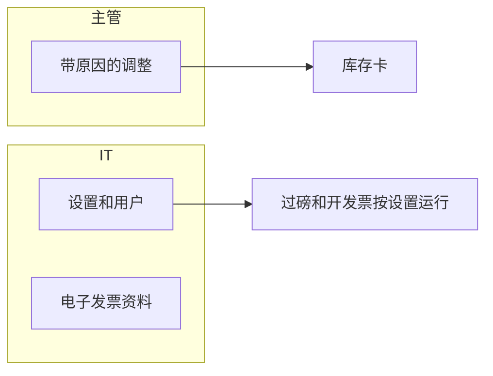
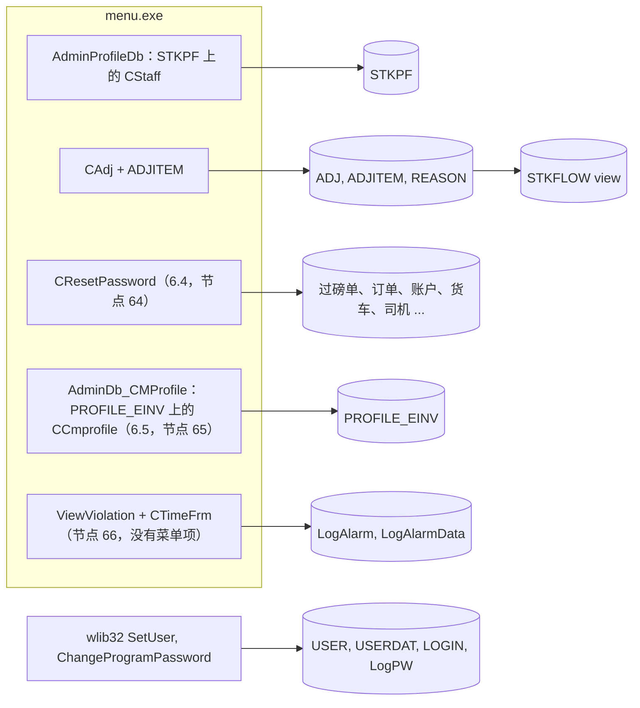

# 其他和库存（菜单 6 和 7）- 模块参考

> 英文版为准。同步自英文版 commit c76cd62（2026-10-30）。

> 本文是 TradeWin 模块参考的一部分。索引和共用章节见：[README](README.md)。
> 涵盖的菜单项：6.1 Set Password、6.2 Company Profile、6.3 Operator Information、6.4 Reset Database、6.5 E-Invoice Profile、7.1 Adjustment Data Entry、7.2 Reason Code。本应用**没有导出菜单 8，也没有备份菜单 9**，**也没有程序更新项**：两个导出功能是菜单项 3.3 和 3.4，在[发票和导出](invoice-cashier.md)里说明；`SubProgram` 里的备份调用已被注释掉。文件名 `other-stock-export.md` 保持不变，让各个参考文档的文件名一一对应。
> 最后核对的 commit 为 `2f77122`。翻译状态：英文版见 [../other-stock-export.md](../other-stock-export.md)；本中文版同步于 2026-10-30（commit c76cd62）。

## 目录

- [第一部分 - 业务视图](#第一部分---业务视图)
  - [1.1 简单说明](#11-简单说明)
  - [1.2 谁用什么](#12-谁用什么)
  - [1.3 一天的工作](#13-一天的工作)
  - [1.4 实例演示](#14-实例演示)
  - [1.5 界面导览](#15-界面导览)
  - [1.6 这个数字从哪里来？](#16-这个数字从哪里来)
  - [1.7 状态含义](#17-状态含义)
  - [1.8 如果发生以下情况](#18-如果发生以下情况)
  - [1.9 你可能看到的消息](#19-你可能看到的消息)
  - [1.10 该做和不该做](#110-该做和不该做)
  - [1.11 开始之前](#111-开始之前)
  - [1.12 词汇表](#112-词汇表)
  - [1.13 问AI](#113-问ai)
- [第二部分 - 技术视图](#第二部分---技术视图)
  - [2.1 概览](#21-概览)
  - [2.2 架构和依赖](#22-架构和依赖)
  - [2.3 主数据目录](#23-主数据目录)
  - [2.4 子表层级](#24-子表层级)
  - [2.5 模块和处理流程](#25-模块和处理流程)
  - [2.6 端到端流程](#26-端到端流程)
  - [2.7 报表目录](#27-报表目录)
  - [2.8 集成](#28-集成)
  - [2.9 配置](#29-配置)
  - [2.10 维护](#210-维护)

---

# 第一部分 - 业务视图

## 1.1 简单说明

- **Other**（菜单 6）放系统设置：程序密码、公司和过磅设置、用户清单、**数据重置**和公司的**电子发票资料**。
- **库存**（菜单 7）让你用**调整**来更正某个产品的库存（例如盘点之后），并保存调整原因清单。库存本身不是手工输入的：它由过磅单和调整算出来。
- 每月月底**导出**到会计系统的功能在发票菜单里（3.3 和 3.4），见[发票和导出](invoice-cashier.md)。没有备份菜单项，也没有更新项；数据库备份用框架的关闭并备份功能，或由 IT 在服务器上做。
- 如果设置有误，过磅和开发票就会出错；如果电子发票资料有误或为空，就无法提交电子发票；如果盘点之后从不调整库存，库存卡就会和堆场的实际数量脱节。
- 警告：**6.4 Reset Database 真的会删除数据**（菜单 1.1 和 1.2 的过磅单、订单、账户、货车、司机等，清单见 2.5）。它要求输入 IT 保管的重置密码。绝对不要在正式系统上使用。

## 1.2 谁用什么

| 部门 | 菜单项 | 主要工作 |
|---|---|---|
| IT / 管理员 | 6.1 到 6.5 | 密码、公司和过磅设置、用户、电子发票资料、数据重置（只限培训数据） |
| 管理层 | 6.3（只有 99 级） | 决定谁可以做什么 |
| 会计 | 6.5 E-Invoice Profile | 维护公司自己的电子发票身份资料 |
| 地磅主管 | 7.1 Adjustment、7.2 Reason | 库存更正 |
| 仓库 / 货场 | 7.1 | 盘点更正 |

**从这里开始 - IT / 管理员**
- 一次性：Company Profile（地址、结账账户代码、零位和稳定控制、税号和日期）、Operator Information（用户）和 E-Invoice Profile。

**从这里开始 - 主管**
- 盘点之后：用 Adjustment Data Entry 并填写原因。

## 1.3 一天的工作

**盘点。**货场清点纸堆，发现比库存卡少了 300 kg。主管打开 7.1，输入今天的日期，选择原因“STOCK COUNT”，加一行：产品、数量 -300，按产品的价格。库存卡现在就显示出这项更正。

**新用户。**IT 打开 6.3 Operator Information（只有 99 级），添加用户：代码、姓名、密码、级别，以及不允许该用户打开的菜单项。

**公司的电子发票身份。**第一张电子发票之前，会计或 IT 打开 6.5 E-Invoice Profile，填写电子发票用的公司名称、公司注册号（ROC）、SST 号、MSIC 代码、TIN、电子邮件、业务活动、电话号码和地址代码，以及电子发票服务商提供的服务凭据。
泳道图：



*说明：主管的调整流向库存卡；IT 维护设置、用户和电子发票资料。*

## 1.4 实例演示

所有数值都是虚构的。

| 步骤 | 屏幕 | 用户做什么 | 程序做什么 |
|---|---|---|---|
| 1 | 7.2 Reason Code | 添加 `SC` “STOCK COUNT” | 保存 |
| 2 | 7.1 Adjustment | Add，日期 2026-10-31，原因 `SC`，备注“Yard count” | 表头已保存 |
| 3 | 调整明细行 | 产品 `AL01`，数量 -300，价格 2.000 | 金额 = -300 x 2.000 = -600.00 |
| 4 | 产品代码屏幕（4.1.1） | `AL01` 的 Stock Flow 按钮 | 显示收货、发货、磅秤过磅单和这笔调整（“进”一栏为 -300），并带有滚动余额 |

注意：代码里把调整屏幕标为“不能新增”；如果你的电脑上没有 New 按钮，就无法从这个屏幕创建调整（见 2.10，发现 10）。

## 1.5 界面导览

### 6.1 Set Password

修改程序（系统）密码。只有 99 级或以上的用户可以。窗口显示当前密码，并要求输入新密码。

### 6.2 Company Profile

**用途：**公司和过磅设置。程序先要求输入程序密码。

| 字段标签 | 含义 | 必填？ | 值的来源 |
|---|---|---|---|
| Address (3 lines) | 打印在过磅单上 | 否 | 输入 |
| Closing Account Code | 发票选择清单使用的现金客户账户 | 否 | 输入或选择 |
| Zero Weight Control | `Y` = 在重量窗口按 OK 之前，磅秤必须显示零 | 是（Y 或 N） | 输入 |
| Stable Weight Control | `Y` = 按 OK 之前读数必须稳定 | 是（Y 或 N） | 输入 |
| Variance Control | 自己的净重和对方的净重之间允许的百分比差异（本版本不强制执行） | 否 | 输入 |
| GST NO, GST DATE | 税号和开始征税的日期（在此日期之前不征税） | 否 | 输入 |

公司代码框和 gatepass 控制在表单上有，但已关闭。表单上没有别的东西：姊妹应用里的“小数重量”勾选在这里没有。

### 6.3 Operator Information

用户清单（只有 99 级）：每个用户有代码、描述、密码、级别，以及用户不能打开、只能查看或只能编辑的菜单项清单。窗口的细节属于程序框架。

### 6.4 Reset Database

打开一个小窗口“Reset all database”，要求输入**重置密码**。密码由程序里的一条规则生成，IT 知道这条规则（这里不写出来）。密码正确时，按 **OK** 会立刻删除数据，不再问任何问题：清单见 2.5（菜单 1.1 和 1.2 的过磅单及其第一次重量、订单、直接送货、会计一侧的发票、账户清单、货车、运输商、司机、产品清单行、员工、分级员、报表日志），这些表的流水号从 1 重新开始；最后显示“Completed”。窗口还有两个按钮：**Import**，只清除报表日志；**Clean**，什么也不做。**磅秤过磅单、公共过磅的过磅单、地磅发票（菜单 3）、产品、库存调整和设置都不受影响。**

### 6.5 E-Invoice Profile

**用途：**公司自己的电子发票资料（一条记录，不要求输入密码）。表单上的标签：

| 字段标签 | 含义 |
|---|---|
| Gar Ver. | 连接程序的版本框（按标签原样） |
| State, City, Postal Code, Country | 公司地址的各部分（State 和 Country 用选择的，名称显示在框旁边） |
| Company Name (E-Invoice) | 电子发票登记的公司名称 |
| ROC (New) | 公司注册号 |
| SST No | 销售和服务税注册号 |
| MSIC | 行业分类代码 |
| TIN Number | 公司税务识别号 |
| Tourism Tax Number | 旅游税号（如有） |
| Email | 公司电子邮件 |
| Business Activity | 描述业务的文字（多行） |
| Tel No | 电话号码，格式为 +60-XXXXXXXXXX |
| Client ID, Secret ID 1, Secret ID 2 | 电子发票服务的凭据（绝不要复制到文档或聊天里） |
| Digital Cert. | 证书文字；这个框在表单上已关闭 |

### 7.1 Adjustment Data Entry

**表头**

| 字段标签 | 含义 | 必填？ | 值的来源 |
|---|---|---|---|
| Ref.no | 调整单号 | 是（主键） | 自动 |
| Date | 调整日期 | - | 默认今天 |
| Reason | 原因代码 | 是 | 选择 |
| Remarks | 自由文字（最多 200 个字符） | 否 | 输入 |

**明细行（表格）：**No, Product, Description, Quantity, U/price, Amount。数量以 kg 为单位；负数量表示扣减库存。

### 7.2 Reason Code

Code（键）、Description、Remarks。

## 1.6 这个数字从哪里来？

- **调整明细行金额** = 数量 x 单价（数量为负，金额也为负）。例子：-300 x 2.000 = **-600.00**。
- **库存卡余额** = 收货（买进的磅秤过磅单、收货过磅单、调整）减发货（磅秤发货过磅单、发货过磅单），按日期和过磅单顺序滚动计算；数量为负的调整会减少余额。磅秤明细行按输入的数量计算，不扣箱子和损耗。库存卡包括哪些过磅单表，由一个不在本仓库里的数据库视图决定（见 2.5）。

## 1.7 状态含义

| 单据 | 状态 | 含义 | 谁修改 |
|---|---|---|---|
| Adjustment | 无 | 存在一行记录 | 保存 |
| Company Profile | 单条记录 | 设置在下一次过磅时生效 | 管理员 |

## 1.8 如果发生以下情况

| 情况 | 怎么办 | 什么时候找 IT |
|---|---|---|
| 调整错了 | 编辑或删除它（库存卡会随之改变） | - |
| 重置窗口被误打开 | 不输入密码，直接关闭 | - |
| 电子发票资料需要修改 | 在 6.5 里修改（凭据归 IT 管） | 服务拒绝新的值 |
| 用户忘记密码 | 99 级用户在 Operator Information 里重置 | 没有 99 级用户可用 |
| 重量指示灯一直不变绿 | 把 Zero Weight Control 设为 `N` | 总是 |
| 需要清除培训数据 | 用重置密码执行 6.4 Reset Database；它同时会删除账户、货车和司机，所以之后要重新导入 | 总是：由 IT 在备份之后做 |

## 1.9 你可能看到的消息

| 消息 | 含义 | 怎么办 |
|---|---|---|
| `Database not open` | 设置表不可用 | 找 IT |
| `Dialog IDD not found` | 这张表没有屏幕 | 找 IT |
| `Incorret password`（拼写照屏幕所示） | 重置窗口里的密码错误 | 不要乱猜；找 IT |
| `Completed` | 重置或报表日志清除已完成 | - |
| “没有权限”的消息 | 用户没有 99 级，或菜单项受限制 | 请 99 级用户帮忙 |

## 1.10 该做和不该做

- 做任何批量修改之前都要备份，重置之前更是一定要备份。
- 99 级用户的人数要少。
- 不要在正式系统上用 6.4 Reset Database：它会删除过磅单、账户、货车和司机，而且不能撤销。
- 不要把电子发票凭据写在电子邮件或聊天里。
- 不要把密码复制到电子邮件或聊天里。

## 1.11 开始之前

- 做库存调整：产品和原因已存在。
- 电子发票资料：公司的注册号码和服务商提供的服务凭据。
- 重置：最近的备份和 IT 保管的重置密码。
- 用 Operator Information 和 Set Password：要有 99 级用户。

## 1.12 词汇表

| 术语 | 英文 | 马来文 | 中文 |
|---|---|---|---|
| Company profile | Company and weighing settings | Profil syarikat | 公司资料 |
| Operator | System user | Pengendali | 操作员 |
| User level | Number that decides what a user may do | Tahap pengguna | 用户级别 |
| Adjustment | Stock correction | Pelarasan | 调整 |
| Reason code | Why the stock was corrected | Kod sebab | 原因代码 |
| Backup | Copy of the database | Sandaran | 备份 |
| E-invoice profile | The company's own e-invoice identity | Profil e-Invois | 电子发票公司资料 |
| TIN | Tax identification number | Nombor pengenalan cukai | 税务识别号 |
| Zero / stable control | Switches that make the scale wait | Kawalan sifar / stabil | 归零 / 稳定控制 |

## 1.13 问AI

1. 盘点之后，怎样更正某个产品的库存？
2. Zero Weight Control 设置有什么作用？
3. 使用 Reset Database 之前我必须做什么？
4. 谁可以添加用户？怎样对某个用户屏蔽菜单项？
5. 我在哪里输入公司的电子发票资料？
6. 数据库备份在哪里？
7. 调整明细行的金额是怎么算出来的？
8. 怎样看某个产品的库存卡？
9. Closing Account Code 有什么作用？
10. Reset Database 会删除什么，保留什么？

---

# 第二部分 - 技术视图

## 2.1 概览

- 应用程序：TradeWin Metals 地磅系统（wlib32 上的 VC6/MFC，`menu.dsp`、`menu.exe`）。见 [README](README.md)。
- 本模块：菜单 6 和 7。本仓库里的类：`CAdj`（ADJ.H / ADJ.CPP）、`CResetPassword`（ResetPassword.cpp）、`CTimeFrm`（TIMEFRM.CPP）。其余（密码、用户清单）都是 wlib32；Company Profile 是建立在 `stkpf` 上的通用 `CStaff`；E-Invoice Profile 是 wlib32 的类 `CCmprofile`（头文件 `Cmprofile.h`，对话框 `IDD_CMPROFILE` 在共用的 `einv.rc` 里），由 MAIN.CPP:21-31 的 `AdminDb_CMProfile` 启动。
- 与姊妹应用（Application_LekokPaper）相比：节点 64（Reset Database）在这里**有菜单项**，节点 65 是 E-Invoice Profile，不是程序更新；没有 `OnSystemUpgrade` 调用，没有授权计时器，也没有 `LICENCE.CPP`。

## 2.2 架构和依赖



*说明：设置、电子发票资料和调整是本地的表；用户和密码是 wlib32 程序；重置会删除数据；违规屏幕存在，但没有菜单项打开它。*

- 库：wlib32（通用屏幕、用户和密码对话框、`CCmprofile`）、MSFlexGrid、MSChart。
- 数据库：SQL Server；TradeWin 没有结构仓库（下面的类型来自姊妹应用 `SQL_LekokPaper`，除非特别说明，TradeWin 未核实）。

## 2.3 主数据目录

### STKPF（Company Profile，菜单 6.2）

- 字段和含义：见 [过磅 2.3](weighing.md#23-主数据目录)（那里记录了这张表的所有列）。
- 屏幕：`AdminProfileDb(&stkpf)`（MAIN.CPP:123-138，case MAIN.CPP:371-374）：先问 `CAskPassword`（wlib32），然后是对话框 `IDD_STKPF` 上 `OneRecordOnly = TRUE` 的 `CStaff`（`stkpf.ID = IDD_STKPF`，MENU.CPP:409）。如果启动时这张表是空的，应用会插入 `COMPANY_NO = "1"` 这一行（MENU.CPP:410-414），并据此填写 `logo` 行（MENU.CPP:417-427）。
- 对话框显示 `ADD1..3`、`ACCODE`、`ZERO`、`STABLE`、`VARIANCE`、`GST_NO` 和 `GST_DATE`；没有 `PT`、`PT1` 或 `Decimal_Weight` 的框（姊妹应用的对话框有小数重量的勾选；TradeWin 的 rc 去掉了它）。

### LOGO

单行的打印抬头表 `LOGO`（姊妹脚本 `LOGO.sql`；枚举 `logo` MENU.H:321）。启动时由 `SetStdCompanyLogo` 写入（MENU.CPP:361-383：`NAME` = 程序标题 `TRADEWIN METALS SDN BHD`，地址行来自 `STKPF`，`PROGRAM_ID` = `Pref`，`GST_NO`，一个取自会计资料列 `RMCD`（存在时）的 `SST_NO`，以及税务开始日期常量）和 `logo.Update()`（MENU.CPP:426）。不能从菜单编辑。

| # | SQL column | data type | null | key | 含义 |
|---|---|---|---|---|---|
| 1 | `CODE` | nvarchar(7) | no | PK | 公司代码（从 STKPF 复制） |
| 2 | `NAME` | nvarchar(50) | yes |  | 打印在表单和报表上的公司名称 |
| 3 to 6 | `ADD1`, `ADD2`, `ADD3`, `ADD4` | nvarchar(50) | yes |  | 地址行（ADD4 没有使用） |
| 7 to 9 | `DATE`, `DATE1`, `DATE2` | smalldatetime | yes |  | 报表日期、起、止 |
| 10, 11 | `TIME1`, `TIME2` | nvarchar(8) | yes |  | 报表时间 |
| 12 to 14 | `SELECT1..3` | nvarchar(80) | yes |  | 报表选择文字 |
| 15 | `RTITLE` | nvarchar(50) | yes |  | 报表标题 |
| 16 | `GROUP` | nvarchar(20) | yes |  | 报表分组 |
| 17, 18 | `USER`, `UNAME` | nvarchar(5), nvarchar(35) | yes |  | 用户代码和姓名 |
| 19 | `PROGRAM_ID` | nvarchar(6) | yes |  | 最后运行的菜单项的程序编号 |
| 20 | `ACCODE` | nvarchar(10) | yes |  | 账户筛选 |
| 21 | `BRANCH` | nvarchar(50) | yes |  | 分行 |
| 22 | `PCCODE` | nvarchar(10) | yes |  | 利润中心筛选 |
| 23 | `GST_NO` | nvarchar(20) | yes |  | 税号 |

### PROFILE_EINV（E-Invoice Profile，菜单 6.5）

- 屏幕：`case M_OTHER*10+5` 在表 `profile_einv` 上打开一个 `ado` 对象，对话框 `IDD_CMPROFILE`，并调用 `AdminDb_CMProfile`（MAIN.CPP:381-388）：`CCmprofile`（wlib32，一个 `CStaff`），`OneRecordOnly = TRUE`，`LptNo = 0`（MAIN.CPP:21-31）。窗口关闭时表也随之关闭。**没有密码提示，也没有级别检查**保护它（对比 6.2，它要求输入程序密码）；只有每个用户的菜单限制清单起作用。
- 这张表在 TradeWin 可用的任何脚本里都没有定义（姊妹结构里也没有）：**列名和类型未核实**。对话框按这个顺序把各个框绑定到字段：

| # | 对话框标签 | 类型 |
|---|---|---|
| 1 | （隐藏的键框） | 未核实 |
| 2 | State（代码，名称显示在旁边） | 未核实 |
| 3 | City | 未核实 |
| 4 | Postal Code | 未核实 |
| 5 | Gar Ver. | 未核实 |
| 6 | Country（代码，名称显示在旁边） | 未核实 |
| 7 | Company Name (E-Invoice) | 未核实 |
| 8 | ROC (New) | 未核实 |
| 9 | SST No | 未核实 |
| 10 | MSIC | 未核实 |
| 11 | TIN Number | 未核实 |
| 12 | Tourism Tax Number | 未核实 |
| 13 | Email | 未核实 |
| 14 | Business Activity（多行） | 未核实 |
| 15 | Tel No（格式 +60-XXXXXXXXXX） | 未核实 |
| 16 | Digital Cert.（表单上隐藏） | 未核实 |
| 17 | Client ID（凭据） | 未核实 |
| 18 | Secret ID 1（凭据） | 未核实 |
| 19 | Secret ID 2（凭据） | 未核实 |

- 嵌套子表：无。使用者：电子发票的数据库程序（提交发票的公司一侧；未核实）。

### USER 及相关的表（菜单 6.3，wlib32）

- 脚本 `USER.sql`：`CODE` nvarchar(5) 主键、`DESCRIPTION` nvarchar(25)、`ACCESS` nvarchar(15)（密码）、`LEVEL` nvarchar(5)、`REMARKS`、`N01`..`N10`、`H01`..`H10`、`N11`..`N100` float(53)。wlib32 从这些列读取节点号：被屏蔽的菜单节点、只能查看的节点、只能编辑的节点（README，“用户权限”）。
- 相关的表：`USERDAT`（每个用户的表标志）、`LOGIN`（`DATE`、`USER`、`ACCESS`、`TIMEIN`、`TIMEOUT`、`PKKEY`）、`LogPW`（`date`、`user`、`OldPW` varchar(50)、`NewPW` varchar(50)、`pkkey`：密码修改日志里有旧密码和新密码两列，见 2.10）、`ExpiredPW`、`LogUserAccountSuspended`、`TableUserControl`、`FieldUserControl`。
- 只有 99 级或以上的用户才能打开用户清单或修改程序密码（wlib32 的 `SetUser`、`ChangeProgramPassword`）。

### REASON（菜单 7.2）

- 屏幕 `AdminDb(&reason)`（MAIN.CPP:395-397）；`IDD_REASON`；`ado(&reason,"reason")`（MENU.CPP:494）。姊妹脚本 `REASON.sql`。

| # | SQL column | data type | null | key | 含义 |
|---|---|---|---|---|---|
| 1 | `CODE` | nvarchar(5) | no | PK | 原因代码 |
| 2 | `DESCRIPT` | nvarchar(50) | yes |  | 描述 |
| 3 | `REMARK` | nvarchar(200) | yes |  | 自由文字 |
| 4 to 9 | `NEWUSER` nvarchar(5), `NEWTIME` datetime, `REC_STATUS` char(1), `MODIFYUSER` varchar(10), `MODIFYTIME` datetime, `Print Counter` int | | yes |  | 框架审计 |

### LogAlarm, LogAlarmData, TIMEFRM, WEIGHT_MAX_DATA（重量报警日志）

姊妹脚本 `LogAlarm.sql`（`DATE` datetime 默认 getdate()、`VIOLATION` int、`VNAME1`、`VNAME2` nvarchar(150)、`COMPUTER` nvarchar(50)、`USER` nvarchar(10)、`CLEARTIME` datetime、`CLEARBY` nvarchar(10)、`VEHICLE` nvarchar(15)、`TICKETWT` int、`PKKEY` int identity）、`LogAlarmData.sql`（`ID` int、`DATE` datetime、`WT` int、`AW` int、`PKKEY`）、`TIMEFRM.sql`（`DATE`、`WT`、`AW`、`PKKEY`）、`WEIGHT_MAX_DATA.sql`（见[过磅](weighing.md#25-模块和处理流程)）。应用的报警钩子会写入它们（2.5）。

## 2.4 子表层级

### ADJ（库存调整表头）

```text
ADJ (header, key REFNO)
  - ADJITEM  link: ADJITEM.REFNO = ADJ.REFNO   (key PKKEY identity, line number SQNO)
    Nested sub-tables: none
```


*说明：一张调整单有若干明细行，每行指向一个产品；表头指向一个原因。*

- 屏幕 `CAdj`（`CParent`，ADJ.CPP），对话框 `IDD_ADJ` 和 `IDD_ADJITEM`；对象 `adj(IDD_ADJ)`、`adjitem(IDD_ADJITEM)`、`reason(IDD_REASON)`（MENU.CPP:54）；以 `tado(&adj,"adj",init_adj)`、`tado(&adjitem,"adjitem",init_adjitem)` 打开（MENU.CPP:492-493）。入口 `AdjustmentEntry()`（ADJ.CPP:122-129）设置 `m_OpenLpt = FALSE`；`CAdj` 设置 `df->m_CannotAdd = TRUE`（ADJ.CPP:25）。
- 链接键：明细行的第一个字段（`REFNO`）等于表头；`init_adj` 还设置 `e->chain = &adjitem` 和浏览对话框 `IDD_BROWSE`（ADJ.CPP:111-120）。各行由 `CParent` 机制和表头一起保存。表头浏览表格：Ref no、Date、Reason 和原因名称（`ReplaceAdjGrid`，ADJ.CPP:86-97）。
- 枚举 `adj`（MENU.H:338）和 `adjitem`（MENU.H:339）。

**ADJ**（姊妹脚本 `ADJ.sql`）

| # | field (enum) | SQL column | data type | null | key | 含义 |
|---|---|---|---|---|---|---|
| 1 | `Aj_REFNO` | `REFNO` | nvarchar(10) | no | PK | 调整单号 |
| 2 | `Aj_DATE` | `DATE` | smalldatetime | yes |  | 调整日期 |
| 3 | `Aj_REASON` | `REASON` | nvarchar(5) | yes | FK to `REASON.CODE` | 原因代码 |
| 4 | `Aj_REMARKS` | `REMARKS` | nvarchar(200) | yes |  | 自由文字 |
| 5 to 10 | | `REC_STATUS`, `NEWUSER`, `NEWTIME`, `MODIFYUSER`, `MODIFYTIME`, `Print Counter` | char(1), char(5), smalldatetime, char(5), smalldatetime, int | yes |  | 框架审计 |

**ADJITEM**（姊妹脚本 `ADJITEM.sql`）

| # | field (enum) | SQL column | data type | null | key | 含义 |
|---|---|---|---|---|---|---|
| 1 | `ADJ_REFNO` | `REFNO` | nvarchar(10) | no | FK to `ADJ.REFNO` | 上级单号（链接键） |
| 2 | `ADJ_SQNO` | `SQNO` | float(53) | yes |  | 行号 |
| 3 | `ADJ_ITEM` | `PT` | nvarchar(8) | yes |  | 产品代码 |
| 4 | `ADJ_QTY` | `QTY` | decimal(11,2) | yes |  | 数量，单位 kg（正数增加库存，负数扣减库存） |
| 5 | `ADJ_PRICE` | `PRICE` | decimal(10,3) | yes |  | 每 kg 单价 |
| 6 | `ADJ_AMOUNT` | `AMOUNT` | decimal(10,2) | yes |  | 数量 x 单价 |
| 7 | `ADJ_PKKEY` | `PKKEY` | int | no | PK identity | 行键 |

- 规则：`start_adj` 把日期设为今天（ADJ.CPP:105-109）；`tell_adjprodtype`（ADJITEM.CPP:8-19）：每次修改都会重新计算 金额 = 数量 x 单价，金额字段被跳过；调整单一有明细行，`tell_adj` 就跳过日期（`IsAdjStable`，ADJ.CPP:63-84）。
- 基数 1..n。嵌套子表：无。

## 2.5 模块和处理流程

### 菜单项和入口

| 菜单项（标题） | 节点 | `SubProgram` 里的处理程序 | 打开 |
|---|---|---|---|
| 6.1 Set Password | 61 | 框架消息映射 `ON_COMMAND(ID00061, OnPassword)`（MAINFRM.CPP:64）调用 wlib32 的密码程序；`case M_OTHER*10+1: break;` 是空的（MAIN.CPP:369-370） | wlib32 密码窗口（99 级） |
| 6.2 Company Profile | 62 | `AdminProfileDb(&stkpf)`（MAIN.CPP:371-374） | 密码提示，然后是单记录屏幕 |
| 6.3 Operator Information | 63 | `SetUser()`（MAIN.CPP:375-377） | wlib32 用户清单 |
| 6.4 Reset Database | 64 | `CleanDatabase()`（MAIN.CPP:378-380；ResetPassword.cpp:179） | `CResetPassword`，对话框 `IDD_RESET_DATABASE` |
| 6.5 E-Invoice Profile | 65 | `profile_einv` 上的 `AdminDb_CMProfile`（MAIN.CPP:381-388） | `CCmprofile`，对话框 `IDD_CMPROFILE` |
| （没有菜单项） | 66 | `ViewViolation()`（MAIN.CPP:389-391；TIMEFRM.CPP:178） | `CTimeFrm` 图表窗口 |
| 7.1 Adjustment Data Entry | 71 | `AdjustmentEntry()`（MAIN.CPP:392-394） | `CAdj` |
| 7.2 Reason Code | 72 | `AdminDb(&reason)`（MAIN.CPP:395-397） | 通用 |

菜单项 6.1 到 6.5 的 ID 是 `ID00061` 到 `ID00065`（menu.rc:179-183，在单一资源 `IDR_MAINMENU` 里）；框架把它们映射到 wlib32 的处理程序（MAINFRM.CPP:64-69），由它应用用户限制清单，然后调用 `SubProgram`。不存在导出（8）或备份（9）节点；`M_BACKUP` 的 case 和旧的会计 case（包括它们的导出调用）都在一个注释块里（MAIN.CPP:398-459）。

### 流程：库存调整

1. `AdjustmentEntry` 打开 `CAdj`（表头-明细）。`Aj_DATE` 默认为今天。
2. 每一行：选择产品（查找 `PT`），输入数量和价格，金额 = 数量 x 价格。
3. 库存卡是视图 `STKFLOW`（代码读取 `select * from [stkflow] where [pt]=<code> order by [date],[ordertype],[refno]`，STKFLOW.CPP:19-22）。姊妹结构的脚本把 `ADJITEM`（连接 `ADJ` 和 `REASON`，列 `IN` = 数量，说明 = 原因文字，类型 `ADJ`）、`DS`/`DP` 过磅单视图、`RT`，以及 `SCALE`/`SCALESUB`（进）和 `SCALEDW`/`SCALEDWSUB`（出）合并在一起；线上的 TradeWin 视图不在本仓库里（未核实）。负数的调整数量显示为负的“进”。

### 流程：Company Profile

`AdminProfileDb`（MAIN.CPP:123-138）显示 `CAskPassword`；按 OK 后在 `stkpf` 上运行 `OneRecordOnly = TRUE` 的 `CStaff`。这些开关在下次使用时生效：`STKPF.ZERO` 和 `STABLE` 在重量对话框的每个定时器节拍都会被读取（GETWT.CPP:200-212），`GST_DATE` 由 `FindPercen` 读取。

### 流程：更新

本程序没有更新流程：姊妹应用的 wlib32 `OnSystemUpgrade` 调用不在 `SubProgram` 里。`ProgramVersionNo = 2`（MENU.CPP:127）和文件夹文件 `IFOLDERAA.SYS`（内容 `CHYE`）是框架留下来的；仓库里没有版本文件（`CHYE.ver`），也没有 `HENGHUP.EXE` 的引用。

### 流程：Reset Database 程序（菜单 6.4，节点 64）

1. `CleanDatabase`（ResetPassword.cpp:179-184）打开 `CResetPassword`（对话框 `IDD_RESET_DATABASE`，menu.rc:1553，标题“Reset all database”）。`CResetPassword::OnOK`（ResetPassword.cpp:50-177）把输入的密码与代码里一条按日期生成的规则比对（ResetPassword.cpp:56-60；这里不写出来）；输错时显示 `Incorret password`。密码正确之后**没有确认提问**。
2. 运行，每行一个 `RunSql`，并带进度条：`truncate table [aroinv]`、`delete from [arinv]`、`truncate table [apoinv]`、`delete from [apinv]`（会计一侧的发票对象）、`truncate [wds]`、`[wdp]`、`[ds]`、`[dp]`、`[poitem]`、`delete from [po]`、`truncate [soitem]`、`delete from [so]`、`truncate [dtitem]`、`[dt]`、`[fc_dp]`、`[fc_ds]`、`[ic]`（司机）、`[rptlog]`、`[spitem]`、`DELETE FROM [accode]`（所有账户）、`truncate [lorry]`、`[transp]`、`[grade]`、`[staff]`、`[ReportFilterDescription]`（ResetPassword.cpp:63-145）。
3. 然后对 `ds`、`dp`、`wds`、`wdp`、`dt`、`arinv`、`apinv`、`so`、`po` 执行 `update [ticketno] set [NEXTNO] = 1 where [recordset] = ...`（ResetPassword.cpp:147-172），最后显示 `Completed`。
4. **不受影响：**`SCALE`、`SCALESUB`、`SCALEDW`、`SCALEDWSUB`、`PR_NEW`、`WPR_NEW`、`RT`、`WRT`、`ARINV_WB`、`AROINV_WB`、`APINV_WB`、`APOINV_WB`、`ADJ`、`ADJITEM`、`PAYMENTDATE`、`PAYMENTDATED`、`PT`、`PTSUB`、`LOGERR`、`STKPF`、`PROFILE_EINV`、`EINV_API`：磅秤过磅单、公共过磅的过磅单、退货单、地磅发票和电子发票日志都保留下来，而菜单 1.1 和 1.2 的过磅单、账户、货车、司机及其产品清单被清空。这样发票明细行（`DO`）就指向已被删除的过磅单。
5. `OnButton1`（ResetPassword.cpp:186-201）绑定在对话框上标为 **Import** 的按钮（`IDC_BUTTON1`），只清空 `rptlog`；标为 **Clean** 的按钮（`IDC_BUTTON2`）没有处理程序。

### 流程：违规查看器（节点 66，不在任何菜单上）

`ViewViolation`（TIMEFRM.CPP:178-200）运行 `select [date], vname1 as Violation_Description, vehicle, ticketWt, pkkey from logalarm where [date] >= '<today>' order by [date] desc`，让用户选一行，然后打开 `CTimeFrm`（TIMEFRM.CPP:52-91, 104-161），用图表（MSChart）显示这次报警在 `logAlarmData` 里的重量、最大重量、确认重量、差异和出现最大值的日期；按钮可以画出完整曲线或只画最高的范围（`m_wrange`，默认 1000 kg）。这些行由报警钩子 `CMenuApp::OnLogAlram4DriveThrough` 和 `OnLogAlram4OverMaxWt` 写入（MENU.CPP:614-658）：“Drive through without weighing”（违规 0）和“Over max weight variance”（违规 1，当最大重量超过过磅单重量 `w_maxVar` 时），每次都把 `timefrm` 曲线复制到 `logAlarmData` 并清空 `timefrm`。

### 读写的表

| 表 | 读 | 写 | 键 |
|---|---|---|---|
| STKPF | 所有过磅和发票代码 | Company Profile | `COMPANY_NO` |
| LOGO | 打印表头 | 启动时 | `CODE` |
| ADJ, ADJITEM, REASON | `CAdj`, STKFLOW | `CAdj`、Reason 屏幕 | `REFNO`, `PKKEY`, `CODE` |
| USER, USERDAT, LOGIN, LogPW | 用户清单 | wlib32 | `CODE` |
| LogAlarm, LogAlarmData, TIMEFRM | 违规查看器 | 报警挂钩 | `PKKEY` |
| 很多（见重置清单） | - | 重置程序 | - |
| PROFILE_EINV | 电子发票程序（未核实） | E-Invoice Profile | 未核实 |

### 流水号

调整单号：框架为表 `adj` 分配键（`TICKETNO` 里名为 `adj` 的一行；不在重置清单里）。

### 状态转换

这些表没有。

### 对其他模块的依赖

- 库存卡需要 [过磅单](tickets.md)、[磅秤过磅](scale-weighing.md) 和调整；设置影响 [过磅](weighing.md)；出口在 [发票](invoice-cashier.md) 里。

## 2.6 端到端流程

见 [README](README.md#26-端到端流程)。

## 2.7 报表目录

- 选择窗口里的库存报表：`00134` Physical Stock Report（`stkflow2.rpt`）和 `00135` Stock Card Report（`stkflow.rpt`），见 [报表](reports.md)。
- 产品屏幕的 Stock Flow 按钮以浏览窗口显示库存卡（STKFLOW.CPP:17-37，表单 `stkflow.rep`）。
- 调整单据 `ADJ.RPT`、`adjdtl.rpt`、`ADJSUM.RPT` 在仓库里存在（这个屏幕本身没有打印按钮：`m_OpenLpt = FALSE`）。

## 2.8 集成

| 触发 | 系统 | 内容 | 审计 | 故障处理 |
|---|---|---|---|---|
| E-Invoice Profile | 电子发票连接程序读取表 `profile_einv`（公司身份和凭据） | 公司数据 | 无 | 无（未核实） |
| 重量报警（wlib32 通信层） | `LogAlarm`、`LogAlarmData` | 读数轨迹 | 这些表 | 无 |

本仓库里没有库存接口视图（与 Seng Hiap Metal 不同）。

## 2.9 配置

- `STKPF` 开关（见过磅 2.3）。
- win.ini 和 PROVIDER.SYS 见[过磅](weighing.md#29-配置)；`INIT_ADO_USER | INIT_ADO_PROGRAM_PASSWORD` 登录标志加 `0x0002`（MENU.CPP:250）。
- 程序名称和版本文字：窗口标题“<title> VER 2.00”，注释为“E-Inv version”（MAINFRM.CPP:113）；标题是公司常量 `TRADEWIN METALS SDN BHD`（MENU.CPP:116），由 `CMenuApp::Profile` 复制（MENU.CPP:238-240）；`ProgramVersionNo = 2`（MENU.CPP:127）；数组 `tcompany` 里有一个编码的公司字符串，没有被使用（MENU.CPP:117-119）。
- `HideStaffMenu = 99990`（MENU.CPP:273）；`m_useDropDownBtnInsteadSrollbar = TRUE`（MENU.CPP:274）。
- 本程序没有授权计时器（姊妹应用的 `OnTimer` 和 `LICENCE.CPP` 不在本仓库里）。

## 2.10 维护

- 修改菜单 6 和 7、调整表或重置清单时，要更新本文件。
- 修改记录：

| 日期 | Commit | 作者 | 修改内容 |
|---|---|---|---|
| 2026-10-19 | `2f77122` | Claude（草稿待审阅） | Application_TradeWin 的第一版，以 Application_LekokPaper 的参考为起点；6.4 是真正的 Reset Database，6.5 是 E-Invoice Profile，没有更新项，没有授权计时器 |

- 最后核对的 commit 为 `2f77122`。翻译状态：zh-CN 已完成，同步于 2026-10-30。

### 代码发现（给开发人员）

1. **6.4 Reset Database 是有效的、破坏性的，而且没有确认。**输入按日期生成的密码之后，它不问任何问题就删除（ResetPassword.cpp:50-177）：1.1 和 1.2 的过磅单、账户、货车、司机、运输商和产品清单行，以及几个日志。磅秤过磅单、公共过磅的过磅单、地磅发票和电子发票日志被保留，所以发票明细行可能指向已经不存在的过磅单。会计一侧的对象（`arinv`、`apinv`、`accode`）通过实际的对象用 `delete` 和 `truncate` 语句删除（对视图执行 `truncate` 会失败）。
2. **重置密码是源码里一条按日期生成的规则**（ResetPassword.cpp:56-60）：任何拿到源码的人都能推算出来。应换成保存起来的密钥。
3. **按钮标签错位**：在重置对话框里，标为“Import”的按钮运行的是清除 `rptlog`，标为“Clean”的按钮没有处理程序。
4. **E-Invoice Profile 没有保护。**任何被允许使用菜单 65 的用户，都可以通过菜单 6.5 打开公司身份和服务凭据（Client ID、Secret ID 1 和 2）：没有密码提示，也没有级别检查（MAIN.CPP:381-388），与 6.2 不同。凭据存放在本仓库之外的表里；应当当作机密，并检查谁能打开 6.5。
5. **`PROVIDER.SYS` 里有明文的数据库登录信息。**第 1 行有一个用户名和一个密码，第 2 行有一个用户名（文件由 wlib32 在启动时读取）；这个文件已提交到仓库里。这里没有复制机密：应更换这个登录并把文件从仓库里删除。
6. **密码日志表有旧密码和新密码的列**（姊妹脚本里的 `LogPW.OldPW`、`LogPW.NewPW`）；如果 wlib32 填写它们，密码就以可读的形式保存。请检查线上的表。
7. **公司名称常量**：程序标题和注册表键是普通的公司常量（MENU.CPP:238-240），而未使用的 `tcompany` 数组里放的是编码的字符串（MENU.CPP:117-119）；MENU.CPP:30-32 里的公司地址字符串是编译进程序的站点数据。
8. **`ViewViolation` 没有菜单项**，但报警钩子仍然不断写入 `LogAlarm` 行。
9. **`CAdj` 设置了 `m_CannotAdd = TRUE`**（ADJ.CPP:25）。在 wlib32 里，这个标志会关闭屏幕的 New 功能，并使不存在的编号回答“Data Not found”（`CStaff`）。请在运行的电脑上检查能否从 7.1 新建调整。
10. **没有更新途径**：程序没有更新项，所以新版本靠手工复制（文件 `IFOLDERAA.SYS` 里的文字 `CHYE` 是另一家公司名称的遗留）。
