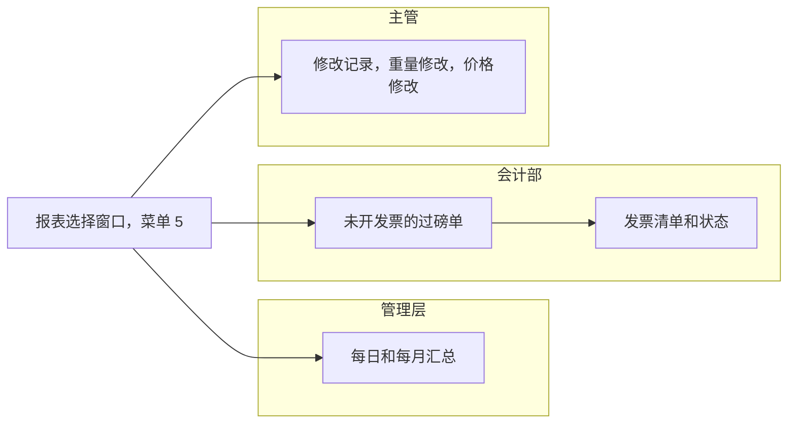
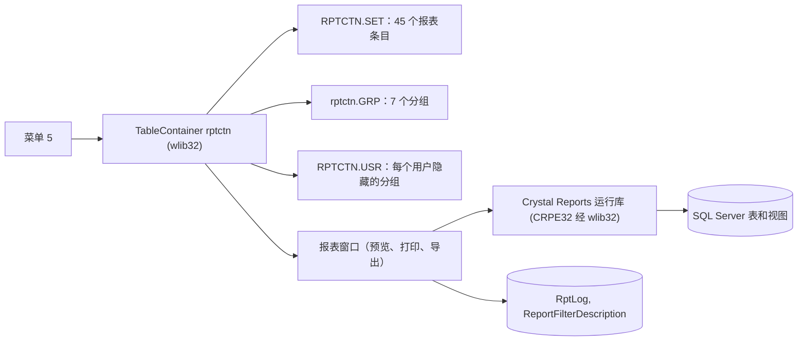
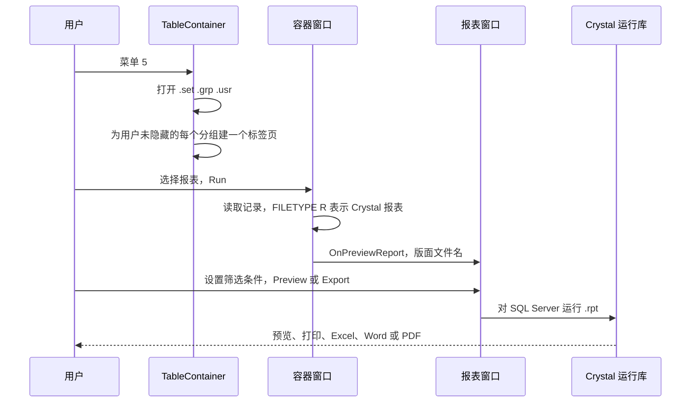

# 报表（菜单 5）- 模块参考

> 英文版为准。同步自英文版 commit c76cd62（2026-10-30）。

> 本文是 TradeWin 模块参考的一部分。索引和共用章节见：[README](README.md)。
> 涵盖的菜单项：5 Report。从其他屏幕打印的过磅单、发票和清单单据，在各自的模块里说明。
> 最后核对的 commit 为 `2f77122`。翻译状态：英文版见 [../reports.md](../reports.md)；本中文版同步于 2026-10-30（commit c76cd62）。

## 目录

- [第一部分 - 业务视图](#第一部分---业务视图)
  - [1.1 简单说明](#11-简单说明)
  - [1.2 谁用什么](#12-谁用什么)
  - [1.3 一天的工作](#13-一天的工作)
  - [1.4 实例演示](#14-实例演示)
  - [1.5 界面导览](#15-界面导览)
  - [1.6 这个数字从哪里来？](#16-这个数字从哪里来)
  - [1.7 状态含义](#17-状态含义)
  - [1.8 如果发生以下情况](#18-如果发生以下情况)
  - [1.9 你可能看到的消息](#19-你可能看到的消息)
  - [1.10 该做和不该做](#110-该做和不该做)
  - [1.11 开始之前](#111-开始之前)
  - [1.12 词汇表](#112-词汇表)
  - [1.13 问AI](#113-问ai)
- [第二部分 - 技术视图](#第二部分---技术视图)
  - [2.1 概览](#21-概览)
  - [2.2 架构和依赖](#22-架构和依赖)
  - [2.3 主数据目录](#23-主数据目录)
  - [2.4 子表层级](#24-子表层级)
  - [2.5 模块和处理流程](#25-模块和处理流程)
  - [2.6 端到端流程](#26-端到端流程)
  - [2.7 报表目录](#27-报表目录)
  - [2.8 集成](#28-集成)
  - [2.9 配置](#29-配置)
  - [2.10 维护](#210-维护)

---

# 第一部分 - 业务视图

## 1.1 简单说明

- 菜单 5 打开**报表选择窗口**：一个窗口，左边是报表分组，右边是所选分组的报表。
- 这些报表回答每天和月底的问题：按产品、供应商和买家，进了多少纸、出了多少纸；开了哪些发票；哪些过磅单还没开发票；过磅单保存后改了什么；库存是多少；现金买了多少、卖了多少。
- 每份报表都是一个预先做好的版面。你选择报表，在打开的窗口里设置日期范围和筛选条件，然后预览、打印，或导出为 Excel、Word 或 PDF。
- 如果不运行报表，管理层就看不到采购、销售、库存或未开发票的过磅单，也发现不了被修改的过磅单。
- 这个选择窗口列出 **7 个分组共 45 份报表**。名称里有“Receiving”和“Despatch”的报表读取收货和发货过磅单（菜单 1.1、1.2、2.1、2.2）；名称里有“Scale”的读取磅秤过磅单；“Public Weighing”读取公共过磅的过磅单。

## 1.2 谁用什么

| 部门 | 报表分组 | 主要工作 |
|---|---|---|
| 管理层 | Receiving Report, Despatch Report, Security Report | 按产品、供应商、买家的每日和每月合计；库存卡；实物库存 |
| 会计部 | Purchase Report, Sales Report, 未开发票的过磅单报表 | 发票清单和状态、未开发票的过磅单、现金采购和现金销售 |
| 地磅主管 | Audit Report, Public Weighing | 找出保存后价格或重量被修改的过磅单；公众过磅明细 |
| IT / 管理员 | 全部 | 检查报表清单、报表文件和每个用户的可见范围 |

**从这里开始 - 管理层**
- 每天：看昨天的 Receiving Product Summary Report 和 Despatch Product Summary Report。
- 月底：Stock Card Report 和各产品明细报表。

**从这里开始 - 会计部**
- 每天：用 Receive Unbill Ticket 和 Despatch Unbill Ticket 查看还没开发票的过磅单。
- 月底：发票清单和状态报表。

**从这里开始 - 主管**
- 每周：Audit Report 分组：Receiving 和 Despatch 的 File Change、Weight Change 和 Price Change 报表。

## 1.3 一天的工作

**早上检查。** 经理选择分组 **Receiving Report**，再选“Receiving Product Summary Report”，设置昨天的日期，按 Preview。同一清单里的另一份报表显示每个供应商的合计。

**开发票之前。** 会计选择 **Despatch Report** 和“Despatch Unbill Ticket”，列出还没有开发票的过磅单。

**过磅单看起来不对时。** 主管选择 **Audit Report** 分组和 File Change 报表，查看谁在什么时候把过磅单的哪个字段从什么值改成了什么值。

**月底。** 会计运行采购和销售的发票清单，以及库存报表来取得期末结余。

泳道图：

*说明：大家都从同一个选择窗口开始；每个部门使用不同的报表分组。*

## 1.4 实例演示

所有数值都是虚构的。

| 步骤 | 屏幕 | 用户做什么 | 程序做什么 |
|---|---|---|---|
| 1 | 菜单 5 Report | 打开选择窗口 | 左边显示分组；第一个分组已选中 |
| 2 | 选择窗口 | 点击分组 `Receiving Report`，选择“Scale Weighing Detail Report”，按工具栏的 Print | 打开报表窗口 |
| 3 | 报表窗口 | 设置日期从 2026-10-01 到 2026-10-31 | - |
| 4 | 报表窗口 | 按“预览” | 显示本月每张磅秤过磅单及其明细行，例如 `AL01` 3,435 公斤、金额 6,830.00（来自前面例子中的过磅单） |
| 5 | 报表窗口 | 选择 Excel | 写出一个 Excel 文件并打开 |

## 1.5 界面导览

### 报表选择窗口

**用途：**选择报表。

| 部分 | 含义 | 来源 |
|---|---|---|
| 带分组图标的左侧栏 | 每个报表分组一个按钮：Receiving Report, Despatch Report, Purchase Report, Sales Report, Public Weighing, Security Report, Audit Report | 程序自带的分组清单文件 |
| 报表清单 | 报表名称，例如“Scale Weighing Detail Report” | 程序自带的报表清单文件 |
| 工具栏：Back, Print | Back 关闭选择窗口；Print 运行所选报表并打开报表窗口 | - |
| 工具栏：Edit, New, Delete, Security | 维护报表清单及其用户权限；只有 99 级用户看得到 | - |

可以用程序自带的用户清单文件里的一条记录，禁止某些用户使用某些分组（见 2.9）。

### 报表窗口

| 字段 | 含义 | 值的来源 |
|---|---|---|
| 日期范围、账户、车辆、产品和其他筛选条件 | 哪些记录进入报表 | 输入或选择；可用的筛选条件因报表而异 |
| Preview / Print | 在屏幕上查看或打印 | - |
| Export to Excel / Word / PDF | 保存为文件 | - |

### 报表分组

| 分组 | 项数 | 内容 |
|---|---|---|
| Receiving Report | 15 | 所购货物的产品明细和汇总、供应商汇总、未开发票的过磅单、差异、磅秤过磅明细（也有调整价格版）、按付款日期的明细、实际数量报表 |
| Despatch Report | 13 | 所售货物的同类报表、磅秤发货明细 |
| Purchase Report | 3 | 采购发票清单和状态、现金采购 |
| Sales Report | 3 | 销售发票清单和状态、现金销售 |
| Public Weighing | 1 | 公众过磅明细 |
| Security Report | 4 | 发货和收货的警方报告、实物库存、库存卡 |
| Audit Report | 6 | 收货和发货的 File Change、Weight Change 和 Price Change 报表 |

带代码的完整清单见 2.7。

## 1.6 这个数字从哪里来？

- 收货和发货报表里的**数量和金额**来自过磅单的明细行（收货和发货过磅单以及磅秤过磅单）。每个版面的确切来源在版面文件里，这里没有核实。
- **未开发票的过磅单报表**列出编号不在任何发票明细行里的过磅单。
- **发票报表**使用发票表头和明细行（见 [发票](invoice-cashier.md#16-这个数字从哪里来)）。
- **库存报表**把库存卡的收货加上、发货减去，再加上库存调整（见 [其他、库存](other-stock-export.md)）。
- **File、Weight 和 Price 修改报表**列出每个被修改字段的旧值和新值、用户和时间（收货和发货过磅单的修改日志）。

## 1.7 状态含义

报表没有状态。唯一的状态是用户能否看到某个分组（在用户清单文件里设置），以及报表版面文件是否存在于这台电脑上。

## 1.8 如果发生以下情况

| 情况 | 怎么办 | 什么时候找 IT |
|---|---|---|
| 报表窗口打开后是空的 | 放宽日期范围；检查账户和产品筛选条件 | 有过磅单的日期范围里报表仍是空的 |
| “file not found” | 这台电脑上缺少报表版面文件 | 总是：IT 必须复制版面文件 |
| 过磅单报表是空的，但过磅单存在 | 菜单 1.1 和 1.2 的过磅单用收货和发货报表，磅秤过磅单用磅秤报表，公共过磅单用公共过磅报表 | 用对了报表仍是空的 |
| 用户看不到某个分组 | 用户清单文件把它隐藏了 | IT 修改用户清单 |
| 报表合计与发票不一致 | 检查过磅单在开发票之后有没有被修改（File Change 报表会显示谁改了什么） | 差异仍然存在 |
| 打印时断电或断网 | 重新运行报表 | 窗口打不开 |

## 1.9 你可能看到的消息

| 消息 | 含义 | 怎么办 |
|---|---|---|
| `<file> not found`（显示文件名） | 程序文件夹里缺少一个报表清单文件 | 找 IT |
| `Database not open` | 报表需要的一张表没有打开 | 找 IT |
| `Backgroud printing in progress...Please wait`（关闭程序时） | 还有打印任务在运行 | 等待，或回答 Yes 终止它 |

报表窗口和 Crystal 预览有它们自己的消息，不属于本仓库。

## 1.10 该做和不该做

- 打印大报表之前，要检查日期范围。
- 月底开发票之前，要用未开发票的过磅单报表。
- 最后的过磅单还没完成之前，不要运行月底报表。
- 除非 IT 正在修改清单，否则不要使用选择窗口的 Edit、New 和 Delete 按钮。

## 1.11 开始之前

- 你要报表的过磅单和发票已经保存。
- 报表版面文件（`.rpt`）在程序文件夹里。
- 电脑上已安装 Crystal Reports 运行库。
- 你的用户有权查看这个分组。

## 1.12 词汇表

| 术语 | 英文 | 马来文 | 中文 |
|---|---|---|---|
| Report | Printed or previewed summary | Laporan | 报表 |
| Summary / detail | Totals only / every ticket | Ringkasan / butiran | 汇总 / 明细 |
| Unbilled ticket | Ticket not on any invoice | Tiket belum bil | 未开发票过磅单 |
| File change report | Audit of changed fields | Laporan perubahan | 修改记录 |
| Party | The other company | Pihak | 对方 |
| Stock card | Movement list of one product | Kad stok | 库存卡 |
| Physical stock | Stock counted | Stok fizikal | 实物库存 |

## 1.13 问AI

1. 怎样按产品打印昨天的收货汇总？
2. 哪份报表显示还没开发票的过磅单？
3. 怎样看到过磅单保存后是谁修改的？
4. 哪份报表列出某个月的磅秤过磅单？
5. 为什么清单里的某份报表什么都不显示？
6. 怎样把报表导出为 Excel？
7. 哪份报表显示某个产品的库存变动？
8. 怎样对某个用户隐藏一些报表分组？
9. 在哪里找现金采购和现金销售报表？
10. 哪份报表显示公众过磅？

---

# 第二部分 - 技术视图

## 2.1 概览

- 应用程序：TradeWin Metals 地磅系统（wlib32 上的 VC6/MFC，`menu.dsp`、`menu.exe`）。见 [README](README.md)。
- 本模块：只有菜单 5。菜单 5 在本仓库里没有自己的代码：`case M_REPORT: TableContainer("rptctn")`（MAIN.CPP:354-356）把工作交给 wlib32 的表格容器，由它读取仓库里的三个数据文件（`RPTCTN.SET`、`rptctn.GRP`、`RPTCTN.USR`）。报表是 Crystal Reports 版面（`.rpt`）。
- 仓库里还有较旧的“DOS 风格”报表程序（Sdp.cpp、sv.cpp、Dpp.cpp、mnws.cpp、detail.cpp、Chkvar.cpp、fc.cpp）及其表单；大多数从菜单到达不了（见 2.5）。

## 2.2 架构和依赖

*说明：选择窗口读取三个本地数据文件；报表窗口通过 Crystal 运行库对 SQL Server 运行 `.rpt` 版面，并记录所用的公式。*

- 库：wlib32（容器、报表窗口）、Crystal Reports 运行库。
- 数据库：SQL Server 表和视图。姊妹结构 `SQL_LekokPaper` 里有容器表 `rptctn_grp` 和 `rptctn_set`；这个选择窗口不使用它们（它打开的是文件）。
- 本仓库里没有 `.rdl` 报表，也没有 ReportEngine 调用。仓库根目录的版面文件：407 个 `.rpt`、51 个 `.rep`、24 个 `.FMT`、38 个 `.scr`（按扩展名统计，不分大小写）。没有 `reportE` 或 `reportS` 文件夹。

## 2.3 主数据目录

容器数据文件（不是 SQL 表）。本仓库里的这些文件与 Application_LekokPaper 的**逐字节相同**（`RPTCTN.SET`、`rptctn.GRP`、`RPTCTN.USR`、`RPTCTN_OLD.SET`、`WBCTN.usr`），所以下面的清单也相同。这些文件是 dBase 风格：文件头里有字段清单，然后是定长记录；每个文件头里的记录数比文件里实际的记录数少（见 2.10，发现 1）。

| 文件 | 字段（来自文件头） | 作用 |
|---|---|---|
| `RPTCTN.SET` | `REFNO`(5), `NAME`(50), `REPORT`(30), `MODE`(60), `PREF`(5), `GROUP`(10), `FILETYPE`(20) | 每份报表一条记录；`REPORT` 是版面文件；`GROUP` 选择标签页；`FILETYPE` 以 `R`（值为 `Report`）开头表示 Crystal 报表 |
| `rptctn.GRP` | `GROUP`(10), `NAME`(40), `USER_LEVEL`(5), `ADD`, `EDIT`, `DELETE`（各 1） | 每个标签页一条记录；七个分组为 9 级，两条重复的 `SECURITY` 行为 999 级（2.10，发现 1） |
| `RPTCTN.USR` | `CODE`, `NAME`，然后是标志列 `N01`..`N100` 和 `H01`..`H10` | 每个用户隐藏的分组编号清单（wlib32 按位置读取）；文件里有用户名，这里不复制 |
| `WBCTN.usr` | 相同结构 | 程序自带的第二个用户清单（本仓库的代码没有引用它） |
| `RPTCTN_OLD.SET` | 与 `RPTCTN.SET` 结构相同 | 较旧的副本：按其文件头有 40 个条目，包括当前文件没有的“Security report”（`rep_ALLTRANmaxweight.rpt`）；程序不读取它 |

相关 SQL 表（类型来自姊妹结构 `SQL_LekokPaper`，TradeWin 未核实）：`RptLog`（`NAME` varchar(50)、`DATE` datetime、`USER` varchar(5)、`formula` varchar(500)；每次运行一行，没有主键）、`ReportFilterDescription`（`Field`、`Table`、`Rpt`、`pref`、`Description`、`user`、`date`）、`RptReportName`（`RPT` varchar(50) 主键、`NAME` varchar(250)）、`REPORT_FLD_SELECTION`（`REFNO`、`REP_FLD` 到 `REP_FLD11`、`REMARKS`、`VIEW`、`PKKEY`）。重置数据库程序（菜单 6.4）会清空 `rptlog` 和 `ReportFilterDescription`（ResetPassword.cpp:114, 144, 194）。

## 2.4 子表层级

无：选择窗口基于文件，报表直接读取视图。下面是**姊妹结构**为这些版面定义的视图（仅供参考：TradeWin 没有结构仓库，这里看不到线上的视图，可能不同；许多视图把过磅单的 8 + 8 行产品拆成多行）：

| 视图 | 用途 |
|---|---|
| `DS_ALLPT`, `DS_ALLPT1`, `DS_ALLINVPT`, `DS_ALLINVPTNAME`, `DS_ALLPARTYSTK`, `DS_PT1` 到 `DS_PT8`、`DS_PT11` 到 `DS_PT18`, `DS_AMOUNT`, `DS_DIFF_AMT` | 收货过磅单明细行变成多行（自己的、对方的、可开发票的） |
| `DP_ALLPT`, `DP_ALLPT1`, `DP_ALLPTPARTY`, `DP_ALLINVPT`, `DP_ALLINVPTNAME`, `DP_ALLPARTYSTK`, `DP_PT1` 到 `DP_PT8`、`DP_PT11` 到 `DP_PT18`, `DP_AMOUNT`, `DP_DIFF_AMT`, `RT_ALLPT`, `RT_ALLPT1`, `RT_ALLPTPARTY`, `RT_ALLINVPT`, `DP_RT` | 发货和退货过磅单 |
| `SC_ALLPT`, `SC_SUM`, `SCW_ALLPT`, `DSnSC_ALLPT`, `DPnSC_ALLPT`, `REP_DSnSCDETAIL`, `REP_RCVSCALE`, `DSINV_SCALE` | 磅秤过磅单报表（姊妹视图中 RECEIVE/DESPATCH 过磅单的那些在这里不适用） |
| `FC_DS_RPT`, `FC_DS_WT`, `FC_DS_PRICE`, `FC_DS_OTHER` 和 `FC_DP_*` 系列 | 修改记录报表（行来自表 `fc_ds`、`fc_dp`、`fc_scale`、`fc_scalesub` 等） |
| `UNBILL_DS`, `UNBILL_DP`, `UNBILL_RT`, `UNPAID_DP`, `UNPAID_RT`, `unpaid_ds` | 未开发票和未付款的过磅单 |
| `STKFLOW` | 库存卡 |
| `REP_FMAXWEIGHT_*`, `REP_SMAXWEIGHT_*`, `rep_maxweight` | 保安重量报表 |

## 2.5 模块和处理流程

### 入口

| 菜单项 | 节点 | 处理程序 | 打开 |
|---|---|---|---|
| 5 Report | 5 | `TableContainer("rptctn")`（MAIN.CPP:354-356） | wlib32 容器 |

同样在 `SubProgram` 里但不在任何菜单上（节点 51 到 54）：`FileChangeReport(&ds)`、`FileChangeReport(&dp)`、`VarianceDetailReport(&ds)`、`VarianceDetailReport(&dp)`（MAIN.CPP:357-368）。它们使用旧的筛选屏幕和表单 `fc_ds.scr`、`fc_dp.scr`、`daily.scr`。

### 流程：运行一份报表

*说明：记录里的报表类型字母决定运行什么；这 45 个条目都是 Crystal 报表。*

1. `TableContainer`（wlib32）检查用户是否有权查看，要求程序文件夹里有 `rptctn.set` 和 `rptctn.grp`（否则显示消息 `<file> not found`），如果有 `rptctn.usr` 就打开它，并为用户未隐藏的每个分组建一个标签页。
2. 工具栏对所有人有 Back 和 Print，只有 99 级或以上的用户才有 Edit、New、Delete 和 Security。
3. 运行时按 `FILETYPE` 的第一个字符分支：`T` 表、`E` exe、`O` 对象、`R` Crystal 报表、`S` 简单对话框、`Q` 存储过程查询、`I` 带内部筛选的 Crystal、`P` 存储过程报表、`B` 批处理、`H` HTML、`W` 过磅设置（wlib32）。
4. 报表窗口提供预览、打印和三种导出。
5. `CMenuApp::RptResetFiles` 和 `ConfirmCrystalTableFile`（MENU.CPP:132-181、182-220）在 `STCR` 不是 `St_CR` 时，把会计表名改成对应的采购表名（`aripay` 改为 `apipay` 或 `payment`，`debtor` 改为 `supplier`，`arinv` 改为 `apinv` 或 `purchase`，等等）；它们只对休眠的会计报表有用。

### 仓库里的旧报表代码（已编译，大多到达不了）

| 文件 | 作用 | 能到达吗？ |
|---|---|---|
| Sdp.cpp, sv.cpp, Dpp.cpp, mnws.cpp, detail.cpp, Chkvar.cpp, fc.cpp | 旧的针式打印机汇总和检查 | 只能经隐藏节点 51 到 54（差异和修改记录） |
| Daily.cpp, Month.cpp, One.cpp, Two.cpp, Tap.cpp, TSO.CPP, FChange.cpp | 条件窗口（`CDaily`、`CMonth`、`COne`、`CTwo`、`CTap`、`CTso`、`CFChange`） | `CTwo` 被出口屏幕使用（菜单 3.3 和 3.4） |
| STATE.CPP, A_STATE.CPP, B_state.cpp, S_STATE.CPP, VIEWCIQ.CPP, CIQ.CPP | 客户对账单和查询（会计） | 没有菜单路径（见 README） |

### 读写的表

| 表 | 读 | 写 | 键 |
|---|---|---|---|
| 2.4 列出的视图 | 版面 | - | - |
| RptLog, ReportFilterDescription | 报表窗口 | 报表窗口 | - |
| RPTCTN.SET, rptctn.GRP, RPTCTN.USR（文件） | 选择窗口 | 99 级维护按钮 | - |

### 流水号、状态转换

无。

### 对其他模块的依赖

- 所有其他模块：报表读取它们的过磅单、发票和库存。

## 2.6 端到端流程

见 [README](README.md#26-端到端流程)。

## 2.7 报表目录

表的来源：`RPTCTN.SET`（其文件头计入的 45 条记录）。`REPORT` 列里的每个版面文件都在仓库根目录。所有报表的菜单路径：5 Report > 分组。参数在报表窗口里选择（版面的日期范围和筛选条件；这里没有核实）。每条记录的 `MODE` 和 `PREF` 都是空的。

| 代码 | 名称 | 版面文件 | 分组 |
|---|---|---|---|
| 00001 | Receiving Product Detail Report | `mnws.rpt` | RECEIVING |
| 00002 | Despatch Product Detail Report | `mmws.rpt` | DESPATCH |
| 00003 | Receiving Price Change Report | `fc_ds_price.rpt` | AUDIT |
| 00004 | Despatch Price Change Report | `fc_dp_price.rpt` | AUDIT |
| 00005 | Receiving Product Summary Report | `sds.rpt` | RECEIVING |
| 00006 | Supplier Product Summary Report | `dsp.rpt` | RECEIVING |
| 00007 | Receiving Detail Report | `des.rpt` | RECEIVING |
| 00008 | Supplier Summary | `ss.rpt` | RECEIVING |
| 00009 | Variance Receive Report | `chkvar.rpt` | RECEIVING |
| 00010 | Despatch Product Summary Report | `sdp.rpt` | DESPATCH |
| 00011 | Buyer Product Summary Report | `dpp.rpt` | DESPATCH |
| 00012 | Despatch Detail Report | `detail.rpt` | DESPATCH |
| 00013 | Buyer Summary | `sv.rpt` | DESPATCH |
| 00014 | Polis report (Despatch) | `Polis.rpt` | SECURITY |
| 00015 | Variance Despatch Report | `dchkvar.rpt` | DESPATCH |
| 00016 | Purchase Invoice Listing | `aplist.rpt` | PURCHASE |
| 00017 | Sales Invoice Listing | `arlist.rpt` | SALES |
| 00018 | Receive Unbill Ticket | `unbill_ds.rpt` | RECEIVING |
| 00019 | Despatch Unbill Ticket | `unbill_dp.rpt` | DESPATCH |
| 00020 | Receiving Category Product Summary Report | `sdsCAT.rpt` | RECEIVING |
| 00021 | Despatch Category Product Summary Report | `sdpCAT.rpt` | DESPATCH |
| 00022 | Actual Receiving Quantity Report | `Des2.rpt` | RECEIVING |
| 00023 | Actual Sales Quantity Report | `detail2.rpt` | DESPATCH |
| 00024 | Purchase Invoice Status Report | `apstt.rpt` | PURCHASE |
| 00025 | Sales Invoice Status Report | `arstt.rpt` | SALES |
| 00026 | Despatch File Change Report | `fc_dp.rpt` | AUDIT |
| 00027 | Receiving File Change Report | `fc_ds.rpt` | AUDIT |
| 00028 | Cash Sales Report | `Cashsale.rpt` | SALES |
| 00029 | Cash Purchase Report | `Cashpur.rpt` | PURCHASE |
| 00030 | Actual Receiving Report | `des3.rpt` | RECEIVING |
| 00031 | Actual Despatch Report | `detail3.rpt` | DESPATCH |
| 00032 | Receiving Weight Change Report | `fc_ds_wt.rpt` | AUDIT |
| 00033 | Despatch Weight Change Report | `fc_dp_wt.rpt` | AUDIT |
| 00034 | Actual Despatch Summary Report | `actsum_des.rpt` | DESPATCH |
| 00035 | Actual Receiving Summary Report | `actsum.rpt` | RECEIVING |
| 00036 | Public Weighing Detail Report | `pr_list.rpt` | PUBLIC |
| 00038 | Receiving and Scale Weighing Detail Report | `dsnsc.rpt` | RECEIVING |
| 00039 | Receiving Detail Report By Pay Date | `despd.rpt` | RECEIVING |
| 00040 | Scale Despatch Detail Report | `scdwdetail.rpt` | DESPATCH |
| 00133 | Polis Report (Receive) | `polis_rcv.rpt` | SECURITY |
| 00134 | Physical Stock Report | `stkflow2.rpt` | SECURITY |
| 00135 | Stock Card Report | `stkflow.rpt` | SECURITY |
| 00136 | Scale Weighing Detail Report | `scdetail.rpt` | RECEIVING |
| 00137 | Scale Weighing Detail Report (Price adjusted) | `scdetail_adjprice.rpt` | RECEIVING |
| 00138 | Scale Despatch Detail Report(Price adjusted) | `scdwdetail_adjprice.rpt` | DESPATCH |

各分组条数：RECEIVING 15、DESPATCH 13、AUDIT 6、SECURITY 4、PURCHASE 3、SALES 3、PUBLIC 1。文件里在计入的 45 条之后还有 28 条记录，全是代码 `10093` “Scale Despatch Weighing Detail Report”（`scdwdetail.rpt`，分组 `Despatch` 为大小写混合）的重复，没有任何分组与之匹配。

从其他屏幕打印的其他单据：过磅单和发票（见 [过磅](weighing.md#27-报表目录)、[磅秤过磅](scale-weighing.md#27-报表目录)、[过磅单](tickets.md#27-报表目录)、[发票](invoice-cashier.md#27-报表目录)）。仓库根目录里其他像报表的文件：`Upload.rpt`、`UploadReport.VIW` 和 `.VIW` 文件（视图脚本）、`.rep` 和 `.FMT` 针式打印机表单；`DoUploadProcess`（MAIN.CPP:163-173）本来会启动 `WINCUT` 程序并打印 `Upload.rpt`，但没有调用它的地方。

## 2.8 集成

无。（Excel、Word 和 PDF 导出由报表窗口完成。）

## 2.9 配置

- `RPTCTN.USR` 每个用户隐藏的分组；`rptctn.GRP` 里的 `USER_LEVEL`（没有使用：本应用没有改写容器的分组级别挂钩，所以 9 和 999 这两个值在这里没有作用）。
- 每台预览报表的电脑都要有 Crystal 运行库。
- 名称带 `*_GST` 或 `*_LINE` 变体的版面，由 wlib32 根据日期和 `logo` 标志选择。

## 2.10 维护

- 修改 `RPTCTN.SET`、`rptctn.GRP` 或版面名称时，要更新本文件。要重新生成 2.7 的表，请读取 `RPTCTN.SET` 257 字节文件头之后的 181 字节记录。
- 修改记录：

| 日期 | Commit | 作者 | 修改内容 |
|---|---|---|---|
| 2026-10-19 | `2f77122` | Claude（草稿待审阅） | Application_TradeWin 的第一版：容器文件与 Application_LekokPaper 的相同（45 个条目，7 个分组），文件数量和行号引用已在本仓库重新核对 |

- 最后核对的 commit 为 `2f77122`。翻译状态：zh-CN 已完成，同步于 2026-10-30。

### 代码发现（给开发人员）

1. **容器文件里的记录比文件头计数的更多。**`RPTCTN.SET` 计入 45 条记录，实际有 73 条（28 条是代码 `10093` 的重复）；`rptctn.GRP` 计入 7 条，实际 9 条（两条重复的 `SECURITY` 行，级别 999）；`RPTCTN.USR` 计入 7 个用户，实际有 24 个位置。框架是否读取多出的行，取决于它的记录计数逻辑（未核实）；如果会读，选择窗口会显示 28 行重复的“Scale Despatch Weighing Detail Report”。
2. **收货和发货条目背后的姊妹应用视图不能直接套用。**条目 00001 到 00035 是为姊妹应用的 `RECEIVE`/`DESPATCH` 和 `DS`/`DP` 过磅单做的；TradeWin 只有 `DS`/`DP` 过磅单，所以哪些版面仍然匹配线上视图，在这里无法核实（版面内部和线上视图未核实）。

3. `RPTCTN_OLD.SET` 和 `WBCTN.usr` 在仓库里，但没有被引用。
