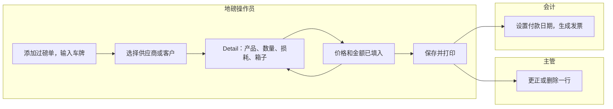
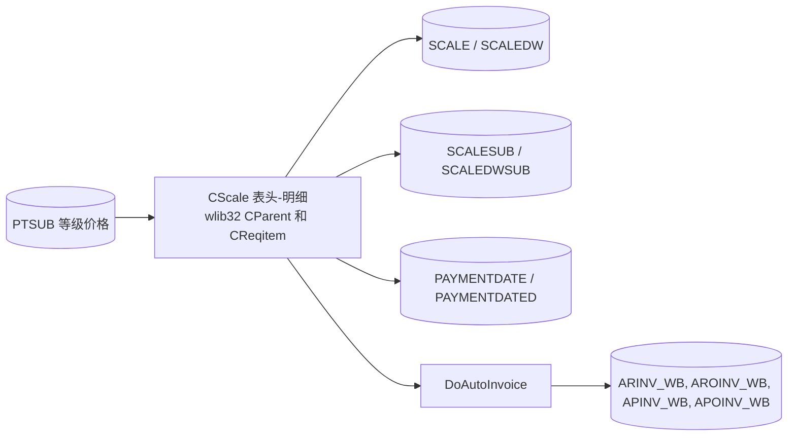
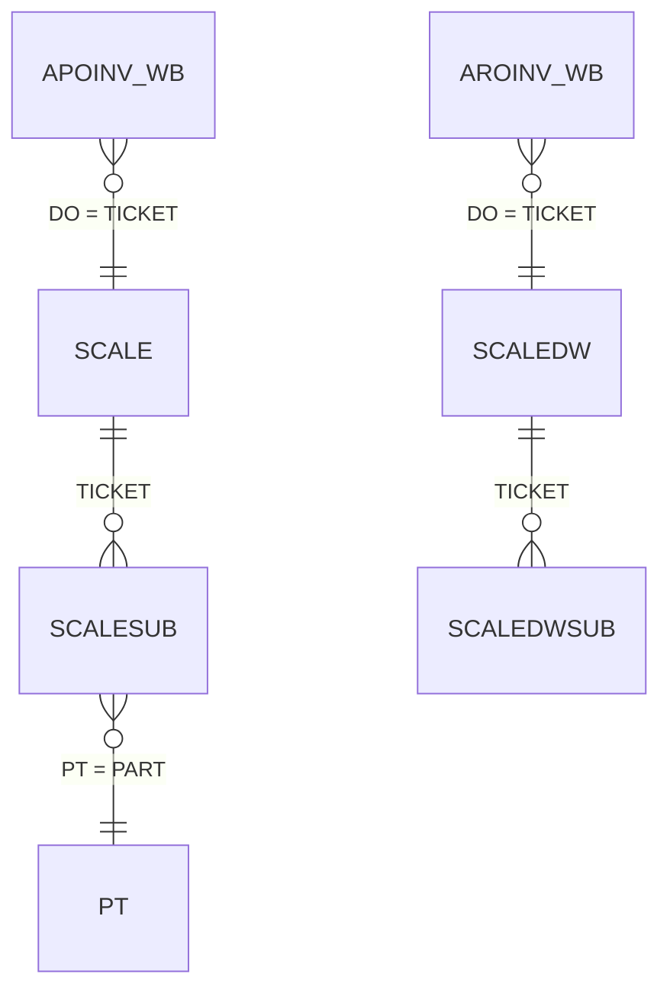
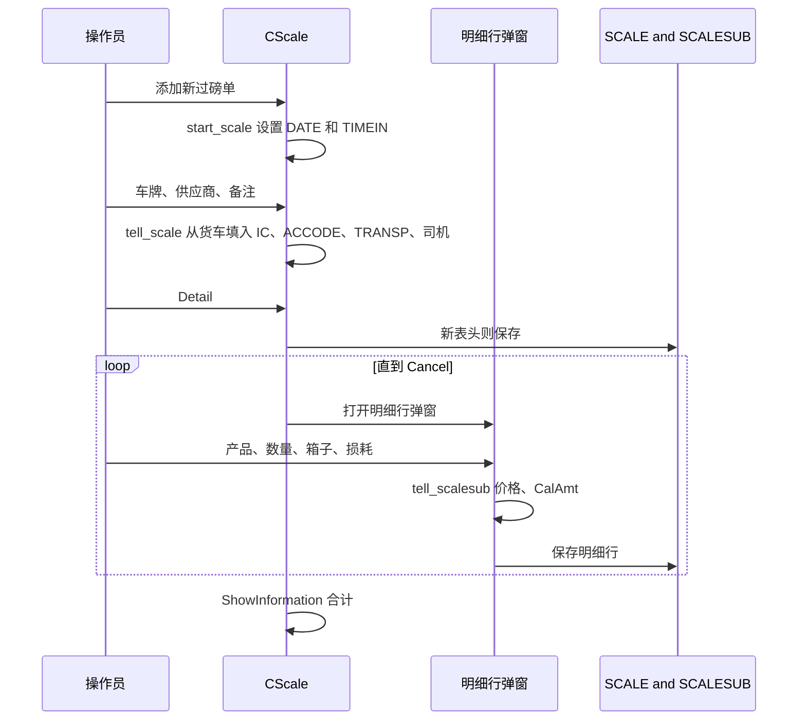
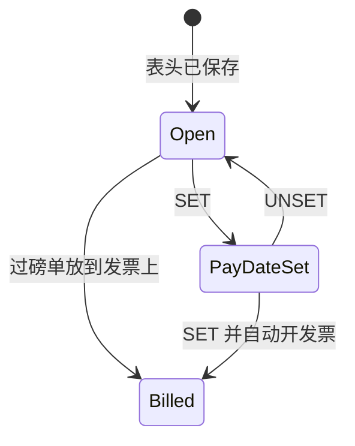

# 磅秤过磅（菜单 1.6 和 1.7）- 模块参考

> 英文版为准。同步自英文版 commit c76cd62（2026-10-30）。

> 本文是 TradeWin 模块参考的一部分。索引和共用章节见：[README](README.md)。
> 涵盖的菜单项：1.6 Scale Weighing (Unlimited Product Features) 和 1.7 Scale Despatch Weighing (Unlimited Product Features)。与 Application_LekokPaper 相比，这里的磅秤屏幕是 wlib32 的普通表头加明细屏幕：**不从指示器采集重量，没有箱子代码主表，没有 Cancel Ticket，没有客户价目表，也没有无限产品的收货和发货表单**。
> 最后核对的 commit 为 `2f77122`。翻译状态：英文版见 [../scale-weighing.md](../scale-weighing.md)；本中文版同步于 2026-10-30（commit c76cd62）。

## 目录

- [第一部分 - 业务视图](#第一部分---业务视图)
  - [1.1 简单说明](#11-简单说明)
  - [1.2 谁用什么](#12-谁用什么)
  - [1.3 一天的工作](#13-一天的工作)
  - [1.4 实例演示](#14-实例演示)
  - [1.5 界面导览](#15-界面导览)
  - [1.6 这个数字从哪里来？](#16-这个数字从哪里来)
  - [1.7 状态含义](#17-状态含义)
  - [1.8 如果发生以下情况](#18-如果发生以下情况)
  - [1.9 你可能看到的消息](#19-你可能看到的消息)
  - [1.10 该做和不该做](#110-该做和不该做)
  - [1.11 开始之前](#111-开始之前)
  - [1.12 词汇表](#112-词汇表)
  - [1.13 问AI](#113-问ai)
- [第二部分 - 技术视图](#第二部分---技术视图)
  - [2.1 概览](#21-概览)
  - [2.2 架构和依赖](#22-架构和依赖)
  - [2.3 主数据目录](#23-主数据目录)
  - [2.4 子表层级](#24-子表层级)
  - [2.5 模块和处理流程](#25-模块和处理流程)
  - [2.6 端到端流程](#26-端到端流程)
  - [2.7 报表目录](#27-报表目录)
  - [2.8 集成](#28-集成)
  - [2.9 配置](#29-配置)
  - [2.10 维护](#210-维护)

---

# 第一部分 - 业务视图

## 1.1 简单说明

- **Scale Weighing** 用来记录本站**买进**的货物，逐个产品由操作员按磅秤读数输入。**Scale Despatch Weighing** 用来记录**卖出**的货物。两个屏幕相同，只是标签不同（买进时编号叫“RN NO”，卖出时叫“DN NO”，对方叫“SUPPLIER”或“CUSTOMER”）。
- 一张过磅单有一个**表头**（货车、供应商或客户、付款方式、运输商、司机、备注）和任意多行**产品明细行**（产品清单不限，所以菜单名称这样写）。每一行由操作员选择产品并**输入**数量（重量，单位 kg），也可以输入要扣除的**损耗**和**箱子**重量。程序根据产品填入**单价**，并算出**金额**。
- 过磅单合计是各行金额之和。现金过磅单还会把合计再显示一次，作为取整到整数单位的 **Final Amount**，并显示取整差额。
- 过磅单用采购发票或销售发票来开票。高级别用户可以在过磅单上按 **SET**，给它一个付款日期，并一步生成发票（见 [发票](invoice-cashier.md)）。
- 过磅单没有保存，就没有东西可以开发票，库存和报表也会漏掉这批货。
- 与[过磅](weighing.md)里的两次称重过磅单不同，磅秤过磅单在本程序里**没有与磅秤的实时连接**：每一行的重量都是输入的。

## 1.2 谁用什么

| 部门 | 菜单项 | 主要工作 |
|---|---|---|
| 地磅操作员 | 1.6 Scale Weighing、1.7 Scale Despatch Weighing | 打开过磅单、选择供应商或客户、添加产品明细行、保存、打印 |
| 地磅主管 | 1.6、1.7 | 更正明细行、删除明细行或未开发票的过磅单 |
| 会计（99 级） | 1.6、1.7 | 设置付款日期，从而生成发票（见 [发票](invoice-cashier.md)） |
| IT / 管理员 | 4.1.1 Product Code | 维护产品及其价格 |

**从这里开始 - 地磅操作员**
- 菜单 1 > Scale Weighing（买进）或 Scale Despatch Weighing（卖出）。
- 添加新过磅单，输入车牌（供应商、运输商和司机从货车清单自动填入），选择供应商，然后用 Detail 按钮逐个添加产品。
- 对每个产品，选择代码，输入数量，检查价格，按 OK。
- 保存并打印。

**从这里开始 - 主管**
- 更正一行：双击这一行，修改数字，OK。过磅单一旦在发票上，就不能再编辑。

## 1.3 一天的工作

**供应商送货来。**操作员选择 1.6，添加新过磅单。日期和时间已填好。操作员输入车牌；程序从货车清单填入供应商、运输商、司机编号和姓名。操作员按 Detail 按钮（程序先用新的 RN NO 保存表头），打开明细行窗口。操作员选择产品代码（单价自动出现），输入从磅秤读到的数量，需要时再输入损耗和箱子重量。OK 保存这一行，窗口再次打开，输入下一个产品。最后一行做完后，操作员在明细行窗口里按 Cancel，然后保存并打印过磅单。

**客户来取货。**步骤相同，用 1.7。这张过磅单随后就是销售发票的依据。

**某一行输错了。**主管打开过磅单，双击这一行，更正，OK。过磅单一旦在发票上，就不能再编辑。

泳道图：



*说明：操作员不断添加明细行，直到货物登记完；主管负责更正；会计给过磅单开发票。*

## 1.4 实例演示

所有数值都是虚构的。

**之前：**供应商 `S0001` “TEST METAL SUPPLIER SDN BHD”已存在；货车 `WXX1234` 的第二个司机字段是 `S0001`；产品 `AL01` 在它的（第一行）等级上采购价为 2.000；产品 `CU01` 的采购价为 0.335；过磅单的付款方式是 `CASH`。

| 步骤 | 屏幕 | 操作员做什么 | 程序做什么 | 之后的状态 |
|---|---|---|---|---|
| 1 | 1.6 Scale Weighing | Add，输入货车 `WXX1234` | 日期和时间已填好；供应商、运输商、司机从货车清单填入 | 表头已打开 |
| 2 | 表头 | Detail 按钮 | 用新的 RN NO 保存表头，然后打开明细行窗口 | 表头已保存 |
| 3 | 第 1 行 | 产品 `AL01`；输入数量 3,435；箱子 20 | 单价 2.000 来自产品；金额 = (3,435 - 0 - 20) x 2.000 = **6,830.00** | 明细行已保存 |
| 4 | 第 2 行 | 产品 `CU01`；数量 1,200；损耗 50 | 单价 0.335；金额 = (1,200 - 50 - 0) x 0.335 = 385.25（**385.25**） | 明细行已保存 |
| 5 | 表头 | 在明细行窗口里按 Cancel | 表格显示两行；Total 7,215.25；Rounding Adj -0.25；Final Amount 7,215.00（现金过磅单） | 过磅单完成 |
| 6 | 表头 | （99 级）SET，选择付款日期，对“Auto create Invoice?”回答 Yes | 生成一张采购发票，包含这张过磅单的一行（见 [发票](invoice-cashier.md#14-实例演示)） | 过磅单已开发票 |

## 1.5 界面导览

### 磅秤过磅单窗口（买进：“RN NO”；卖出：“DN NO”、“CUSTOMER”）

**用途：**过磅单的表头、产品明细行清单和合计。

| 字段标签 | 含义 | 必填？ | 值的来源 |
|---|---|---|---|
| RN NO / DN NO | 过磅单号 | - | 自动流水号（空白或 `NEW` 的编号表示过磅单还没保存） |
| DATE | 过磅单日期；低于 9 级的用户不能修改 | - | 默认今天 |
| TIME | 过磅单打开的时间 | - | 自动 |
| VEHICLE NO | 车牌 | 是（没有车牌，程序拒绝保存） | 输入，或从货车清单选择 |
| SUPPLIER / CUSTOMER | 对方的账户 | 开发票必填 | 选择；从货车的第二个司机字段填入 |
| PAY TYPE | 对方怎样付款 | 否 | 选择。**没有默认值**（Lekok 版本一开始是 `CASH`）；`01` 或 `CASH` 使过磅单成为现金过磅单 |
| TRANSPORTER | 运输公司 | 否 | 选择；从货车填入 |
| I/C NO, DRIVER | 司机编号和姓名 | 否 | 选择；从货车填入 |
| REMARKS | 自由文字 | 否 | 输入 |
| PAY DATE | 由 SET 按钮设置的日期 | - | 自动 |
| Print Counter | 打印次数 | - | 自动 |
| Total | 所有明细行金额之和 | - | 计算 |
| Rounding Adj, Final Amount | 现金过磅单：合计取整到整数单位，以及差额。其他过磅单：调整数 0.00，Final Amount 等于合计 | - | 计算 |

隐藏的字段（D/O NO、GATEPASS、UNIT、SCRAP G/NOTE）在表单上有，但已关闭。

**产品明细行表格：**No、Product Code、Product Description、Quantity、Unit Price、`*`（单价与原价不同）、Amount。

**按钮：**Detail（添加明细行）、双击一行（编辑或删除它）、Print，以及 99 级在编辑模式下的 **SET** 和 **UNSET**（付款日期）。标准的记录按钮（Add、Edit、Save、Delete、Search、Previous、Next）来自框架。这里没有 Cancel Ticket 按钮。

### 产品明细行窗口

| 字段标签 | 含义 | 必填？ | 值的来源 |
|---|---|---|---|
| Product | 产品代码 | 是 | 选择；自动填入单价 |
| Qty | 重量，单位 kg | 是（不能为负数或空白） | 输入 |
| Wastage | 因脏污而扣除的重量；不能超过 Qty | 否 | 输入 |
| Bin | 箱子或袋子的重量；不能超过 Qty | 否 | 输入（本程序没有箱子代码清单） |
| Unit Price | 每 kg 单价 | 是（不能为负数或空白） | 从产品的第一行等级填入（买进用采购价，卖出用销售价）；可以直接改写 |
| `*` | 标记：单价与原价不同 | - | 自动，但不可靠，见 1.8 |
| Amount | 明细行金额 | - | 计算，见 1.6 |

**按钮：**OK、Cancel、Delete（框架）。本程序的明细行窗口没有 Net Weight 框，也没有 Capture Weight 按钮。

## 1.6 这个数字从哪里来？

- **明细行金额** = (Qty - Wastage - Bin) x Unit Price。每一行**不取整**。例子：(3,435 - 0 - 20) x 2.000 = **6,830.00**；(1,200 - 50 - 0) x 0.335 = **385.25**。
- **单价** = 产品的第一行等级（菜单 4.1.1）：买进（1.6）用采购价，卖出（1.7）用销售价。本程序的磅秤过磅单**不**使用客户自己的价目表（菜单 4.2.1）。取等级行时没有排序，所以有多行等级时，价格取决于服务器返回行的顺序。
- **过磅单合计** = 各行金额之和。
- **Final Amount（现金过磅单）** = 合计取整到最接近的整数单位；**Rounding Adj** = Final Amount 减 Total。例子：合计 7,215.25 得出 Final Amount 7,215.00，Rounding Adj -0.25。现金过磅单是指付款方式代码为 `01` 或 `CASH` 的过磅单。其他付款方式的调整数为 0.00，Final Amount 框重复显示合计。
- **库存卡：**每个磅秤明细行按它的数量算作库存**进**（买进）或**出**（卖出）（见 [其他、库存](other-stock-export.md)）。

## 1.7 状态含义

| 单据 | 状态 | 含义 | 谁或什么来修改 | 还能编辑什么 |
|---|---|---|---|---|
| 磅秤过磅单 | Open | 已保存，未开发票 | Save | 用户级别允许的字段；可以添加、编辑和删除明细行 |
| 磅秤过磅单 | Pay date set | 过磅单有付款日期 | SET 按钮（99 级） | 相同 |
| 磅秤过磅单 | Billed | 过磅单号在发票明细行里 | 发票屏幕或 SET | 已锁定：程序提示过磅单已开发票，并拒绝编辑和删除 |

本程序里磅秤过磅单没有“已取消”状态。

## 1.8 如果发生以下情况

| 情况 | 怎么办 | 什么时候找 IT |
|---|---|---|
| 某一行的数量是空白 | 程序不会保存空白或负数的数量；输入重量 | - |
| 某一行的重量错了 | 双击这一行，修改数量，OK | - |
| 某一行的产品错了 | 双击这一行，用 Delete，然后重新添加 | - |
| 客户或价格错了 | 开发票之前编辑表头或明细行；开发票之后过磅单就被锁定 | - |
| 过磅单已在发票上 | 请会计先把过磅单从发票上拿掉 | - |
| 过磅单是误做的 | 在未开发票时删除它（没有 Cancel Ticket） | - |
| 断电或断网 | 已保存的明细行会保留；在新过磅单上第一次按 Detail 时会保存表头 | 重启后连不上服务器 |
| 价格是 0 | 产品没有等级价格：补上一个（菜单 4.1.1），或在这一行输入价格 | - |
| 每一行的价格列都显示 `*` | 程序从不保存原价，所以这个标记不可靠 | 总是（已知问题） |

## 1.9 你可能看到的消息

| 消息 | 含义 | 怎么办 |
|---|---|---|
| `Please key in vehicle no` | 保存过磅单时没有车牌 | 输入车牌 |
| `Please select Product` | 这一行没有产品 | 选择一个 |
| `Quantity is Zero.` + `Not allowed to save.` | 数量为空或为负数 | 输入重量 |
| `Unit Price is Zero.` + `Not allowed to save.` | 单价为空或为负数 | 填写价格 |
| `Bin cannot more than quantity` | 箱子重量超过数量；箱子框被清空 | 检查数字 |
| `Wastage cannot more than quantity` | 损耗超过数量；框被清空 | 检查数字 |
| `Ticket is issued to Invoice:<no>` + `Not allow modify.` | 过磅单在发票上 | 见 1.8 |
| `Error Message` + `Cannot delete Ticket No: <no>` + `because this ticket already Invoiced.` | 拒绝删除 | - |
| `Auto create Invoice?` | SET 之后 | Yes 就创建发票 |
| `Ticket No : <no> already existed in Invoice : <inv>.` + `Please rectify` | 过磅单已经开过发票 | - |
| `RECORD COMPLETE` | 付款日期已保存 | - |
| `UNSET COMPLETED` / `RECORD DOES NOT EXIST` | UNSET 删除了付款日期，或者本来就没有 | - |

## 1.10 该做和不该做

- 请仔细读取磅秤上的重量：没有任何东西检查输入的数量。
- 保存之前检查价格列；缺少价格就意味着金额为零。
- 不要在一行里称两种产品。
- 不要指望 `*` 价格标记告诉你价格是否被修改过（见 1.8）。
- 在各行定稿之前，不要在过磅单上按 SET：SET 根据过磅单的合计生成发票。

## 1.11 开始之前

- 供应商或客户账户、至少有一行等级的产品和付款方式已存在。
- 如果希望表头自动填入，货车清单里要有货车及其司机、供应商和运输商。

## 1.12 词汇表

| 术语 | 英文 | 马来文 | 中文 |
|---|---|---|---|
| Scale weighing | Weighing goods product by product on the scale | Timbang skala | 磅秤称重 |
| RN / DN | Receiving note / delivery note number | No. terimaan / hantaran | 收货 / 送货单号 |
| Bin / bag | Container whose weight is deducted | Bakul / beg | 容器 |
| Wastage | Weight deducted for dirt or moisture | Susut | 扣重 |
| Grade | Quality level of a product with its own prices | Gred | 等级 |
| Final amount | Total after rounding | Jumlah akhir | 最终金额 |
| Pay date | Date set for payment of the ticket | Tarikh bayaran | 付款日期 |

## 1.13 问AI

1. 供应商把货送到磅秤，我怎样记录？
2. 怎样在同一张过磅单上添加第二个产品？
3. 产品明细行的金额是怎样算出来的？
4. 明细行的单价从哪里来？
5. 现金过磅单上的 Rounding Adj 和 Final Amount 是什么？
6. 箱子框和损耗框有什么作用？
7. 怎样更正某一行的重量？
8. 误做的过磅单怎样撤销？
9. SET 按钮有什么作用？谁可以按？
10. Scale Weighing 和 Scale Despatch Weighing 有什么不同？

---

# 第二部分 - 技术视图

## 2.1 概览

- 应用程序：TradeWin Metals 地磅系统（wlib32 上的 VC6/MFC，`menu.dsp`、`menu.exe`）。见 [README](README.md)。
- 本模块：磅秤过磅单屏幕 `CScale`（SCALE.CPP，建立在 `CParent` 上的表头加明细）及其明细行表。明细行弹窗是通用的 wlib32 `CReqitem`，对话框是 `IDD_SCALESUB`（menu.rc:241）；本仓库没有自己的明细行编辑类（Lekok 的 `CScaleSub`、`CCWT`、`CConfirmWeight`、`CWb`、`CReceive`、`CFgw_Wb` 文件不在本仓库里）。
- 同一个类既用于买进也用于卖出：1.6 的 `Purchase_Flag` 为 TRUE，1.7 为 FALSE（MAIN.CPP:209, 213）。

## 2.2 架构和依赖



*说明：屏幕读取等级价格，保存过磅单及其明细行，并在 SET 时把过磅单交给自动发票程序。*

- 库：wlib32（`CParent`、`CReqitem`、`MGRID`、`DB`、过磅单编号）、MSFlexGrid。
- 数据库：SQL Server；TradeWin 没有结构仓库。
- 指示器：**没有**。本模块从不读取磅秤。
- 二维码 / 电子钱包：SCALE.CPP:8-243 和 247-315 里有已注释掉的代码，用于在磅秤过磅单上生成手机钱包付款二维码（加密过磅单数据，用外部的 `qrcode.exe` 生成 `qrcode.jpg`，通过 `CMyJpg` 存入表 `scale_qrcode`，并调用网上付款接口）。这是无效代码；`scale_qrcode` 没有被打开（MENU.CPP:435）。仓库根目录里仍有 `qrcode.jpg`。这里没有复制任何密钥或接口地址。

## 2.3 主数据目录

### PAYMENTDATE 和 PAYMENTDATED（每张过磅单的付款日期）

类型：来自 `SQL_LekokPaper` 脚本 `PAYMENTDATE.sql`、`PAYMENTDATED.sql`（姊妹应用），TradeWin 未核实：`TICKET` nvarchar(10) 主键，`PAYDATE` smalldatetime。`AdminDbScale` 为磅秤表打开 `paymentdate`，为其他表打开 `paymentdated`（SCALE.CPP:571-578）；`CSETPAYDATEU` 写入这一行（SETPAYDATEU.cpp:45-61）。

本程序没有箱子主表：Lekok 的 `BIN_BAG` 表及其对话框不在这里，明细行的 `BIN` 是输入的重量。

## 2.4 子表层级

```text
SCALE   (header, key TICKET)         SCALEDW  (header, key TICKET)
  - SCALESUB     link: TICKET          - SCALEDWSUB   link: TICKET
    Nested sub-tables: none              Nested sub-tables: none
```



*说明：一张磅秤过磅单有以过磅单号为键的产品明细行；发票明细行通过它的 `DO` 列指回过磅单。*

- 链接键：子表的第一个字段（`TICKET`）等于表头的过磅单号（wlib32 的 `OnAddSub` 把 `df->dat[1]` 复制到 `sub->dat[1]`）。子表用 `tado(&scalesub,"scalesub",init_scalesub)` 和 `tado(&scaledwsub,"scaledwsub",init_scalesub)` 打开（MENU.CPP:436, 438）；`AdminDbScale` 设置 `p1.sub = sub`（SCALE.CPP:580）。
- 保存：表头由 wlib32 的 `CParent` 机制保存，**新**表头在用户按 Detail 时立即保存（`CParent::OnAddSub` 在明细行弹窗打开之前调用 `db_save(df,0)`；wlib32，没有逐行追踪）；之后每一行在弹窗里按 OK 时各自保存。行号 `SQNO` 由框架分配。

### SCALE 和 SCALEDW（表头）

类型：来自 `SQL_LekokPaper` 脚本 `SCALE.sql`、`SCALEDW.sql`（姊妹应用，结构相同），TradeWin 未核实；枚举 `scale`（MENU.H:804）命名字段 1 到 17。

| # | field (enum) | SQL column | data type | null | key | 含义 |
|---|---|---|---|---|---|---|
| 1 | `SCA_TICKET` | `TICKET` | nvarchar(10) | no | PK | 过磅单号 |
| 2 | `SCA_SERIAL` | `SERIAL` | nvarchar(10) | yes |  | 流水号（表单上字段已隐藏） |
| 3 | `SCA_DATE` | `DATE` | smalldatetime | yes |  | 过磅单日期 |
| 4 | `SCA_VEHICLE` | `VEHICLE` | nvarchar(10) | yes |  | 车牌 |
| 5 | `SCA_UNIT` | `UNIT` | nvarchar(6) | yes |  | 单位（隐藏） |
| 6 | `SCA_ACCODE` | `ACCODE` | nvarchar(10) | yes |  | 供应商或客户账户 |
| 7 | `SCA_PTYPE` | `PTYPE` | nvarchar(5) | yes |  | 付款方式；`01` 和 `CASH` 是现金 |
| 8 | `SCA_TRANSP` | `TRANSP` | nvarchar(5) | yes |  | 运输商 |
| 9 | `SCA_DO` | `DO` | nvarchar(12) | yes |  | 送货单号（隐藏） |
| 10 | `SCA_SCRAP` | `SCRAP` | nvarchar(20) | yes |  | 废料分级单（隐藏） |
| 11 | `SCA_IC` | 姊妹脚本里是 `ICNO`；TradeWin 代码里是 `IC` | nvarchar(12) / 未核实 | yes |  | 司机编号（被注释掉的代码按名称 `IC` 读取这一列，SCALE.CPP:258） |
| 12 | `SCA_DRIVER` | `DRIVER` | nvarchar(50) | yes |  | 司机姓名 |
| 13 | `SCA_REMARKS` | `REMARKS` | nvarchar(40) | yes |  | 备注 |
| 14 | `SCA_TIMEIN` | `TIMEIN` | nvarchar(8) | yes |  | 过磅单打开的时间 |
| 15 | `SCA_SUBTOTAL` | `SUBTOTAL` | decimal(18) | yes |  | 各行金额之和；`after_save` 里的更新把表名与 `SCALE` 区分大小写比较，而表是以 `scale` 打开的，所以大概从不运行（SCALE.CPP:399、MENU.CPP:439；见 2.10） |
| 16 | `SCA_API_SCANNED_QR` | `API_SCANNED_QR` | datetime | yes |  | 由外部系统写入的二维码扫描时间（这里没有有效代码） |
| 17 | `SCA_API_DISPENSED` | `API_DISPENSED` | decimal(18,2) | yes |  | 由外部系统写入的发放金额（这里没有有效代码） |
| 18 to 23 | | `REC_STATUS`, `NEWUSER`, `NEWTIME`, `MODIFYUSER`, `MODIFYTIME`, `Print Counter` | | yes |  | 框架审计字段；本程序里没有任何代码在磅秤过磅单上写 `REC_STATUS = 1` |

姊妹脚本有更多的列（`FIRST_WT`）；线上的 TradeWin 表可能还有 `Encrypted_Data` 和 `jpgkey`（只在被注释掉的代码里出现，SCALE.CPP:289, 291）。未核实。

### SCALESUB 和 SCALEDWSUB（产品明细行）

类型：来自 `SQL_LekokPaper` 脚本 `SCALESUB.sql`、`SCALEDWSUB.sql`（姊妹应用），TradeWin 未核实。枚举 `scalesub`（MENU.H:807）在这里有 **10** 个条目，所以姊妹脚本（12 列，`BIN_BAG` 在第 9 位，`QTY_MODIFIED` 在第 11 位）与本程序的列顺序不一致；下表按 TradeWin 的枚举排列，姊妹脚本的类型只作提示。

| # | field (enum) | SQL column | data type | null | key | 含义 |
|---|---|---|---|---|---|---|
| 1 | `SCASB_TICKET` | `TICKET` | nvarchar(10) | no |  | 上级过磅单（链接键） |
| 2 | `SCASB_SQNO` | `SQNO` | float(53) | yes |  | 行号 |
| 3 | `SCASB_PT` | `PT` | nvarchar(8) | yes |  | 产品代码 |
| 4 | `SCASB_QTY` | `QTY` | decimal(18,2) | yes |  | 数量（重量，单位 kg），输入的 |
| 5 | `SCASB_UPRICE` | `UPRICE` | decimal(18,3) | yes |  | 每 kg 单价 |
| 6 | `SCASB_AMT` | `AMT` | decimal(18,2) | yes |  | 明细行金额 |
| 7 | `SCASB_UPRICE_ORI` | `UPRICE_ORI` | decimal(18,3) | yes |  | 原价（程序从不写入） |
| 8 | `SCASB_WASTAGE` | `WASTAGE` | decimal(18,2) | yes |  | 损耗 kg |
| 9 | `SCASB_BIN` | `BIN` | decimal(18,2) | yes |  | 箱子重量，单位 kg，输入的 |
| 10 | `SCASB_PKKEY` | `PKKEY` | int | no | PK identity | 行键 |

- 每张过磅单的基数为 1..n。嵌套子表：无。
- 查找：`PT`（产品主表）取说明，`PTSUB`（等级价格）取价格。

## 2.5 模块和处理流程

### 菜单项和入口

| 菜单项 | 节点 | 处理程序 | 打开 |
|---|---|---|---|
| 1.6 Scale Weighing (Unlimited Product Features) | 16 | `Purchase_Flag = TRUE; AdminDbScale(&scale,&scalesub)`（MAIN.CPP:208-211） | `CScale`，对话框 `IDD_SCALE`（menu.rc:269），明细行对话框 `IDD_SCALESUB` |
| 1.7 Scale Despatch Weighing (Unlimited Product Features) | 17 | `Purchase_Flag = FALSE; AdminDbScale(&scaledw,&scaledwsub)`（MAIN.CPP:212-215） | 相同，用 `scaledw` |

### 流程：添加磅秤过磅单



*说明：开始第一行时保存表头；每一行单独保存。*

1. `start_scale`（SCALE.CPP:675-680）：日期 = 今天，`TIMEIN` = 现在。不设置默认的付款方式。
2. `tell_scale`（SCALE.CPP:596-663）：货车改变时，它读取 `lorry`，设置司机编号（`LO_DRIVER1`）、**账户**（`LO_DRIVER2`）、运输商和司机姓名（`driver.dat[2]`，`driver` 对象是表 `ic`，MENU.CPP:464）；司机编号改变时刷新姓名。
3. `CScale::OnDetail`（SCALE.CPP:518-521）只是调用 wlib32 的 `CParent::OnDetail` / `OnAddSub`，由它保存新表头并循环打开明细行弹窗直到 Cancel。在表格某一行上双击会为这一行打开同一个弹窗（wlib32）；弹窗的 `IsSaveConditionOk` 运行 `scalesub_save`。
4. `OnReqitemInitDialog`（SCALE.CPP:460-478）在 `UPRICE` 与 `UPRICE_ORI` 不同时，在弹窗里设置 `*` 文字。`ReplaceSubGrid`（SCALE.CPP:542-561）填写表格行（产品代码和说明、数量、单价、`*`、金额），并把金额加到 `subtotal_amt`；表格标题在 `ShowInitFrame`（SCALE.CPP:523-540）。
5. `tell_scalesub`（SCALE.CPP:736-778）：选了产品：`ScalesubChangePrice` 根据 `Select COST,SALES from PTSUB where PART='<product>'` 设置 `UPRICE`（取第一行，不排序）：`Purchase_Flag` 时用 `COST`，否则用 `SALES`（SCALE.CPP:713-733；按等级和客户查找的代码已被注释掉“revert back for tradewin”）。箱子：拒绝超过数量的箱子（SCALE.CPP:752-762）。损耗：拒绝超过数量的损耗（SCALE.CPP:763-773）。每次改动都调用 `CalAmt`。
6. `scalesub_save`（SCALE.CPP:780-800）：产品、数量（>= 0，不能空白）和单价（>= 0，不能空白）必填；然后 `CalAmt`。
7. `CalAmt`（SCALE.CPP:808-816）：金额 = (QTY - WASTAGE - BIN) x UPRICE，按原样保存；明细行不取整。
8. `Get_Adjustment(subtotal)`（SCALE.CPP:409-414）用 wlib32 的格式化函数 `dtoa(subtotal, ..., 12, 0)` 取整到整数单位，它使用 `fcvt`（四舍五入）。姊妹应用里的版本带一个方法编号；这里的没有。
9. `CScale::ShowInformation`（SCALE.CPP:431-458）：刷新表格，从 `paymentdate` 显示付款日期；付款方式为 `01   ` 和 `CASH ` 时，用 `Get_Rounding_Adjustment(sum)` 和 `Get_Final_Amount(sum)` 显示 Rounding Adj 和 Final Amount（SCALE.CPP:447-451）；其他方式的 Rounding Adj 为 `0.00`，Final Amount 等于合计框（SCALE.CPP:452-456）。没有“Ticket Cancelled”文字。

### 流程：编辑锁定、删除、付款日期

- **编辑锁定：**`CScale::IsCannotEdit`（SCALE.CPP:340-363）按 `DO` 在 `apoinv_wb`（表 `scale`）或 `aroinv_wb`（其他表）里查找过磅单；找到就显示 `Ticket is issued to Invoice:<no>` 并阻止编辑。
- **删除：**屏幕的删除钩子是 `Delete_ds`（SCALE.CPP:703；DS.CPP:1013-1026），当 `IsTicketAlreadyBilled`（DS.CPP:994-1011）找到这张过磅单的发票明细行时拒绝删除（`dp`、`rt` 和 `scaledw` 查 `aroinv_wb`，其他查 `apoinv_wb`）。
- **SET / UNSET**（`OnSetpaydate` SCALE.CPP:818-838，`OnUnset` SCALE.CPP:840-853）：这两个按钮只在编辑模式下对 99 级或以上的用户显示（`SetAttribute`，SCALE.CPP:365-386）。SET 打开 `CSETPAYDATEU`，由它写入 `PAYMENTDATE`（或 `PAYMENTDATED`），然后对采购表或销售表调用 `DoAutoInvoice`（见[发票](invoice-cashier.md#25-模块和处理流程)）。UNSET 删除付款日期这一行。
- **打印：**`CScale::OnPrint`（SCALE.CPP:245-319）是函数体被注释掉的包装，所以它只调用 `CParent::OnPrint`（SCALE.CPP:318）；表单是这张表的 Crystal 版面（仓库里有 `SCALE.rpt`、`SCALEDW.rpt`；由 wlib32 选择，这里没有核实）。
- `scale_initial`（SCALE.CPP:586-594）：9 级以下日期只读。
- `scale_save`（SCALE.CPP:665-673）：车牌空白时用 `Please key in vehicle no` 拒绝保存。

### 读写的表

| 表 | 读 | 写 | 键 |
|---|---|---|---|
| SCALE / SCALEDW | `CScale` | 表头插入、更新 | `TICKET` nvarchar(10) |
| SCALESUB / SCALEDWSUB | 明细行表格、合计 | 明细行插入、更新、删除 | `PKKEY` int identity |
| LORRY, `driver`（表 `ic`） | 货车改变时的默认值 | - | 见[控制表](control-tables.md) |
| PT, PTSUB | 名称和价格 | - | |
| PAYMENTDATE / PAYMENTDATED | 付款日期 | SET / UNSET | `TICKET` |
| APINV_WB, APOINV_WB, ARINV_WB, AROINV_WB | 编辑和删除的锁定 | `DoAutoInvoice` | 见 [发票](invoice-cashier.md) |
| TICKETNO | 下一个编号 | 递增 | `RecordSet` |

关键字段类型来自姊妹应用，TradeWin 未核实。

### 流水号

TICKETNO 行以表名命名（`scale`、`scaledw`）；wlib32 保存新表头时给编号计数。前缀和长度是站点数据。

### 状态转换



*说明：开发票会锁定编辑和删除。本程序里磅秤过磅单没有取消状态。*

### 对其他模块的依赖

- [控制表](control-tables.md)：带等级的产品、货车、司机、付款方式。
- [发票](invoice-cashier.md)：过磅单按它的 `TICKET` 号开发票。
- [其他、库存](other-stock-export.md)：库存卡和调整。

## 2.6 端到端流程

见 [README](README.md#26-端到端流程)。

## 2.7 报表目录

- 磅秤过磅单在选择窗口里的条目：`00136` Scale Weighing Detail Report（`scdetail.rpt`）、`00137` 调整价格版（`scdetail_adjprice.rpt`）、`00040` 和 `00138` Scale Despatch Detail Report（`scdwdetail.rpt`、`scdwdetail_adjprice.rpt`）、`00038` Receiving and Scale Weighing Detail Report（`dsnsc.rpt`）；见 [报表](reports.md)。
- 过磅单表单：`SCALE.rpt`、`SCALEDW.rpt`（以及仓库里的 `_logo` 和备份变体，代码没有引用）。

## 2.8 集成

| 触发 | 系统 | 细节 | 故障处理 |
|---|---|---|---|
| SET | 发票表 | `DoAutoInvoice` 写入 `ARINV_WB` / `APINV_WB` 及其明细行 | 显示消息，失败的插入回滚 |
| `API_SCANNED_QR`, `API_DISPENSED` 列 | 外部的发放或二维码系统 | 只有列；本仓库没有有效代码读写它们 | - |

## 2.9 配置

- 没有专属于本模块的设置。`Purchase_Flag` 选择买进或卖出（MAIN.CPP:209, 213）。

## 2.10 维护

- 修改磅秤表、`CScale`、价格规则或取整时，要更新本文件。
- 修改记录：

| 日期 | Commit | 作者 | 修改内容 |
|---|---|---|---|
| 2026-10-19 | `2f77122` | Claude（草稿待审阅） | Application_TradeWin 的第一版，以 Application_LekokPaper 的磅秤参考为起点，并对照本仓库的代码核实（磅秤明细行已简化，没有无限产品表单） |

- 最后核对的 commit 为 `2f77122`。翻译状态：zh-CN 已完成，同步于 2026-10-30。

### 代码发现（给开发人员）

1. **磅秤过磅单不能取消，也没有任何东西记录这个意图**：姊妹应用的 Cancel Ticket 按钮和状态文字已从 `CScale` 和对话框里去掉。错误的过磅单只能删除（开发票之后不能删）。
2. **`UPRICE_ORI` 从不被写入**：赋值被注释掉了（SCALE.CPP:744-745），而 `ReplaceSubGrid` 和 `OnReqitemInitDialog` 拿它与 `UPRICE` 比较（SCALE.CPP:468, 550），所以每一行有价格的明细行都显示 `*` 标记。
3. **`SUBTOTAL` 大概从不被填写**：`after_save` 测试 `strcmp(df->name, "SCALE")`（SCALE.CPP:399），但表是以小写名称 `scale` 打开的（MENU.CPP:439），wlib32 按给定的名称复制。
4. **单价取第一行 `PTSUB`，不排序**（SCALE.CPP:728）：每个产品有多行等级时，价格取决于服务器的行顺序。不查客户价目表（SCALE.CPP:719-727 已注释掉）。
5. **休眠的电子钱包二维码付款代码**在 SCALE.CPP 里（8-243 行和 247-315 行，已注释掉），里面有内嵌的公钥、付款网关的基础地址和一个开账单的调用；如果重新启用，密钥和地址必须移到配置里。`scale_qrcode` 没有被打开，`qrcode.jpg` 放在仓库根目录。
6. **`scale_save` 只检查车牌**（SCALE.CPP:665-673）：保存的过磅单可以没有供应商或客户。
7. **付款方式不再默认为 `CASH`**（SCALE.CPP:675-680），所以没有付款方式就保存的过磅单不被当作现金过磅单，也没有取整。
