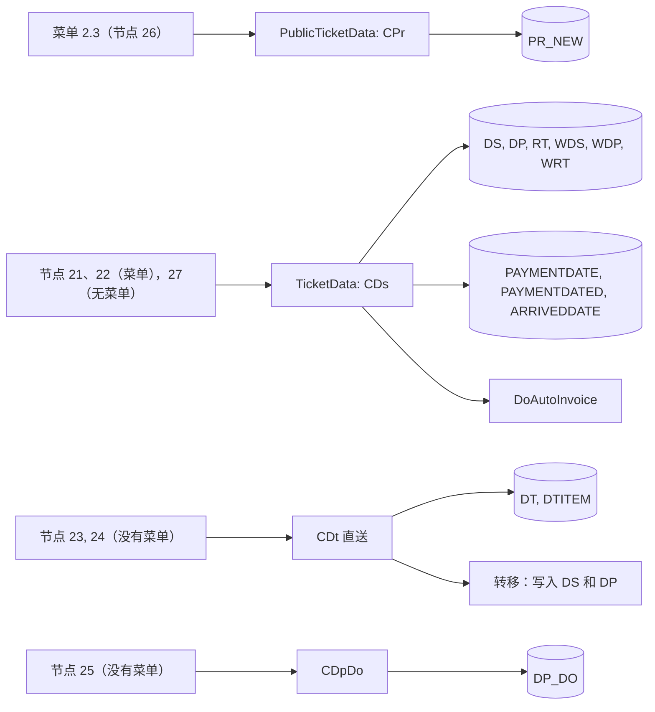
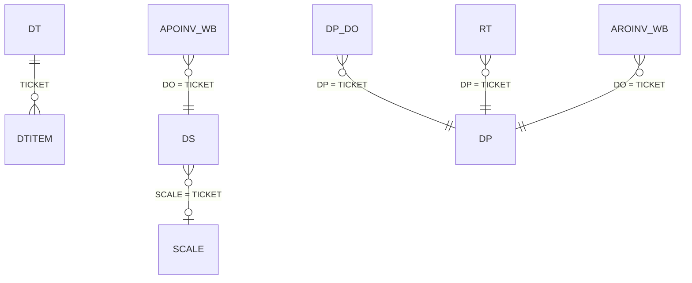
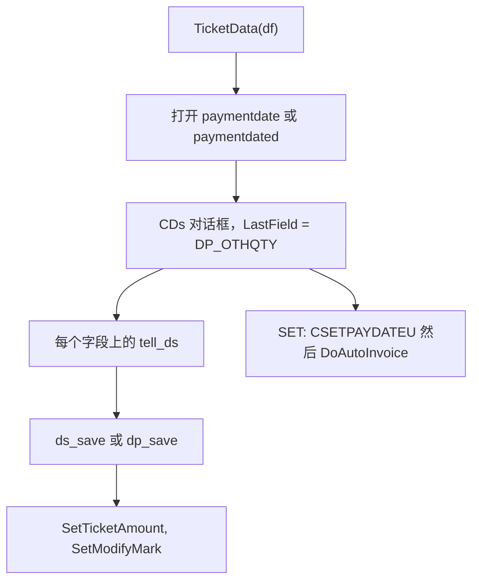
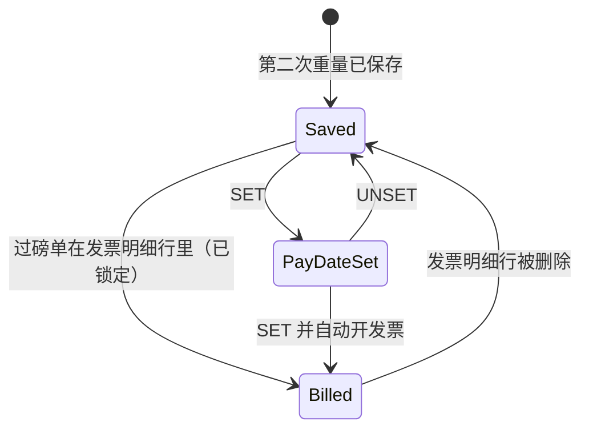

# 过磅单（菜单 2）- 模块参考

> 英文版为准。同步自英文版 commit c76cd62（2026-10-30）。

> 本文是 TradeWin 模块参考的一部分。索引和共用章节见：[README](README.md)。
> 涵盖的菜单项：2.1 RECEIVING NOTE、2.2 DESPATCH 和 2.3 Public Weighing；以及完全没有菜单项的过磅单节点：23 直接送货过磅单、24 直接送货价格更新、25 发货送货单（D/O）、27 退货单。磅秤过磅单（SCALE、SCALEDW）从过磅菜单打开，见[磅秤过磅](scale-weighing.md)。
> 最后核对的 commit 为 `2f77122`。翻译状态：英文版见 [../tickets.md](../tickets.md)；本中文版同步于 2026-10-30（commit c76cd62）。

## 目录

- [第一部分 - 业务视图](#第一部分---业务视图)
  - [1.1 简单说明](#11-简单说明)
  - [1.2 谁用什么](#12-谁用什么)
  - [1.3 一天的工作](#13-一天的工作)
  - [1.4 实例演示](#14-实例演示)
  - [1.5 界面导览](#15-界面导览)
  - [1.6 这个数字从哪里来？](#16-这个数字从哪里来)
  - [1.7 状态含义](#17-状态含义)
  - [1.8 如果发生以下情况](#18-如果发生以下情况)
  - [1.9 你可能看到的消息](#19-你可能看到的消息)
  - [1.10 该做和不该做](#110-该做和不该做)
  - [1.11 开始之前](#111-开始之前)
  - [1.12 词汇表](#112-词汇表)
  - [1.13 问AI](#113-问ai)
- [第二部分 - 技术视图](#第二部分---技术视图)
  - [2.1 概览](#21-概览)
  - [2.2 架构和依赖](#22-架构和依赖)
  - [2.3 主数据目录](#23-主数据目录)
  - [2.4 子表层级](#24-子表层级)
  - [2.5 模块和处理流程](#25-模块和处理流程)
  - [2.6 端到端流程](#26-端到端流程)
  - [2.7 报表目录](#27-报表目录)
  - [2.8 集成](#28-集成)
  - [2.9 配置](#29-配置)
  - [2.10 维护](#210-维护)

---

# 第一部分 - 业务视图

## 1.1 简单说明

- **过磅单**是称重的单据。过磅单菜单有三个项目：**2.1 Receiving Note**（买进的货）、**2.2 Despatch**（卖出的货）和 **2.3 Public Weighing**（散客服务，客户只付磅秤使用费）。它们打开已完成的过磅单，可以查看、更正、打印、开发票或设置付款日期。公共过磅不在发票上开票。
- 收货和发货过磅单有一个表头（货车、对方、订单、司机等）、**八行产品明细行**（产品、占净重的百分比、数量、单价和金额）和**八行对方自己数字的明细行**（对方分级）。它们在采购发票和销售发票上开票。
- 在磅秤上逐个产品买卖货物的过磅单（**磅秤过磅单**）从过磅菜单打开，见[磅秤过磅](scale-weighing.md)。
- 程序里还有四个过磅单屏幕**没有菜单项**：**直接送货过磅单**（货物直接从供应商的货车送到买方）、直接送货的**价格更新**、**送货单（delivery order）**表单和**退货单**。因为程序里有它们，所以在下面说明；除非修改菜单，站点无法从菜单打开它们。
- 如果过磅单错了，库存、报表和发票都会错。

## 1.2 谁用什么

| 部门 | 菜单项 | 主要工作 |
|---|---|---|
| 地磅主管 | 2.1 Receiving Note、2.2 Despatch、2.3 Public Weighing | 查看过磅单、更正输入的字段、输入产品明细行和价格、重新采集重量（公共过磅）、打印 |
| 地磅操作员 | 2.1、2.2、2.3 | 重新打印过磅单 |
| 会计 | 2.1、2.2（SET 按钮）、[发票](invoice-cashier.md) | 给过磅单设置付款日期并生成它的发票；过磅单的开票在发票屏幕上进行 |
| IT / 管理员 | Other > Company Profile | 影响重量窗口的设置 |

**从这里开始 - 主管**
- 每天几次：Ticket > Receiving Note、Despatch 和 Public Weighing，复核当天的过磅单。
- 会计开发票之前，检查每张收货和发货过磅单都有产品明细行、单价和金额。

## 1.3 一天的工作

**重新打印过磅单。**操作员打开 2.1、2.2 或 2.3，用 Search 或箭头按钮找到过磅单，按 Print。“Print Counter”框记录打印次数。

**完成一张过磅单。**第二次称重之后，主管从 2.1 或 2.2 打开过磅单，按 Edit，填写或更正产品明细行（每个产品的百分比、单价）和对方的明细行，然后按 Save。程序检查各行数量加起来是否等于净重。

**设置付款日期并开发票。**会计在过磅单上按 **SET**，选择付款日期，对“Auto create Invoice?”回答 Yes。程序为这张过磅单生成采购发票或销售发票（见[发票](invoice-cashier.md)）。

**更正错误。**主管打开过磅单，按 Edit，修改字段，按 Save。已开发票的过磅单不能编辑。

泳道图：


*说明：操作员通过称重产生过磅单；主管在过磅单菜单里复核并完成；会计给它开发票。*

## 1.4 实例演示

接着[过磅](weighing.md#14-实例演示)里的收货称重：货车 `WXX1234`，供应商 `S0001`，第一次重量 18,500 kg，第二次重量 8,500 kg，损耗 100 kg，净重 9,900 kg 的过磅单。

| 步骤 | 屏幕 | 用户做什么 | 程序做什么 | 之后的状态 |
|---|---|---|---|---|
| 1 | 2.1 Receiving Note | 打开过磅单，按 Edit | 显示两次重量、两次时间、两个用户和 NETT WEIGHT 9,900 | 已打开可编辑 |
| 2 | 同上 | 产品行 1：`P001`，百分比 100，单价 2.00 | 数量 = 100 x 9,900 / 100 = 9,900；金额 = 9,900 x 2.00 = 19,800.00；TOTAL 19,800.00 | 明细行已填 |
| 3 | 同上 | 按 Save | 检查数量加起来等于 9,900，保存 | 已保存 |
| 4 | 同上 | 按 Print | 打印过磅单表单，Print Counter 加 1 | 已打印 1 次 |
| 5 | 同上 | （会计）按 SET，选择付款日期，对“Auto create Invoice?”回答 Yes | 写入付款日期，并生成一张采购发票，其中有这张过磅单的一行 | 已开发票 |

**结果：**一张收货过磅单，净重 9,900 kg，金额 19,800.00，在一张采购发票上。第 5 步之后，过磅单被锁定：修改会被拒绝。

## 1.5 界面导览

### 2.3 Public Weighing（过磅单窗口）

**用途：**查看、更正和打印已完成的公共过磅单。

| 字段标签 | 含义 | 必填？ | 值的来源 |
|---|---|---|---|
| RN NO. | 过磅单号 | - | 自动 |
| Date | 过磅日期 | 否 | 第二次过磅的日期；本意是只有 9 级或以上的用户才能修改（见 2.10，发现 1：这个限制没有生效） |
| Vehicle No. | 货车 | 是 | 来自过磅 |
| Driver Name | 司机 | 否 | 输入，或来自货车清单 |
| Customer | 客户账户 | 否 | 输入或选择 |
| Product | 自由文字 | 否 | 输入 |
| Remarks | 自由文字 | 否 | 输入 |
| Print Counter | 打印了多少次 | - | 自动 |
| Weight Modify | 保存后重量被修改时设置的标记 | - | 自动 |
| FIRST / SECOND: time, weight, user | 两次过磅 | 否 | 自动 |
| NETT WEIGHT (KG) | 货物的净重 | - | 计算，见 1.6 |
| CHARGES AMOUNT | 使用磅秤的收费 | 否 | 输入 |

**按钮：**Add、Edit、Save、Delete、Search、Previous、Next、Print（标准的记录按钮）；**Capture 1st Weight** 和 **Capture 2nd Weight**（只在记录处于查看状态时显示）：把磅秤的实时读数连同当前时间和用户，复制到第一次或第二次重量里。没有 Cancel Ticket 按钮。

### 2.1 Receiving Note 和 2.2 Despatch（过磅单窗口）

两个屏幕几乎相同；发货时对方叫“Customer”，过磅单号叫“DN NO”，收货的第一次重量表单上则是“Supplier”和“RN NO”。下面是表单上**可见**的字段（对话框里还有已关闭的框，见下文）。

| 字段标签 | 含义 | 必填？ | 值的来源 |
|---|---|---|---|
| Ticket No, Date, Vehicle No | 编号、日期、货车 | 是（货车） | 自动 / 来自称重 |
| Supplier / Customer | 账户（名称显示在旁边） | 选择产品之前必填 | 从货车清单填入，或选择 |
| Pay Type | 现金或赊账 | 否 | 选择（本程序里**没有**默认为现金） |
| Transporter, I/C No, Driver | 运输公司、司机编号和姓名 | 否 | 从货车清单填入，或选择 |
| Party Gross, Tare, Wastage | 对方声称的重量 | 否 | 输入 |
| First (gross) and second (tare) weight, times, users | 自己的两次过磅 | - | 自动 |
| Wastage (less wastage) | 扣除的重量 | 否 | 输入 |
| 产品行 1 到 8：Product、%、Qty、U/Price 和金额 | 车上装的是什么 | 有第二次重量时至少第 1 行 | 选择产品；输入 %；数量计算得出；**单价输入**（本程序里没有任何东西填它）；金额计算得出 |
| Remarks | 自由文字 | 否 | 输入 |
| NETT, PARTY NETT, GROSS DIFF, TARE DIFF, VAR, TOTAL, total % and total quantity | 计算框 | - | 见 1.6 |
| Print Counter, Weight Modify, Manual | 打印次数；重量被编辑过的标记；读数是输入而不是从磅秤读到的标记 | - | 自动 |
| PAY DATE | 付款日期 | 否 | SET 和 UNSET 按钮（只限最终过磅单） |

**按钮：** **THIRD PARTY GRADING**（打开对方的八行产品）、**SET**（付款日期，然后自动开发票）和 **UNSET**（最终过磅单 2.1 和 2.2）。明细行里的 `*` 标记表示价格与原价不同（不可靠，见 2.10）。

**表单上已关闭的**（存在但隐藏）：采购或销售订单、单位、序号、分包商、D/O 号、废料单、合约、分级员、退货单号和日期、基准、其他数量、磅秤过磅单、业务员、车辆类型、D/O Entry 按钮、到货日期的 SET 和 UNSET 按钮，以及刷卡按钮。程序仍在记录里带着这些字段；在这个屏幕上不能输入。

### 直送过磅单（节点 23，没有菜单项）

表头：Ticket No、Date、Vehicle No、Purchase Order No 和 Supplier、Sales Order No 和 Buyer、Driver IC No 和姓名、Remarks、SRN No，采购一侧和销售一侧的重量（第一次、第二次、扣除损耗）及其时间，以及计算出来的净重和差异。明细行：Code 和 Particular 加 Qty (Purchase)、Price、Amount，以及 Code 和 Particular 加 Qty (Sales)、Price、Amount。按钮：**Transfer ticket to Main system**、**Update Price**。

### 直送价格更新（节点 24，没有菜单项）

REF NO、DATE FROM、TO、UPDATE PRICE（勾选 = 采购价，不勾选 = 销售价）、ACCODE、PRODUCT、PRICE、Update (Y/N)。

### 发货 D/O（节点 25，没有菜单项）

DO No、Date、Despatch ticket、PO number、L/C number、Delivery To（带地址）、货车状况（Raining、Water、Tyre Dirty、Gas Cylinder、Absorber or Explosive Matter 带气瓶数量、Others）和备注。

### 退货单（节点 18、19 和 27，没有菜单项）

版面与发货过磅单相同，另有一个必填的“Despatch Ticket”链接：第一次过磅屏幕会提供同一辆货车最近 10 天内的发货过磅单。

## 1.6 这个数字从哪里来？

- **公众过磅的过磅单净重** = |第二次重量 - 第一次重量|。例子 14,200 和 6,700 得出 **7,500 kg**。
- **收货或发货过磅单的本方净重** = |皮重 - 毛重| - 损耗。**对方净重** = |对方皮重 - 对方毛重| - 对方损耗。**VAR** = 本方净重 - 对方净重。**GROSS DIFF** = 本方毛重 - 对方毛重；**TARE DIFF** = 本方皮重 - 对方皮重。例子：毛重 18,500，皮重 8,500，损耗 100，得出 **9,900 kg**。
- **明细行数量** = % x 本方净重 / 100（对方的明细行在对方净重大于零时用对方净重，否则用本方净重）。例子：9,900 的 100% 得出 9,900 kg。
- **明细行金额** = 数量 x 单价，程序**不取整**（这一列保留两位小数）。例子：6,060 kg x 0.355 = **2,151.30**。Lekok 风格的去尾取整在这里不适用。
- **合计** = 各行金额之和。当表里有 SUBTOTAL 列时，程序也把这个合计存进去（见 2.10，发现 10）。
- **单价**在明细行上输入；程序不去查找（按等级价格、客户价目表和订单价格查找的代码，在过磅单屏幕里都已被注释掉）。
- **直送：**金额 = 每一侧的数量 x 价格；一侧各行的数量不能超过该侧的净重（第一次 - 第二次 - 损耗）。

## 1.7 状态含义

| 单据 | 状态 | 含义 | 谁或什么来修改 | 还能编辑什么 |
|---|---|---|---|---|
| 公众过磅的过磅单 | 已保存 | 最终的过磅单 | 过磅 | 用户级别允许的字段 |
| 收货 / 发货过磅单 | Saved | 最终过磅单 | 第二次重量 | 按级别的字段：5 级以下没有重量和时间，9 级以下没有日期（关于级别清单见 2.10，发现 11） |
| 收货 / 发货过磅单 | Pay date set | 已有付款日期 | SET 按钮 | 相同 |
| 收货 / 发货过磅单 | Billed | 在发票明细行上 | 发票或 SET | 已锁定：拒绝编辑，拒绝删除 |
| 直送过磅单 | 已转移 | 收货和发货过磅单都已存在 | Transfer 按钮 | 已锁定：“Already Transfer to Main System! can not be modified” |
| 价格更新 | 已更新 | Update = `Y` | 过账 | 已锁定：“Price Updated.Modification Not Allow” |

本程序里过磅单没有“已取消”状态。

## 1.8 如果发生以下情况

| 情况 | 怎么办 | 什么时候找 IT |
|---|---|---|
| 公众过磅的过磅单上客户或产品错了 | Edit 然后 Save | - |
| 公众过磅的过磅单上重量错了 | Edit；磅秤上有货车时按 Capture 1st Weight 或 Capture 2nd Weight（或手工输入）；Save | 磅秤读数是错的 |
| 过磅单是误做的 | 在未开发票时删除它；没有 Cancel Ticket | - |
| 过磅单打印错了 | 再打印一次 | 表单缺失 |
| 各行数量加起来不对 | 程序拒绝保存：更正百分比 | - |
| 开发票之后再编辑（收货、发货、磅秤过磅单） | 不允许；会计必须把过磅单从发票上拿掉 | - |
| 删除已在发票上的过磅单 | 拒绝 | - |
| 收货或发货过磅单没有单价 | 保存之前在每一行输入价格；会计需要金额 | - |
| 公众过磅的过磅单在第二次重量之后不问是否打印 | 正常：从过磅单屏幕打印 | - |

## 1.9 你可能看到的消息

| 消息 | 含义 | 怎么办 |
|---|---|---|
| `Ticket is issued to Invoice:<no>` + `Not allow modify.` | 过磅单在发票上 | 问会计 |
| `Cannot delete Ticket No: <no> because this ticket already Invoiced.` | 拒绝删除 | - |
| `Total Qty is not tally with Nett weight.` | 各行数量加起来不等于自己的净重 | 修正各行 |
| `Please key in vehicle no` / `zero weight` / `Please key in product` | 缺少必要数据 | 填写 |
| `Duplicate Product Code` | 同一个产品出现在两行里 | 合并这些行 |
| `Percentage over 100` | 各行百分比加起来超过 100 | 程序会修正这一行 |
| `Supplier Code is empty, please key in supplier code` / `Customer Code is empty, please key in customer code` | 先选了产品，没选账户 | 先选账户 |
| `Supplier Code <code> not regiestered yet` / `Customer Code <code> not regiestered yet`（拼写照屏幕所示） | 未知账户 | 先登记它 |
| `Pay Type Change to Cash.` + `Do you want to refresh Amount` | 带金额的过磅单上，付款方式改成了现金 | Yes 就重新计算 |
| `View Only` + `Any Changes to Ticket Information need to edit the ticket First` | 在只读的过磅单上打开了 Party Grading | 先 Edit |
| `Despatch Ticket cannot empty` / `Despatch Ticket No. Not Existed` | 退货单没有有效的发货过磅单 | 填写 |
| `D/O No <no> existed in system. Please revise.` | D/O 号已被使用 | 用另一个 |
| `DESPATCH TICKET : <no> already existed at DO NO : <no>` | 这张过磅单已经有送货单 | - |
| `Despatch Ticket Not Existed` | D/O 指向一张不存在的过磅单 | 检查号码 |
| `PURCHASE OVERLOAD` / `SALES OVERLOAD` / `PURCHASE QTY OVERLOADED` / `SALES QTY OVERLOADED` | 直送的数量超过该侧的净重 | 减少数量 |
| `Please key in vehicle no.` | 直送转移时没有货车 | 填写 |
| `Ticket <no> already Existed at Receive Data Entry` / `at Despatch Data Entry` | 转移时发现已有较早的副本 | - |
| `Transfer Completed` | 转移完成 | - |
| `Update Completed` | 价格更新已过账 | - |
| `Unit Price <= 0` / `Please key in product` / `Please key in ACCODE` | 价格更新的输入不完整 | 填写 |
| `Auto create Invoice?` | 在收货或发货过磅单上按 SET 之后 | Yes 就生成发票（见[发票](invoice-cashier.md)） |
| `RECORD COMPLETE` | 付款日期已保存 | - |
| `UNSET COMPLETED` / `RECORD DOES NOT EXIST` | UNSET 的结果 | - |

## 1.10 该做和不该做

- 要重新打印，请在过磅单屏幕上做，不要重新过磅。
- 打印之前要检查公众过磅的过磅单的产品文字；它是自由文字。
- 除非你确定，否则不要删除过磅单：删除的过磅单不能从屏幕上找回来。
- 不要把明细行的单价留空：程序里没有任何东西填它，所以金额一直是 0。
- 除非货车在磅秤上，否则不要在旧的过磅单上按 Capture 1st Weight 或 Capture 2nd Weight：它会用实时读数覆盖重量。

## 1.11 开始之前

- 称重已经存在（公共过磅单由菜单 1.5 产生，收货和发货过磅单由 1.1 和 1.2 产生）。
- 账户（供应商和客户）、产品和付款方式已存在，并且你知道每个产品明细行的单价。

## 1.12 词汇表

| 术语 | 英文 | 马来文 | 中文 |
|---|---|---|---|
| Ticket | Weighing document | Tiket | 磅单 |
| Public weighing | Weighing service for outsiders | Timbang awam | 公众过磅 |
| Print counter | How many times a ticket was printed | Kiraan cetak | 打印次数 |
| Party grading | The other party's own product figures | Penggredan pihak | 对方等级 |
| D/O | Delivery order | Pesanan penghantaran | 送货单 |
| Direct delivery | Straight from supplier to buyer | Penghantaran terus | 直送 |
| Return note | Goods returned against a despatch ticket | Nota pulangan | 退货单 |
| Variance | Own net minus party net | Varians | 差异 |

## 1.13 问AI

1. 怎样重新打印公众过磅的过磅单？
2. 怎样更正公共过磅单的重量？
3. 收货过磅单的净重是怎样算出来的？
4. Capture 1st Weight 和 Capture 2nd Weight 按钮有什么作用？
5. 为什么我不能编辑已在发票上的过磅单？
6. 收货过磅单明细行的价格从哪里来？
7. “Total Qty is not tally with Nett weight”是什么意思？
8. 收货过磅单上的明细行金额是怎样算出来的？
9. 什么是直送过磅单？
10. 过磅单上的 SET 按钮有什么作用？

---

# 第二部分 - 技术视图

## 2.1 概览

- 应用程序：TradeWin Metals 地磅系统（wlib32 上的 VC6/MFC，`menu.dsp`、`menu.exe`）。见 [README](README.md)。
- 本模块：`CPr`（Pr.cpp，公众过磅的过磅单，基类 `CStaff`）、两次过磅的过磅单用的 `CDs`（DS.CPP）和 `CDp`（DP.CPP）、直送用的 `CDt`（DT.CPP，`CParent`）、`CSetPrice`（SetPrice.cpp）、`CDpDo`（DpDo.cpp）、`CTransferDirectTicketToMainSystem`（TransferDirectTicketToMainSystem.cpp）、`CPartyGrading`（PartyGrading.cpp，`CFEdit`）和 `CSETPAYDATEU`（SETPAYDATEU.cpp）。
- `CDs` 用于每一张过磅单表：`TicketData(df)`（MAIN.CPP:47-72）总是创建 `CDs`；`CDp` 已编译，但从未被实例化（它的处理程序是无效代码）。
- 菜单到达 `TicketData(&ds)`（节点 21）、`TicketData(&dp)`（节点 22）和 `PublicTicketData(&pr_new)`（MAIN.CPP:33-45，节点 26）。

## 2.2 架构和依赖



*说明：过磅单菜单的三个项目分别到达公共过磅屏幕和两次称重的过磅单屏幕；直接送货、价格更新和送货单在代码里存在，但没有菜单项。*

- 库：wlib32（`CStaff`、`CParent`、`CFEdit`、过磅单编号、打印代码）、winlib、wtlib32。
- 数据库：SQL Server；TradeWin 没有结构仓库（下面的类型来自姊妹应用 `SQL_LekokPaper`，TradeWin 未核实）。
- 报表：以表命名的 Crystal 版面（`PR_NEW.rpt`、`ds.rpt`、`dp.rpt`、`dt.rpt`、`dp_do.rpt`）和针式打印机表单；没有 `.rdl`。

## 2.3 主数据目录

### PAYMENTDATE, PAYMENTDATED, ARRIVEDDATE

本章的类型来自 `SQL_LekokPaper` 脚本（姊妹应用），除非特别说明，TradeWin 未核实。`PAYMENTDATE`（收货一侧）和 `PAYMENTDATED`（发货一侧），脚本 `PAYMENTDATE.sql`、`PAYMENTDATED.sql`：`TICKET` nvarchar(10) 主键，`PAYDATE` smalldatetime。`ARRIVEDDATE`（脚本 `ARRIVEDDATE.sql`，以 `tado(&arriveddate,"ARRIVEDDATE")` 打开，MENU.CPP:508）以同样的形式保存每张过磅单的到货日期。`TicketData` 为表 `wds` 和 `ds` 打开 `paymentdate`，为其他表打开 `paymentdated`（MAIN.CPP:53-57）。

### DP_DO（发货送货单）

脚本 `DP_DO.sql`（姊妹应用）；枚举 `dp_do`（MENU.H:802）；对话框 `IDD_DP_DO`。以 `tado(&dp_do,"dp_do",init_dp_do)` 打开（MENU.CPP:447）。

| # | field (enum) | SQL column | data type | null | key | 含义 |
|---|---|---|---|---|---|---|
| 1 | `DPDO_DO` | `DP_DO` | nvarchar(12) | no | PK | 送货单号 |
| 2 | `DPDO_DATE` | `DATE` | smalldatetime | yes |  | 日期 |
| 3 | `DPDO_DP` | `DP` | nvarchar(10) | no | unique (`IX_DP_DO_1`) | 发货过磅单（每张过磅单一张送货单） |
| 4 | `DPDO_PO_NO` | `PO_NO` | nvarchar(20) | yes |  | PO 号 |
| 5 | `DPDO_LC_NO` | `LC_NO` | nvarchar(20) | yes |  | L/C 号 |
| 6 | `DPDO_DELIVERY` | `ACCODE` | nvarchar(10) | yes |  | 送货对象账户（地址显示在表单上） |
| 7 | `DPDO_REMARK` | `REMARK` | nvarchar(100) | yes |  | 备注 |
| 8 to 11 | `DPDO_RAINING`, `DPDO_WATER`, `DPDO_TYPEDIRTY`, `DPDO_GAS` | `RAINING`, `WATER`, `TYPERDIRTY`, `GAS` | bit | yes |  | 货车状况勾选框 |
| 12 | `DPDO_GASNO` | `GASNO` | int | yes |  | 气瓶数量 |
| 13 | `DPDO_OTHERS` | `OTHERS` | nvarchar(50) | yes |  | 其他状况 |
| 14 to 19 | | 审计列 | | yes |  | `REC_STATUS`, `NEWUSER`, `NEWTIME`, `MODIFYUSER`, `MODIFYTIME`, `Print Counter` |

规则：`dp_do_save` 要求发货过磅单已存在，并拒绝同一张过磅单再开第二张送货单（DpDo.cpp:109-124）；当气体勾选框是 `N` 或 `F`（即没有勾选）时，`tell_dp_do` 跳过气瓶数量字段（DpDo.cpp:87-91）；`CDpDo::ShowInformation` 显示过磅单的日期、时间、货车、账户、毛重、皮重和净重（DpDo.cpp:43-82；“Tare”和“Gross”框按顺序分别由第一次和第二次重量填入，59-60）。

### SETPRICE（直送价格更新日志）

脚本 `SETPRICE.sql`（姊妹应用）；枚举 `setprice`（MENU.H:342）；由 `DirectDeliveryPricingUpdate` 在本地打开（SetPrice.cpp:179-188）。

| # | field (enum) | SQL column | data type | null | key | 含义 |
|---|---|---|---|---|---|---|
| 1 | `ML_REFNO` | `REFNO` | nvarchar(10) | no | PK | 参考号 |
| 2, 3 | `ML_DATE1`, `ML_DATE2` | `DATE1`, `DATE2` | smalldatetime | yes |  | 过磅单的日期范围 |
| 4 | `ML_ACCODETYPE` | `TYPE` | bit | yes |  | 勾选 = 采购一侧，空白 = 销售一侧 |
| 5 | `ML_ACCODE` | `ACCODE` | nvarchar(10) | yes |  | 账户 |
| 6 | `ML_PT` | `PT` | nvarchar(8) | yes |  | 产品 |
| 7 | `ML_PRICE` | `PRICE` | float(53) | yes |  | 新价格 |
| 8 | `ML_UPDATE` | `UPDATE` | char(1) | yes |  | 过账之后为 `Y` |
| 9 to 14 | | 审计列 | | yes |  | `REC_STATUS`, `NEWUSER`, `NEWTIME`, `MODIFYUSER`, `MODIFYTIME`, `Print Counter` |

## 2.4 子表层级

```text
DS / DP / RT / WDS / WDP / WRT   (flat: 8 own lines + 8 party lines as columns)
PR_NEW / WPR_NEW                 (flat)
DT   (direct delivery header, key TICKET)
  - DTITEM   link: DTITEM.TICKET = DT.TICKET   (key PKKEY identity, line number SQNO)
    Nested sub-tables: none
```



*说明：只有直送过磅单有子行；其他表是扁平的，彼此通过过磅单号链接。*

### DS 和 DP（两次称重的过磅单）

姊妹应用的脚本 `DS.sql`、`DP.sql`、`WDS.sql`、`WDP.sql`、`RT.sql`、`WRT.sql`（TradeWin 未核实）；枚举 `dp`（MENU.H:284）有 144 个名称，用于全部六张表。对 `DS`、`DP`、`WDP`，第 1 到 144 位与脚本一致（字段 5 在 DS 里是 `PO`，在 DP 里是 `SO`，字段 14 是 `ICNO`）；`WDS` 在 `REC_STATUS` 之前多了三列（`SUBTOTAL`、`API_SCANNED_QR`、`API_DISPENSED`）；`RT` 和 `WRT` 有 128 列：没有 `ORI_WT` 列，字段 65（`DP_SCALE`）是列 `DP`，即这张退货所属的发货过磅单。

| # | field (enum) | SQL column (DS) | data type | 含义 |
|---|---|---|---|---|
| 1 | `DP_TICKET` | `TICKET` | nvarchar(10) PK | 过磅单号 |
| 2 | `DP_SERIAL` | `SERIAL` | nvarchar(10) | 流水号 |
| 3 | `DP_DATE` | `DATE` | smalldatetime not null | 日期 |
| 4 | `DP_VEHICLE` | `VEHICLE` | nvarchar(10) not null | 货车 |
| 5 | `DP_PO` | `PO` (DP: `SO`) | nvarchar(10) | 采购（销售）订单 |
| 6 | `DP_UNIT` | `UNIT` | nvarchar(6) | 单位 |
| 7 | `DP_ACCODE` | `ACCODE` | nvarchar(10) | 供应商 / 客户 |
| 8 | `DP_PTYPE` | `PTYPE` | nvarchar(5) | 付款方式（`01` 或 `CASH` = 现金） |
| 9 | `DP_SUBCON` | `SUBCON` | nvarchar(40) | 分包商 |
| 10 | `DP_TRANSP` | `TRANSP` | nvarchar(5) | 运输商 |
| 11 | `DP_DO` | `DO` | nvarchar(12) | 送货单号 |
| 12 | `DP_SCRAP` | `SCRAP` | nvarchar(20) | 废料分级单 |
| 13 | `DP_CONTRACT` | `CONTRACT` | nvarchar(20) | 合约 |
| 14 | `DP_IC` | `ICNO` | nvarchar(14) | 司机编号 |
| 15 | `DP_DRIVER` | `DRIVER` | nvarchar(35) | 司机姓名 |
| 16 to 47 | `DP_PT1`, `DP_PCENT1`, `DP_QTY1`, `DP_WT1` ... `DP_PT8` to `DP_WT8` | `PT1..8` nvarchar(8), `PCENT1..8` decimal(18), `QTY1..8` decimal(18), `WT1..8` decimal(18,3) | | 自己的明细行：产品、百分比、数量、单价 |
| 48 | `DP_REMARKS` | `REMARKS` | nvarchar(60) | 备注 |
| 49 | `DP_MODIFY` | `MODIFY` | nvarchar(3) | 重量被修改的标记 |
| 50, 51 | `DP_TIMEIN`, `DP_TIMEOUT` | `TIMEIN`, `TIMEOUT` | nvarchar(8) not null | 时间 |
| 52 to 54 | `DP_CGROSS`, `DP_CTARE`, `DP_CWASTAGE` | `CGROSS`, `CTARE`, `CWASTAGE` | decimal(18) | 对方的毛重、皮重、损耗 |
| 55 to 57 | `DP_SGROSS`, `DP_STARE`, `DP_WASTAGE` | `SGROSS`, `STARE`, `WASTAGE` | decimal(18) | 自己的毛重、皮重、损耗 |
| 58, 59 | `DP_USER1`, `DP_USER2` | `USER1`, `USER2` | nvarchar(5) | 用户 |
| 60, 61 | `DP_SRNNO`, `DP_SRNDATE` | `SRNNO`, `SRNDATE` | nvarchar(20), smalldatetime | 退货单 |
| 62 | `DP_BASIS` | `BASIS` | char(1) | 基准（没有使用） |
| 63 | `DP_NOTSHOW` | `NOTSHOW` | bit | 隐藏标志 |
| 64 | `DP_GRADE` | `GRADE` | nvarchar(5) | 验货员代码 |
| 65 | `DP_SCALE` | `SCALE` (RT, WRT: `DP`) | nvarchar(10) | 链接的磅秤过磅单（退货单：发货过磅单） |
| 66, 67 | `DP_SALESMAN`, `DP_VTYPE` | `SALESMAN`, `VTYPE` | nvarchar(15) | 业务员、车辆类型 |
| 68 | `DP_OTHQTY` | `OTHQTY` | int | 其他数量 |
| 69 to 72 | `DP_W1`, `DP_W2`, `DP_Z1`, `DP_Z2` | `W1`, `W2`, `Z1`, `Z2` | decimal(18) | 原始读数和扣重后的读数 |
| 73 to 104 | `DP_PT11` ... `DP_WT18` | `PT11..18`, `PCENT11..18`, `QTY11..18`, `WT11..18` | 相同类型 | 对方的明细行 |
| 105 to 120 | `DP_AMT1..8`, `DP_AMT11..18` | `AMT1..8`, `AMT11..18` | decimal(18,2) | 明细行金额 |
| 121, 122 | `DP_PUSER`, `DP_TNG` | `PUSER`, `TNG` | nvarchar(5), nvarchar(10) | 打印用户、标签卡 |
| 123 to 138 | `DP_ORI_WT1..8`, `DP_ORI_WT11..18` | `ORI_WT1..8`, `ORI_WT11..18` | decimal(18,3) | 原始价格（程序从不写入） |
| 139 to 144 | | `REC_STATUS` ... `Print Counter` | | 审计列 |

- 自己的明细行和对方的明细行都是列，所以没有子表。嵌套子表：无。

### DT 和 DTITEM（直送）

姊妹应用的脚本 `DT.sql`、`DTITEM.sql`；枚举 `dt`（MENU.H:328）和 `dtitem`（MENU.H:330）；对话框 `IDD_DT`、`IDD_DTITEM`。以 `tado(&dt,"dt",init_dt)`、`tado(&dtitem,"dtitem",init_dtitem)` 打开（MENU.CPP:484-485）。

**DT**

| # | field (enum) | SQL column | data type | 含义 |
|---|---|---|---|---|
| 1 | `Dt_TICKET` | `TICKET` | nvarchar(10) PK | 过磅单号 |
| 2 | `Dt_DATE` | `DATE` | smalldatetime | 日期 |
| 3 | `Dt_VEHICLE` | `VEHICLE` | nvarchar(10) | 货车 |
| 4 | `Dt_PO` | `PO` | nvarchar(10) | 采购订单 |
| 5 | `Dt_SUPPLIER` | `ACCODE` | nvarchar(10) | 供应商 |
| 6 | `Dt_SO` | `SO` | nvarchar(10) | 销售订单 |
| 7 | `Dt_BUYER` | `ACCODE2` | nvarchar(10) | 买家 |
| 8, 9 | `Dt_IC`, `Dt_DRIVER` | `IC`, `DRIVER` | nvarchar(14), nvarchar(40) | 司机 |
| 10 | `Dt_REMARKS` | `REMARKS` | nvarchar(50) | 备注 |
| 11 | `Dt_DO` | `DO` | nvarchar(10) | D/O 号 |
| 12, 13 | `Dt_TIMEIN`, `Dt_TIMEOUT` | `TIMEIN`, `TIMEOUT` | nvarchar(8) | 时间 |
| 14 to 16 | `Dt_PW1`, `Dt_PW2`, `Dt_PW3` | `PW1`, `PW2`, `PW3` | float(53) | 采购一侧的第一次重量、第二次重量、损耗 |
| 17 to 19 | `Dt_SW1`, `Dt_SW2`, `Dt_SW3` | `SW1`, `SW2`, `SW3` | float(53) | 销售一侧的第一次重量、第二次重量、损耗 |
| 20 to 25 | | 审计列 | | `REC_STATUS`, `NEWUSER`, `NEWTIME`, `MODIFYUSER`, `MODIFYTIME`, `Print Counter` |

表单上还显示一个“SRN No”框（对话框的第 11 个字段绑定到 `DO`；枚举里没有 SRN 字段）。

**DTITEM**

| # | field (enum) | SQL column | data type | 含义 |
|---|---|---|---|---|
| 1 | `Dti_REFNO` | `TICKET` | nvarchar(10) | 上级过磅单（链接键） |
| 2 | `Dti_SQNO` | `SQNO` | float(53) | 行号 |
| 3 | `Dti_ITEM` | `PT` | nvarchar(8) | 采购产品 |
| 4 | `Dti_QTY1` | `QTY1` | float(53) | 采购数量 |
| 5 | `Dti_PRICE1` | `PRICE1` | decimal(18,5) | 采购价 |
| 6 | `Dti_AMOUNT1` | `AMOUNT1` | decimal(24,3) | 采购金额 |
| 7 | `Dti_ITEM2` | `PT2` | nvarchar(8) | 销售产品 |
| 8 | `Dti_QTY2` | `QTY2` | float(53) | 销售数量 |
| 9 | `Dti_PRICE2` | `PRICE2` | decimal(18,5) | 销售价 |
| 10 | `Dti_AMOUNT2` | `AMOUNT2` | decimal(24,3) | 销售金额 |
| 11 | | `PKKEY` | int PK identity | 行键 |

- 基数 1..n。各行由 `CParent` 机制与表头一起保存。嵌套子表：无。

## 2.5 模块和处理流程

### 菜单项和入口

| 菜单项 | 节点 | 处理程序 | 打开 | 在菜单里？ |
|---|---|---|---|---|
| 2.1 RECEIVING NOTE | 21 | `Purchase_Flag = TRUE; TicketData(&ds)`（MAIN.CPP:224-227） | `ds` 上的 `CDs`，对话框 `IDD_DS` | 是 |
| 2.2 DESPATCH | 22 | `Purchase_Flag = FALSE; TicketData(&dp)`（MAIN.CPP:228-231） | `dp` 上的 `CDs`，对话框 `IDD_DP` | 是 |
| （没有菜单项） | 23 | `DirectDeliveryTicket()`（MAIN.CPP:232-234；DT.CPP:344） | `CDt` | 否 |
| （没有菜单项） | 24 | `DirectDeliveryPricingUpdate()`（MAIN.CPP:235-237；SetPrice.cpp:179） | `CSetPrice` | 否 |
| （没有菜单项） | 25 | `dpKey = 0` 的 `Despatch_DO(&dp_do)`（MAIN.CPP:238-242；MAIN.CPP:152） | `CDpDo` | 否 |
| 2.3 Public Weighing | 26 | `PublicTicketData(&pr_new)`（MAIN.CPP:243-245；MAIN.CPP:33-45） | `CPr`，对话框 `IDD_PR_NEW` | 是（标题“2.3”，ID `ID00026`） |
| （没有菜单项） | 27 | `TicketData(&rt)`（MAIN.CPP:246-249） | `rt` 上的 `CDs` | 否 |

标题“2.3”属于节点 **26**：这里菜单文字的编号和节点号不一致。

### 流程：公众过磅的过磅单（`CPr`）

1. `PublicTicketData`（MAIN.CPP:33-45）：`CPr p1(df->ID, df, df->f[1].idx & 0x01)`，`p1.LastField = PR_USER2`，`DoModal`。
2. `CPr::OnInitDialog` 立即返回；它后面的通信线程代码到达不了（Pr.cpp:50-65）。`OnDestroy` 调用 `CloseCommThread()`（Pr.cpp:109-114）。
3. `CPr::SetAttribute` 在记录不处于编辑模式时显示 **Capture 1st Weight** 和 **Capture 2nd Weight**，在编辑模式下隐藏它们（Pr.cpp:67-80）。
4. `OnFirst` / `OnSecond`（Pr.cpp:91-107）：`ltodb(GetCurrenctCommWeight(1), df, PR_SGROSS or PR_STARE)`（wlib32 通信层），时间 = 现在，用户 = 当前用户，`ShowInformation`。这时不应用预设扣重，也不设置标记。
5. `ShowInformation`（Pr.cpp:81-89）：`getprmet` 给出净重 |STARE - SGROSS|（Wpr.cpp:44-51），显示在 NETT 框里。本程序里没有取消按钮，也没有“Ticket Cancelled”文字。
6. 保存运行 `pr_save`（Wpr.cpp:196-207）：重量改变时重新盖上 `USER1` / `USER2`，对表 `pr_new` 则通过 `SetModifyMark` 设置 `MODIFY` 标记。
7. `pr_initial` 的只读清单没有被应用（见[过磅](weighing.md#210-维护)，发现 2）。

### 流程：两次称重的过磅单（`CDs`）



*说明：字段规则在每次修改时运行；保存挂钩验证并重新计算金额。*

- `getmet`（DS.CPP:116-163）：`m[2]` = SGROSS，`m[5]` = STARE，`m[1]` = CGROSS，`m[4]` = CTARE（每个比较的两个分支赋值方式相同），`m[7]` = CWASTAGE，`m[8]` = WASTAGE，`m[10]` = |m[4]-m[1]| - m[7]（对方净重），`m[11]` = |m[5]-m[2]| - m[8]（自己的净重），`m[3]` = m[2]-m[1]，`m[6]` = m[5]-m[4]，`m[12]` = m[11]-m[10]。
- `CDs::ShowInformation`（DS.CPP:239-347）：显示毛重差、皮重差、VAR、对方净重、净重；每一行本方金额 = QTY x WT，按原样存入 `DP_AMT1..8`（DS.CPP:285；使用 `Get_Adjustment` 的现金过磅单分支已被注释掉，DS.CPP:278-283）；百分比、数量和金额的合计；付款日期；`IsManual` 标记（任一原始读数 `W1` / `W2` 为空时显示 `*`，DS.CPP:331, 1277-1287；第一次重量表从不显示）。
- `SetTicketAmount`（DS.CPP:446-481）：对任何一侧有产品的每一行，金额 = QTY x WT（本方），对方的行也一样，用 `dtodb` 存入 `DP_AMT1..8` 和 `DP_AMT11..18`；本方合计通过 `GetDbFieldNo` 写入名为 `SUBTOTAL` 的列（DS.CPP:476-479），表里没有这一列时它返回 0（见 2.10，发现 10）。
- `tell_ds`（DS.CPP:483-792）：货车改变时，从货车和司机清单填入 IC、账户、运输商和司机（DS.CPP:495-510）；PO 改变时复制订单的供应商（`UpdatePoInformation`，DS.CPP:517-523；DP.CPP:140）；毛重或皮重改变时，重新计算每一行的数量 = % x 本方净重 / 100 和金额（DS.CPP:533-548）；百分比改变时，检查合计是否超过 100，超过时显示 `Percentage over 100` 并更正这一行（DS.CPP:552-582）；数量改变时，按百分比重新计算（DS.CPP:584-607）；价格改变时，重新计算金额（DS.CPP:608-622）；产品改变（DS.CPP:623-675）需要账户（有消息），输入了订单号时把产品清单限制在订单的明细行里，**但不设置价格**（查找价格的代码行已被注释掉，DS.CPP:668-674）；对方的明细行（DS.CPP:676-755）把百分比限制在 100 以内，并在对方净重大于零时按对方净重计算数量；付款方式改成现金时，提示是否刷新金额（DS.CPP:768-787）。`ClearContent` 清空产品不存在的那些行的百分比、数量和价格（DS.CPP:374-388，在 DS.CPP:790 调用）。发货使用 `tell_dp`（DP.CPP:145-440），规则相同，措辞换成客户和销售订单（产品 case DP.CPP:274-326）。
- `ds_save`（DS.CPP:876-981）：依次为：(1) `QTY1..8` 之和必须等于本方净重，否则显示 `Total Qty is not tally with Nett weight.`（DS.CPP:881-885；本程序里，每张使用 `ds_save` 的表，即 `ds` 和 `wds`，都会运行这个检查）；(2) 货车必填（DS.CPP:887-891）；(3) 本方净重不能为 0（`zero weight`，DS.CPP:893-897）；(4) `STARE` 已填时，产品 1 必须存在（DS.CPP:927-933）；(5) 重复产品检查（循环 `j < 9` 把字段 48，即备注，当作第九个产品读取，见 2.10）；(6) `CheckVarianceWeightParty` 和 (7) `CheckVarianceNetWeight`（它们只构造一条消息；登录确认已被注释掉，所以从不阻止，DP.CPP:492-524、DS.CPP:1123-1146；DS.CPP:960-963）；(8) `FindProductCategorySerialNo` 在第一行就返回（DS.CPP:72）；(9) `SetTicketAmount`（DS.CPP:965）；(10) 清除刷卡变量并重新应用只读清单（DS.CPP:967-973）；(11) 对表 `ds`，重量改变时设置 `MODIFY` 标记（DS.CPP:975-979）。
- `dp_save`（DP.CPP:526-609）：检查相同，只是没有 `CheckVarianceNetWeight`；对 `wrt` 和 `rt`，发货过磅单必须填写并且存在（DP.CPP:584-597）；对表 `dp` 设置修改标记（DP.CPP:603-607）。
- 只读清单：`Ds_initial`（DS.CPP:794-827）和 `Dp_initial`（DP.CPP:442-463）从 0 开始按序号填写清单：999 级以下是 `MODIFY`，然后被 9 级以下的 `DATE` **覆盖**，再然后 5 级以下，序号 1 到 4 是 `STARE`、`SGROSS`、`TIMEIN`、`TIMEOUT`；所以 5 到 8 级的用户可以编辑 `MODIFY`，而 9 到 998 级的用户不能（见 2.10，发现 11）。百分比框可以编辑。`Wds_initial` 使第一次重量上的 `STARE` 和 `TIMEOUT` 只读（DS.CPP:829-848）。
- 起始值：`init_ds` 和 `init_dp` 都没有起始钩子，所以付款方式没有默认值（DS.CPP:1028-1039、DP.CPP:611-621）。
- 编辑锁定：当过磅单在发票明细行里时（`ds` 看 `apoinv_wb`，其他看 `aroinv_wb`），`CDs::IsCannotEdit`（DS.CPP:198-221）拒绝编辑：`Ticket is issued to Invoice:<no>`。
- 删除：`Delete_ds`（DS.CPP:1013-1026）在已开发票时拒绝删除。
- 对方分级（`CDs::OnPartyGrading`，DS.CPP:1103-1121）：在字段 `DP_PT11` 到 `DP_WT18` 上打开 `CPartyGrading`，`isCheck = FALSE`；它的 `ShowInformation` 显示对方每一行的金额（数量 x 价格）和来自 `DP_ORI_WT11..` 的 `*` 价格标记（PartyGrading.cpp:52-94）。对话框上的按钮写的是“THIRD PARTY GRADING”。
- SET / UNSET（`OnSetpaydate` DS.CPP:1148-1178，`OnUnset` DS.CPP:1180-1201）：SET 按钮打开 `CSETPAYDATEU`（保存时显示 `RECORD COMPLETE`），然后调用 `DoAutoInvoice`（收货开采购发票，发货开销售发票，带提问 `Auto create Invoice?`）。在第一次重量表单上，`W2Saved` 询问“Set Payment Date”并调用同一个程序（WDS.CPP:127-148、WDP.CPP:245-251）。这里没有用户级别检查保护这两个按钮（99 级检查只存在于磅秤过磅单，SCALE.CPP:369）。
- D/O 按钮（`CDs::OnDo`，DS.CPP:1204-1243）和到货日期按钮（`OnSetarrdate` DS.CPP:1245-1255，`OnUnsetarr` DS.CPP:1257-1270）：代码存在，但这些按钮在对话框里已关闭（`NOT WS_VISIBLE`：`IDC_DO` 也被禁用，`IDC_SETARRDATE`、`IDC_UNSETARR`），所以用户按不了。`OnDo` 会查找发货过磅单的 D/O 记录（`dp_do`），拒绝已被另一张过磅单用过的 D/O 号，然后为这张过磅单打开 `CDpDo`。

### 流程：直送（`CDt`，没有菜单项）

- 除非该过磅单已经有 `ds` 和 `dp` 两行，`CDt::SetAttribute` 在编辑模式下显示 **Transfer ticket to Main system**（DT.CPP:77-94）；两者都存在时，`IsCannotEdit` 阻止编辑：`Already Transfer to Main System! can not be modified`（96-105）。
- `getdirect`（DT.CPP:107-138）是针对 `Dt_*` 字段的 `getmet`（采购净重在 `m[11]`，销售净重在 `m[10]`）；`tell_dt` 保存每一侧允许的数量：`check_qty1 = |PW1 - PW2| - PW3`，`check_qty2 = |SW1 - SW2| - SW3`（254-255）。
- 当各行数量之和超过该侧允许的数量时，`dt_save`（259-286）和 `dtitem_save`（288-319）拒绝（消息见 1.9）。明细行金额 = 每一侧的数量 x 价格（`tell_dtitem`，236-239）。
- `OnTransferToMain`（DT.CPP:356-388）要求有货车；然后 `CTransferDirectTicketToMainSystem::OnOK`（TransferDirectTicketToMainSystem.cpp:44-134）在不存在时创建一行 `ds`（采购一侧：产品 `PT`、数量、价格、金额、单位 `KG`、`SGROSS` = 总数量、账户 = 供应商、订单 = PO）和一行 `dp`（销售一侧：`PT2`，……，账户 = 买家，订单 = SO），过磅单号相同，各最多 8 行，然后显示 `Transfer Completed`。
- `OnUpdatePrice` 打开价格更新屏幕（DT.CPP:395-399）。

### 流程：价格更新（`CSetPrice`）

`setprice_save`（SetPrice.cpp:147-164）要求价格大于 0、产品存在、账户存在。Save 之后，程序询问“Posting Data”（`choice_menu`）；按 OK，`upp_pm`（SetPrice.cpp:45-123）对日期范围内还不在 `DS`（或 `DP`）里的过磅单运行 `UPDATE dtitem SET PRICE1 = <price>, AMOUNT1 = QTY1 * <price>`（勾选 = 采购一侧，按 `DT.ACCODE`、`DTITEM.PT` 筛选）或 `PRICE2` / `AMOUNT2`（销售一侧，`DT.ACCODE2`、`DTITEM.PT2`），显示受影响的行，设置 `UPDATE = 'Y'`，屏幕随即变成只读（`CSetPrice::IsCannotEdit`，125-132）。

### 读写的表

| 表 | 读 | 写 | 键 |
|---|---|---|---|
| PR_NEW | `CPr` | `CPr` | `TICKET` nvarchar(10) |
| DS, DP, RT, WDS, WDP, WRT | `CDs` | `CDs`；直送转移写入 DS 和 DP | `TICKET` |
| PAYMENTDATE(D), ARRIVEDDATE | 付款和到达日期 | SET、UNSET | `TICKET` |
| DP_DO | `CDpDo`、`CDs::OnDo` | `CDpDo` | `DP_DO`，唯一的 `DP` |
| DT, DTITEM | `CDt` | `CDt`、`CSetPrice` | `TICKET`, `PKKEY` |
| SETPRICE | `CSetPrice` | `CSetPrice` | `REFNO` |
| APOINV_WB, AROINV_WB | 编辑和删除的锁定 | `DoAutoInvoice` | 见 [发票](invoice-cashier.md) |
| PO, POITEM, SO, SOITEM, PT, ACCODE（视图）, LORRY, `driver`（表 `ic`） | 查找 | - | |

### 流水号

每张过磅单的表都有自己在 TICKETNO 里的一行；保存时 `CountTicketNo` 递增（wlib32）。直送转移把直送过磅单号复制给收货和发货的行。

### 状态转换



*说明：开发票会锁定编辑和删除；本程序里过磅单没有取消状态。*

### 对其他模块的依赖

- [过磅](weighing.md)：创建过磅单；[磅秤过磅](scale-weighing.md)：磅秤过磅单。
- [发票](invoice-cashier.md)：开发票和锁定。
- [控制表](control-tables.md)：账户、产品和等级价格、货车、司机、付款方式。

## 2.6 端到端流程

见 [README](README.md#26-端到端流程)。

## 2.7 报表目录

- 过磅单表单：仓库根目录里的 `PR_NEW.rpt`、`ds.rpt`、`wds.rpt`、`dp.rpt`、`dt.rpt`、`dp_do.rpt`、`dp_dolorry.rpt`、`pr_list.rpt`。`CDs` 和 `CDp` 不分配打印程序（`init_ds` 里的赋值已被注释掉，DS.CPP:1030-1031；`init_dp`，DP.CPP:613），所以打印按钮使用 wlib32 对这张表的默认打印。第一次重量表 `wds` 和 `wdp` 设为 `unprint`（DS.CPP:1047、DP.CPP:628）。
- 过磅单相关的报表列在 [报表](reports.md) 里。

## 2.8 集成

无。（`WDS` 和 `WDP` 的列 `API_SCANNED_QR` 和 `API_DISPENSED` 由外部系统写入；本仓库里没有代码使用它们。）

## 2.9 配置

- `STKPF.VARIANCE`（百分比）会被读取，但由于登录确认被关闭，它只生成一条消息。
- `isCheck`（DS.CPP:31）在 Party Grading 打开时被关闭。
- 用户级别的字面值：5（重量和时间）、9（日期）、99（SET 和 UNSET 按钮，只限磅秤过磅单）、999（`MODIFY`）。

## 2.10 维护

- 修改过磅单、过磅单的表或直送和 D/O 屏幕时，要更新本文件。
- 修改记录：

| 日期 | Commit | 作者 | 修改内容 |
|---|---|---|---|
| 2026-10-19 | `2f77122` | Claude（草稿待审阅） | Application_TradeWin 的第一版，以 Application_LekokPaper 的参考为起点，并对照本仓库的代码核实（过磅单菜单 2.1 到 2.3 有效，没有取消，没有取整，单价靠输入） |
- 最后核对的 commit 为 `2f77122`。翻译状态：zh-CN 已完成，同步于 2026-10-30。

### 代码发现（给开发人员）

1. **公共过磅单上的级别检查什么也不做**（见[过磅](weighing.md#210-维护)，发现 2）：日期、修改和时间框每个用户都能编辑。
2. **采集按钮会不留痕迹地覆盖重量**：`CPr::OnFirst` / `OnSecond`（Pr.cpp:91-107）把实时读数（通道 1）直接写进记录；只有之后的保存才设置修改标记。
3. **从不要求批准。**重量差异的登录确认（`UserPasswordLoginAccepted(df,5,...)`）在注释里（DS.CPP:1138、DP.CPP:516）；`CheckVarianceNetWeight` 和 `CheckVarianceWeightParty` 总是返回 1。
4. **重复产品的循环多跑了一个序号**（`for (j = i + 1; j < 9; j++)`，DS.CPP:944、DP.CPP:569）：`j = 8` 时 `z` = 字段 48（`DP_REMARKS`），所以产品代码与备注文字相同时，会出现 `Duplicate Product Code`。
5. **`getmet` 的分支完全相同**（DS.CPP:130-151）：代码似乎想要的“大的在前”排序从来不会发生；毛重减皮重为负数时，只靠净重里的 `labs` 处理。
6. **`CDp` 是死代码**（从未实例化）；它的处理程序与 `CDs` 重复。
7. **`CDpDo::ShowInformation` 把重量对调了**：皮重框 = `DP_SGROSS`，毛重框 = `DP_STARE`（DpDo.cpp:59-60）。
8. **过磅单明细行上从不填入价格。**按等级、价目表和订单价格的查找在 `tell_ds` 和 `tell_dp` 里都已被注释掉（DS.CPP:668-674、DP.CPP:319-325），`ChangePrice` 也被注释掉了（DS.CPP:422），所以没有输入价格就保存的明细行，金额是 0.00，`ORI_WT` 列（`*` 价格标记）也从不被写入。
9. **隐藏的控件仍然带着数据**：采购或销售订单、D/O 号、废料单、合约、业务员和车辆类型在 `IDD_DS`、`IDD_DP`、`IDD_WDS` 和 `IDD_WDP` 里已关闭，D/O Entry、到货日期和刷卡按钮被隐藏，所以 `CDs::OnDo`、`OnSetarrdate` 和 `OnUnsetarr` 用不了（DS.CPP:1204-1270），发货的 D/O 号由 `CWeighing::OnAddedit` 建议到操作员看不到的框里（WEIGHING.CPP:153-163），在这个屏幕上也不能输入订单。
10. **`SetTicketAmount` 按名称写入 `SUBTOTAL`**（DS.CPP:476-479）。表里没有这一列时 `GetDbFieldNo` 返回 0（姊妹脚本里只有 `WDS` 有这一列），这会把合计存进记录的 0 号缓冲区；请检查线上的 `DS` 和 `DP` 表。
11. **只读的级别清单互相覆盖**：`Ds_initial` 和 `Dp_initial` 三次给序号 0 赋值（DS.CPP:796-806、DP.CPP:444-453），所以 9 级以下日期被锁定，但 `MODIFY` 没有；第一次重量表单的清单 `Wds_initial` 是正确的（DS.CPP:829-848）。
12. **总数量检查现在对收货的第一次和第二次重量也会运行**，因为 `ds_save` 不再把它限制在表 `DS`（DS.CPP:881；姊妹应用按区分大小写的方式把表名与 `DS` 比较，所以在那里它从不运行）。
13. **本方行的百分比限制现在有效**（DS.CPP:563-570）：`Percentage over 100` 会更正这一行；在姊妹应用里这段代码到达不了。
