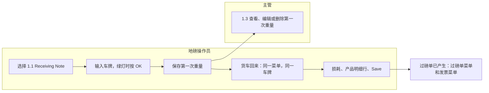
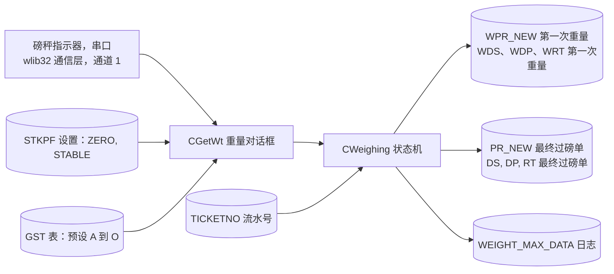
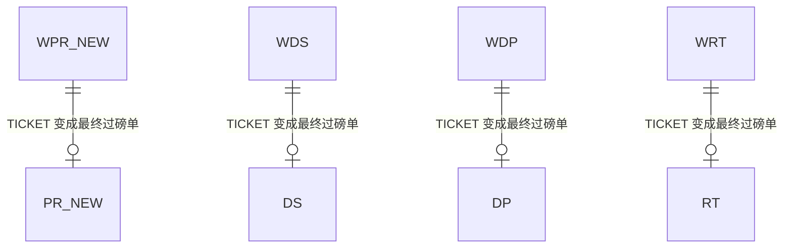
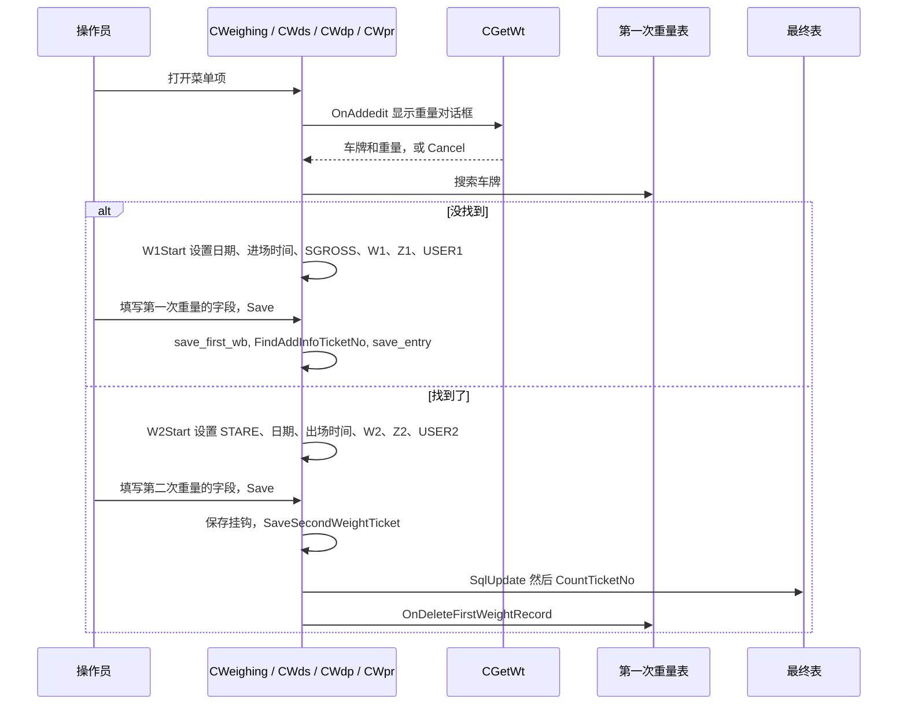
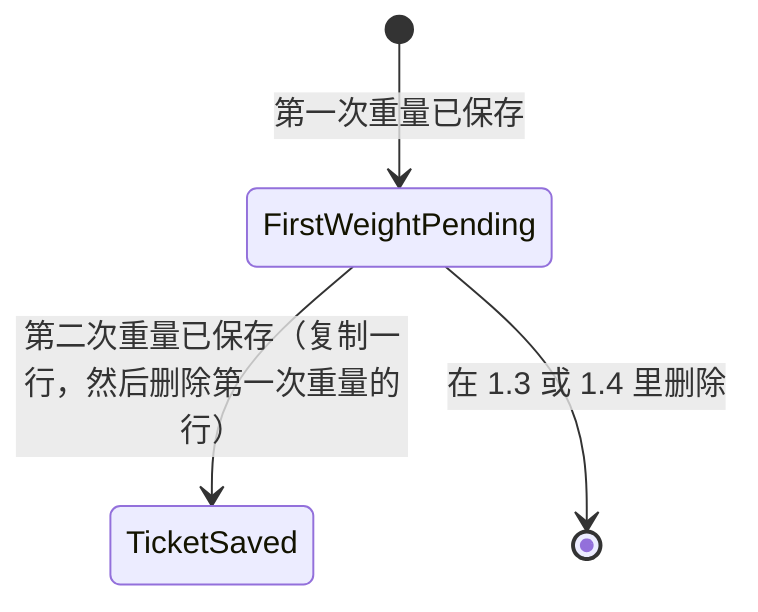

# 过磅（菜单 1，两次称重和公共过磅）- 模块参考

> 英文版为准。同步自英文版 commit c76cd62（2026-10-30）。

> 本文是 TradeWin 模块参考的一部分。索引和共用章节见：[README](README.md)。
> 本文涵盖的菜单项：1.1 RECEIVING NOTE 和 1.2 DESPATCH（第一次重量和第二次重量）、1.3 和 1.4 View/Edit/Delete First Weight、1.5 Public Weighing，以及没有菜单项的退货单称重（节点 18 和 19）。**Scale Weighing（1.6）和 Scale Despatch Weighing（1.7）**有自己的文件：[scale-weighing.md](scale-weighing.md)。
> 最后核对的 commit 为 `2f77122`。翻译状态：英文版见 [../weighing.md](../weighing.md)；本中文版同步于 2026-10-30（commit c76cd62）。

## 目录

- [第一部分 - 业务视图](#第一部分---业务视图)
  - [1.1 简单说明](#11-简单说明)
  - [1.2 谁用什么](#12-谁用什么)
  - [1.3 一天的工作](#13-一天的工作)
  - [1.4 实例演示](#14-实例演示)
  - [1.5 界面导览](#15-界面导览)
  - [1.6 这个数字从哪里来？](#16-这个数字从哪里来)
  - [1.7 状态含义](#17-状态含义)
  - [1.8 如果发生以下情况](#18-如果发生以下情况)
  - [1.9 你可能看到的消息](#19-你可能看到的消息)
  - [1.10 该做和不该做](#110-该做和不该做)
  - [1.11 开始之前](#111-开始之前)
  - [1.12 词汇表](#112-词汇表)
  - [1.13 问AI](#113-问ai)
- [第二部分 - 技术视图](#第二部分---技术视图)
  - [2.1 概览](#21-概览)
  - [2.2 架构和依赖](#22-架构和依赖)
  - [2.3 主数据目录](#23-主数据目录)
  - [2.4 子表层级](#24-子表层级)
  - [2.5 模块和处理流程](#25-模块和处理流程)
  - [2.6 端到端流程](#26-端到端流程)
  - [2.7 报表目录](#27-报表目录)
  - [2.8 集成](#28-集成)
  - [2.9 配置](#29-配置)
  - [2.10 维护](#210-维护)

---

# 第一部分 - 业务视图

## 1.1 简单说明

- 这个金属贸易地磅的过磅菜单有七个项目。**收货单**（买进的货）和**发货**（卖出的货）要**称两次**：第一次称重（通常是满载的货车）保存为**第一次重量记录**，表示货车“在场内”；货车回来后，第二次称重完成整个工作，程序算出**净重**，过磅单就产生了。**公共过磅**对只付磅秤使用费的散客，做法相同。
- 另外两个项目 **Scale Weighing** 和 **Scale Despatch Weighing** 逐个产品称重，见[磅秤过磅](scale-weighing.md)。
- 1.3 和 1.4 两个项目分别打开收货和发货的第一次重量记录清单，主管可以查看、更正或删除其中一条（例如一辆一直没有回来的货车）。
- 如果称重没有完成，就没有过磅单。没有第二次重量、留在“场内”的货车，会一直留在场内清单里，直到有人完成这项工作或删除这条记录。

## 1.2 谁用什么

| 部门 | 菜单项 | 主要工作 |
|---|---|---|
| 地磅操作员 | 1.1 Receiving Note、1.2 Despatch、1.5 Public Weighing | 货车的第一次和第二次称重，输入对方、司机、产品和损耗 |
| 地磅主管 | 1.3 和 1.4 View/Edit/Delete First Weight | 更正或删除仍在等货车回来的第一次重量记录 |
| IT / 管理员 | 6.2 Company Profile、4.1.9 GWST | 开关归零和稳定重量控制、设置预设扣重、检查指示器 |

**从这里开始 - 地磅操作员**
- 每辆货车：Weighing > Receiving Note（买进）、Despatch（卖出）或 Public Weighing，输入车牌，灯变绿时按 OK。
- 货车回来时：用同一个菜单项和同一个车牌。程序会认出它，进入第二次重量。
- 填写产品明细行（收货和发货），然后保存。

**从这里开始 - 主管**
- 打开 1.3 或 1.4 查看仍在场内的货车；只有确认货车不会再回来之后，才删除记录。

**从这里开始 - IT / 管理员**
- 一次性：检查屏幕上显示的重量与指示器一致，并在 Company Profile 里设置归零和稳定控制。

## 1.3 一天的工作

**货车送废料来（收货）。**满载的货车停在磅秤上。操作员选择 1.1。一个小窗口显示磅秤的实时读数、红灯或绿灯、“Status”（稳定或不稳定）、“zero status”（是或否），以及已经在场内的货车清单。操作员输入车牌，灯变绿时按 OK。第一次重量表单打开，日期、进场时间、第一次重量和用户已填好；货车常用的司机、供应商和运输商从货车清单复制过来。操作员检查供应商和付款方式，按 Save。货车卸货后空车回来。操作员再次选择 1.1，输入同一个车牌。这次第二次重量、出场时间和用户已填好；操作员输入损耗和产品明细行（每个产品的百分比），按 Save。第一次重量记录消失，收货过磅单产生。程序随后询问“Set Payment Date”。

**货车一直没有回来。**第一次重量记录留在场内清单里。主管打开 1.3（收货）或 1.4（发货），找到这条记录并删除。

一次收货称重的泳道图：

*说明：操作员的泳道贯穿两次称重；等得太久的第一次重量由主管在 1.3 或 1.4 处理；完成的过磅单继续进入过磅单菜单和发票菜单。*

## 1.4 实例演示

所有数值都是虚构的。

**之前：**供应商 `S0001` “TEST METAL SDN BHD”已存在；产品 `P001` “ALUMINIUM SCRAP”已存在，采购价每 kg 2.00；货车 `WXX1234` 在货车清单里；指示器已连接。

| 步骤 | 屏幕 | 操作员做什么 | 程序做什么 | 之后的状态 |
|---|---|---|---|---|
| 1 | 1.1，重量窗口 | 输入货车 `WXX1234`，磅秤显示 18,500 kg，灯是绿色，按 OK | 找不到这辆货车的第一次重量记录，复制货车常用的司机、供应商和运输商，填入第一次重量 18,500 kg、进场时间、今天的日期和用户 | 第一次重量表单已打开 |
| 2 | 第一次重量表单 | 检查供应商 `S0001` 和付款方式 `CASH`，Save | 用新编号保存第一次重量记录 | 第一次重量待处理（货车在场内） |
| 3 | 再次 1.1 | 输入 `WXX1234`，磅秤现在显示 8,500 kg，OK | 找到待处理的记录，填入第二次重量 8,500 kg、出场时间、用户 | 第二次重量进行中 |
| 4 | 第二次重量表单 | 输入损耗 100，产品行 1 `P001` 占 100%，Save | 净重 = 18,500 - 8,500 - 100 = 9,900 kg；明细行数量 9,900 kg；金额 9,900 x 2.00 = 19,800.00；生成收货过磅单并删除第一次重量记录 | 过磅单已保存 |
| 5 | 提问框 | 对“Set Payment Date”回答 No | 不过账 | 过磅单待开发票 |

**结果：**一张收货过磅单，净重 9,900 kg，金额 19,800.00，可以在采购发票上开票。过磅单和开发票的细节见[过磅单](tickets.md)和[发票](invoice-cashier.md)。

## 1.5 界面导览

### 重量窗口（每次都最先打开）

**用途：**显示磅秤的实时重量，并决定这次过磅能否确认。

| 字段标签 | 含义 | 必填？ | 值的来源 |
|---|---|---|---|
| Vehicle No | 车牌。与场内某辆货车相同，表示“第二次重量”。 | 是（或选清单里的一行） | 输入，或点击清单里的一行来选择 |
| Weight（大号数字） | 磅秤读数。只有 Receiving Note 上，读数高于 1,000 kg 时会减去预设扣重。 | - | 自动取自磅秤指示器 |
| Status | `Unstable` 或 `stable`：读数与上一次读数相同时为稳定 | - | 自动 |
| zero status | `No` 或 `Yes`：磅秤是否回到了零 | - | 自动 |
| Traffic light | 绿色表示可以按 OK | - | 自动，来自 Company Profile 里的归零和稳定控制 |
| 场内清单：No, Vehicle No, Date, Time In, Wt.In(Kg) | 有第一次重量、没有第二次重量的货车 | - | 自动 |
| Total Vehicle In Yard | 该清单的数量 | - | 自动 |

**按钮和按键**
- **OK / Enter：**确认。灯是红色时不能用。
- **Cancel / Esc：**不称重，离开。
- **点击清单里的一行：**把那辆货车的车牌复制到输入框。双击也会确认。
- **在车牌框里按 Ctrl+A 到 Ctrl+O，且 Scroll Lock 打开：**选择预设扣重 A 到 O（起重机、空托盘等的重量，保存在 4.1.9 GWST）。程序会从每个高于 1,000 kg 的读数里减去它，**但只在 1.1 Receiving Note 上有效**；其他过磅屏幕忽略它。按两次空格会清除它，Scroll Lock 关闭时按任何键也会清除。

### 公共过磅表单（1.5，第一次和第二次重量）

**用途：**记录货车属于谁、运了什么。

| 字段标签 | 含义 | 必填？ | 值的来源 |
|---|---|---|---|
| RN NO. | 这条记录的编号 | - | 自动流水号 |
| Date | 过磅日期。第二次重量会再次写入今天的日期。 | - | 自动 |
| Vehicle No. | 车牌 | 是 | 来自重量窗口 |
| Driver Name | 司机，从货车的第一个司机填入 | 否 | 输入，或选择货车时填入 |
| Customer | 客户账户 | 否 | 从货车的第二个司机字段填入，或输入 |
| Product | 自由文字，最多 50 个字符 | 否 | 输入 |
| Remarks | 自由文字 | 否 | 输入 |
| Weight Modify | 标记保存后重量被修改过 | - | 自动 |
| WEIGHT(KG) FIRST / SECOND, TIME, USER | 第一次和第二次重量、各自的时间、各自的用户 | - | 从磅秤自动取得 |
| NETT WEIGHT (KG) | 货物的净重 | - | 计算，见 1.6 |
| CHARGES AMOUNT | 使用磅秤的收费 | 否 | 输入 |

**按钮：**Save、Cancel。**Capture 1st Weight** 和 **Capture 2nd Weight** 两个按钮属于过磅单屏幕（菜单 2.3），不属于这个表单。本程序的公共过磅没有 Cancel Ticket 按钮。

### 收货和发货称重表单（1.1 和 1.2）

第一次重量表单显示：供应商或客户（从货车清单填入）、付款方式、运输商、司机身份证号和姓名、车牌，以及（仅收货）对方的毛重、皮重和损耗。第二次重量表单增加：损耗、八行带百分比、数量和单价的产品行、备注，以及对方的八行产品（按钮 **THIRD PARTY GRADING**）。记录里还带有若干个框，但在这些表单上已关闭：采购或销售订单、单位、序号、分包商、D/O 号、废料单、合约、分级员、车辆类型、业务员、退货单、基准、其他数量和磅秤过磅单。**SET** 和 **UNSET** 按钮（付款日期）在最终的过磅单上，不在第一次重量表单上。所有字段、金额和检查都在[过磅单](tickets.md)里说明。

### 1.3 和 1.4 View/Edit/Delete First Weight

它们在第一次重量表上打开过磅单屏幕（见[过磅单](tickets.md)）：查找、查看、编辑和删除第一次重量记录。第一次重量记录上，第二次重量的框是只读的。

## 1.6 这个数字从哪里来？

- **公众过磅的净重** = 第一次和第二次重量的差，大的减小的。例子：14,200 和 6,700 得出 **7,500 kg**。
- **重量窗口里显示的重量** = 磅秤读数，减去所选的预设扣重（只限收货单，且只在读数高于 1,000 kg 时）。
- **收货或发货过磅单的净重** = 两次重量之差减去输入的损耗；对方的净重 = 对方毛重与皮重之差减去对方损耗；差异 = 本方净重减对方净重。细节见[过磅单](tickets.md#16-这个数字从哪里来)。例子：18,500 - 8,500 - 100 = **9,900 kg**。

## 1.7 状态含义

| 单据 | 状态 | 含义 | 谁或什么来修改 | 还能编辑什么 |
|---|---|---|---|---|
| 第一次重量记录 | Pending（在场内） | 已保存第一次重量，货车还没回来 | 保存第一次重量 | 第一次重量表单；菜单 1.3 和 1.4 |
| 第一次重量记录 | Gone | 第二次重量保存后被删除，或在 1.3 / 1.4 里被删除 | 保存第二次重量，或 Delete 按钮 | - |
| 最终过磅单 | Saved | 最终过磅单 | 保存第二次重量 | 见[过磅单](tickets.md) |

## 1.8 如果发生以下情况

| 情况 | 怎么办 | 什么时候找 IT |
|---|---|---|
| 重量窗口显示 `00,000` | 检查指示器线缆和这台电脑上的指示器设置 | 总是 |
| 第一次称重时车牌输错了 | 主管在 1.3 或 1.4 里删除第一次重量记录（收货、发货）；公共过磅由 IT 删除记录 | 公共过磅总是 |
| 货车没有第二次重量就离开了 | 同上 | - |
| 旧的第一次重量还在待处理时，在新的工作里输入了同一个车牌 | 程序把它当作旧工作的第二次重量 | - |
| 过磅时断电或断网 | 按 Save 之前什么都没保存。已保存的第一次重量留在场内清单里 | 重启后连不上服务器 |
| 灯一直是红色 | 等到 Status 显示稳定。如果 Company Profile 里的 Zero Weight Control 是 `Y`，在当前程序版本里灯可能永远不会变绿（零位信号没有传来，见 2.10）：请 IT 把这个控制设为 `N` | 如果一直不变绿，总是找 IT |
| 过磅单打印错了 | 从过磅单屏幕重新打印 | - |

## 1.9 你可能看到的消息

| 消息 | 含义 | 怎么办 |
|---|---|---|
| `Error Message` 加 `Indicator weight unstable` | 读数还在变动 | 等到 Status 显示稳定 |
| `Weight indicator must need start with zero during weighing process.` | 自上一辆货车以来，磅秤没有回到零 | 让磅秤清零 |
| `Can not save` | 表单是只读的 | 重新打开这次过磅 |
| `Do you want to save your data !`（标题 `Save`） | 你在最后一个字段按了 Enter | Yes 保存，No 重新开始 |
| `Do you want to print`（标题 `option`） | 第二次重量已保存，且这张表有打印表单 | Yes 就打印 |
| `Set Payment Date`（提问） | 收货或发货的第二次重量之后 | Yes 打开付款日期窗口（见[过磅单](tickets.md)） |
| `Despatch Ticket Not Found` | 退货单第一次重量：这辆货车最近 10 天内没有发货过磅单 | 检查车牌 |
| `<lorry> Vehicle not found` | 需要删除第一次过磅记录时，找不到它 | 找 IT |
| `Can not change code no` | 过磅单编号不能编辑 | - |
| `Out of range` | 点击了场内清单之外的地方 | - |
| `Error Opening LPT1.` | 打不开过磅单打印机端口 | 找 IT |

## 1.10 该做和不该做

- 按 OK 之前，要确认绿灯亮着。
- 两次都要用同样的方式输入车牌。
- 数字还在跳动时，不要确认重量。
- 除非你知道预设扣重代表什么，否则不要使用它（Scroll Lock 打开时按 Ctrl+A 到 Ctrl+O）：在收货时它会悄悄降低每个高于 1,000 kg 的读数。用完后把 Scroll Lock 关掉。

## 1.11 开始之前

- 磅秤指示器已连接，它的读数出现在重量窗口里。
- 供应商和客户已在账户主表里，货车（连同常用的司机、账户和运输商）已在货车清单里，这样才能自动填入。
- 如果要填产品明细行，带等级价格的产品必须已存在。
- 如果要用预设扣重，已在 4.1.9 GWST 里设置。

## 1.12 词汇表

| 术语 | 英文 | 马来文 | 中文 |
|---|---|---|---|
| Weighbridge | Truck scale | Jambatan timbang | 地磅 |
| Public weighing | Weighing service for outsiders | Timbang awam | 公众过磅 |
| First weight / second weight | The two weighings of one trip | Timbangan pertama / kedua | 第一次 / 第二次过磅 |
| In the yard | First weight saved, second weight not yet done | Dalam yard | 在场内 |
| Net weight | Difference of the two weights | Berat bersih | 净重 |
| Preset deduction (GWST) | Fixed weight taken off every reading | Potongan berat | 预设扣重 |
| Wastage | Weight taken off for dirt or moisture | Susut | 扣重 / 损耗 |
| Party | The other company (supplier or buyer) | Pihak | 对方 |

## 1.13 问AI

1. 载着废料来的货车（收货）怎样称重？
2. 货车回来了，但程序显示的是一项新工作，而不是第二次重量。为什么？
3. 称重的净重是怎样算出来的？
4. 重量窗口里的红灯是什么意思？
5. Ctrl+A 到 Ctrl+O 这些按键是做什么的，为什么需要 Scroll Lock？
6. 为什么重量窗口显示 00,000？
7. 货车一直没有回来，怎样删除它的第一次重量？
8. Company Profile 里的归零和稳定控制有什么作用？
9. 公众过磅的过磅单在哪里打印？
10. 为什么预设扣重在发货屏幕上不起作用？

---

# 第二部分 - 技术视图

## 2.1 概览

- 应用程序：TradeWin Metals Sdn Bhd 的地磅系统（公司名称文字在代码里），建立在 wlib32 框架上的 VC6/MFC 应用。构建：VC6 项目 `menu.dsp`，主程序 `menu.exe`。见 [README](README.md)。
- 本模块：使用两次称重引擎 `CWeighing` 的菜单 1 项目。`CWds`（WDS.CPP，收货，节点 11）、`CWdp`（WDP.CPP，发货节点 12 和退货单节点 18）和 `CWpr`（Wpr.cpp，公共过磅，节点 15）派生自它。节点 13 和 14 在过磅单屏幕 `CDs` 上打开第一次重量表（`TicketData`，MAIN.CPP:47）。
- 类的继承链：`CWeighing`（WEIGHING.CPP，基类 `CStaff`）。重量对话框是 `CGetWt`（GETWT.CPP）；车牌输入框是 `CGwEdit`（GWEDIT.CPP）。

## 2.2 架构和依赖

*说明：重量对话框读取指示器、归零和稳定开关以及预设扣重；状态机先写第一次重量表，再写最终过磅单表，并记录每个确认的重量。*

- 库：wlib32（`CStaff`、过磅单编号、`DB` 类、通信层）、winlib、wtlib32。
- 数据库：SQL Server。`PROVIDER.SYS`（第 1 行和第 2 行是连接行，各带一个登录；第 1 行还带有明文密码，见 [README 代码发现](README.md#代码发现)；这里不复制）在每一行里指明一个库，第一行是 `tradewin_dev`，第二行是 `tradewin2`。TradeWin 没有结构仓库。本仓库里没有摄像头、图像数据库或轮胎传感器的代码。
- 指示器：本仓库**没有自己的读取线程**（Lekok 的 `THREAD.CPP` 不在这里）。`CGetWt::OnGw` 通过 wlib32 通信层读取重量，`GetCurrenctCommWeight(1)`（GETWT.CPP:105），`CPr` 的采集按钮也是这样做（Pr.cpp:93, 102）。指示器的端口、波特率和 `device=` 掩码来自 wlib32 读取的 win.ini 段 `[Indicator]`（只写名称；见 `wlib32-indicator-mask` 技能）。`CMainFrame` 设置 `bCommOpen = TRUE`（MAINFRM.CPP:114）；`CMainFrame::OnOpenOtherFiles` 自己不打开通信通道（MAINFRM.CPP:117-153）。wlib32 超过 5 秒没有数据时，读数为 -1。在 **Debug** 构建里，读取器被模拟器取代：Scroll Lock 打开时是 17,000 kg，关闭时是 12,000 kg，零位标志被强制打开（GETWT.CPP:107-111）。每次有重量到达时，wlib32 通信层还会对应用对象调用 `ToDisplay`；应用的 `CMenuApp::ToDisplay`（MENU.CPP:289）本来会设置红绿灯用的标志 `IsWBZeroWt`，但见 2.10 发现 1：它的签名与 wlib32 的虚函数不同，所以不会被调用。

## 2.3 主数据目录

### STKPF（Company Profile，菜单 6.2）- 过磅用到的字段

类型：来自 `SQL_LekokPaper` 脚本 `STKPF.sql`（姊妹应用），TradeWin 未核实。完整屏幕见[其他、库存](other-stock-export.md)。一行记录，程序启动时若不存在就创建（MENU.CPP:408-414）。

| # | field (enum) | SQL column | data type | null | key | 含义 |
|---|---|---|---|---|---|---|
| 1 | `PRO_CODE` | `COMPANY_NO` | nvarchar(10) | no | PK | 公司代码（单行） |
| 2 to 4 | `PRO_ADD1..3` | `ADD1`, `ADD2`, `ADD3` | nvarchar(60) | yes |  | 地址行（打印在过磅单上） |
| 5 | `PRO_ACCODE` | `ACCODE` | nvarchar(7) | yes |  | 结账账户代码：发票清单使用的现金客户（ARINV_WB.CPP:340） |
| 6 | `PRO_ZERO` | `ZERO` | nvarchar(3) | yes |  | `Y` = 按 OK 之前磅秤必须显示为零 |
| 7 | `PRO_STABLE` | `STABLE` | nvarchar(3) | yes |  | `Y` = 按 OK 之前读数必须稳定 |
| 8 | `PRO_GATEPASS` | `GATEPASS` | nvarchar(3) | yes |  | 门禁单开关（屏幕上字段已隐藏；本仓库没有代码读取它） |
| 9 | `PRO_VARIANCE` | `VARIANCE` | decimal(18) | yes |  | 允许的本方与对方净重差异百分比（默认 5）；由 `CheckVarianceNetWeight`（DS.CPP:1132）读取，它从不阻止保存（见[过磅单](tickets.md)） |
| 10 | `PRO_GST_NO` | `GST_NO` | nvarchar(20) | yes |  | 税务登记号 |
| 11 | `PRO_GST_DATE` | `GST_DATE` | smalldatetime | yes |  | 税务开始日期：日期早于它的发票税率为 0%（TAXCODE.CPP:46） |

第 12 到 17 列是框架的审计列（`REC_STATUS`、`NEWUSER`、`NEWTIME`、`MODIFYUSER`、`MODIFYTIME`、`Print Counter`）。姊妹脚本还有三列（`PT`、`PT1`、`Decimal_Weight`）；本仓库没有代码使用它们，TradeWin 的 Company Profile 对话框也没有对应的控件，所以 TradeWin 的表里有没有这些列未核实。

### GST（G.W.S.T，菜单 4.1.9）- 预设扣重

单记录表（类型来自 `SQL_LekokPaper` 脚本 `GST.sql`，TradeWin 未核实）：`CODE` int 主键，然后是 `A` 到 `O` float(53)（十五个重量，单位 kg），然后是审计列。`CGwEdit::OnChar` 读取 `gst.dat[nChar + 1]`（GWEDIT.CPP:67）：Ctrl+A 是字段 2（`A`），依此类推到 Ctrl+O。屏幕说明见[控制表](control-tables.md)。

## 2.4 子表层级

过磅的表是**扁平的**：每行公众过磅记录没有子行，每行两次过磅的过磅单记录以列的形式带有八行自己的产品和八行对方的产品（`PT1..8`、`PT11..18`）。

*说明：保存第二次重量时，第一次重量行被最终行取代。*

- 嵌套子表：无。
- **没有外键把两次重量连起来。**`CWeighing::OnAddedit` 在第一次重量表里查找相同的车牌值（WEIGHING.CPP:120，`df->Search(df->dat[vehicle_fld],vehicle_fld, TRUE)`）；找到就表示“第二次重量”。第一次重量行用 `DELETE FROM [<table>] WHERE [<vehicle column>] = '<lorry>'` 删除（WEIGHING.CPP:265-271）。

### PR_NEW 和 WPR_NEW（公众过磅）

类型：来自 `SQL_LekokPaper` 脚本 `PR_NEW.sql`（最终）和 `WPR_NEW.sql`（第一次重量），TradeWin 未核实。枚举 `pr_new`（MENU.H:277）。两者分别由 `tado(..., "pr_new", init_pr)` 和 `tado(..., "wpr_new", init_wpr)` 打开（MENU.CPP:442-443）；两者的对话框都是 `IDD_PR_NEW`。

| # | field (enum) | SQL column PR_NEW / WPR_NEW | data type | null | key | 含义 |
|---|---|---|---|---|---|---|
| 1 | `PR_TICKET` | `TICKET` | nvarchar(10) | no | PK | 流水号 |
| 2 | `PR_SERIAL` | `SERIAL` | nvarchar(10) | yes |  | 流水号（表单上字段已隐藏：门禁单框） |
| 3 | `PR_DATE` | `DATE` | smalldatetime | no / yes |  | 日期 |
| 4 | `PR_VEHICLE` | `LORRY` / `VEHICLE_MANUAL` | nvarchar(50) / nvarchar(10) | yes |  | 车牌 |
| 5 | `PR_DRIVER` | `ICNO` | nvarchar(12) | yes |  | 司机（标签“Driver Name”）；`pr_tell` 把司机姓名写到这里（Wpr.cpp:184-185），所以超过 12 个字符的姓名会被截断（如果 TradeWin 的列是这个宽度：未核实） |
| 6 | `PR_ACCODE` | `ACCODE_MANUAL` | nvarchar(10) | yes |  | 客户账户 |
| 7 | `PR_PRODUCT` | `PRODUCT` | nvarchar(50) | yes |  | 产品，自由文字 |
| 8 | `PR_REMARKS` | `REMARKS` | nvarchar(40) | yes |  | 备注 |
| 9 | `PR_MODIFY` | `MODIFY` | nvarchar(3) | yes |  | 重量被编辑的标记（由 `SetModifyMark` 设置，Wpr.cpp:204-205） |
| 10 | `PR_TIMEIN` | `TIMEIN` | nvarchar(8) | yes |  | 第一次重量的时间 |
| 11 | `PR_TIMEOUT` | `TIMEOUT` | nvarchar(8) | yes |  | 第二次重量的时间 |
| 12 | `PR_SGROSS` | `SGROSS` | decimal(18) | yes |  | 第一次重量（kg） |
| 13 | `PR_STARE` | `STARE` | decimal(18) | yes |  | 第二次重量（kg） |
| 14 | `PR_AMOUNT` | `AMOUNT` | decimal(18,2) | yes |  | 收费金额 |
| 15 | `PR_USER1` | `USER1` | nvarchar(5) | yes |  | 第一次重量的用户 |
| 16 | `PR_USER2` | `USER2` | nvarchar(5) | yes |  | 第二次重量的用户 |
| 17 | `PR_W1` | `W1` | decimal(18) | yes |  | 扣重之前的第一次原始读数 |
| 18 | `PR_W2` | `W2` | decimal(18) | yes |  | 第二次原始读数 |
| 19 | `PR_Z1` | `Z1` | decimal(18) | yes |  | 扣重之后的第一次重量 |
| 20 | `PR_Z2` | `Z2` | decimal(18) | yes |  | 扣重之后的第二次重量 |
| 21 | | `REC_STATUS` | char(1) | yes |  | 在姊妹应用里 `1` = 过磅单已取消；**TradeWin 里没有任何东西写它**（姊妹应用的 Cancel Ticket 按钮不在这里） |
| 22 to 25 | | `NEWUSER`, `NEWTIME`, `MODIFYUSER`, `MODIFYTIME` | char(5), smalldatetime | yes |  | 审计 |
| 26 | | `Print Counter` | int | yes |  | 打印次数 |

- 查找：货车主表（`LORRY`）、司机主表（`driver`，在表 `ic` 上打开，MENU.CPP:464）、客户（`ACCODE` 视图）。
- 使用者：菜单 2.3（`CPr`）、报表 `pr_list.rpt`（选择窗口条目 00036，见[报表](reports.md)）。
- 枚举 `pr_new` 有 20 个条目，与第 1 到 20 列对应；审计列没有枚举。列清单 TradeWin 未核实（没有脚本）。

### 两次称重表 DS、DP、WDS、WDP、RT、WRT

记录在 [过磅单](tickets.md#24-子表层级)（枚举 `dp`，144 个字段）。

## 2.5 模块和处理流程

### 菜单项和入口

只有一个菜单资源 `IDR_MAINMENU`（menu.rc:126）；`CMenuApp::Domain` 用它创建文档模板（MENU.CPP:245-270，见 [README](README.md#菜单图和覆盖范围)）。菜单 ID `ID000nn` 变成节点 `nn`；`ExecuteNode` 应用用户的限制清单并调用 `CMenuApp::SubProgram`（MAIN.CPP:176）。

| 菜单项 | 节点 | `SubProgram` 里的处理程序 | 打开 |
|---|---|---|---|
| 1.1 RECEIVING NOTE | 11 | `Purchase_Flag = TRUE; WeighingProcess(&ds,&wds)`（MAIN.CPP:188-191；WDS.CPP:161） | `CWds`，对话框 `IDD_WDS` |
| 1.2 DESPATCH | 12 | `Purchase_Flag = FALSE; Weighing_Despatch(&dp,&wdp)`（MAIN.CPP:192-195；WDP.CPP:203） | `CWdp`，对话框 `IDD_WDP` |
| 1.3 View/Edit/Delete First Weight RECEIVING NOTE | 13 | `TicketData(&wds)`（MAIN.CPP:196-200） | `wds` 上的 `CDs` |
| 1.4 View/Edit/Delete First Weight DESPATCH | 14 | `TicketData(&wdp)`（MAIN.CPP:201-204） | `wdp` 上的 `CDs` |
| 1.5 Public Weighing | 15 | `PublicWeighingProcess(&pr_new,&wpr_new)`（MAIN.CPP:205-207；Wpr.cpp:139） | `CWpr`，对话框 `IDD_PR_NEW` |
| 1.6 Scale Weighing (Unlimited Product Features) | 16 | `AdminDbScale(&scale,&scalesub)`（MAIN.CPP:208-211） | [磅秤过磅](scale-weighing.md) |
| 1.7 Scale Despatch Weighing (Unlimited Product Features) | 17 | `AdminDbScale(&scaledw,&scaledwsub)`（MAIN.CPP:212-215） | 相同 |
| （没有菜单项） | 18 | `Weighing_Despatch(&rt,&wrt)`（MAIN.CPP:216-219） | 退货单第一次重量，`wrt` 上的 `CWdp` |
| （没有菜单项） | 19 | `TicketData(&wrt)`（MAIN.CPP:220-223） | `wrt` 上的 `CDs` |

框架自己的消息映射（MAINFRM.CPP:23-93）只列出了一部分 ID；其他的通过 wlib32 基类到达 `On00001`。`menu.ini` 里的公司编号 2 到 9 会隐藏节点 11 到 17 和节点 2（“small scale only”，MAINFRM.CPP:119-129）。

### 流程：第一次和第二次重量（`CWeighing`）

*说明：按车牌搜索的结果决定是第一次还是第二次重量；最终过磅单只由第二次重量产生。*

分步说明：
1. `CWeighing::OnInitDialog` 在子类没有提供车牌字段、两张表和两个字段数组时拒绝启动（WEIGHING.CPP:436-464），调用 `CStaff::OnInitDialog`，然后返回 TRUE（WEIGHING.CPP:466-468；注释“user not allow to enter weighing entry - 20211004 JF”）；它后面的 `SetCommThread` 调用到达不了（WEIGHING.CPP:476）。**与姊妹应用不同，`CWds` 和 `CWdp` 没有自己的 `OnInitDialog`**：第一次重量对话框由 wlib32 的 `CStaff` 启动流程启动，它调用虚函数 `OnAddedit`（WEIGHING.CPP:88）和 `GetRecord`（WEIGHING.CPP:496，它又一次调用 `OnAddedit`）。启动流程会到达它几次，在 wlib32 里，没有追踪。
2. `OnAddedit`（WEIGHING.CPP:88）清空记录，运行 `df->e->start`，显示 `CGetWt`（WEIGHING.CPP:95-98）。Cancel 设置 `SaveFlag = CANNOTSAVE` 并关闭（WEIGHING.CPP:100-104）。车牌为空时，让用户从 `ShowField1Table` 选择（WEIGHING.CPP:107-116）。
3. 在车牌列上 `df->Search(..., TRUE)`（WEIGHING.CPP:120）。没找到：对 `wpr_new`，从 `lorry` 查账户和司机（WEIGHING.CPP:125-130），对其他表则查 IC、账户、运输商和司机（WEIGHING.CPP:131-138）；`SaveFlag = NEWFILE`，可编辑清单 `w1_array`，`W1Start`。找到：`SaveFlag = OLDFILE`，`FindAddInfoTicketNo(m_mfile)` 预先分配最终编号（WEIGHING.CPP:149-150），清单 `w2_array`，`W2Start`；对表 `wdp`，还会建议下一个空闲的数字 D/O 号：`SELECT TOP 1 DO FROM dbo.DP WHERE (ISNUMERIC(DO) = 1) ORDER BY DO DESC` 再加一（WEIGHING.CPP:153-163）。
4. `CWeighing::OnSave`（WEIGHING.CPP:315）。NEWFILE（WEIGHING.CPP:323-339）：`save_first_wb`、加锁、`FindAddInfoTicketNo(df)`、`save_entry(NONEXIST,...)`、`W1Saved`（本仓库里是空的，WEIGHING.CPP:241-243）、`SaveWeightMaxDataWB`、`CountTicketNo(df,1)`，然后为下一辆货车调用 `OnAddedit`。OLDFILE（WEIGHING.CPP:340-366）：`e->save` 钩子，给两张表加锁，`SaveSecondWeightTicket`（WEIGHING.CPP:203-223：`fetch`、`FindAddInfoTicketNo`、`FindProductCategorySerialNo`、`SqlUpdate(TRUE)`、`CountTicketNo`），`W2Saved`，`OnDeleteFirstWeightRecord`，然后只有最终表的 `prec` 不是 `unprint` 时才显示打印提问，使用 `<table>.RPT`（WEIGHING.CPP:352-362），`SaveWeightMaxDataWB`。
5. `CWpr::OnSave`（Wpr.cpp:64-99）是公共过磅的一份拷贝：不调用 `SaveWeightMaxDataWB`，第一次重量时不调用 `CountTicketNo(df,1)`（对比 WEIGHING.CPP:337），第二次重量用自己的 `SaveSecondWeightTicket`（Wpr.cpp:53-61），最终表有打印程序时通过 `OnPrintTicket`（LPT1）打印（Wpr.cpp:90-94）。

各前端的行为：

| 前端 | W1 设置 | W2 设置 | 第一次重量可编辑的字段 | 最终保存挂钩 |
|---|---|---|---|---|
| `CWpr`（公共） | SGROSS, W1, Z1, TIMEIN, USER1, date（Wpr.cpp:101-109） | STARE, date, TIMEOUT, W2, Z2, USER2（Wpr.cpp:111-119） | SERIAL, DRIVER, ACCODE, PRODUCT, REMARKS, AMOUNT, VEHICLE（`PrFirstArray`，Wpr.cpp:137）；第二次重量：相同但没有 VEHICLE（`PrArray`，Wpr.cpp:138） | `pr_save`（Wpr.cpp:196-207）：重量被编辑时重新盖上 USER1 / USER2，并设置重量修改标记 |
| `CWds`（收货） | SGROSS, W1, Z1, TIMEIN, USER1（WDS.CPP:48-56） | STARE, W2, Z2, TIMEOUT, USER2（WDS.CPP:58-66） | `FirstArray`（WDS.CPP:151）；表 `wds` 的第二次重量 `DSWeighingArray`（WDS.CPP:157, 168） | `ds_save`（DS.CPP:876）；W2Saved 询问“Set Payment Date”（WDS.CPP:127-148） |
| `CWdp`（发货） | 相同；对 `wrt`，先询问最近 10 天内匹配的发货过磅单（WDP.CPP:48-110） | 相同 | `FirstArr`（WDP.CPP:198） | `dp_save`（DP.CPP:526）；W2Saved 询问“Set Payment Date”（WDP.CPP:245-251） |

`pr_initial`（Wpr.cpp:155-174）设置只读字段清单，但它没有设置清单的第 2 项，而框架读到第一个 0 就停止读取清单（wlib32 里的 `ReadOnlyArray` 循环）；所以第 3 到 6 项上的日期、修改和时间限制从未生效（见 2.10）。

### 流程：重量对话框（`CGetWt`）

- 100 ms 定时器（GETWT.CPP:75）调用 `OnGw`（GETWT.CPP:90）：显示 `Unstable` / `stable` 和 `No` / `Yes`，读取 `GetCurrenctCommWeight(1)`（GETWT.CPP:105），`ActualWeight = weight`（GETWT.CPP:113），并且**只在表是 `wds` 时**（`strcmp(df->m_strTable,"wds")`，注释“only receiving”）且 `(weight > 1000 && GwstWeight > 0) || GwstWeight < 0` 时减去 `GwstWeight`（GETWT.CPP:114-118）。
- 稳定 = 读数与上一个节拍相同（`hwt[0]`，GETWT.CPP:184-186）。零位 = 全局变量 `IsWBZeroWt`（GETWT.CPP:189-194），只有 `CMenuApp::ToDisplay` 能把它设为 TRUE（连续两次零读数之后，MENU.CPP:295-304）；保存称重会清除它（WEIGHING.CPP:336, 364）。
- 确认规则来自 `STKPF.ZERO` 和 `STKPF.STABLE`（GETWT.CPP:200-211）：N/N 总是通过；Y/N 需要零位；N/Y 需要稳定；Y/Y 两者都需要。结果驱动红绿灯图标（GETWT.CPP:214-222）。
- `OnOK`（GETWT.CPP:133）：最小重量测试已被注释掉（GETWT.CPP:136-142）；灯是红色时，显示带原因的 `Error Message` 并停止（GETWT.CPP:143-153）；否则复制输入的车牌并关闭。
- `CGwEdit`（GWEDIT.CPP）：预设扣重只在 Scroll Lock 打开时有效（`GetKeyState(VK_SCROLL)`，GWEDIT.CPP:57）；控制字符 1 到 15（Ctrl+A 到 Ctrl+O）在 `FacileFlag == 1` 时设置 `GwstWeight = atol(gst.dat[nChar + 1])`（GWEDIT.CPP:67；`FacileFlag` 在 MENU.CPP:58 设置）；Backspace 和 Enter 照常通过（GWEDIT.CPP:59-65）；连按两次空格清除它（GWEDIT.CPP:73-75）；Scroll Lock 关闭时按任何键都会重置它（GWEDIT.CPP:45-51）。Lekok 风格的 `GWST_Code` 字母在 TradeWin 里不记录。
- 场内表格显示第一次重量表的每一行（`ShowGridContent`，GETWT.CPP:273-286），列有 No、Vehicle No、Date、Time In、Wt.In(Kg)（GETWT.CPP:249-259）。

### 读写的表

| 表 | 读 | 写 | 键 |
|---|---|---|---|
| WPR_NEW / WDS / WDP / WRT | 场内表格，车牌搜索 | 插入第一次重量，第二次重量后删除 | `TICKET` nvarchar(10) |
| PR_NEW / DS / DP / RT | - | 插入最终过磅单 | `TICKET` nvarchar(10) |
| TICKETNO | 下一个编号，前缀 | `NextNo` 递增 | `RecordSet` nvarchar(20) |
| STKPF | `ZERO`、`STABLE` | - | `COMPANY_NO` |
| GST | 预设值 | - | `CODE` |
| LORRY, `driver`（表 `ic`）, ACCODE 视图 | 新的第一次重量的默认值 | - | 见[控制表](control-tables.md) |
| WEIGHT_MAX_DATA | - | 每个确认的第一次或第二次重量一行（`CWpr` 除外） | `PKKEY` int identity |
| TIMEFRM, LogAlarm, LogAlarmData | - | wlib32 通过 `CMenuApp` 挂钩做的重量轨迹和报警记录 | `PKKEY` |

关键字段类型来自姊妹应用，TradeWin 未核实。`SaveWeightMaxDataWB`（WEIGHING.CPP:280-313）往文件 `wt.log` 追加一行，并插入 `weight_max_data`（用户、WBNO `'A'`、过磅单、货车、重量、第一张过磅单、表名），然后设置超重报警用来比较的全局变量（`TicketVehicleNo`、`TicketWt`、`WbTicketSaved`）。`CheckMaxWeight`（WEIGHING.CPP:368-388）是无效代码（调用已被注释掉，WEIGHING.CPP:319）。

### 流水号

- 每张称重表在 TICKETNO 里有一行（`RecordSet` = 表名）；编号来自 `FindAddInfoTicketNo` 和 `CountTicketNo`（wlib32）。前缀和长度是站点数据。重置程序（节点 64，6.4 Reset Database）见[其他、库存](other-stock-export.md#210-维护)。

### 状态转换

*说明：唯一的自动转换是第一次重量变成过磅单；等待中的第一次重量也可以由主管删除。取消已完成的过磅单在本程序里不是一个状态。*

### 对其他模块的依赖

- 过磅单：保存后的过磅单在那里查看、更正和打印（[过磅单](tickets.md)）。
- 控制表：货车、司机、账户、GWST（[控制表](control-tables.md)）。
- 发票：收货和发货过磅单在发票屏幕上开票；公共过磅的过磅单**不**开票（[发票](invoice-cashier.md)）。

## 2.6 端到端流程

见 [README](README.md#26-端到端流程)。

## 2.7 报表目录

- 公共过磅：报表选择窗口条目 `00036` “Public Weighing Detail Report”（`pr_list.rpt`）；见[报表](reports.md)。
- 过磅单表单 `pr_new.rpt`、`ds.rpt`、`dp.rpt` 和第一次重量表单 `wds.rpt` 在仓库里。对最终表，表单名称通过 wlib32 打印代码跟随表名（`<table>.RPT`，WEIGHING.CPP:352-362；没有进一步追踪）。第一次重量表 `wds` 的 `prec = unprint`（DS.CPP:1047），所以这里**不打印第一次重量表单**（姊妹应用会打印 `wds.rpt`）。程序 `PrintPublicTicket`（ppublic.cpp:38，针式打印机表单 `ppublic.rep`）已编译，但从未分配给任何表（`init_pr` 里的分配已被注释掉，Wpr.cpp:213）。

## 2.8 集成

| 触发 | 系统 | 细节 | 故障处理 |
|---|---|---|---|
| 每次读取重量 | 经 wlib32 的磅秤指示器 | `GetCurrenctCommWeight(1)`，在 win.ini `[Indicator]` 里配置 | 窗口显示 00,000；5 秒没有数据时为 -1 |
| 每次确认第一次和第二次重量（两次过磅表单） | `weight_max_data` 表和 `wt.log` 文件 | 车牌、重量、表 | 无 |
| 报警钩子 | `logAlarm`、`logAlarmData`、`timefrm` | `OnLogAlram4DriveThrough`、`OnLogAlram4OverMaxWt` 插入报警行，并向主窗口发送命令 `ID00099`（MENU.CPP:614-658） | 无 |

本模块不使用出站网络 API、摄像头或传感器盒。

## 2.9 配置

- `STKPF.ZERO`、`STKPF.STABLE`（只写名称）。
- win.ini：wlib32 的 `[Indicator]` 段，键 `device`（只写名称）。
- PROVIDER.SYS：数据库连接（内容不记录）。
- 代码常量：`FacileFlag = 1`（MENU.CPP:58）；`bCommOpen = TRUE`（MAINFRM.CPP:114）。本仓库里没有 `Program4` 或 `isUnlimited_Product` 构建常量。
- `menu.ini`（仓库里是空的）由 `CMenuApp::Profile` 读取，得到 0 到 15 的公司编号（MENU.CPP:222-234）；`company_no` 2 到 9 通过 `ProfileHiddenMenu` 隐藏节点 11 到 17 和 2（“small scale only”，MAINFRM.CPP:119-129）。

## 2.10 维护

- 修改菜单 1、过磅的类或上面的表时，要同时更新本文件。
- 修改记录：

| 日期 | Commit | 作者 | 修改内容 |
|---|---|---|---|
| 2026-10-19 | `2f77122` | Claude（草稿待审阅） | Application_TradeWin 的第一版，以 Application_LekokPaper 的参考为起点，并对照本仓库的代码核实 |

- 最后核对的 commit 为 `2f77122`。翻译状态：zh-CN 已完成，同步于 2026-10-30。

### 代码发现（给开发人员）

1. **`CMenuApp::ToDisplay` 从不被调用。**wlib32 的虚函数是 `ToDisplay(HANDLE, long, long &GwstWeight)`（wlib32 MYAPP.H），wlib32 通过基类签名调用它；应用声明的是 `ToDisplay(HANDLE, long, long GwstWeight)`（MENU.H:831、MENU.CPP:289），这是不同的签名，是隐藏而不是重写。结果 `IsWBZeroWt` 和 `IsStableWt` 从不由它设置。`STKPF.ZERO = 'Y'` 时，Release 构建里重量窗口的红绿灯永远不会变绿（GETWT.CPP:189-211）。请对照构建电脑上使用的 wlib32 拷贝重新核对。
2. **公共过磅按级别设置的只读设置是无效的。**`pr_initial` 没有设置清单的第 2 项（Wpr.cpp:155-174），所以框架在 `PR_USER1` 和 `PR_USER2` 之后就停止；日期、修改和进出场时间对所有级别都仍可编辑。
3. **`CWpr::OnSave` 在第一次重量时不调用 `CountTicketNo`**（Wpr.cpp:71-83；`CWeighing::OnSave` 会调用，WEIGHING.CPP:337）。第一次重量的编号系列是否仍然前进，取决于 `save_entry`；请在线上数据库检查 `wpr_new` 的 `TICKETNO`。
4. **`PR_DRIVER` 收到的是司机姓名**（Wpr.cpp:184-185），而姊妹脚本里是 12 个字符的 `ICNO` 列；请检查 TradeWin 这一列的宽度。
5. **预设扣重只对收货有效。**`CGetWt::OnGw` 把它限制在表 `wds`（GETWT.CPP:114-118），而 `CGwEdit` 在每个称重屏幕上都接受 Ctrl+A 到 Ctrl+O，所以在其他屏幕上，操作员可以选了扣重却被悄悄忽略。
6. **Debug 构建不读取磅秤**（GETWT.CPP:107-111）：Debug 的 exe 会按 Scroll Lock 显示 17,000 或 12,000 kg。绝不要交付 Debug 构建。
7. `CWeighing::OnInitDialog` 在 `SetCommThread` 之前返回（WEIGHING.CPP:466-476）；它后面的代码到达不了。
8. **公共过磅没有取消。**姊妹应用的 Cancel Ticket 按钮和“Ticket Cancelled”标签已从对话框和 `CPr` / `CWpr` 里去掉；错误的公共过磅单只能编辑或删除。
